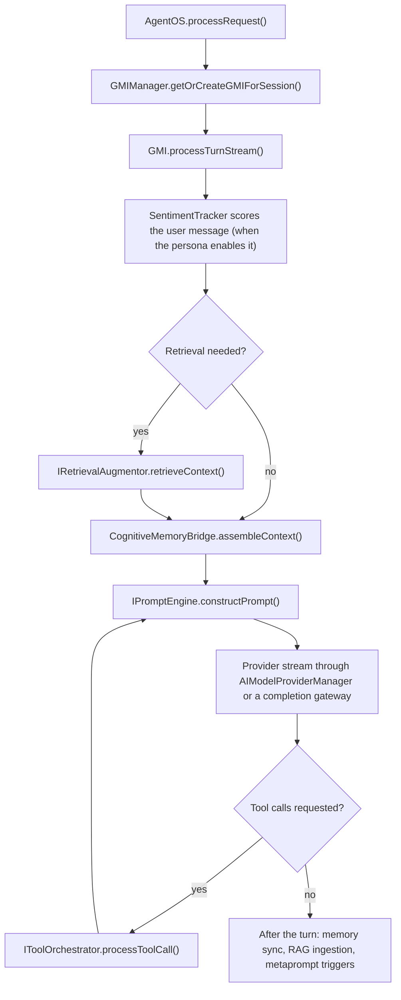

# Generalized Mind Instances (GMIs)

A **Generalized Mind Instance** (GMI) is the per-session agent of the full AgentOS runtime. Every request to [`AgentOS.processRequest()`](https://github.com/framerslab/agentos/blob/master/src/api/AgentOS.ts) is handled by the GMI bound to the request's session. The GMI holds that session's persona, working memory, conversation history, mood, user and task context, and a reasoning trace, and it runs the turn: retrieval, prompt construction, the streamed model call, and the tool calls the model makes.

GMIs serve the full runtime's sessions, and, with `runtime: 'gmi'` (or [`gmi()`](https://github.com/framerslab/agentos/blob/master/src/api/gmi.ts)), the sessions of [`agent()`](https://github.com/framerslab/agentos/blob/master/src/api/agent.ts) ([GMIs from agent()](#gmis-from-agent)). A host can also build one itself ([Model calls through a completion gateway](#model-calls-through-a-completion-gateway) shows how). `agent()` without `runtime` (or with `runtime: 'legacy'`), [`generateText()`](https://github.com/framerslab/agentos/blob/master/src/api/generateText.ts) and [`streamText()`](https://github.com/framerslab/agentos/blob/master/src/api/streamText.ts) create no GMI: they call the model provider directly. [`agency()`](https://github.com/framerslab/agentos/blob/master/src/api/agency.ts) builds no GMI of its own: the manager, synthesizers and spawned specialists it creates are plain agents, and a roster member is a GMI only when its config sets `runtime: 'gmi'` or the roster holds an agent already built with `runtime: 'gmi'` or `gmi()` ([Multi-agent work](#multi-agent-work)). On the path without a GMI, `agent().session()` keeps each session's message history in process memory unless the agent is created with `history: false`, and `agency().session()` always keeps it; `generateText()`, `streamText()` and the `generate()` and `stream()` methods of an agent or an agency keep none, and a caller of `generateText()` or `streamText()` passes the earlier turns in `messages`.

| | Full runtime (`AgentOS`) | `agent({ runtime: 'gmi' })` and `gmi()` | Lightweight helpers (`agent()`, `agency()`) |
|---|---|---|---|
| Entry point | `AgentOS.create()`, or `new AgentOS()` and `initialize(config)`; then `processRequest()` | `agent({ runtime: 'gmi', ... }).session(id).send()` or `.stream()` | `agent({...}).session(id).send()` or `.stream()`; `agency({...})` |
| Per-session state | A GMI from `GMIManager` | A GMI per session, over the session's message history held in process memory | A message history held in process memory |
| Persona | A persona definition, named on every request by `selectedPersonaId`; its HEXACO traits reach the prompt only with `learning` on ([Learning](#learning)) | A persona built from the agent's options: the system prompt `agent()` sends, `personality` as HEXACO traits; with `learning` on, the personality section is a system prompt of its own | `instructions` and `personality`, written into the system prompt |
| Sentiment tracking and metaprompts | Yes | With `cognition: 'full'` or a `CognitionConfig` that turns them on | No |
| Long-term memory | A cognitive memory manager, when `gmiManagerConfig.cognitiveMemoryFactory` supplies one | A cognitive memory manager built from `memory`, one per agent; or a `memoryProvider` you pass in | A `memoryProvider` you pass in |
| Guardrails, RAG, HITL, channels, emergent tools | Run by the runtime | Accepted without being applied, with a warning; `voice`, `avatar` and `channels` throw | `agent()` accepts them without applying them and logs a warning ([capability contract](https://github.com/framerslab/agentos/blob/master/src/api/runtime/capabilityContract.ts)); `agency()` applies HITL approvals and, on `hierarchical`, emergent specialists at the agency level, reports its guardrail ids as not enforced, adds no RAG context and wires no channels ([Agencies](./AGENCIES.md)) |
| Output | A stream of `AgentOSResponse` chunks | `GenerateTextResult` and `StreamTextResult`, as `agent()` returns them | `agent()`: a `GenerateTextResult` from `generate()` and `send()`, a `StreamTextResult` (`textStream`, `fullStream`) from `stream()`. `agency()`: a result with `text`, `agentCalls` and `usage` from `generate()` and `send()`, an `AgencyStreamResult` from `stream()` |

## What a GMI adds over a plain agent

A plain agent, `agent({...})` without `runtime: 'gmi'`, calls the model with a system prompt built from your instructions and personality values, keeps the session's messages in process memory, and runs the tools you list. A GMI runs the same model, tools, extensions, guardrail packs and cognitive memory manager inside a turn loop the lightweight helper does not have:

| Only on a GMI | What it does | Where |
|---|---|---|
| Persona definition and overlays | A loaded persona with traits, a mood (PAD) state and per-session overlays, bound to the session by `GMIManager` | [`GMIManager.ts`](https://github.com/framerslab/agentos/blob/master/src/cognition/substrate/GMIManager.ts), [`persona_overlays/`](https://github.com/framerslab/agentos/tree/master/src/cognition/substrate/persona_overlays) |
| Sentiment scoring and events | When the persona enables `sentimentTracking`, the runtime's utility AI scores every user turn (one LLM call per turn with the default `LLMUtilityAI`; `StatisticalUtilityAI` makes no call and scores the turn with a word lexicon: see [Text Statistics and Classification](./text/TEXT_STATISTICS.md#sentiment)), and score thresholds, runs of consecutive turns and confusion phrases raise events such as `USER_FRUSTRATED` and `USER_CONFUSED`; without it the sentiment path does not run | [`GMI.ts`](https://github.com/framerslab/agentos/blob/master/src/cognition/substrate/GMI.ts) (`processTurnStream()`, the sentiment step), [`SentimentTracker.ts`](https://github.com/framerslab/agentos/blob/master/src/cognition/substrate/SentimentTracker.ts) (`analyzeTurnSentiment()` and `detectAndEmitEvents()`) |
| Metaprompts | Events and turn intervals run metaprompts: frustration recovery, confusion clarification, satisfaction reinforcement, error recovery, engagement, and a self-reflection metaprompt (`gmi_self_trait_adjustment`) that re-reads the GMI's mood, user skill and task context from evidence. It does not change HEXACO traits; `adapt_personality` and a host's own `GMI.setPersonalityTrait()` call do. The sentiment presets merge into a persona that enables `sentimentTracking`; turn-interval and manual metaprompts run from the persona's own `metaPrompts` regardless. | [`MetapromptExecutor.ts`](https://github.com/framerslab/agentos/blob/master/src/cognition/substrate/MetapromptExecutor.ts), [`metaprompt_presets.ts`](https://github.com/framerslab/agentos/blob/master/src/cognition/substrate/personas/metaprompt_presets.ts), [`PersonaLoader.ts`](https://github.com/framerslab/agentos/blob/master/src/cognition/substrate/personas/PersonaLoader.ts) lines 199-222 |
| Mood-weighted memory bridge | With cognitive memory attached, every exchange is observed and encoded with the GMI's current PAD state and mood, and recalled with emotional congruence in the composite score | [`CognitiveMemoryBridge.ts`](https://github.com/framerslab/agentos/blob/master/src/cognition/substrate/CognitiveMemoryBridge.ts) lines 277-292, [`RetrievalPriorityScorer.ts`](https://github.com/framerslab/agentos/blob/master/src/cognition/memory/core/decay/RetrievalPriorityScorer.ts) lines 40-46 |
| Reasoning trace | The last N decision entries of the turn loop (500 by default; `reasoningTraceConfig.maxEntries` on the persona, `defaultReasoningTraceMaxEntries` on the runtime config), readable for debugging and used as evidence by the self-reflection metaprompt | [`GMI.ts`](https://github.com/framerslab/agentos/blob/master/src/cognition/substrate/GMI.ts) (`initialize()` and `addTraceEntry()`), [`reasoningTraceLimits.ts`](https://github.com/framerslab/agentos/blob/master/src/cognition/substrate/reasoningTraceLimits.ts) |
| Self-modification tools | With `emergentConfig.selfImprovement.enabled`, the runtime registers `adapt_personality`, `manage_skills`, `create_workflow` and `self_evaluate`. `adapt_personality` changes the running GMI's traits within bounds; a `PersonalityMutationStore` records the changes only when a storage adapter is supplied and `personality.persistWithDecay` is on, and stored mutations are not reloaded into later GMIs. Only the full runtime passes the tool orchestrator the options that register these tools, so a GMI from `agent({ runtime: 'gmi' })` or `gmi()` has none of them. With a learning layer, the actions of these four tools and `forge_tool` that change the agent refuse on a turn with no learner and in modes `off` and `frozen`, and under `AGENTOS_LEARNING_FREEZE=1` they refuse with a layer or without one ([Learning](#learning)) | [`ToolOrchestrator.ts`](https://github.com/framerslab/agentos/blob/master/src/core/tools/ToolOrchestrator.ts) lines 369-401, [`SelfImprovementSessionManager.ts`](https://github.com/framerslab/agentos/blob/master/src/api/runtime/SelfImprovementSessionManager.ts) line 369, [`AdaptPersonalityTool.ts`](https://github.com/framerslab/agentos/blob/master/src/cognition/emergent/AdaptPersonalityTool.ts) line 391, [`toolContext.ts`](https://github.com/framerslab/agentos/blob/master/src/cognition/learning/toolContext.ts) |
| RAG trigger and discovery context | The loop decides per turn whether to retrieve, and injects capability-discovery context when discovery is configured | [`GMI.ts`](https://github.com/framerslab/agentos/blob/master/src/cognition/substrate/GMI.ts) (`processTurnStream()`: the RAG decision and the discovery-context step) |

Reusable without a GMI: the eight memory mechanisms, the observer and reflector pipeline, HyDE and graph retrieval all belong to `CognitiveMemoryManager` and the RAG layer. A host wires them (wilds-ai and Wunderland build the manager themselves). `agent()` without `runtime: 'gmi'` runs none of them and warns when given `cognitiveMechanisms`; with `runtime: 'gmi'` and memory on (`memory` set, or `cognition: 'full'`), the agent's own `CognitiveMemoryManager` runs the mechanisms, `cognitiveMechanisms` or all eight at their defaults ([GMIs from agent()](#gmis-from-agent)). Shared by both paths: the model and provider, tools and extensions, and the HEXACO trait values. `agent()` writes those values into the prompt once; a GMI also carries them as persona state. On the full runtime, with self-improvement enabled, `adapt_personality` can change that state; a GMI from `agent({ runtime: 'gmi' })` or `gmi()` gets no such tool, so its traits stay as given.

The [GMI versus agent() Study](./evaluation/GMI_VS_AGENT.md) measures whether these additions improve companion conversation, against `agent()` and a bare model loop.

## Getting a GMI

```typescript
import { AgentOS, AgentOSResponseChunkType, BUILT_IN_PERSONAS } from '@framers/agentos';

// AgentOS.create() reads persona files from ./personas by default. Personas can
// also be given inline, as parsed JSON or code-built objects; here, the five the
// package ships. A custom loader covers any other source.
const agentos = await AgentOS.create({ personas: BUILT_IN_PERSONAS });

for await (const chunk of agentos.processRequest({
  userId: 'user-42',
  sessionId: 'research-session-1',
  selectedPersonaId: 'v_researcher',
  textInput: 'Summarize the open incidents from this week.',
})) {
  if (chunk.type === AgentOSResponseChunkType.TEXT_DELTA) {
    process.stdout.write(chunk.textDelta);
  }
}
```

Persona definitions, the three loading paths (a directory of JSON files, an inline `personas` list, a custom loader) and validation are on [Defining and loading personas](./PERSONAS.md).

`AgentOS.create()` builds the default `AgentOSConfig` with [`createAgentOSConfig()`](https://github.com/framerslab/agentos/blob/master/src/core/config/AgentOSConfig.ts), which reads its settings from environment variables, and initializes the runtime. That configuration loads persona definitions from `./personas` and uses `v_researcher` as the default persona id (`DEFAULT_PERSONA_ID` overrides it). For full control, construct `new AgentOS()` and call `initialize(config)` with your own `AgentOSConfig`. An inline `personas` list (the sample passes `BUILT_IN_PERSONAS`, the five persona definitions the package exports; `getBuiltInPersona(id)` returns one by id) or a custom `personaLoader` replaces the `./personas` file loader; the two cannot be combined. A `./personas` directory of persona JSON files works without either override. When no source provides the requested persona id, `getOrCreateGMIForSession()` rejects it with `PERSONA_NOT_FOUND`.

A request that names no `selectedPersonaId` uses the configuration's `defaultPersonaId`; the turn pipeline rejects the request only when neither is set ([`TurnExecutionPipeline.ts`](https://github.com/framerslab/agentos/blob/master/src/api/runtime/TurnExecutionPipeline.ts)). The pipeline hands the turn to [`GMIManager.getOrCreateGMIForSession()`](https://github.com/framerslab/agentos/blob/master/src/cognition/substrate/GMIManager.ts), which loads the persona, checks that the user may use it, and either reuses the GMI already bound to the session or creates one. A GMI serves its session until the session asks for a persona refresh or the host removes it. `GMIManager.cleanupInactiveGMIs()` removes GMIs idle longer than a threshold (60 minutes by default); nothing in the runtime calls it on a schedule, so a long-running host calls it. A GMI the manager deactivates (a persona refresh, `deactivateGMIForSession()`, the idle cleanup) stays bound to its session until its shutdown has ended; an acquisition for the session meanwhile waits for that and gets a new GMI, never the one shutting down.

`AgentOS.shutdown()` shuts the manager down after the orchestrator. From then on `getOrCreateGMIForSession()` and the manager's other calls fail with `NOT_INITIALIZED`, and a call already in flight shuts down the GMI it built instead of registering it. Every active GMI is shut down at the same time, each within `gmiManagerConfig.shutdownTimeoutMs` (8000 ms by default); a GMI that has not finished by then is logged at warn and finishes on its own while the runtime shuts down its other components. A GMI's own `shutdown()` stops the turn it is running, as `session.close()` does: the turn's model call is aborted, the turn ends with the abort error, and the GMI's state stays `SHUTDOWN` after the turn ends. The GMI waits for the stopped turn within the same bound before it closes its memories. Calls to `shutdown()` that overlap (a second signal to the host, or a manager that shuts down while a session is deactivated) share one shutdown, so a GMI's memories are closed once.

## GMIs from agent()

```typescript
import { agent } from '@framers/agentos';

const tutor = agent({
  runtime: 'gmi',
  provider: 'openai',
  instructions: 'You are a patient CS tutor.',
  personality: { openness: 0.9, conscientiousness: 0.95 },
  cognition: 'full',
  memory: { embedding: { provider: 'openai', model: 'text-embedding-3-small' } },
});

const session = tutor.session('lesson-1', { userId: 'student-7f3a' });
const reply = await session.send('Explain recursion with an analogy.');
console.log(reply.text);

await tutor.close();
```

`agent({ runtime: 'gmi' })` returns [`gmi(opts)`](https://github.com/framerslab/agentos/blob/master/src/api/gmi.ts), and `gmi()` (alias `createGmi()`, both exported from `@framers/agentos` and `@framers/agentos/api`) builds the same handle from the same options. It has the `Agent` surface (`generate()`, `stream()`, `session()`, `usage()`, `close()`, `export()`), and every session it opens is served by a GMI built in process from the agent's options: no `AgentOS` runtime, no persona files, no `GMIManager`. `agent()` without `runtime`, or with `runtime: 'legacy'`, keeps the `generateText()` path.

**Construction.** `gmi()` checks at construction what needs no environment, and throws naming the option: `voice`, `avatar` and `channels`, which the GMI path does not run (a config that sets nothing but `enabled: false` counts as unset, as on `agent()`); `budget` settings with a `maxCostUSD` or a `maxTotalTokens` below zero, or one that is not a number (a `RangeError`); an unknown cognition profile or metaprompt preset; a `learning` value of the wrong type, a blank `learning.agentKey` or an unknown `learning.mode`; a `memory.embedding` that names a provider without embedding models, a model that does not resolve on it, a dimension that is not a positive integer, or no dimension for a model whose output size agentos does not know. `rag`, `discovery`, `guardrails`, `security`, `permissions`, `hitl`, `emergent`, `output` and `provenance` are accepted without being applied, and one warning names the ones that are set (the `gmi` column of the [capability contract](https://github.com/framerslab/agentos/blob/master/src/api/runtime/capabilityContract.ts)). The persona, with the provider and model it resolves, the prompt engine, the tool orchestrator and the cognitive memory are built on first use, so an agent created before its keys are set reads them on its first call. When no provider or model resolves, that call rejects with the error `agent()` gives; a build that fails is not kept, and the next call builds again.

**Profiles.** `cognition` picks what each GMI runs: `'light'` (the default), `'full'`, or a `CognitionConfig` that sets each switch ([`gmiCognition.ts`](https://github.com/framerslab/agentos/blob/master/src/api/runtime/gmiCognition.ts); `resolveCognition()` returns the switches an agent's options resolve to).

| | `'light'` (default) | `'full'` | `CognitionConfig` |
|---|---|---|---|
| Cognitive memory | Only when `memory` is set | On unless `memory: false` | `memory`; unset, the agent's `memory` option |
| Memory mechanisms | With memory on: the agent's `cognitiveMechanisms`, or all eight at their defaults | Same as `'light'` | `mechanisms`: `true` (the default, as in `'light'`), `false`, or a per-mechanism config |
| Sentiment tracking | Off | On | `sentiment: true` |
| Metaprompts | None | The five sentiment presets | `metaprompts`: `'all'`, a list of presets, or `false`; only with `sentiment: true` |

Every profile keeps the reasoning trace. Sentiment tracking scores each user turn with [`StatisticalUtilityAI`](https://github.com/framerslab/agentos/blob/master/src/cognition/nlp/ai_utilities/StatisticalUtilityAI.ts), with no model call, by the word lexicon `natural` ships for the user's language (the user context's `language`, else the persona's `defaultLanguage`, else the class's own default, English unless set), AFINN in English ([Text Statistics and Classification](./text/TEXT_STATISTICS.md#sentiment)). With the default thresholds, `USER_FRUSTRATED` fires on a turn that scores below -0.3 with an intensity above 0.6, or on the second turn in a row below -0.3; `USER_SATISFIED` on a turn above 0.3 with an intensity above 0.5, or on the third turn in a row above 0.3; `USER_CONFUSED` on its phrases, or on a neutral turn with more than two negative tokens; `LOW_ENGAGEMENT` from the fourth turn in a row that scores between the two thresholds, while the recent user messages average under 50 characters; and `ERROR_THRESHOLD_EXCEEDED` when two or more of the last ten reasoning-trace entries are errors ([Adaptive Prompt Intelligence](./ADAPTIVE_PROMPT_INTELLIGENCE.md#three-trigger-types)). The presets are `frustration_recovery`, `confusion_clarification`, `satisfaction_reinforcement`, `error_recovery` and `engagement_boost`. Each is event-based: at the end of a turn that raised its event (`USER_FRUSTRATED`, `USER_CONFUSED`, `USER_SATISFIED`, `ERROR_THRESHOLD_EXCEEDED`, `LOW_ENGAGEMENT`), it calls the persona's model, and that call is not counted in the turn's usage or in the usage ledger. No profile runs the self-reflection metaprompt or a turn-interval metaprompt: the persona has only the presets' metaprompts.

**Persona.** [`personaFromAgentOptions()`](https://github.com/framerslab/agentos/blob/master/src/api/runtime/gmiPersona.ts) builds it:

| Persona field | From |
|---|---|
| `id`, `name`, `description` | A slug of `name` (an id of its own for an agent with no name); `name`, or `Agent`; the first line of `instructions`, or the name |
| `baseSystemPrompt` | The system prompt `agent()` sends ([`buildSystemPrompt()`](https://github.com/framerslab/agentos/blob/master/src/api/agent.ts): the soul file's body and style, `instructions`, the name line, the personality description, `skills`), or the joined `systemBlocks`; with `learning` on, without the personality description, which the GMI sends as a system prompt of its own ([Learning](#learning)) |
| `personalityTraits` | `personality`, as HEXACO traits |
| `defaultProviderId`, `defaultModelId` | `provider` and `model`, resolved as `generateText()` resolves them |
| `defaultModelCompletionOptions` | `maxTokens` (or `controls.maxTotalTokens`), `controls.maxDurationMs` as `requestTimeout`, `thinking`, `effort`, `customModelParams`, `cache`; nothing else, so the provider's default temperature applies ([Completion options](#completion-options)) |
| `allowedCapabilities` | The `requiredCapabilities` of the agent's tools |
| `sentimentTracking`, `metaPrompts` | The profile |

A soul file's front matter is not applied, and the persona carries no `hardLimits`, so the "Hard limits" block ([Guardrails](./safety/GUARDRAILS_USAGE.md#hard-limits-in-the-persona)) is not in this path's prompt. The chain-of-thought instruction (`chainOfThought`, on by default) goes first in the system prompt of each model call that offers tools, as `generateText()` puts it; a structured send's calls offer no tools and carry no such instruction, nor do the calls of a seat's turn whose tool names leave none. `onBeforeGeneration` receives the tool definitions the call offers: none on a structured send's calls, and on a seat's turn only the tools its tool names allow.

**Tools and model calls.** The agent's `tools` run through a tool orchestrator of the agent's own, with capability checks off; the built-in `getCurrentDateTime` tool is left out, so an agent without tools offers the model none. `maxSteps` (5 by default) is each turn's tool-loop limit. Each GMI calls the model through a [completion gateway](#model-calls-through-a-completion-gateway) built from `apiKey`, `baseUrl`, `fallbackProviders`, `policyTier`, `router`, `routerParams` and `hostPolicy`, and the agent's `onFallback(error, provider)` is called on each fallback. The fallback guarantee is the gateway's: a hop that cannot start, or an attempt that fails with a retryable error before any output, moves to the next hop, and a step that has streamed output ends the turn when it fails. The metaprompts call the persona's model and find a provider only when the persona's provider served the turn; they have no fallback of their own.

**Sessions.** `agent.session(id, { userId })` opens a session over a GMI of its own. The session store ([`SessionHistoryBuffer`](https://github.com/framerslab/agentos/blob/master/src/api/sessionHistory.ts)) is the source of truth for the history ([`gmiSession.ts`](https://github.com/framerslab/agentos/blob/master/src/api/runtime/gmiSession.ts)):

- Before each turn the GMI's history is replaced with the store's messages. Each model step the turn finishes is written to the store, with its tool calls, their results and its thinking blocks, and the turn's steps land as one block when the turn ends.
- A turn that fails after some steps keeps those steps; its last message is marked `partial: true`, which is never sent to a provider. A turn that fails before any step finishes keeps nothing.
- One turn runs at a time per session: a second `send()` or `stream()` waits for the first to end.
- `history: { maxTokens }` bounds the store as on the legacy path (120,000 tokens by default), but a request does not carry the whole store. The GMI's prompt engine gives the history 35 percent of the serving model's context window (`applyTokenBudget` in [`PromptEngine.ts`](https://github.com/framerslab/agentos/blob/master/src/core/llm/PromptEngine.ts); the window counts as 8,192 tokens when agentos does not know the model's). When the history is over that budget, or the whole prompt over the window, the messages of the turn being answered stay whole, and the earlier messages are dropped, oldest first and a tool round (a call and its results) at a time, until they fit in what the budget leaves; no summary takes their place. The store keeps the dropped messages and `messages()` lists them; nothing tells the caller that a request left them out. On a model with a 128,000-token window, a history of about 60,000 tokens reaches the model as about its newest 45,000, where the legacy path sends all of it, and throws `ContextWindowExceededError` in place of a call's first request when that request does not fit a model whose window is in agentos's model catalog. With `history: false`, each turn runs on a GMI built for that turn, `messages()` is empty, and `reseed()` throws.
- `messages()`, `reseed()`, `clear()` and `drainHistoryEvents()` act on the store; `reseed()` and `clear()` also replace the session GMI's own history and what it recorded about the dropped turns ([Conversation history](#conversation-history)). A `clear()` or `reseed()` during a turn discards that turn's writes, as on the legacy path.

`session.send(input, options)` returns a `GenerateTextResult` whose `transcriptDelta` holds the messages the turn added, and takes `responseSchema`, `schemaName`, `blockLabel`, `toolChoice`, `requestTimeout`, `cacheDiagnostics`, `cache`, `maxTokens`, `abortSignal` and `budget`. With `responseSchema`, the gateway sends each hop the structured-output payload its provider takes, `text` is the JSON string and `object` the parsed value; an answer that does not parse or validate rejects with `ObjectGenerationError`, as does an answer the output limit stopped (finish reason `length`) whatever its JSON, and the turn leaves nothing in the history. `session.stream(input, { abortSignal, budget })` returns a `StreamTextResult` whose promises settle after the turn is written to the store, so a caller that awaits `text` and sends again finds the turn in the history; a consumer that stops reading `textStream` or `fullStream` stops the turn and aborts its model call. A failed turn rejects `send()` with the GMI's error, its code kept (`LLM_PROVIDER_ERROR`, for example), and ends `stream()` with an `error` part and the `'error'` finish reason. An `abortSignal` is joined with the session's own stop: when it aborts, the turn ends as one `close()` stops (its model call aborted, the steps it finished kept and marked partial), `send()` rejects with the signal's reason and `stream()` ends with an `error` part that carries it (on both, a failure the turn met before the stop keeps its own error), and the session stays open for the next turn; a signal that aborts after the turn's last request, while `onAfterGeneration` runs, ends the turn the same way. A send whose signal has already aborted starts no turn and rejects with the reason; a stream starts none either and ends at once with one `error` part that carries the reason, before any lock, memory context, hook or budget check.

`agent.generate()` and `agent.stream()` run one turn on a GMI built for that call, on the `'light'` profile whatever `cognition` sets, with no history and no cognitive memory. They take the per-call options `temperature`, `maxTokens`, `topP`, `responseFormat`, `model`, `provider`, `maxSteps`, `usageLedger`, `abortSignal` and `budget`, and the tool-approval gate `agency()` passes with each call to a member ([Multi-agent work](#multi-agent-work)), and throw naming any other. An `abortSignal` stops the call's turn: `generate()` rejects with the signal's reason and `stream()` ends with an `error` part that carries it, unless the turn had already failed on its own, which keeps its own error on both. A call whose signal has already aborted starts no turn: `generate()` rejects with the reason, and `stream()` ends at once with one `error` part that carries it. A signal that aborts after the turn's last request, while `onAfterGeneration` runs, ends the call the same way, as `agent()`'s check after each step's hook does, and `generate()` then verifies no citations. With `verifyCitations`, `generate()` checks its answer against the sources the configured retriever returns for the prompt and sets `result.grounding`, as `agent().generate()` does.

**Cognitive memory.** With memory on, the agent builds one [`CognitiveMemoryManager`](https://github.com/framerslab/agentos/blob/master/src/cognition/memory/CognitiveMemoryManager.ts) on the first session turn and every session of the agent shares it ([`agentCognitiveMemory.ts`](https://github.com/framerslab/agentos/blob/master/src/api/runtime/agentCognitiveMemory.ts)): an in-memory vector store, the in-memory knowledge graph (the `'knowledge-graph'` graph backend), an embedding manager for `memory.embedding`, the persona's HEXACO traits (0.5 for a trait `personality` leaves out) and the profile's mechanisms. Everything it holds lives in process memory and ends with the process or `agent.close()`.

- **Scope.** Each session's GMI sees the store through a working memory of its own, and its recall, graph associations included, reads only the session's scopes. The user's messages are encoded under the session's user id, which is the `userId` passed to `session()` or, without one, the session's scope id; the replies are encoded under the scope id. The scope id is the session id the first time the agent opens that id, and a new id each time the agent opens it again after `close()`. To tell the two apart the agent keeps one entry per session id it has opened, until `agent.close()`, which starts a new memory in which an id's next opening is its first. The scope id is memory's alone: tools, the user context and the reasoning trace see the session id the caller opened, and the `userId` or, without one, that session id. Sessions opened with the same `userId` recall what that user said in each of them; sessions opened without one recall nothing of each other's, and that includes a closed session and a session opened after it with the same id. A `userId` passed to `session()` is also sent with each model request as the end user's id (OpenAI's `user` or `safety_identifier`), so pass an opaque or hashed id, not an email address; a session opened without one sends none. Reopening an open session id with another `userId` throws.
- **`memory.embedding`.** `{ provider, model?, dimension? }` picks the embedding model. Unset, the memory uses the global default provider (`setDefaultProvider()`) when agentos has an embedding model for it, else the first of OpenAI, Gemini and Ollama whose `OPENAI_API_KEY`, `GEMINI_API_KEY` or `OLLAMA_BASE_URL` is set, with that provider's default model (`text-embedding-3-small`, `gemini-embedding-2`, `nomic-embed-text`). Anthropic, Groq, Together AI, xAI, MiniMax and the Claude Code and Gemini CLIs have no embedding models in agentos, and `memory.embedding` naming one is refused when the agent is built. `dimension` is required for a model whose output size agentos does not know. Building the memory embeds one test text through the model. When no embedding model is found, or the model cannot answer (an Ollama model that was never pulled) or returns another size than the memory expects, the first session turn rejects with an error naming `memory.embedding`; a build that fails is retried on the next turn.
- **Consolidation.** `memory.consolidation.enabled: true` starts the manager's consolidation cycle, which runs every hour (`interval` is not applied, and a warning says so). A cycle reads the traces filed under the agent's persona id, while the sessions file theirs under their user and scope ids, so it finds none of them, and with no model invoker passed it writes no schema summaries.

**`memoryProvider`.** `memoryProvider.getContext()` runs once per turn, within `memoryProviderOptions.timeoutMs`, and its text goes into every model call of the turn as a system message after the leading system messages, where the legacy path puts it. In the sessions of an agent with cognitive memory on, the cognitive memory supplies the context and `getContext()` is skipped; a warning at construction says so. `observe()` runs after each turn that ends without error, for the user's text and the reply, except a structured send whose answer fails to parse.

**Hooks.**

- `onBeforeGeneration` runs before every model attempt, a fallback hop's included, with the attempt's `messages` (system messages included), `system` (the persona's base prompt), `tools`, `model`, `provider`, `step` and `prompt`. Messages it returns replace that attempt's prompt and do not enter the history. On a structured send, on each hop whose payload carries no schema (a fallback hop's included), the schema instructions are among the `messages`, as on `agent()`, so a hook that removes them removes them.
- `onAfterGeneration` runs after each model step. A `text` it returns replaces the step's text in the result and in the store. The exception is a schema answer the provider returns as a schema tool call, which stays the JSON the schema validated; a schema answer returned as text (a JSON response format, or the schema's instructions in the prompt) is replaced like any text, and a structured send parses and validates the replacement. Changes to `toolCalls` are not applied: the GMI has already run the step's tool calls.
- `onBeforeToolExecution` runs before each tool call. Returning `null` skips the call, and the model receives an error result; returned `args` replace the call's arguments.

A hook that throws (or an `onBeforeToolExecution` that resolves with nothing) is warned about, and the turn goes on as if the hook were not set.

**Usage.** Each model call of a turn is metered with the provider and model that served it: one usage ledger row and one usage event for the process-wide observer (`setGlobalLlmObserver()`; none while content-safe telemetry is on) per finished step, and one for each attempt that failed and was billed, with the finish reason `error`. `session.usage()` and `agent.usage(id)` add a session's turns, and `agent.usage()` adds every session's and every `generate()` and `stream()` call's; with the usage ledger enabled they read the ledger alone.

**Spend budget.** `budget` caps the agent's completion calls as on the legacy path ([A spend budget for a run of calls](./safety/COST_OPTIMIZATION.md#a-spend-budget-for-a-run-of-calls)). Settings make one `SpendBudget` that every session and every `generate()` and `stream()` call of the agent share, and a `budget` passed to `generate()`, `stream()` or a session's `send()` or `stream()` replaces it for that call. The completion gateway checks each completion call of a turn against the budget before it is sent, a fallback hop's at the output cap that hop sends and a structured send's without the tool definitions its requests leave out, and the GMI's provider manager checks each metaprompt call against the budget of the turn that queued it, whenever the call runs (a later turn may be in progress by then); the budget records each finished step, each attempt that failed and was billed, and each metaprompt call. A step of a turn that has already stopped (a `close()` or the caller's signal during a tool round) is not checked: nothing is sent, and the turn ends stopped. A refused step is not sent or tried on a fallback hop, and it ends the turn: `send()` and `generate()` reject with the GMI's error, whose code is `LLM_PROVIDER_ERROR` and whose message carries the budget's, in place of `CostCapExceededError` or `UnpricedModelError`, and `stream()` ends with an `error` part. A refused metaprompt leaves the turn's reply as it is, and is warned about on the console with its id and the refusal, as any metaprompt that fails is. The `SpendLimitInfo` an `onLimitReached` function receives names the call `gmi.step` or `gmi.metaprompt`. `session.recordExternalCost()` charges the agent's budget. The cognitive memory's calls to its embedding model are not checked or counted. A seat's turn is held to two budgets: a member seated in a team, by [`sessionSeat()`](https://github.com/framerslab/agentos/blob/master/src/api/runtime/agencyLaunch/sessionSeat.ts) or by `launch_agency`, checks each call against the budget its team's call carries and against its own, refuses the call when either refuses it, and charges it to both, where a send's `budget` would replace the agent's; a team the member launches from that seat draws on both as well. A refusal by the member's own budget runs the carried budget's `onLimitReached` function, as a refusal by that budget's parent does, so a launch whose seat's call it refused reports `budget_exhausted`, the seat `cut`. A budget both draw on, such as a host budget the member's own draws on, is charged once, and so is the one total that budgets on one guard and one `budgetId` keep, while each of them counts the call's tokens.

**Closing.** `session.close()` stops a turn still running: its model call is aborted, its caller gets the abort error, and the steps it finished stay in `messages()`, marked partial; then the session's GMI is shut down and, with `learning` on, its learner session ended, and the next `agent.session(id)` with that id starts empty. `agent.close()` closes every session, then the cognitive memory; a session opened afterwards builds a new one and uses the agent's learning layer, which `close()` leaves open. The tools the agent was given are not shut down.

## What a turn does



[`GMI.processTurnStream()`](https://github.com/framerslab/agentos/blob/master/src/cognition/substrate/GMI.ts) runs these steps itself, calling its injected services at each one:

1. **Sentiment.** When the persona enables `sentimentTracking` and the latest message is from the user, `SentimentTracker` scores it before the first model call. Score thresholds, runs of consecutive turns and confusion phrases emit [`GMIEvent`](https://github.com/framerslab/agentos/blob/master/src/cognition/substrate/GMIEvent.ts)s, which drive event-based metaprompts ([Adaptive Prompt Intelligence](./ADAPTIVE_PROMPT_INTELLIGENCE.md) lists the conditions).
2. **Retrieval.** When `shouldTriggerRAGRetrieval()` decides the turn needs context and a retrieval augmentor is configured, the GMI calls `retrieveContext()` and emits a `RAG_SOURCES_AVAILABLE` chunk with the retrieved sources.
3. **Memory context.** With cognitive memory attached, `CognitiveMemoryBridge.assembleContext()` retrieves memories relevant to the user's message.
4. **Prompt.** `IPromptEngine.constructPrompt()` builds the messages for the model call. A GMI given a learner session or the persona's traits (`GMIBaseConfig.learning`, `GMIBaseConfig.personaTraits`) adds the personality section after the persona's base prompt; the section is prepared once per user turn, before the first model call, and every model step of the turn sends it ([Learning](#learning)).
5. **Model call.** `AIModelProviderManager` resolves the provider for the turn's model, and the GMI streams `generateCompletionStream()` with the persona's and the turn's [completion options](#completion-options). With a completion gateway, the gateway resolves the serving model before step 4 and streams the call ([Model calls through a completion gateway](#model-calls-through-a-completion-gateway)). A model step that completes ends with a `STEP_FINISHED` chunk. A step that fails emits none: an error after output, a failure that is not retryable, the end of the fallback chain or any other error inside the step ends the turn with an `ERROR` chunk. When `GMIBaseConfig.beforeModelCall` is set, the GMI calls it before every attempt, a fallback hop's included, with the turn id, the step index, the hop, the provider, the model and a copy of the attempt's prompt. Messages it returns replace that attempt's prompt and do not enter the history; a hook that throws or returns an empty list is recorded on the reasoning trace, and the built prompt is sent. A turn whose `metadata.options` sets `cacheDiagnostics` (`true`, or `{ previousMessageId }`) sends Anthropic's prompt-cache diagnostics on every step: the first step compares against the message the turn names, each later step against the previous step's response ([Cache Diagnostics](./features/CACHE_DIAGNOSTICS.md)).
6. **Tools.** The GMI runs each requested tool call through `IToolOrchestrator.processToolCall()`, with the turn's learner and mode in the call's `sessionData.learning` when the GMI has a learner session, and emits a `TOOL_RESULT` chunk for each result it records in the history: a failed call's too, and, when a round stops early, the error result it records for each call the round did not finish. The loop then builds the next prompt with the tool results (step 4) and calls the model again, until the model answers without requesting tools or `maxToolLoopIterations` (5 by default) is reached. Retrieval and memory context (steps 2 and 3) run only for the turn's first model call.
7. **After the turn.** With cognitive memory attached, the bridge encodes the exchange (`syncForTurn()`). When the persona's RAG configuration enables turn-summary ingestion, the GMI ingests the exchange into the retrieval augmentor, summarizing it first if that is configured; when the summary fails, the exchange goes in as it is. Finally `MetapromptExecutor` checks its triggers.

## Model calls through a completion gateway

`GMIBaseConfig.completionGateway` gives a GMI one model layer, a [`CompletionGateway`](https://github.com/framerslab/agentos/blob/master/src/api/runtime/completionGateway.ts) built by `createCompletionGateway(defaults)`. A host that builds a GMI itself sets it, with a [`GatewayProviderManager`](https://github.com/framerslab/agentos/blob/master/src/api/runtime/gatewayProviderManager.ts) as the GMI's `llmProviderManager`:

```typescript
import { createCompletionGateway, GatewayProviderManager } from '@framers/agentos';
import { GMI } from '@framers/agentos/cognition/substrate';

const gmi = new GMI('support-gmi');
await gmi.initialize(persona, {
  ...services, // working memory, prompt engine, tool orchestrator, utility AI
  completionGateway: createCompletionGateway({
    fallbackProviders: [{ provider: 'anthropic', model: 'claude-opus-4-8' }],
  }),
  llmProviderManager: new GatewayProviderManager().asProviderManager(),
});
```

The defaults carry the routing inputs a turn does not: the router and its params, the host policy, the policy tier, the fallback chain and the primary's credentials. Credentials set in the defaults beside a `providerId` or `modelId` are for that provider: a turn that names another provider, or a `modelId` whose `provider:` prefix names another, runs there on its own, or on that provider's from the environment. Without `fallbackProviders`, the chain is the one [`buildPolicyAwareFallbackChain()`](https://github.com/framerslab/agentos/blob/master/src/api/generateText.ts) builds for the policy tier from the provider keys in the environment, without the primary's provider ([Fallback Behavior](./features/LLM_PROVIDERS.md#fallback-behavior) lists its legs); `fallbackProviders: []` turns fallback off. A fallback entry's `effort`, `cache` and `maxTokensHeadroom` apply to the steps its hop serves. The GMI passes the model and provider it would call, the last user message in its history, the tools and its completion options. The text of that message is the router's task hint: the text parts of a multimodal message, and, on a continuation that resolves a route of its own, the message being answered. It also passes its own `onFallback` and `onHopFailure`, which record each fallback and each hop that could not start as `WARNING` entries in the reasoning trace; callbacks set in the defaults do not run for a GMI's turns. `GMIManager` sets no gateway, so the GMIs of the full runtime call their provider directly, one call per model step, with no fallback. `gmi()` gives every GMI it builds a gateway made from the agent's options ([GMIs from agent()](#gmis-from-agent)). [`examples/gmi-completion-gateway.mjs`](https://github.com/framerslab/agentos/blob/master/examples/gmi-completion-gateway.mjs) builds a GMI with a gateway and prints the chunks of a turn its fallback hop serves.

With a gateway, each model step runs this way:

- **Resolved before the prompt.** The gateway picks the hop (the router's choice or the primary, then the fallback chain), skips a hop whose provider circuit is open or whose provider cannot start (a failed initialisation, a fallback leg without credentials), initialises the hop's provider and reads its context window and capabilities. The GMI builds the prompt for that model.
- **Fallback before output.** An attempt that fails before its first content chunk (text, a tool call or a schema answer) emits none of its chunks. When the failure is retryable, the gateway resolves the next hop and the GMI rebuilds the prompt for that hop's model. A failure is retryable when `generateText()` would fail over on it ([`isRetryableError()`](https://github.com/framerslab/agentos/blob/master/src/api/generateText.ts): HTTP 401, 402, 403, 429, 500, 502, 503, 504 and 529, network failures, timeouts and a provider that cannot initialize, among others) or when it is a content-policy refusal; a caller's abort is never retried. A failure that is not retryable, or the end of the chain, ends the turn with `LLM_PROVIDER_ERROR`; a turn with no hop that can start ends with `LLM_PROVIDER_UNAVAILABLE`, and a primary that cannot be set up (no credentials in the defaults or the environment, a provider or model that does not resolve) fails the turn with that configuration error's message and the code `CONFIGURATION_ERROR` (`SYS_CONFIGURATION_ERROR`).
- **No fallback after output.** Once text or a tool call has streamed, an error ends the step and the turn with `LLM_PROVIDER_ERROR`.
- **Forward within a turn.** The next step of the turn, after a tool round or in a continuation through `handleToolResults()`, stays on the hop that served the last one. A continuation the runtime gives to a GMI whose last turn was another conversation's starts at the primary, as on a GMI built for it (`hydrateTurnContext()`). The next user turn starts at the primary again.
- **Billed failures count.** When the provider billed an attempt that failed and reported it (a refused Claude turn reports its usage), that usage is added to the turn's total and emitted as a `USAGE_UPDATE` whose `metadata` holds `attemptFailed: true` and the failed hop's `hop`, `providerId` and `modelId`. No `STEP_FINISHED` carries it. This holds for an attempt that failed before any output and for a step that failed after output; the same marked `USAGE_UPDATE` reports a failed step on a GMI without a gateway.
- **Metaprompts and utility calls.** `MetapromptExecutor`, and a utility AI built over the same manager, reach a provider through the `GatewayProviderManager`, whose `getProvider()` answers only for the serving hop's provider id and `getProviderForModel()` only for its model id. When a fallback hop on another provider serves the turn, a metaprompt that runs on the persona's provider finds none, records the failure in the reasoning trace and warns about it on the console. They have no fallback of their own.
- **Replay blocks stay in the history.** Each provider sends only its own replay blocks (Anthropic's thinking blocks, Gemini's thought signatures), so the history keeps them as the model produced them, whichever hop serves the next step.

## Completion options

Each model call of a turn carries the completion options the persona and the turn set. The GMI reads these keys from the persona's `defaultModelCompletionOptions`, then from the turn's `metadata.options`, and a value the turn sets replaces the persona's for that key: `temperature`, `maxTokens`, `topP`, `frequencyPenalty`, `presencePenalty`, `stopSequences`, `thinking`, `effort`, `cache`, `promptCacheKey`, `promptCacheRetention`, `serviceTier`, `requestTimeout`, `customModelParams`, `responseFormat` and `toolChoice` (`FORWARDED_COMPLETION_OPTION_KEYS` in [`GMI.ts`](https://github.com/framerslab/agentos/blob/master/src/cognition/substrate/GMI.ts)). A key neither sets is not sent, so the provider's default applies: the GMI sets no `temperature` and no `maxTokens` of its own. The exception is `toolChoice`: on a turn with tools it is `auto` unless the persona or the turn sets it, and on a turn with no tools to offer it is not sent, whatever they set (OpenAI rejects `tool_choice` on a request without `tools`). Other keys, `cacheDiagnostics` among them, are not sent. The tool definitions, the `userId` and streaming are the GMI's own.

On the full runtime, a request's `options` are the turn's `metadata.options`: the `temperature`, `topP`, `maxTokens` and `responseFormat` of a `processRequest()` call reach the provider, and its `preferredModelId` picks the turn's model.

A turn on a GMI with a completion gateway can ask for a schema answer: `metadata.options.responseSchema` takes a Zod schema and `schemaName` its name. The gateway sends each hop the structured-output payload its provider takes ([`responseFormatForProvider.ts`](https://github.com/framerslab/agentos/blob/master/src/api/runtime/responseFormatForProvider.ts)) and sends the step without tools. An Anthropic hop answers JSON text through the JSON output format on a model that has it when the schema fits the format's limits, and the gateway lifts that text onto `STEP_FINISHED` as `structuredOutput` when it parses; a schema the format cannot carry (a record, say) on a model that accepts a forced tool choice, and every schema on Claude Opus 4 and Sonnet 4, is answered with a forced tool call, lifted the same way when its arguments parse; OpenAI, OpenRouter and Gemini hops return the JSON as the step's text. An answer that does not parse is not lifted, and neither is any answer the output limit stopped (`max_tokens`), whose JSON can parse though it was cut: it stays the step's text, the step keeps its own `finishReason` (`length` for a cut-off), a cut tool call is never run as a tool, and a session's `send()` rejects with an `ObjectGenerationError` that names the cut-off. The gateway lifts from where the provider says it put the schema (`schemaRoute` on its chunks), since the provider decides on the request it sends: a citations request takes the forced tool in place of the format, and a thinking budget, or a passthrough `tool_choice` of `auto`, `none` or another tool's name, sends a forced-tool schema in the prompt instead. A hop whose payload carries no schema gets the schema as a system message after the prompt's leading system messages, in the words `generateObject` uses: a record schema on an Anthropic model that refuses a forced tool choice (Claude Opus 5.5, Sonnet 5.5, Fable, Mythos 5.1), a provider with no structured-output payload, and the JSON mode OpenAI and OpenRouter get for a schema that strict mode cannot take; an Anthropic request the provider sends with the schema in its own system block says so on its chunks (`schemaInPayload: false`). On every hop, a fallback hop's included, the GMI puts it there before `beforeModelCall` runs, as `generateText` puts it there before `onBeforeGeneration` on each of its fallback legs, so the hook sees it and can remove it. A structured reply (`metadata.options.structuredReply`, see [Structured reply](./features/STRUCTURED_REPLY.md)) puts its own instruction in the system prompt, so its hops get no second copy. Without a gateway, `responseSchema` is not used.

## Conversation history

The GMI keeps the session's messages in its [`ConversationHistoryManager`](https://github.com/framerslab/agentos/blob/master/src/cognition/substrate/ConversationHistoryManager.ts). A turn records its input, then trims the history to the newest 20 messages, or to the persona's `conversationContextConfig.maxMessages`; a cut that falls inside a tool round also removes that round's remaining tool results, so none is left without the assistant message that called its tool. The turn's assistant replies and tool results are added as it runs. A host sets the history with these calls ([`IGMI.ts`](https://github.com/framerslab/agentos/blob/master/src/cognition/substrate/IGMI.ts); optional on `IGMI`, all three implemented by `GMI`):

- `replaceHistory(messages)` makes `messages` the whole history. An empty array empties it.
- `clearHistory()` empties the history.
- `hydrateConversationHistory(messages)` replaces the history the same way. The runtime calls it when `resumeExternalToolRequest()` continues a stored turn, and when results passed on a paused stream continue the turn on a GMI whose own history holds a turn of another conversation, or that replaced the GMI the turn paused on.
- `getConversationHistory()` returns the history as the GMI holds it, in the messages `hydrateConversationHistory()` takes: the calls of its own tool rounds with their results, and the thinking blocks and thought signatures of its assistant turns. With conversational persistence on, the runtime reads it when a turn stops for the host.
- `getLastTurnHistory()` returns the messages of that history from the input of the GMI's last turn on: the input, the assistant turns and tool results of the turn's tool rounds, and what a tool continuation of the turn added; none once the history no longer holds that input (replaced, cleared or trimmed past it). With conversational persistence on, the runtime reads it when a turn stops for the host on a GMI whose history also holds a turn of another conversation.

Both replacing calls take [`ConversationMessage`](https://github.com/framerslab/agentos/blob/master/src/core/conversation/ConversationMessage.ts)s: they leave out messages with the `error` or `thought` role and turn a `summary` message into a system message. Neither trims what it sets; the next turn trims the history to its window when it records its input.

`replaceHistory()` and `clearHistory()` also drop what the GMI recorded about the turns the new history no longer holds, so a replaced or cleared fact reaches no later model call through those records (the reflection metaprompt sends recent trace entries to the model). A recorded turn stays while the history has a user message with that turn's input. For every other turn, its reasoning-trace entries keep their type and message and lose their details (the first characters of the input, the tool calls and results), its sentiment trend in `gmi_sentiment_history` loses its `context`, and its events lose their `evidencePreview`; the sentiment part has finished before the next turn starts. Cognitive memory is separate: what a turn encoded there stays until the memory itself forgets it. `hydrateConversationHistory()` drops nothing.

A turn whose `metadata.conversationHistoryForPrompt` is a non-empty array builds its prompts from that history instead of the GMI's own: the conversation before the turn, ending before the current user message. The full runtime passes its stored conversation this way. With the rolling summary on, that is the conversation's first `headMessagesToKeep` messages and the messages newer than the summary's boundary, and a tool round is passed whole when any message of it is: a call and its results are passed together or left to the summary together. A compaction pass starts at the oldest message after those first ones that the summary does not cover yet, and the compaction model reads each call it summarizes with its results, a result with no text as `[empty result]`. The compaction profiles (`rollingSummaryCompactionProfilesConfig`), one picked for each turn by `customFlags.mode` or else the persona id, share the conversation's one summary state (`rollingSummaryStateKey`). That state records the `headMessagesToKeep` of the pass that first wrote it, and every later pass and turn keeps that head whatever the turn's profile sets: a profile with a shorter head leaves no message out of both the summary and the history, and one with a longer head sends no summarized message again. A conversation an earlier release compacted keeps any gap it has: its summary state records no head, so each turn keeps its own profile's head until a pass writes the state and records that turn's, and the stored boundary does not show which messages the earlier passes left to the head. Where those passes kept a longer head than the one a turn keeps, the messages between the two heads stay out of both the summary and the history; where they kept a shorter one, those messages are in the summary and the turn sends them again. With the rolling summary off, the runtime passes what the conversation keeps under `maxHistoryLengthMessages` (100 by default): its first `messagesToKeepVerbatimHead` messages, the last summary after them, and the newest, with a tool round they reach into passed whole, past that number. An empty array is ignored.

A session's GMI serves every conversation of its session, so its own history holds the turns of each. A tool continuation (`handleToolResult()`, `handleToolResults()`) builds its prompt from the GMI's own history, so the runtime first gives the paused turn to a GMI whose own history holds a turn of another conversation, or that replaced the GMI the turn paused on. Through `hydrateConversationHistory()` it sets the history the GMI held of the paused turn when the turn paused: what `getConversationHistory()` returned on a GMI that held that conversation alone, and, on one that also held a turn of another conversation, the conversation's stored history before the turn followed by what `getLastTurnHistory()` returned; each ends with an assistant message for each call of the pause the GMI did not record, so the calls the GMI ran itself in the turn stay and the other conversation's turn stays out. Without one it sets the conversation's stored history, which holds the conversation's messages and the pause's calls. Then it sets the pause's session, conversation and organization and the sources the turn retrieved through `hydrateTurnContext()`, which on a GMI whose last turn was another conversation's also drops what the GMI kept for that turn: its memory scope, its tool-call gate, its learning preparation and its model hop. The continuation then starts as on a GMI built for it, and asks the learner session for a preparation of its own ([Learners](#learners)). Its calls are judged with the tool-call gate the continuation is given, or else with the one its turn ran with, which the runtime keeps with the turn's stream. A GMI that ran only the paused conversation's turns keeps its own history. With conversational persistence off the runtime sets no history: the GMI's own history is then the only record of the session's conversations ([Turn lifecycle](./TURN_LIFECYCLE.md)).

## Learning

```typescript
import { agent } from '@framers/agentos';

const tutor = agent({
  runtime: 'gmi',
  provider: 'openai',
  name: 'Tutor',
  instructions: 'You are a patient CS tutor.',
  personality: { openness: 0.9, conscientiousness: 0.95 },
  learning: true,
});

const session = tutor.session('lesson-1', { userId: 'student-7f3a' });
await session.send('Explain recursion with an analogy.');

const manifest = await tutor.learning!.manifest();
console.log(manifest.loops.personality_rendering); // { live: true }
console.log(manifest.turns); // { prepared: 1, bound: 1, none: {} }
```

The learning layer binds each session to a learner (one agent with one user, in one namespace) and sends the persona's personality section on every turn. It is off unless the host turns it on: `AgentOSConfig.learning`, or a layer passed in `gmiManagerConfig.learningLayer`, on the full runtime, and the `learning` option of `agent({ runtime: 'gmi' })` and `gmi()`. With `learning` unset or `false` and no layer passed, there is no layer: the full runtime's GMIs send no personality section, the persona base prompt of `gmi()` carries it, and the self-modification tools refuse only under the process freeze ([Modes and the process switches](#modes-and-the-process-switches)). The layer keeps nothing beyond the process: it records no outcome, lesson, trait change or ledger entry, and its manifest lists those loops as off ([`src/cognition/learning/`](https://github.com/framerslab/agentos/tree/master/src/cognition/learning)).

### The option

| `learning` | Effect |
|---|---|
| unset or `false` (the default) | No layer |
| `true` | A layer in mode `on`, with the switches of the agent's cognition profile (the full runtime's is `custom`) |
| a `LearningConfig` | A layer with each field it sets, and the others as `true` gives them |

| `LearningConfig` field | Meaning |
|---|---|
| `mode` | `'on'` (the default), `'frozen'` or `'off'` ([Modes and the process switches](#modes-and-the-process-switches)) |
| `agentKey` | Names the agent its learners belong to. Unset: the registered persona's id, or the persona id of a `gmi()` agent with a `name` |
| `namespace` | The organization of every learner of a `gmi()` agent. The full runtime refuses it: it takes each turn's resolved organization |
| `anonymousUserIds` | User ids that name no learner, added to `''`, `anonymous_user`, `anonymous`, `system` and `guest` |
| `traits`, `lessons`, `skills` | Ask for trait changes, lessons and the skill library. `true` on a `gmi()` agent with `cognition: 'full'` asks for all three; `'light'`, a `CognitionConfig` and the full runtime ask for none. The manifest lists each as off and says whether it was asked for |

A value of the wrong type, a blank `agentKey` or an unknown `mode` throws naming the field: at construction on `gmi()`, and from `AgentOS.initialize()` with `CONFIGURATION_ERROR` before any service starts. `initialize()` also refuses `learning` set together with `gmiManagerConfig.learningLayer`, a layer the host built itself with `createLearningLayer()`: the runtime uses a passed layer and leaves it open at shutdown, and closes the layer it built from `learning`. `AgentOS.getLearningLayer()` returns the runtime's layer, or `undefined` with learning off; `agent.learning` is set on a `gmi()` agent with learning on; `resolveCognition()` returns the resolved switches as `learning`.

### The personality section

With the layer on, every GMI sends its persona's personality section as a system prompt of its own at priority 2, right after the persona's base prompt at priority 1. The section is prepared once per user turn, before the first model call, and every model step of the turn sends the same text. The words are the ones `agent()` writes ([`personalityPrompt.ts`](https://github.com/framerslab/agentos/blob/master/src/cognition/substrate/personas/personalityPrompt.ts)): the heading `## Personality & Communication Style` and one directive for each HEXACO trait above 0.65 or below 0.35, in the order honesty, emotionality, extraversion, agreeableness, conscientiousness, openness. A persona whose traits all sit from 0.35 to 0.65 sends none. `gmi()` leaves the section out of the persona's base prompt, so the prompt holds it once; an agent built with `systemBlocks` gets it after its blocks.

The section renders the persona's authored traits in every mode. `GMI.setPersonalityTrait()`, and so `adapt_personality`, changes the GMI's copy of the persona and no prompt. A workflow seat's role overlay renders for that seat's session only and never sets honesty-humility or emotionality: an overlay value for either is not rendered, and a warning names the persona and the trait.

### Learners

| | `gmi()` and `agent({ runtime: 'gmi' })` | Full runtime |
|---|---|---|
| Layer | One per agent | One per `AgentOS` |
| Learner session | One per `agent.session()` entry, built with its first turn; one per `generate()` or `stream()` call | One per GMI, built with the GMI |
| User | The `userId` passed to `session()`. A session opened without one, a seat's session (`sessionSeat()`, `launch_agency`) whatever user it runs as, `generate()` and `stream()` have no learner | The user the GMI is created for |
| Agent | `learning.agentKey`, else the persona id of an agent with a `name`; an agent with neither has no learner | `learning.agentKey`, else the persona id |
| Namespace | `learning.namespace`, else none (`''`) | The turn's resolved organization (`organizationId`, or the single-tenant default), else none. The turn pipeline resolves it before it acquires the GMI; a GMI built again to resume a stored turn is bound at the first turn it prepares, under that turn's organization; a GMI built to continue a paused turn on its stream is bound under that turn's organization, as the GMI the turn paused on was |
| Ends | At `session.close()`; a call's when the call's GMI is released; `agent.close()` ends every session's and leaves the layer open | When the GMI shuts down: deactivation, idle cleanup or `AgentOS.shutdown()` |

A session has no learner when its user id is blank, `anonymous_user`, `anonymous`, `system`, `guest` or one of `learning.anonymousUserIds`, and a workflow seat's GMI has none, nor has a seat's session in an agency: the manifest counts the turns of both under `workflow_seat`. A session belongs to the user of its first turn and to the namespace it was opened under: a turn of another user, or of the same user id in another organization, has no learner, and neither has any later turn of that session. A turn that carries `metadata.workflowId` has none: one of the session's own user leaves the next turn its learner, and one of another user or organization ends the session's learner as any such turn does. A tool continuation belongs to the turn it continues; one that runs under another organization than its turn (a resume whose host passes another `organizationId`) is a turn of another namespace. A continuation reuses its turn's preparation on the GMI that prepared it; on a GMI built again for it, or one whose last turn was another conversation's, it asks the learner session for a preparation, marked as a continuation, and the session answers by its learner and namespace as it answers any turn.

A turn with no learner renders the authored traits and learns nothing, and the self-modification tools refuse on it. A learner session that rejects, answers with no preparation or does not answer within 2,000 ms never fails the turn: the GMI sends the section it renders from the persona's traits, the turn has no learner, and the reasoning trace holds a `WARNING`. A layer that fails to open a learner session never fails the GMI either: the session asks again at each turn, and until one opens each turn runs that way.

### Modes and the process switches

| Mode | The section | The self-modification tools |
|---|---|---|
| `on` | The authored traits | Act on a learner's turn; refuse on a turn with no learner (`no_learner`) |
| `frozen` | The authored traits | Refuse (`frozen`) |
| `off` | The authored traits | Refuse (`off`) |

`AGENTOS_LEARNING_OFF=1` puts every turn of every layer in the process in mode `off`. `AGENTOS_LEARNING_FREEZE=1` freezes a turn whose mode would be `on`, and makes the self-modification tools refuse with `frozen` on every host, a host with no layer included. Any other value of either variable sets nothing. The manifest's `mode` and `modeSetBy` say which mode is in effect and what set it.

### The self-modification tools

On a host with a layer every tool call carries the turn's learner and mode (`sessionData.learning`: `{ learner: 'bound' | 'none', mode }`). Before they act, `forge_tool`, `create_workflow`'s `create`, `manage_skills`' `enable` and `disable`, `self_evaluate`'s `adjust` and `adapt_personality` check, in this order: the freeze (`AGENTOS_LEARNING_FREEZE=1` or mode `frozen`, refused with `frozen`), the mode (`off`, refused with `off`) and the learner (none, refused with `no_learner`) ([`toolContext.ts`](https://github.com/framerslab/agentos/blob/master/src/cognition/learning/toolContext.ts)). A refusal is a failed tool result that changes nothing: its `error` reads `<tool> refused (<reason>): <why>; nothing was changed.`, and its `details` are `{ status: 'rejected', reason }`. `self_evaluate`'s `evaluate` on such a turn scores the response and keeps it in the session's report, stores no memory trace, applies no adjustment, and names the reason in its output's `selfChangeRefused`. `list`, `search`, `report` and `create_workflow`'s `run` answer as they do without a layer.

On every host, with a layer or without one, `adapt_personality` refuses `honesty` and `emotionality` (`operator_only`): only the persona definition sets them. With a layer it also keeps the layer's bounds: it refuses a `delta` above 0.02 either way (`step_bound`) and a call after three accepted ones in the session (`call_limit`). A call it accepts changes the GMI's trait as it does without a layer, and the prompt keeps the authored traits ([The personality section](#the-personality-section)). Without a layer the five tools act by their own rules, and their only refusals are `AGENTOS_LEARNING_FREEZE=1` (`frozen`) and `adapt_personality`'s `operator_only`. Only the full runtime registers these tools ([What a GMI adds over a plain agent](#what-a-gmi-adds-over-a-plain-agent)).

### The manifest

`manifest()`, on `agent.learning` and on `AgentOS.getLearningLayer()`, says which loops the deployment runs and, for each one that is off, why ([`LoopManifest`](https://github.com/framerslab/agentos/blob/master/src/cognition/learning/types.ts)):

- `surface` (`'gmi'`, `'runtime'` or `'custom'`), `profile`, `mode` and `modeSetBy` (`'config'`, `AGENTOS_LEARNING_OFF` or `AGENTOS_LEARNING_FREEZE`).
- `loops`: the host's (`memory`, `memory_mechanisms`, `memory_observer_reflector`, `memory_store`, `sentiment`, `metaprompts`, `emergent_tools`, `self_improvement_tools`, `forged_code_executor`, `hitl`, `tool_policy`, `rag`) and the layer's own (`personality_rendering`, `outcomes`, `trait_changes`, `lessons`, `skills`, `ledger`), each `{ live, detail? }`, where `live` is `'varies'` when a persona or a factory the host passes decides it. `personality_rendering` is the one live loop of the layer's own.
- `guardrails`: `{ complete: false }` with its detail; no self-change kind runs.
- `turns`: the turns the layer prepared, how many had a learner, and the others by reason.

The layer logs its manifest once, as a console line that starts `[agentos] learning layer manifest:`, when it opens its first learner session.

### A turn loop of your own

A product that runs its own turn loop over its own memory manager calls the layer itself:

```typescript
import { createLearningLayer } from '@framers/agentos';

const layer = createLearningLayer({ agentKey: 'support-bot' });
const learner = await layer.forLearner(
  { namespace: 'acme', agentKey: 'support-bot', userId: 'user-42' },
  { sessionId: 'session-1', personaId: 'support-bot', authoredTraits: { honesty: 0.9, extraversion: 0.8 } },
);

const turn = await learner.prepareTurn({
  turnId: 'turn-1',
  userId: 'user-42',
  namespace: 'acme',
  text: 'Where is my order?',
  modelIds: ['gpt-4o'],
  workflowSeat: false,
});
// turn.systemPrompts: the personality section at priority 2; turn.learner: 'bound'; turn.mode: 'on'

await learner.endSession();
await layer.close();
```

A key of `null`, a placeholder user id or a key with no agent gives a session with no learner, which renders the authored traits; `context.noLearnerReason` says why a caller passes `null`. A GMI built with `GMIBaseConfig.learning` calls `prepareTurn()` itself, and its `getLearnerSession()` returns the session; the host that passed the session ends it.

## What a GMI holds

From [`GMI.ts`](https://github.com/framerslab/agentos/blob/master/src/cognition/substrate/GMI.ts) (trimmed):

```typescript
export class GMI implements IGMI {
  public readonly gmiId: string;

  // Services injected by GMIManager
  private workingMemory!: IWorkingMemory;
  private promptEngine!: IPromptEngine;
  private retrievalAugmentor?: IRetrievalAugmentor;
  private toolOrchestrator!: IToolOrchestrator;
  private llmProviderManager!: AIModelProviderManager;
  private utilityAI!: IUtilityAI;
  private cognitiveMemory?: ICognitiveMemoryManager;

  // Per-session state
  private activePersona!: IPersonaDefinition;
  private currentGmiMood: GMIMood;
  private currentUserContext!: UserContext;
  private currentTaskContext!: TaskContext;
  private reasoningTrace: ReasoningTrace; // keeps the last N entries (500 by default; persona or runtime config)

  // Collaborators
  private conversationHistoryManager!: ConversationHistoryManager;
  private memoryBridge: CognitiveMemoryBridge | null = null;
  private sentimentTracker!: SentimentTracker;
  private metapromptExecutor!: MetapromptExecutor;
}
```

| Part | What it does |
|---|---|
| [`ConversationHistoryManager`](https://github.com/framerslab/agentos/blob/master/src/cognition/substrate/ConversationHistoryManager.ts) | Holds the session's messages. Keeps the newest 20 by default and drops older ones; a host replaces or clears them ([Conversation history](#conversation-history)). |
| [`CognitiveMemoryBridge`](https://github.com/framerslab/agentos/blob/master/src/cognition/substrate/CognitiveMemoryBridge.ts) | Connects the GMI to its cognitive memory manager: assembles memory context for the prompt and encodes each exchange. The GMI creates it only when it has cognitive memory. |
| [`SentimentTracker`](https://github.com/framerslab/agentos/blob/master/src/cognition/substrate/SentimentTracker.ts) | Scores user sentiment each turn when the persona enables `sentimentTracking`, and emits `GMIEvent`s when patterns cross thresholds. |
| [`MetapromptExecutor`](https://github.com/framerslab/agentos/blob/master/src/cognition/substrate/MetapromptExecutor.ts) | Runs metaprompts on a turn interval, on sentiment events, or on manual flags. The [presets](https://github.com/framerslab/agentos/blob/master/src/cognition/substrate/personas/metaprompt_presets.ts) cover frustration recovery, confusion clarification, satisfaction reinforcement, error recovery and engagement; the self-reflection handler (`gmi_self_trait_adjustment`) re-reads mood, user skill and task complexity. |
| `IWorkingMemory` | Key-value working memory for the session. `GMIManager` gives each GMI an in-memory instance. |
| [`IPromptEngine`](https://github.com/framerslab/agentos/blob/master/src/core/llm/IPromptEngine.ts) | Builds the prompt for each model call. |
| [`IRetrievalAugmentor`](https://github.com/framerslab/agentos/blob/master/src/cognition/rag/IRetrievalAugmentor.ts) | Optional RAG over document corpora; also receives turn summaries when ingestion is enabled. |
| [`IToolOrchestrator`](https://github.com/framerslab/agentos/blob/master/src/core/tools/IToolOrchestrator.ts) | Lists the tools available to the turn and executes tool calls. |
| [`AIModelProviderManager`](https://github.com/framerslab/agentos/blob/master/src/core/llm/providers/AIModelProviderManager.ts) | Resolves the provider for the turn's model. With a completion gateway it is a [`GatewayProviderManager`](https://github.com/framerslab/agentos/blob/master/src/api/runtime/gatewayProviderManager.ts), which answers from the hop serving the turn. |
| [`CompletionGateway`](https://github.com/framerslab/agentos/blob/master/src/api/runtime/completionGateway.ts) | Optional, set by `GMIBaseConfig.completionGateway`. Resolves the model that serves each step, initialises its provider and streams the call, moving to the next hop when a hop cannot start or an attempt fails before any output with a retryable error. |
| [`IUtilityAI`](https://github.com/framerslab/agentos/blob/master/src/cognition/nlp/ai_utilities/IUtilityAI.ts) | Smaller jobs, such as summarizing an exchange before RAG ingestion. |
| `ICognitiveMemoryManager` | Optional long-term cognitive memory, described below. |
| [`ILearnerSession`](https://github.com/framerslab/agentos/blob/master/src/cognition/learning/types.ts) | Optional, set by `GMIBaseConfig.learning` when the host's `learning` option is on: prepares each user turn's personality section, and the learner and mode each tool call is told ([Learning](#learning)). |

## Cognitive memory

On the full runtime, a GMI gets cognitive memory only through `gmiManagerConfig.cognitiveMemoryFactory`; `agent({ runtime: 'gmi' })` builds one manager for its sessions ([GMIs from agent()](#gmis-from-agent)). `GMIManager` calls the factory for each new GMI with the GMI id, session id, user id, persona, working memory, and the runtime's provider manager, utility AI, tool orchestrator and retrieval augmentor, and attaches the `ICognitiveMemoryManager` it returns. `createAgentOSConfig()` sets no factory, so GMIs run without cognitive memory until you add one. If the factory throws, the GMI starts without cognitive memory and `GMIManager` logs a warning. Wunderland's [`CognitiveMemoryInitializer`](https://github.com/jddunn/wunderland/blob/master/src/memory/initialization/CognitiveMemoryInitializer.ts) is a working example of building a `CognitiveMemoryManager` with mechanisms and HEXACO traits.

### The eight mechanisms

The mechanisms belong to [`CognitiveMemoryManager`](https://github.com/framerslab/agentos/blob/master/src/cognition/memory/CognitiveMemoryManager.ts), not to the GMI. They run when the manager is initialized with a `cognitiveMechanisms` config. Without that config the mechanisms engine is never created; `{}` turns on all eight with the defaults below; per-mechanism fields override them. A host that builds a `CognitiveMemoryManager` directly gets the same mechanisms without a GMI. `agent()` without `runtime: 'gmi'` and `agency()` accept a `cognitiveMechanisms` field but do not apply it; `agent({ runtime: 'gmi' })` passes it to the agent's memory manager when memory is on.

Defaults from [`mechanisms/defaults.ts`](https://github.com/framerslab/agentos/blob/master/src/cognition/memory/mechanisms/defaults.ts):

| Mechanism | Default behavior |
|---|---|
| Reconsolidation | A recalled trace's emotional context drifts toward the current mood by 0.05 per recall, at most 0.4 in total. |
| Retrieval-induced forgetting | Related traces that were not recalled are suppressed: similarity threshold 0.7, suppression factor 0.12, at most 5 per query. |
| Involuntary recall | Probability 0.08 that an older related trace surfaces unprompted; the trace must be at least 14 days old with strength of at least 0.15. |
| Feeling of knowing | Partial activations above 0.3 surface as tip-of-the-tongue signals. |
| Temporal gist | Traces older than 60 days that were retrieved at least twice are reduced to a gist that keeps entities and emotional context. |
| Schema encoding | An observation that fits an existing cluster (similarity 0.75) is encoded at 0.85×; a novel one at 1.3×. |
| Source-confidence decay | Decay multipliers by source: user statements and tool results 1.0, observations 0.95, external sources 0.90, agent inferences 0.80, reflections 0.75. |
| Emotion regulation | Reappraisal rate 0.15, suppression above arousal 0.8, at most 10 regulations per cycle. |

The base decay model is Ebbinghaus forgetting, `S(t) = S₀ · e^(−Δt / stability)` ([`DecayModel.ts`](https://github.com/framerslab/agentos/blob/master/src/cognition/memory/core/decay/DecayModel.ts)).

### Personality modulation

When the manager receives HEXACO `traits` (each from 0 to 1), every mechanism except temporal gist scales with them ([`CognitiveMechanismsEngine.ts`](https://github.com/framerslab/agentos/blob/master/src/cognition/memory/mechanisms/CognitiveMechanismsEngine.ts)). For a trait value `v`:

| Trait | Parameter | Scaling |
|---|---|---|
| Emotionality | Reconsolidation drift rate | × (0.5 + v) |
| Conscientiousness | Retrieval-induced forgetting suppression | × (0.7 + 0.6v) |
| Openness | Involuntary recall probability | × (0.5 + v), capped at 1 |
| Openness | Schema-encoding novelty boost | × (0.8 + 0.4v) |
| Extraversion | Feeling-of-knowing threshold | × (1.3 − 0.6v): a lower threshold surfaces more tip-of-the-tongue signals |
| Honesty | Agent-inference and reflection decay multipliers | − 0.15v, with floors of 0.5 and 0.4 |
| Agreeableness | Emotion-regulation reappraisal rate | × (0.7 + 0.6v) |

Personality reaches the model separately on each path. `agent()` writes its `personality` traits into a "Personality & Communication Style" section of the system prompt, with distinct instructions for values above 0.65 and below 0.35. `agent({ runtime: 'gmi' })` puts the same section in its persona's base prompt and carries the traits as the persona's `personalityTraits`, which its memory manager scales the mechanisms with; nothing on that path changes them afterwards, because `gmi()` registers no `adapt_personality` tool and hands the caller no GMI to call `setPersonalityTrait()` on. With `learning` on it leaves the section out of the base prompt and sends it as a system prompt of its own on every turn ([Learning](#learning)). On the full runtime, persona definitions carry `personalityTraits`, which reach the prompt as that section only with `learning` on; `GMI.setPersonalityTrait()` changes one trait for one GMI, and the `adapt_personality` tool (with `emergentConfig.selfImprovement.enabled`) calls it for the GMI that runs the tool; no metaprompt changes traits, and a changed trait reaches no prompt: the section renders the persona's authored traits.

### Retrieval

`CognitiveMemoryManager.retrieve()` runs in four layers:

1. **HyDE (opt in).** With the `hyde` retrieval option, or a retrieval policy whose `hyde` is `'always'`, the manager asks a model for a hypothetical memory and searches with its embedding. The [`MemoryHydeRetriever`](https://github.com/framerslab/agentos/blob/master/src/cognition/memory/retrieval/hyde/MemoryHydeRetriever.ts) is attached automatically when a model invoker is available.
2. **Composite score.** Each candidate is scored on embedding similarity, strength, emotional congruence with the current mood, recency, graph activation and importance. The default weights are 0.35, 0.25, 0.15, 0.10, 0.10 and 0.05 ([`RetrievalPriorityScorer.ts`](https://github.com/framerslab/agentos/blob/master/src/cognition/memory/core/decay/RetrievalPriorityScorer.ts)).
3. **Spreading activation.** The memory graph is on unless the config sets `graph.disabled: true`. Its backend is a knowledge graph by default, or Graphology with `graph.backend: 'graphology'` ([`config.ts`](https://github.com/framerslab/agentos/blob/master/src/cognition/memory/core/config.ts)). The top 5 results seed a spreading-activation pass, the activated memories are rescored and resorted, and the co-activation is recorded so memories recalled together link more strongly.
4. **Reranking (optional).** With a `rerankerService` configured, the final score blends 0.7 cognitive and 0.3 reranker.

## Output stream

`GMIOutputChunkType` ([`IGMI.ts`](https://github.com/framerslab/agentos/blob/master/src/cognition/substrate/IGMI.ts)) has twelve chunk types. A `GMI` yields eight of them: `RAG_SOURCES_AVAILABLE`, `TEXT_DELTA`, `TOOL_CALL_REQUEST`, `USAGE_UPDATE`, `STEP_FINISHED`, `TOOL_RESULT`, `ERROR` and, last, `FINAL_RESPONSE_MARKER`. `REASONING_STATE_UPDATE`, `SYSTEM_MESSAGE`, `LATENCY_REPORT` and `UI_COMMAND` are defined for `IGMI` implementations; `GMI` does not emit them. Three of the chunks describe the model steps:

| Chunk | Content |
|---|---|
| `USAGE_UPDATE` | The `ModelUsage` of every provider chunk that carries usage, a chunk without a choice included. Providers report the request's running total, so a step's last `USAGE_UPDATE` is that step's usage. A failed attempt's billed usage arrives with `metadata.attemptFailed: true`, `hop`, `providerId` and `modelId`: an attempt that failed before any output, and a step that failed after output, whose bill is the usage on its error chunk, else the usage its provider error reports, else the last usage the step reported. |
| `STEP_FINISHED` | `StepFinishedChunkPayload`, one per model step that completes; a step that fails emits none ([What a turn does](#what-a-turn-does)). Fields: `stepIndex` (0-based within the turn), `text` (the step's own text: its deltas joined, or the final message content when the provider sent no deltas), `finishReason`, `providerId`, `modelId` and `hop` (0 for the primary); `usage`, `responseModel`, `serviceTier`, `providerMessageId` and `cacheDiagnostics` when the provider reported them; `structuredOutput` when a gateway hop on Anthropic returned a schema answer that parsed and was not stopped by the output limit, as JSON text on the JSON output format or as a forced tool call ([Completion options](#completion-options)), and never for one that does not parse or that the limit stopped, which stays the step's `text` with its own `finishReason`; `thinkingBlocks` when the step returned extended-thinking blocks (Anthropic), so a host that stores the turn can replay them. The chunk's own `finishReason` and `usage` fields repeat the step's. |
| `TOOL_RESULT` | `ToolResultChunkPayload`, one per result the GMI records for a call of its tool round: a failed call's too, and the error result a stopped round records for each call it did not finish. Fields: `toolCallId`, `name`, `result`, `isError`, and `errorDetails` when the result has them. Results a host passes to `handleToolResults()` enter the history without a `TOOL_RESULT` chunk. |

Within a step, each provider chunk yields its `TEXT_DELTA` and `TOOL_CALL_REQUEST` chunks, then its `USAGE_UPDATE`. The step's `STEP_FINISHED` follows its last chunk, and the `TOOL_RESULT` chunks of its tool round follow the `STEP_FINISHED`. A step's text is emitted once. The turn's usage total, `usage` on the `GMIOutput` the turn returns, adds each completed step's last report once and the billed usage of each failed attempt, whether it failed before output or after it.

[`GMIChunkTransformer`](https://github.com/framerslab/agentos/blob/master/src/api/runtime/GMIChunkTransformer.ts) turns the chunks into the [`AgentOSResponse`](https://github.com/framerslab/agentos/blob/master/src/api/types/AgentOSResponse.ts) chunks that `processRequest()` yields: `TEXT_DELTA` and `TOOL_CALL_REQUEST` keep their type, except that a `TOOL_CALL_REQUEST` that names no call is not forwarded, `RAG_SOURCES_AVAILABLE` becomes a `METADATA_UPDATE` carrying `ragSources`, and `ERROR` becomes an `ERROR` chunk; from an `IGMI` that emits them, `SYSTEM_MESSAGE` becomes `SYSTEM_PROGRESS` and `UI_COMMAND` stays `UI_COMMAND`. The orchestrator builds the turn's `FINAL_RESPONSE` from the `GMIOutput` the turn returns, and `FINAL_RESPONSE_MARKER` is not forwarded. Neither are `USAGE_UPDATE`, `STEP_FINISHED` and `TOOL_RESULT`: the turn's usage reaches the runtime stream on `FINAL_RESPONSE.usage`, and step boundaries and tool results serve hosts that read the GMI's own stream.

An `IGMI` stops a turn for the host by returning an output with `isFinal: false` whose `toolCalls` name the calls the host runs: the runtime saves the pending request and streams an actionable `TOOL_CALL_REQUEST` (`executionMode: 'external'`) for them, on a turn and on a continuation through `handleToolResult()`, `handleToolResults()` or `resumeExternalToolRequest()` alike ([`externalToolPause.ts`](https://github.com/framerslab/agentos/blob/master/src/api/runtime/externalToolPause.ts)). A request for calls the host runs that an `IGMI` streams (a `TOOL_CALL_REQUEST` chunk that names at least one call, whose `metadata.executionMode` is `'external'` and whose `metadata.requiresExternalToolResult` is not `false`) waits for the output, since the host stops reading at the first request it acts on and runs only its calls. When the output stops the turn, the host reads one request, after the pause is saved, naming the calls the turn saved; it keeps the rationale and metadata of the `IGMI`'s request when the `IGMI` streamed one such request naming exactly those calls. When the output does not stop the turn, none of them reaches the host. A streamed request for calls the `IGMI` runs itself streams as it comes, and one that names no call never reaches the host. The runtime reads every call of a non-final output as one the host runs, since a `ToolCallRequest` carries no mode of its own, so an `IGMI` leaves out of such an output the calls it ran itself. Every other output ends the turn or the continuation with one `FINAL_RESPONSE`, marked final or not. `GMI` runs the calls of its tool rounds itself and returns a final output, whose `toolCalls` list the calls of those rounds, the calls the tool-call gate refused included; the runtime reports them in `FINAL_RESPONSE.finalToolCalls`, saves no pending request for them, and keeps only the reply in the conversation. When the host passes results for part of a pause, an `IGMI` that implements `handleToolResults()` receives, after the host's results, an error result for each call the host left out (`isError: true`, `errorDetails.code` `EXTERNAL_TOOL_NOT_RUN`), so its own history answers every call of the pause, as the conversation does; one that implements only `handleToolResult()` receives the host's result alone. A continuation's output reaches the stream as a turn's does: its `ragSources` as a `METADATA_UPDATE` before its text, and the `FINAL_RESPONSE` with the fields a turn's carries ([`turnFinalResponse.ts`](https://github.com/framerslab/agentos/blob/master/src/api/runtime/turnFinalResponse.ts)). `GMI` retrieves nothing in a continuation, so its continuation output carries the `ragSources` of the user turn it continues. The runtime keeps them with the turn's stream and sets them (`hydrateTurnContext({ ragSources })`) on a GMI whose own history holds a turn of another conversation or that replaced the GMI the turn paused on. A pause stores the calls and never the documents the turn retrieved, so a continuation resumed after a restart carries none.

`agent().session(id).stream()` returns a [`StreamTextResult`](https://github.com/framerslab/agentos/blob/master/src/api/streamText.ts) with or without `runtime: 'gmi'`: `textStream` for text deltas and `fullStream` for typed stream parts. With `runtime: 'gmi'`, the session folds the GMI's chunks into it ([`gmiResults.ts`](https://github.com/framerslab/agentos/blob/master/src/api/runtime/gmiResults.ts)).

## Multi-agent work

`agency()` builds each roster member with `agent()`, so a member is a GMI only when its config sets `runtime: 'gmi'`, or when the roster holds an agent built that way. The strategies call a member's `generate()` or `stream()`, which on the GMI path run the `'light'` profile on a GMI built for that call, with no history. In an agency whose `hitl.approvals.beforeTool` is set, a GMI member's tool calls wait for the approval handler as other members' calls do: the agency's gate is asked after the member's `onBeforeToolExecution`, with the arguments the hook left, and a call it does not approve is skipped and the model is told why. Its strategies are sequential, parallel, debate, review-loop, hierarchical and graph. With the hierarchical strategy and `emergent.enabled`, the manager gets a `spawn_specialist` tool; a specialist it creates becomes callable as `delegate_to_<role>` on the manager's next turn ([`hierarchical.ts`](https://github.com/framerslab/agentos/blob/master/src/api/runtime/strategies/hierarchical.ts)). `agency().session()` keeps per-session message history and usage totals; each `send()` starts from the configured roster, so a specialist spawned during one call is gone in the next, whatever `emergent.tier` names.

[`sessionSeat(member, options)`](https://github.com/framerslab/agentos/blob/master/src/api/runtime/agencyLaunch/sessionSeat.ts) seats a persistent `gmi()` agent in an agency as itself. The strategies call the seat's `generate()` and `stream()`, which run each call through one session of the member's own, opened on the seat's first call and closed by `agency().close()`, so the member's persona, cognition profile and tools serve the team and a manager that delegates to the seat twice finds the first exchange. `sessionSeat()` reads five options alone: `sessionId` (prefixed `seat:`), `description`, `dependsOn`, `tools` and `brief`. The seat's session has a memory scope of its own, new at each opening, so its turns recall nothing filed under the user it runs as and file nothing under that user, and it has no learner. Of a call's per-call options the seat applies `abortSignal`, `budget` and the tool-approval gate, and on `generate()` the generation overrides a session's send takes (`maxTokens`, `requestTimeout`, `toolChoice`, `cacheDiagnostics`, `cache`); the member's own ledger records its calls, and the seat warns once about each other option it is given. A call that fails adds the usage its turn was billed for to the seat's `record()` and `usage()`. A closed seat session's memory traces stay in the member's cognitive memory, where no later turn reads them, until the member's `close()`: a long-lived member that many seats serve keeps every seat turn's input and reply, with their embeddings, until then.

The classes in [`src/agents/agency/`](https://github.com/framerslab/agentos/tree/master/src/agents/agency) ([`AgencyRegistry`](https://github.com/framerslab/agentos/blob/master/src/agents/agency/AgencyRegistry.ts), [`AgencyMemoryManager`](https://github.com/framerslab/agentos/blob/master/src/agents/agency/AgencyMemoryManager.ts) and [`AgentCommunicationBus`](https://github.com/framerslab/agentos/blob/master/src/agents/agency/AgentCommunicationBus.ts)) serve the full runtime's workflow layer ([`WorkflowRuntime`](https://github.com/framerslab/agentos/blob/master/src/orchestration/workflows/runtime/WorkflowRuntime.ts)), not `agency()`.

## Where things live

- [`src/api/AgentOS.ts`](https://github.com/framerslab/agentos/blob/master/src/api/AgentOS.ts): the full runtime and `processRequest()`
- [`src/cognition/substrate/GMI.ts`](https://github.com/framerslab/agentos/blob/master/src/cognition/substrate/GMI.ts): the GMI class and its turn loop
- [`src/cognition/substrate/GMIManager.ts`](https://github.com/framerslab/agentos/blob/master/src/cognition/substrate/GMIManager.ts): GMI lifecycle, persona loading and the cognitive memory factory
- [`src/cognition/substrate/personas/`](https://github.com/framerslab/agentos/tree/master/src/cognition/substrate/personas): persona definitions, loaders and metaprompt presets
- [`src/cognition/substrate/personas/InMemoryPersonaLoader.ts`](https://github.com/framerslab/agentos/blob/master/src/cognition/substrate/personas/InMemoryPersonaLoader.ts) and [`src/api/runtime/personaLoaderResolution.ts`](https://github.com/framerslab/agentos/blob/master/src/api/runtime/personaLoaderResolution.ts): inline persona lists and how a runtime picks its persona source; guide: [Defining and loading personas](./PERSONAS.md)
- [`src/cognition/substrate/persona_overlays/`](https://github.com/framerslab/agentos/tree/master/src/cognition/substrate/persona_overlays): per-session persona overlays
- [`src/cognition/memory/`](https://github.com/framerslab/agentos/tree/master/src/cognition/memory): cognitive memory, including [`mechanisms/`](https://github.com/framerslab/agentos/tree/master/src/cognition/memory/mechanisms) and [`retrieval/`](https://github.com/framerslab/agentos/tree/master/src/cognition/memory/retrieval)
- [`src/api/agent.ts`](https://github.com/framerslab/agentos/blob/master/src/api/agent.ts) and [`src/api/agency.ts`](https://github.com/framerslab/agentos/blob/master/src/api/agency.ts): the lightweight helpers
- [`src/api/gmi.ts`](https://github.com/framerslab/agentos/blob/master/src/api/gmi.ts): `gmi()` and `agent({ runtime: 'gmi' })`; [`src/api/runtime/gmiSession.ts`](https://github.com/framerslab/agentos/blob/master/src/api/runtime/gmiSession.ts) runs a session's turns, [`gmiResults.ts`](https://github.com/framerslab/agentos/blob/master/src/api/runtime/gmiResults.ts) folds them into results, [`gmiCognition.ts`](https://github.com/framerslab/agentos/blob/master/src/api/runtime/gmiCognition.ts) and [`gmiPersona.ts`](https://github.com/framerslab/agentos/blob/master/src/api/runtime/gmiPersona.ts) turn the options into a profile and a persona, and [`agentCognitiveMemory.ts`](https://github.com/framerslab/agentos/blob/master/src/api/runtime/agentCognitiveMemory.ts) builds the memory
- [`src/cognition/emergent/`](https://github.com/framerslab/agentos/tree/master/src/cognition/emergent): emergent tool and agent forging
- [`src/cognition/learning/`](https://github.com/framerslab/agentos/tree/master/src/cognition/learning): the learning layer (`createLearningLayer()`, learner sessions, the loop manifest, what a tool reads about its turn); [`src/cognition/substrate/personas/personalityPrompt.ts`](https://github.com/framerslab/agentos/blob/master/src/cognition/substrate/personas/personalityPrompt.ts): the personality section

## Further reading

- [System Architecture](/architecture/system-architecture): module layout and request lifecycle
- [Cognitive Memory](/features/cognitive-memory): encoding, decay and retrieval in depth
- [Adaptive Prompt Intelligence](/features/adaptive-prompt-intelligence): the metaprompt loop that [`MetapromptExecutor`](https://github.com/framerslab/agentos/blob/master/src/cognition/substrate/MetapromptExecutor.ts) runs, its trigger types and presets
- [Skills vs Tools vs Extensions](/architecture/skills-vs-tools-vs-extensions): when each capability system applies
- [Emergent Capabilities](/features/emergent-capabilities): runtime tool forging and `spawn_specialist`
- [Guardrails](/features/guardrails): how guardrails intercept tool calls and generation
- [LLM Providers](/architecture/llm-providers): the provider implementations
- [GMI versus agent() Study](./evaluation/GMI_VS_AGENT.md): the study design that compares a GMI with agent() and a bare model loop, and its reports once published

---

## References

### Cognitive architectures for language agents

- Sumers, T. R., Yao, S., Narasimhan, K., & Griffiths, T. L. (2023). [*Cognitive architectures for language agents.*](https://arxiv.org/abs/2309.02427) arXiv:2309.02427. The CoALA framework, whose episodic, semantic and procedural memory taxonomy AgentOS follows.
- Park, J. S., O'Brien, J. C., Cai, C. J., Morris, M. R., Liang, P., & Bernstein, M. S. (2023). [*Generative agents: Interactive simulacra of human behavior.*](https://arxiv.org/abs/2304.03442) arXiv:2304.03442. Persona, memory and reflection combined in one agent.

### Personality structure

- Ashton, M. C., & Lee, K. (2007). [*Empirical, theoretical, and practical advantages of the HEXACO model of personality structure.*](https://doi.org/10.1177/1088868306294907) *Personality and Social Psychology Review*, 11(2), 150–166. The six-factor model the personality traits use.

### Memory mechanics

The mechanisms on this page draw on the cognitive-science papers listed in [Cognitive Memory](/features/cognitive-memory#references). The most directly relevant:

- Ebbinghaus, H. (1885). *Memory: A Contribution to Experimental Psychology.* The decay curve `S(t) = S₀ · e^(−Δt / stability)`.
- Anderson, J. R. (1983). *A spreading activation theory of memory.* The model behind the graph activation pass in retrieval.
- Hebb, D. O. (1949). *The Organization of Behavior: A Neuropsychological Theory.* Co-retrieval link strengthening.

### Implementation references

- [`src/cognition/substrate/GMI.ts`](https://github.com/framerslab/agentos/blob/master/src/cognition/substrate/GMI.ts): the GMI class
- [`src/cognition/substrate/GMIManager.ts`](https://github.com/framerslab/agentos/blob/master/src/cognition/substrate/GMIManager.ts): GMI lifecycle
- [`src/api/types.ts`](https://github.com/framerslab/agentos/blob/master/src/api/types.ts): `AgencyOptions`, `AgencyStrategy`, `EmergentConfig` and `EmergentPlannerConfig`
- [`src/agents/agency/`](https://github.com/framerslab/agentos/tree/master/src/agents/agency): the workflow layer's agency classes
- [`src/cognition/emergent/`](https://github.com/framerslab/agentos/tree/master/src/cognition/emergent): emergent tool and agent forge primitives
