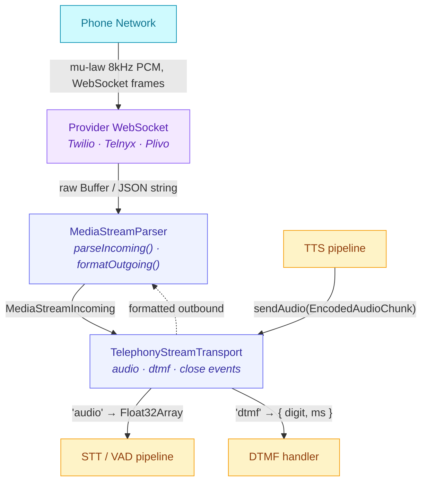

# Telephony Providers

The original examples below describe the legacy compatibility profile. For live-carrier construction, authentication, controls and durable callbacks, use the Carrier protocol profile and Callback identity and persistence sections on this page. Internal call ids in legacy examples are not authentication credentials.

The telephony layer connects AgentOS to phone calls. A provider places and ends calls through its REST API and verifies and parses its webhooks; [`CallManager`](https://github.com/framerslab/agentos/blob/master/src/io/channels/telephony/CallManager.ts) tracks each call's state; [`TelephonyStreamTransport`](https://github.com/framerslab/agentos/blob/master/src/io/channels/telephony/TelephonyStreamTransport.ts) carries a call's audio over the provider's WebSocket media stream, decoding caller audio to Float32 frames for VAD and STT and encoding outbound TTS audio to 8 kHz mu-law.

Three providers ship in [`src/io/channels/telephony/providers/`](https://github.com/framerslab/agentos/tree/master/src/io/channels/telephony/providers): **Twilio**, **Telnyx** and **Plivo**. Each implements [`IVoiceCallProvider`](https://github.com/framerslab/agentos/blob/master/src/io/channels/telephony/IVoiceCallProvider.ts). The package root and `@framers/agentos/io/channels/telephony` export them with `CallManager`, the transport, the media stream parsers and the XML helpers. A mock provider in the same folder backs the tests and is not exported.

---

## Table of Contents

1. [Overview](#overview)
2. [Provider Setup](#provider-setup)
   - [Twilio](#twilio)
   - [Telnyx](#telnyx)
   - [Plivo](#plivo)
3. [Placing a call](#placing-a-call)
4. [Call Modes](#call-modes)
5. [Webhook Configuration](#webhook-configuration)
6. [Inbound calls](#inbound-calls)
7. [DTMF Handling](#dtmf-handling)
8. [Media Stream Flow](#media-stream-flow)
9. [CallManager configuration](#callmanager-configuration)
10. [Wunderland CLI flags](#wunderland-cli-flags)
11. [Carrier protocol profile](#carrier-protocol-profile)
12. [Callback identity and persistence](#callback-identity-and-persistence)
13. [Host manager binding](#host-manager-binding)
14. [Speech XML compatibility](#speech-xml-compatibility)

---

## Overview

| Layer | Purpose |
|---|---|
| [`IVoiceCallProvider`](https://github.com/framerslab/agentos/blob/master/src/io/channels/telephony/IVoiceCallProvider.ts) | Places and hangs up calls, verifies webhooks, parses webhook events |
| [`CallManager`](https://github.com/framerslab/agentos/blob/master/src/io/channels/telephony/CallManager.ts) | Registers providers, places calls, tracks each call's state, emits call events |
| [`TelephonyStreamTransport`](https://github.com/framerslab/agentos/blob/master/src/io/channels/telephony/TelephonyStreamTransport.ts) | Bridges a provider's WebSocket media stream to the voice pipeline |
| [`MediaStreamParser`](https://github.com/framerslab/agentos/blob/master/src/io/channels/telephony/MediaStreamParser.ts) (per provider) | Normalises provider-specific WebSocket frames |

---

## Provider Setup

The providers read no environment variables: the host passes each credential to the constructor. The variable names below are the ones the examples use.

### Twilio

1. Create a Twilio account and note the **Account SID** and **Auth Token** from the Console.
2. Buy or port a phone number with *Voice* capability.

```typescript
import { TwilioVoiceProvider } from '@framers/agentos';

const provider = new TwilioVoiceProvider({
  accountSid: process.env.TWILIO_ACCOUNT_SID!,
  authToken: process.env.TWILIO_AUTH_TOKEN!,
});
```

### Telnyx

1. Create a Telnyx account and generate an **API key** (Mission Control Portal → Auth → API Keys).
2. Buy a phone number and assign it to a TeXML or Call Control application; its id is the `connectionId`.
3. Copy the account's Ed25519 **public key** for webhook verification.

```typescript
import { TelnyxVoiceProvider } from '@framers/agentos';

const provider = new TelnyxVoiceProvider({
  apiKey: process.env.TELNYX_API_KEY!,
  connectionId: process.env.TELNYX_CONNECTION_ID!,
  publicKey: process.env.TELNYX_PUBLIC_KEY!, // without publicKey, verifyWebhook() accepts every webhook
});
```

### Plivo

1. Create a Plivo account and note the **Auth ID** and **Auth Token** from the Console.
2. Buy or rent a phone number with *Voice* capability.

```typescript
import { PlivoVoiceProvider } from '@framers/agentos';

const provider = new PlivoVoiceProvider({
  authId: process.env.PLIVO_AUTH_ID!,
  authToken: process.env.PLIVO_AUTH_TOKEN!,
});
```

No provider takes a caller number. The number a call is placed from comes from the `CallManager` configuration (`provider.config.fromNumber`) or from the call itself.

---

## Placing a call

```typescript
import { CallManager, TwilioVoiceProvider } from '@framers/agentos';

const manager = new CallManager({
  provider: {
    provider: 'twilio',
    config: {
      accountSid: process.env.TWILIO_ACCOUNT_SID!,
      authToken: process.env.TWILIO_AUTH_TOKEN!,
      fromNumber: '+15551234567',
    },
  },
  webhookBaseUrl: 'https://your-domain.com',
  streaming: { enabled: true, wsPath: '/voice/media-stream' },
});
manager.registerProvider(
  new TwilioVoiceProvider({
    accountSid: process.env.TWILIO_ACCOUNT_SID!,
    authToken: process.env.TWILIO_AUTH_TOKEN!,
  }),
);

const call = await manager.initiateCall({ toNumber: '+15550001234', mode: 'conversation' });
console.log(call.callId, call.state); // 'failed' or 'error', with call.errorMessage, when the call was not placed
```

`initiateCall()` uses the provider registered under the configured name (or `providerName`), the configured `fromNumber` unless the call names one, and the configured `defaultMode` (`'conversation'` when unset) unless the call names one. A provider that refuses the call leaves the record in the `failed` state, and one that throws leaves it in the `error` state; both emit `call:error`.

---

## Call Modes

A call record carries one of two modes:

| Mode | Meaning |
|---|---|
| `conversation` | Full duplex: caller audio to STT, the agent's reply to TTS, over a media stream |
| `notify` | Speak a message and hang up |

The providers do not act on the mode. Each one sends its API the destination, the caller number and the webhook URL (Twilio also the status callback URL); the mode, the message, the TTS voice and the media stream URL are not sent. In the carrier profile, Plivo also receives the status callback URL as its ring and hangup URLs, and Telnyx receives the media stream URL. When a Twilio or Plivo call connects, the provider requests the webhook URL, and the host's route answers with the XML for the mode, built with the helpers in [`twiml.ts`](https://github.com/framerslab/agentos/blob/master/src/io/channels/telephony/twiml.ts):

```typescript
import { twilioConversationTwiml, twilioNotifyTwiml } from '@framers/agentos';

// conversation: open a media stream back to your server
const streamXml = twilioConversationTwiml('wss://your-domain.com/voice/media-stream', call.callId);

// notify: speak and hang up
const notifyXml = twilioNotifyTwiml('Your order has shipped.');
```

`plivoStreamXml(streamUrl)` and `plivoNotifyXml(text, voice?)` build the same two answers for Plivo.

A Telnyx call goes through Telnyx's Call Control API, which posts the call's events (`call.initiated`, `call.answered`, `call.hangup` and the others) to the webhook URL and takes [commands](https://developers.telnyx.com/docs/voice/programmable-voice/voice-api-fundamentals) that control the call. AgentOS sends no command when a Telnyx call connects. For a conversation, the host starts the media stream after `call.answered` with Telnyx's [`streaming_start`](https://developers.telnyx.com/api-reference/call-commands/streaming-start) command; in the carrier profile the dial request carries the media stream URL instead, so the stream starts without that command. For a notify call, it speaks the message with `TelnyxVoiceProvider.playTts({ providerCallId, text, voice })`, which sends the `speak` command (voice `female` unless one is given, language `en-US`) and does not hang up. `telnyxStreamXml(streamUrl)` returns `<Response><Stream url="…" /></Response>`, and there is no Telnyx notify helper.

---

## Webhook Configuration

`CallManager` gives each call two URLs under `webhookBaseUrl` (`http://localhost:3000` when unset):

```
<webhookBaseUrl>/voice/webhook/<provider>   Twilio and Plivo request it when the call connects (answer URL); Telnyx posts the call's events to it
<webhookBaseUrl>/voice/status/<provider>    status callback (sent to Twilio, and to Plivo in the carrier profile)
```

The host serves those routes on its own HTTP server. A status or event webhook goes to `manager.processWebhook(providerName, { method, url, headers, body })`, which verifies it, parses its events and applies them to the call they name. AgentOS ships no webhook server.

### Signature verification

All three providers sign their webhook payloads:

| Provider | Algorithm | Headers |
|---|---|---|
| Twilio | HMAC-SHA1 over the URL and the form params sorted by key | `x-twilio-signature` |
| Telnyx | Ed25519 over the timestamp and the raw body; a timestamp more than 300 seconds old is rejected | `telnyx-signature-ed25519`, `telnyx-timestamp` |
| Plivo | HMAC-SHA256 (V3) over the URL, its query, the sorted form params and the nonce | `x-plivo-signature-v3` or `x-plivo-signature-ma-v3`, `x-plivo-signature-v3-nonce` |

`CallManager.processWebhook()` calls the provider's `verifyWebhook()` before it parses any event, and drops a webhook that fails. A legacy Telnyx provider constructed without `publicKey` skips the check and accepts every webhook, so anyone who can reach the webhook URL can post call events to `CallManager`; pass the key outside local development. With `protocol: 'carrier'`, a Telnyx provider without `publicKey` refuses every webhook. `webhookToleranceSec` (300 by default, 0 turns it off) sets the timestamp window.

### Provider console settings

With `webhookBaseUrl` set to `https://your-domain.com`:

**Twilio**: phone number → Voice Configuration: "A call comes in" → `https://your-domain.com/voice/webhook/twilio`; "Call Status Changes" → `https://your-domain.com/voice/status/twilio`.

**Telnyx**: the application's webhook URL → `https://your-domain.com/voice/webhook/telnyx`.

**Plivo**: the application's "Answer URL" → `https://your-domain.com/voice/webhook/plivo`; "Hangup URL" → `https://your-domain.com/voice/status/plivo`.

---

## Inbound calls

`processWebhook()` applies events only to calls the manager knows; an event for an unknown call is logged and dropped. For an inbound call, the host's answer route registers the call first:

```typescript
const record = manager.handleInboundCall({
  providerCallId: 'CA123',          // the provider's call id from the webhook
  provider: 'twilio',
  fromNumber: '+15550001111',
  toNumber: '+15551234567',
});
// null: the inbound policy refused the caller
```

`inboundPolicy` decides: `'disabled'` (the default) refuses every call, `'allowlist'` accepts the numbers in `allowedNumbers`, and `'pairing'` and `'open'` accept every number. An accepted call starts in the `ringing` state in `conversation` mode and emits `call:ringing`.

---

## DTMF Handling

Key presses reach `CallManager` as `call-dtmf` webhook events (Twilio `<Gather>`, Telnyx call events, Plivo `<GetDigits>`) and come out as `call:dtmf`:

```typescript
manager.on((event) => {
  if (event.type === 'call:dtmf') {
    const { digit, durationMs } = event.data as { digit: string; durationMs?: number };
    console.log(`Caller pressed: ${digit}`);
  }
});
```

A DTMF event does not change the call's state. On a media stream, [`TelephonyStreamTransport`](https://github.com/framerslab/agentos/blob/master/src/io/channels/telephony/TelephonyStreamTransport.ts) also emits `dtmf` for each key press its parser reports, with `durationMs` when the message carries a duration. The Twilio parser reports key presses in both profiles; the Telnyx and Plivo parsers report them only when constructed with `{ protocol: 'carrier' }`. The Telnyx and Plivo webhooks carry no duration.

```typescript
transport.on('dtmf', ({ digit, durationMs }) => {
  // a key press during a Twilio media stream
});
```

---

## Media Stream Flow

The following diagram shows the path of inbound audio (phone → pipeline) and
outbound TTS audio (pipeline → phone) for a `conversation` mode call.



**Inbound path (phone → pipeline)**

1. Provider delivers a WebSocket frame (JSON string or binary Buffer).
2. `MediaStreamParser.parseIncoming()` normalises it to a [`MediaStreamIncoming`](https://github.com/framerslab/agentos/blob/master/src/io/channels/telephony/MediaStreamParser.ts)
   discriminated union (`start | audio | dtmf | stop | mark`).
3. `audio` events: mu-law 8 kHz → Int16 PCM → resampled to the transport's `outputSampleRate` (16 kHz unless the constructor's config sets another) → Float32.
4. The [`AudioFrame`](https://github.com/framerslab/agentos/blob/master/src/io/voice-pipeline/types.ts) is emitted from the transport for VAD / STT consumption.

**Outbound path (pipeline → phone)**

1. TTS pipeline produces an [`EncodedAudioChunk`](https://github.com/framerslab/agentos/blob/master/src/io/voice-pipeline/types.ts) (PCM Int16 at pipeline sample rate).
2. `TelephonyStreamTransport.sendAudio()` resamples it to 8 kHz.
3. PCM is mu-law encoded.
4. `MediaStreamParser.formatOutgoing()` wraps it in the provider envelope (e.g., Twilio JSON).
5. The formatted payload is sent over the WebSocket.

---

## CallManager configuration

[`VoiceCallConfig`](https://github.com/framerslab/agentos/blob/master/src/io/channels/telephony/types.ts) is the `CallManager` constructor's argument:

| Field | Type | Used for |
|---|---|---|
| `provider` | `{ provider: 'twilio' \| 'telnyx' \| 'plivo' \| 'mock', config }` | The default provider's name and, in `config.fromNumber`, the default caller number |
| `webhookBaseUrl` | `string` | Base of the webhook, status and media stream URLs (`http://localhost:3000` when unset) |
| `defaultMode` | `'conversation' \| 'notify'` | Mode of a call that names none (`'conversation'` when unset) |
| `inboundPolicy` | `'disabled' \| 'allowlist' \| 'pairing' \| 'open'` | `handleInboundCall()` (see [Inbound calls](#inbound-calls)) |
| `allowedNumbers` | `string[]` | The `'allowlist'` policy |
| `streaming.enabled`, `streaming.wsPath` | `boolean`, `string` | With `streaming.enabled` true, each call is passed a media stream URL: `webhookBaseUrl` with `http` replaced by `ws`, plus `wsPath` (`/voice/media-stream` by default). `wsPath` alone passes none. In the legacy profile no provider sends it; a Telnyx provider constructed with `protocol: 'carrier'` sends it as `stream_url` when dialing |
| `eventHandling` | `'legacy' \| 'carrier'` | `'carrier'` makes `processWebhook()` and `processNormalizedEvent()` apply each event through the carrier transitions in process, with no restart durability (see [Callback identity and persistence](#callback-identity-and-persistence)); omitted or `'legacy'` keeps the original handling. `processWebhookDurable()` uses the carrier transitions whatever this field says |
| `tts.voice` | `string` | Passed with each call; no provider sends it |

`tts.provider`, `tts.speed`, `tts.options`, `stt` and `maxDurationSeconds` are part of the type and are not read.

---

## Wunderland CLI flags

The [`wunderland`](https://wunderland.sh) CLI (`npm install -g @framers/wunderland`) starts a local voice WebSocket server from `wunderland chat`:

| Flag | Type | Description |
|---|---|---|
| `--voice` | boolean | Start the local voice pipeline WebSocket server |
| `--voice-stt=<id>` | string | STT provider (e.g. `deepgram`, `whisper-chunked`) |
| `--voice-tts=<id>` | string | TTS provider (e.g. `openai`, `elevenlabs`) |
| `--voice-endpointing=<strategy>` | string | `acoustic`, `heuristic` or `semantic` |
| `--voice-diarization` | boolean | Speaker diarization |
| `--voice-barge-in=<mode>` | string | `hard-cut`, `soft-fade` or `disabled` |
| `--voice-port=<n>` | number | WebSocket server port (`0` = OS-assigned) |

`wunderland chat` also accepts `--telephony-provider`, `--telephony-webhook-port`, `--telephony-webhook-host` and `--telephony-webhook-path`, parses them and does not use them: no telephony webhook server starts.

---

## Carrier protocol profile

The media parsers, stream XML helpers and stream transport have an explicit `protocol: 'carrier'` option. It selects the documented Twilio, Telnyx and Plivo media messages. Omission, or `protocol: 'legacy'`, preserves the earlier compatibility behavior. Legacy framing is retained for existing callers; it is not a statement that a live carrier accepts that framing.

Construct a carrier parser and a carrier transport together. Verify the WebSocket upgrade with the carrier's authentication rules before constructing the transport. Supply `authorizeStart` to check the call id and any custom parameters against that authenticated connection. Twilio's stream token is a nested custom Parameter, not a query parameter. The callback must be synchronous and return true only for that call. Do not use the internal call id as a secret or accept arbitrary start metadata as authority.

All three carrier profiles use PCMU at 8 kHz mono. Plivo XML explicitly requests `audio/x-mulaw;rate=8000`; output declares the same content type and numeric sample rate. Telnyx dialing with a media URL requests bidirectional RTP with PCMU. Incompatible start formats are refused. Input exposes per-track chunk numbers and source timestamps separately from the transport's monotonic relative audio clock; a missing interval emits a gap. Late or duplicate chunks are discarded.

Carrier output accepts raw or WAV-wrapped PCM16 mono at 8, 16, 24 or 48 kHz. Chunks must contain an integral number of 8 kHz destination samples and last 20 ms to two seconds. WAV callers set `container: 'wav'`. MP3, Opus, malformed WAV and inconsistent metadata are rejected before output. Conversion to PCMU happens once. A chunk that carries a `generation` is played one at a time: a second `sendAudio` before the first completes fails explicitly, and so do an older generation and, once a generation was sent, a chunk without one; await `sendAudio` before producing another chunk. A producer that sends no generation may send without waiting, as `VoicePipelineOrchestrator` without a call profile does: each chunk is written in the order sent, followed by its checkpoint, while the chunks before it play, and at most 196608 bytes of PCMU wait unwritten. Either way, a send's completion means the corresponding carrier playback checkpoint returned, not merely that a socket write completed. Interruption clears the carrier queue and rejects every chunk not yet played; the chunks sent after it play. Checkpoints returned after a clear do not count as played. Other pipeline JSON remains local.

The stream adapters are direct-carrier transports. The hosted web-call and room transports have their own authority and generation contracts. A successful fixture does not certify live carrier latency, phone audio quality or SIP behavior. Verify those against the deployment's selected carriers before advertising phone support.

---

## Callback identity and persistence

Provider `protocol: 'carrier'` enables stable callback ids and advertises `webhookIdentity: 'stable-v1'`. A lifecycle fact is identified by provider, account, call and event kind. Repeatable DTMF needs an occurrence id: a provider event id or signed sequence/timestamp, or a distinct `event_key` in each Gather/GetDigits callback URL. If the provider gives no such field, generate that callback occurrence key on the host before issuing the gather operation. Reuse it for retries of that operation and rotate it for the next operation. A missing occurrence id is an error. Retry signature nonces and callback receipt times are not event identities. Choose one DTMF delivery channel for each action.

Use `CallManager.persistCall` to persist admitted call identity before acknowledging callbacks. Use `processWebhookDurable` with an `ITelephonyCallStore` for restart-safe callbacks. It verifies the provider request first and commits call state, aliases and processed event ids together. The PostgreSQL adapter exports `telephonyCallStoreDdl` for the host migration and uses provider-partition locks. Give each carrier account a separate configured storage namespace. The memory adapter is only for a single process and tests. `InMemoryTelephonyCallStore`, `SqlTelephonyCallStore` and `telephonyCallStoreDdl` are imported from `@framers/agentos/io/channels/telephony/TelephonyCallStore`.

A callback arriving before admission is persisted throws `unknown carrier call`; return a retryable response and preserve the callback. Never acknowledge it as processed. A failed signature is refused without touching storage. After commit, a duplicate callback has no second state effect or terminal notification. Event handlers run after commit and are best-effort notifications. External delivery and billing must use durable records and idempotent delivery, not a handler's invocation count. The synchronous legacy API is still available; `eventHandling: 'carrier'` applies repaired in-process transitions but supplies no restart durability by itself.

The manager's own changes to a call it has persisted, or read through `processWebhookDurable`, go to that call's store as well. `hangupCall` commits the `hangup-bot` end there before it emits `call:ended`, so a carrier callback that follows changes neither the outcome nor the notifications; its promise rejects when that commit fails, and a call the store already holds as ended keeps its stored outcome. `speakText` keeps its synchronous transcript and `speaking` change, and commits them to the store behind the manager's earlier transactions; until one commits them, every later transaction for the call carries them, so a callback's refresh of the manager's record keeps them. A failed commit of speech is written to the console and left to the next transaction. One manager runs its store transactions one at a time, in the order they were requested.

Plivo's creation response identifies a request, not its call leg. Carrier mode returns `providerRequestId` and a `request:`-prefixed pending identity. A verified callback binds that request to its `CallUUID`. Until binding, speech is refused and hangup uses the Request cancellation endpoint. After binding, operations use the Call endpoint. A second call leg cannot silently replace the first. This profile supports one destination per creation request.

Retain terminal records and processed ids for the configured callback and accounting recovery horizon. The stores never evict them automatically. A call exceeding 10000 retained event ids fails explicitly instead of forgetting deduplication state. Store admission does not solve an ambiguous outbound dial response after a process crash; the host still needs carrier dispatch reconciliation before retrying such an external operation.

---

## Host manager binding

`bindVoiceProvider(provider, manager)` registers the provider on the supplied manager and returns a `VoiceProviderBinding`. Its `manager` property is the actual host instance, and its stable `toolHandler` proxy uses that instance. `setManager` explicitly rebinds the proxy; it does not dispose the old manager. This contract lets carrier packs expose their manager rather than hide an unreachable private manager or immutable empty handler. Extension descriptor loading must select this typed binding; loading a package alone is not a complete phone server. `bindVoiceProvider` is imported from `@framers/agentos/io/channels/telephony/CallManager`.

The handler's `speakText` retains its transcript/state semantics. Connect the real synthesis and media path to produce audible speech. The host supplies webhook routes, authentication, credentials, persistence and call admission policy.

---

## Speech XML compatibility

Twilio `playTts` escapes text and voice values by default. `speechXml: 'legacy-raw'` preserves raw interpolation only for trusted compatibility integrations that intentionally supply their own markup. It must not receive untrusted text. No speech text or voice can introduce an XML element in the default mode.
