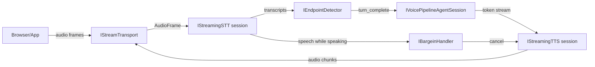
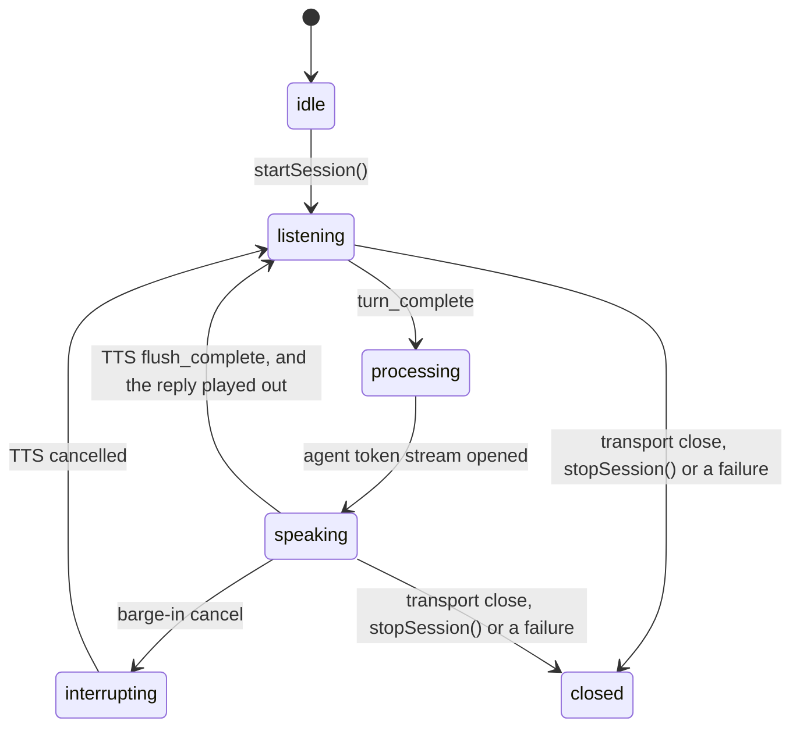

# Streaming voice pipeline

[`VoicePipelineOrchestrator`](https://github.com/framerslab/agentos/blob/master/src/io/voice-pipeline/VoicePipelineOrchestrator.ts) runs one spoken conversation over a transport. Audio frames from the client go to a streaming speech-to-text (STT) session; its transcripts go to an endpoint detector, which decides when the user's turn is over; the turn's text goes to an agent session; the reply's tokens go to a streaming text-to-speech (TTS) session; and its audio goes back through the transport. A barge-in handler decides what happens when the user speaks over the reply.

## Architecture



The legacy injected entry takes its components from the caller: `startSession(transport, agentSession, overrides)` requires explicit STT, TTS, endpoint and barge-in components. It throws when `overrides` lacks `streamingSTT` or `streamingTTS`, and, without `overrides.callProfile`, when it lacks `endpointDetector` or `bargeinHandler`; it resolves no provider from configuration or from installed extension packs. One orchestrator runs one session; start another with a new instance. `overrides.callProfile` runs the session as one scoped call ([Call profile](#call-profile)). The scoped call profile is constructed by `VoiceSessionFactory`, which uses `SpeechProviderResolver.resolveVoicePlan` and owns VAD, audio endpointing, generations and bounded acknowledged playback; a host can also pass the profile itself. The behavior described in State Machine, Quick Start, Endpointing, Barge-in, WebSocket Messages and Failures below is the legacy injected profile unless a paragraph explicitly says call profile. See [Voice platform runtime](VOICE_PLATFORM.md) for scoped calls. `overrides.diarizationEngine` is accepted and not used: neither profile makes legacy `diarizationEngine` wiring into a hosted diarization feature.

## State Machine



- On `turn_complete` the orchestrator sends `agent_thinking`, calls `agentSession.sendText(transcript, metadata)`, sends `agent_speaking` and pushes each token to TTS. A reply ends once its TTS session has reported `flush_complete` and its audio has played, not when its synthesis completes: a transport that plays the audio on its own timing after taking it and reports when it has played out (`waitForPlayout(signal)`, as a speaking `LiveKitStreamTransport` does) says when; on any other transport the orchestrator counts the audio's own duration, each chunk playing after the one before it from the moment it was sent at the earliest, and waits at most `maxPlayoutWaitMs` after the synthesis completed (default `30000`; `0` ends a reply as its synthesis completes; the constructor throws a `RangeError` unless it is a finite number of zero or more). Until then the orchestrator stays `speaking`, so the user's speech over the rest of the reply interrupts it ([Barge-in](#barge-in)), and a barge-in that cuts the reply or a stop aborts the wait's `signal`. Then it sends `agent_done` with the reply's text and the played duration, adds the reply to the conversation (`conversation_item_added`), resets the endpoint detector and returns to `listening`; once a pause discarded audio that a transport playing the audio itself held, `agent_done` carries no text and the reply joins as interrupted with an empty `playedText`, as one whose playout wait failed does ([Barge-in](#barge-in)).
- On a barge-in `cancel` it cancels the TTS session, calls `agentSession.abort()`, sends `barge_in` and returns to `listening` at once. A barge-in `pause` keeps it `speaking` until the user's speech ends ([Barge-in](#barge-in)). A decision the handler returns after the reply has ended is not acted on.
- A transport `close`, `stopSession()` or a failure (below) moves any state to `closed`. The orchestrator and the session it returned emit `close`, with the reason and, after a failure, its `Error`; the orchestrator then calls `agentSession.abort()`, closes the STT and TTS sessions, resets the endpoint detector and closes the transport, unless the transport has closed itself, sending it `session_ended` first ([WebSocket Messages](#websocket-messages)). A pending `waitForUserTurn()` rejects, as does one called after the close.
- An `'error'` from the STT session, the TTS session, the transport or the endpoint detector, a TTS session's `close` that the session's own stop did not make (every later reply would go to a closed session), and a turn whose agent stream throws or whose TTS `flush()` rejects, end that session and no other. The orchestrator reports `Error('voice pipeline failed')` as its `'error'`, and as the returned session's `'error'` when that has a listener, or writes it as a console warning when nothing listens for the orchestrator's `'error'`; the report carries none of the failure's own text, which can hold what was said. Then both emit `session_error` with the same `Error`, the part it came from and `recoverable: false`, before `close`.
- While `listening`, a watchdog gives the endpoint detector a synthetic `speech_end` after `maxTurnDurationMs` (default `30000`); the detector decides whether that ends the turn.
- A send that the transport rejects, such as one on a WebSocket that is closing, is reported as the orchestrator's `'error'`, or written as a console warning when nothing listens for `'error'`, and as a `session_error` with `source: 'transport'` and `recoverable: true`; a failed send ends neither the turn nor the session. Each refused control message is reported; of a reply's audio, only the first refused chunk is. A rejection reason that is not an `Error` is reported as an `Error` with the reason's text, and one `String()` cannot print, such as an object without a prototype or a revoked `Proxy`, as `Error('an unprintable object')`. A call profile ends the call on a failed send instead.
- A listener of a session event (below) that throws or rejects is reported the same way, and as a `session_error` with `source: 'session'` and `recoverable: true`, and the listeners after it still run. Its console warning names the event and the error's type, such as `a user_input_transcribed listener failed: Error`, and not the error's text, which a listener can build from what it was handed, such as a transcript: a built-in type (`TypeError`, `SyntaxError` and the rest) by its own label, and any other error as `Error`, whatever `name` the listener gave it. An `'error'` listener gets the listener's own `Error`.

### Session events

Both runtimes emit the events of [`VoiceSessionEventMap`](https://github.com/framerslab/agentos/blob/master/src/io/voice-pipeline/types.ts) on the session `startSession()` returns, whose `on`, `once` and `off` type each listener by its event's payload. The orchestrator emits them as well, from the moment `startSession()` is called, so a host that listens there hears the session open: `agent_state_changed` from `initializing` to `listening` comes before `startSession()` resolves. Two are the session's alone: the orchestrator emits `state_changed` (`{ from, to }`) in place of `state_change`, and its own `'error'` (above) in place of the session's. The names follow LiveKit Agents' `AgentSession` events where LiveKit has one ([events and error handling](https://docs.livekit.io/agents/build/events/)). `VOICE_SESSION_EVENT_NAMES` lists every name, from `@framers/agentos/io/voice-pipeline` and from its browser entry. No session event is emitted after `close`: a listener that stops the session ends the event it was handed there, and the listeners after it, on the orchestrator or on the session, do not get it.

| Event | Payload | When it fires | LiveKit Agents |
|---|---|---|---|
| `agent_state_changed` | `{ oldState, newState, createdAt }`, each a `VoiceAgentState` | the agent's state changed (below) | `agent_state_changed` |
| `user_state_changed` | `{ oldState, newState, createdAt }`, each a `VoiceUserState` | the user's state changed (below) | `user_state_changed` |
| `user_input_transcribed` | `{ transcript, isFinal, confidence?, language?, speakerId?, itemId?, createdAt }` | each interim and final transcript with words, from the STT session or a client's line; `speakerId` when every word that names a speaker names the same one | `user_input_transcribed` |
| `conversation_item_added` | `{ item, createdAt }`, the item a `VoiceConversationItem` | a user item as the agent takes the turn, with its `source` (`speech`, `client`, or `text` for typed text), its `language` and its `endpointReason`; an assistant item as the reply ends, with `playedText` equal to `text` once its audio has played, or with `interrupted: true` when a barge-in or typed text cut it or the transport's `waitForPlayout()` rejected or a pause discarded audio it held, its `playedText` then holding only what is proven heard: under a call profile, the contiguous prefix of the sentence segments whose last frame the transport acknowledged ([Text boundaries](#text-boundaries)); otherwise none, since which of its words were heard is not known | `conversation_item_added` |
| `speech_created` | `{ source, userInitiated, createdAt }` | the first word of a reply (`source: 'reply'`), or of a prompt `pushToTTS()` speaks (`source: 'say'`, `userInitiated: true`): under a call profile each prompt, which the call speaks as a reply of its own; without one, a prompt pushed while a reply is speaking, whose audio goes out with the reply's | `speech_created` |
| `barge_in` | `{ speechDurationMs, interruptedText, playedDurationMs, action, createdAt }` | the user's speech paused (`pause`), resumed (`resume`) or cut (`cancel`) the reply, as the transport is sent its `barge_in` message, or the user's typed text cut it (`cancel`, with `speechDurationMs: 0`; under a call profile, a reply or a prompt being spoken); under a call profile, `cancel` | none |
| `error` | `Error` | the failure the session ends on, content-free (`Error('voice pipeline failed')`, or `Error('voice call failed (<code>)')` under a call profile), to the session's `errorMonitor` listeners, whether or not it has an `'error'` listener, and then to its `'error'` listeners | none: Node's `'error'` |
| `session_error` | `{ error, recoverable, source, createdAt }` | each failure, with the part it came from (`stt`, `tts`, `agent`, `transport`, `vad`, `endpoint` or `session`): the one the session ends on, with the `Error` of `error`, before `close` (`recoverable: false`), though an `'error'` listener stops the session, and one it goes on after (`recoverable: true`), such as a `text_input` dropped with its reason (`session`) or, under a call profile, a cut reply's agent stream still open `abortGraceMs` after `abort()` (`agent`) | `error` |
| `close` | `{ reason, error?, createdAt }` | the session closed: the reason the stop was given, `transport_closed` or `closed`, with the `Error` it ended on, if any | `close` |
| `state_change` | `PipelineState` | deprecated: each pipeline state, beside `agent_state_changed`, until the next minor | none |
| `turn_complete` | `TurnCompleteEvent` | deprecated: each turn the agent takes, before its user item, until the next minor | none |

The agent's states (`VoiceAgentState`) are LiveKit's: `initializing` until the session has opened; `listening` while the agent waits for the user's turn; `thinking` from the moment the user's turn completes until the reply's first word, and, under a call profile, from a `pushToTTS()` prompt's start until its first word, since the call speaks the prompt as a reply of its own; `speaking` from that word until the reply's or the prompt's audio has played or a barge-in cut it. `idle` is the state of a session whose input a host has turned off, which `VoicePipelineOrchestrator` never reports.

The user's states (`VoiceUserState`): `speaking` from a start of the user's speech to its end, the STT session's `speech_start` and `speech_end`, a client's transcript lines from the first to open until the last closes, or, under a call profile, from `minSpeechMs` of successive VAD speech until a frame of silence; `listening` otherwise; and `away` once the user and the agent have both been listening for `userAwayTimeoutMs`, only with that `VoicePipelineConfig` option set (a finite number above zero; the constructor throws a `RangeError` otherwise), until the user's next speech.

```typescript
import { VoicePipelineOrchestrator, type VoiceConversationItem } from '@framers/agentos/io/voice-pipeline';

const orchestrator = new VoicePipelineOrchestrator({ stt: 'deepgram', tts: 'elevenlabs' });
const session = await orchestrator.startSession(transport, agentSession, overrides);
const history: VoiceConversationItem[] = [];
session.on('agent_state_changed', ({ newState }) => page.showAgent(newState)); // 'listening' | 'thinking' | 'speaking' ...
session.on('user_input_transcribed', ({ transcript, isFinal }) => page.showCaption(transcript, isFinal));
session.on('conversation_item_added', ({ item }) => history.push(item));
session.on('session_error', ({ source, recoverable }) => metrics.count('voice_error', { source, recoverable }));
```

## Quick Start

```typescript
import { randomUUID } from 'node:crypto';
import { WebSocketServer } from 'ws';
import { agent } from '@framers/agentos';
import {
  AgentSessionVoiceAdapter,
  DeepgramStreamingSTT,
  ElevenLabsStreamingTTS,
  HardCutBargeinHandler,
  HeuristicEndpointDetector,
  VoicePipelineOrchestrator,
  WebSocketStreamTransport,
} from '@framers/agentos/io/voice-pipeline';

const assistant = agent({ provider: 'openai', instructions: 'You are a voice assistant. Answer in short sentences.' });
const wss = new WebSocketServer({ port: 8765 });

wss.on('connection', async (ws) => {
  // The page sends 16 kHz mono 16-bit PCM as binary messages.
  const transport = new WebSocketStreamTransport(ws, { sampleRate: 16000, inboundEncoding: 'linear16' });
  const orchestrator = new VoicePipelineOrchestrator({ stt: 'deepgram', tts: 'elevenlabs', language: 'en-US' });

  await orchestrator.startSession(transport, new AgentSessionVoiceAdapter(assistant.session(randomUUID())), {
    streamingSTT: new DeepgramStreamingSTT({ apiKey: process.env.DEEPGRAM_API_KEY! }),
    streamingTTS: new ElevenLabsStreamingTTS({ apiKey: process.env.ELEVENLABS_API_KEY! }),
    endpointDetector: new HeuristicEndpointDetector(),
    bargeinHandler: new HardCutBargeinHandler(),
  });
});
```

`AgentSessionVoiceAdapter` sends each turn through the agent session's stream with the supplied abort signal, `session.stream(text, { abortSignal })`, and hands its text deltas to TTS; abort cancels that upstream request: `abort()` aborts the signal, so the turn ends as an aborted `stream()` ends ([Cancellation](../getting-started/HIGH_LEVEL_API.md#cancellation)), and `whenIdle()` resolves once the turn's stream has unwound. A turn whose `sendText()` was called before an `abort()` and has not been read yet is cancelled too: it never reaches the session and yields nothing. One turn runs at a time: iterating a second `sendText()` while one is active throws. Direct injected construction still owns its component choices. The config's `stt` and `tts` strings are required by the type and not read by the orchestrator; it reads `language` and `sttOptions` for the STT session, `voice`, `format`, `ttsOptions` and `ttsExpressiveness` for the TTS session, `maxTurnDurationMs` for the watchdog, and `falseInterruptionMs` for a reply paused by barge-in. A transport that plays one audio format alone names it as `playbackFormat`, as a speaking `LiveKitStreamTransport` names `'pcm'`: the TTS session is then asked for that format in place of `format`, and without a call profile a chunk in another format is reported once as `'error'`, naming the TTS provider, and not sent, nor held by a pause. A configured `voiceSession()` delegates to `VoiceSessionFactory`, which freezes the scoped provider plan and refuses unsupported options before opening models.

`agent({ voice: { enabled: true, session: { factory, agent: revision } } })` exposes `voiceSession({ scope, funding, slot })`, which prepares the scoped call through `factory.startSession()`. The captured factory and revision do not change when the caller mutates its options. That form refuses any other field in `voice` or `session`, `enabled: false` and `runtime: 'gmi'` at construction; the agent's text calls stay text calls, and its exported configuration reads `voice` as `{ enabled: true }`. Other legacy voice fields of a [`VoiceConfig`](https://github.com/framerslab/agentos/blob/master/src/api/types.ts) remain deferred and produce a construction warning: `agent()` accepts them and does not read them. `agency({ voice: { enabled: true } }).listen()` accepts JSON text only; binary input receives `audio_not_supported` and close code 1003. It performs no speech recognition or synthesis ([Agency API](../orchestration/AGENCY_API.md)).

### Wunderland CLI

The [Wunderland](https://wunderland.sh) CLI's `chat --voice` starts a WebSocket voice server built on this orchestrator, with the reply streamed from the chat runtime and the model request aborted on barge-in ([flags](./TELEPHONY_PROVIDERS.md#wunderland-cli-flags)):

```sh
wunderland chat \
  --voice \
  --voice-stt=deepgram \
  --voice-tts=elevenlabs \
  --voice-endpointing=heuristic \
  --voice-barge-in=hard-cut \
  --voice-port=8765
```

## Components

| Interface | Implementations in AgentOS |
|-----------|---------|
| [`IStreamTransport`](https://github.com/framerslab/agentos/blob/master/src/io/voice-pipeline/types.ts) | `WebSocketStreamTransport`, `WebRTCStreamTransport`, `LiveKitStreamTransport`, `TelephonyStreamTransport` |
| [`IStreamingSTT`](https://github.com/framerslab/agentos/blob/master/src/io/voice-pipeline/types.ts) | `DeepgramStreamingSTT` (default model `nova-3`), `ElevenLabsStreamingSTT`, `OpenAIRealtimeTranscriptionSTT` (default model `gpt-4o-mini-transcribe`), `StreamingSTTChain` over several of them, and `ReconnectingSTT` over one |
| [`IEndpointDetector`](https://github.com/framerslab/agentos/blob/master/src/io/voice-pipeline/types.ts) | `HeuristicEndpointDetector`, `AcousticEndpointDetector` |
| [`IStreamingTTS`](https://github.com/framerslab/agentos/blob/master/src/io/voice-pipeline/types.ts) | `ElevenLabsStreamingTTS`, `DeepgramAuraStreamingTTS`, `CartesiaStreamingTTS`, `HumeStreamingTTS`, `OpenAIRealtimeTTS`, and `StreamingTTSChain` over several of them |
| [`IBargeinHandler`](https://github.com/framerslab/agentos/blob/master/src/io/voice-pipeline/types.ts) | `HardCutBargeinHandler`, `SoftFadeBargeinHandler` |
| [`IDiarizationEngine`](https://github.com/framerslab/agentos/blob/master/src/io/voice-pipeline/types.ts) | none in this package (see the diarization pack); the orchestrator does not call one |

`createVoiceProvidersFromEnv()` builds STT and TTS providers from the API keys in the environment. Hume ends its TTS API on 13 November 2026 ([Hume's changelog](https://dev.hume.ai/voice/changelog)), so `HumeStreamingTTS` joins the TTS chain only with `ttsPreference: 'hume'`, as the first try, and never from `HUME_API_KEY` alone.

## Endpointing

| Detector | The turn ends when | Text sent to the agent |
|------|-------------|---------|
| `HeuristicEndpointDetector` | The keyed-final implementation retains the clauses of an active turn and evaluates punctuation or its silence deadline when speech ends. Revisions to one item replace that item's text. The turn ends when speech ends and the last final transcript ends in `.`, `?` or `!`; otherwise after `silenceTimeoutMs` (default `1500`) of silence. When speech ends before any final, the first final that arrives before speech resumes is decided the same way when it arrives, the silence timeout still counted from the end of speech. Finals that carry an `itemId`, as those of `OpenAIRealtimeTranscriptionSTT` do (its final for an utterance follows the utterance's end of speech), are kept per item, and the turn is decided once every speech end the transcriber reported since it began has its final, the silence timeout counted from the last speech end: an utterance that starts before the previous one's final arrives stays in the same turn. A speech end whose final has not arrived within `silenceTimeoutMs` stops holding the turn, so an utterance that gets no final, such as a noise the provider found no words in, holds it for at most that long. A final that finds no speech end waiting answers one that stopped waiting without its final, if any, or else the next speech end the moment it comes, so a final that arrives before its end of speech, such as the one a listen session's stop flushes with client commits (`turnDetection: null`), decides the turn at that speech end without waiting. A speech end from a standalone VAD or from the orchestrator's `maxTurnDurationMs` watchdog (`source: 'vad'`) gets no final of its own and decides the turn on the finals held. Finals answer speech ends in the order they arrive, so a final that arrives more than `silenceTimeoutMs` after its own speech end can answer a later one and end the turn without that utterance's words ([#390](https://github.com/framerslab/agentos/issues/390)). After a reset of a turn in which speech started, including the one at each `turn_complete`, an item-keyed final that arrives before speech ends again, or before a standalone VAD (`source: 'vad'`) reports speech starting, is that turn's late final, including one that arrives while the transcriber reports the user's next utterance (it sends an utterance's final after that utterance's end of speech): it is dropped from the conversation's turns instead of joining the next turn or paying its speech end, and reported as `late_final`, which a listen session writes as its own turn; a `late_final` listener that throws or rejects is written as a console warning, and the listeners after it still get the final. A session's start ends that wait: `VoicePipelineOrchestrator.startSession()` and `startListenSession()` reset the detector they are given with `reset('session')`, since the new session's transcriber sends no final of an earlier session's turns, so a detector a host hands to one session after another waits for no late final of the session before. A final its provider marks `beforeSpeechEnd`, as `DeepgramStreamingSTT` marks every result (Deepgram sends a segment's final before the end of speech of its utterance), belongs to the speech it arrives in: it is never a late final, after a completed turn or after a barge-in's cut, and it answers that speech's coming end of speech, not one that a sound with no words left waiting, so every turn of the quick start's stack reaches the agent, and so do the words that cut a reply | the accumulated keyed turn text: with `itemId`s, the texts of the turn's finals that have words, each trimmed, joined by one space in the order their utterances began (by `startMs`; a final whose utterance has none keeps its place in the order the finals arrived). The retained unkeyed compatibility input remains supported: without `itemId`s, the last final transcript with text it received. A final with no text adds nothing. A backchannel phrase such as "uh huh" is dropped and reported as `backchannel_detected`. A caller that sets no agent context, such as a listen session, keeps the exact-phrase recognition: a final whose whole text, trimmed and lowercased, is a backchannel phrase is dropped whatever the agent is doing. Once a caller sets one through `setAgentContext()`, as `VoicePipelineOrchestrator` does at a session's start, as each user turn completes and as each reply ends or a barge-in cuts it, a final is compared trimmed, lowercased and without trailing `.`, `,`, `!` or an ellipsis, with or without an `itemId`, so "Sure." is a backchannel, while a final that ends with `?`, such as "Okay?", never is. A backchannel is then dropped only while the agent holds the floor, from the moment the user's turn completes until the agent's reply ends or a barge-in cuts it; while the agent listens every final is the user's, so a lone "okay" after "It is booked." reaches the agent as a turn |
| `AcousticEndpointDetector` | silence reaches `utteranceEndThresholdMs` (default `3000`) after speech ends | none: the legacy detector emits an empty transcript, and the orchestrator sends that empty text to the agent. The call profile sends the agent the transcript its audio endpoint detector reports and attaches no STT text of its own |
| `SemanticEndpointDetector` (pack `@framers/agentos-ext-endpoint-semantic`) | terminal punctuation as above; otherwise an LLM, called through the pack's `llmCall`, judges whether the turn is complete, with a silence timeout as the fallback | the transcript |

Without an `llmCall`, the semantic pack's classifier answers `INCOMPLETE` and the silence timeout ends every turn without terminal punctuation.

Without a call profile, the orchestrator feeds the detectors the STT session's `speech_start` and `speech_end` events; it runs no voice activity detection of its own. A call profile takes a VAD session and an audio endpoint detector instead ([Call profile](#call-profile)).

## Barge-in

Without a call profile, speech that starts while the pipeline is `speaking` interrupts the reply until the floor is decided. The orchestrator measures the speech from its `speech_start`, or from the opening of a client's line, and asks the barge-in handler as it grows: at the start with `speechDurationMs: 0`, then every 100 ms while the speech lasts, on each of its transcripts and at its end, each time with the speech so far, the reply's text so far (`interruptedText`) and the duration of the reply's audio sent (`playedDurationMs`), until the handler answers `cancel` or the floor is decided. Speech that starts again before the floor is decided belongs to the same interruption, measured across its segments. A call profile measures the speech from its VAD frames instead and needs no handler ([Call profile](#call-profile)).

| Handler | Decision | With the orchestrator, at the defaults |
|------|----------|----------|
| `HardCutBargeinHandler` | `cancel` when `speechDurationMs` is at least `minSpeechMs` (default `300`), else `ignore` | cancels once the user has spoken over the reply for 300 ms; a shorter sound lets the reply go on |
| `SoftFadeBargeinHandler` | `ignore` below `ignoreMs` (default `100`), `cancel` at `cancelMs` (default `2000`) or more, else `pause` with `fadeMs` (default `200`) | pauses the reply once the user has spoken over it for 100 ms and cancels it at 2000 ms; when the speech ends sooner, its final decides |

- `cancel`: the pipeline goes `interrupting` and back to `listening`, as described under State Machine. The endpoint detector is then told the speech that cut the reply, as the user holds the floor, so its words become the user's turn.
- `pause`: the orchestrator sends `barge_in` with the action, and the client fades the audio, or the transport holds the audio it plays itself (below). The pipeline stays `speaking` and the TTS session goes on synthesizing, while the orchestrator stops sending the reply's audio and holds each chunk that arrives; `playedDurationMs`, and the `durationMs` of `agent_done`, count only the audio sent. When the speech ends, its final decides:
  - A final with words cancels the reply: the orchestrator sends `barge_in` with `{ type: 'cancel' }` and drops the held audio, and the words reach the agent as the user's turn.
  - An empty final, a backchannel the endpoint detector's `isBackchannel()` recognizes, such as "uh huh", or no final within `falseInterruptionMs` of the end of speech is a false interruption: the orchestrator sends `barge_in` with `{ type: 'resume' }`, then the held audio in order, and the reply goes on where it paused. When no final came within `falseInterruptionMs`, the orchestrator goes on listening for it while the resumed reply plays: a final with words that comes before the reply ends cuts the reply, as one within the wait does, and its words reach the agent as the user's turn. Speech that starts meanwhile can pause the reply again, and resumes it on its own final. The detector hears the speech as said while the agent holds the floor, so a backchannel stays out of the conversation. A reply whose synthesis completed during the pause ends, with `agent_done`, once its held audio is sent and has played ([State Machine](#state-machine)). `falseInterruptionMs` is a `VoicePipelineConfig` option, default `1500`; the constructor throws a `RangeError` unless it is a finite number of zero or more.
- `ignore` changes nothing, and speech that never paused the reply ends with the reply going on. A `resume` from the handler changes nothing either: the end of the speech decides.
- The endpoint detector hears the speech's first start at once, and the rest of the speech, its transcripts, ends and later starts, once the floor is decided, in the order it came.
- A transport decides what `pause` and `resume` do to audio it already holds. `TelephonyStreamTransport` with `protocol: 'carrier'` clears the carrier's queue on `pause`, as on `cancel`, and ignores `resume`, so a resumed reply goes on from the first chunk the pause held. A speaking `LiveKitStreamTransport` outside participant playout, a phone caller's among them, holds its track on `pause`: it clears the track's native queue and plays nothing more until `resume`, so the caller stops hearing the reply, and a resumed reply goes on from the first chunk the track had not taken. The audio the native queue held at the pause, at most `maxDurationMs`, is not heard ([Speaking in the room](#speaking-in-the-room)). The session knows this of a transport that reports its playout (`waitForPlayout()`), and from that pause on knows none of the reply's words to have been heard: such a reply ends with `agent_done` carrying no text and joins the conversation as interrupted with an empty `playedText`, as a reply whose playout wait failed does, and the transport's line of it holds what the transport proved played, never the whole reply.
- A `cancel` from a stock handler carries `injectMarker: '[interrupted]'`; the client receives it in the `barge_in` message, and nothing writes it into the conversation history.
- There is no `disabled` handler, and the config's `bargeIn` field is not read. To never interrupt, pass a handler whose `handleBargein()` returns `{ type: 'ignore' }`.

### Text boundaries

A streaming TTS chunk may carry a `textBoundary` (`TtsTextBoundary`): the exact text of one sentence segment of the reply, with its offsets in the text the session was given (`start` to `end`, exclusive of `end`, every character and every space kept), on the last audio frame of a segment the provider reported complete, and on no other frame. Its `final` is always `true`: a frame that carries a boundary ends a whole segment.

`DeepgramAuraStreamingTTS` and `ElevenLabsStreamingTTS` cut the text they are given into sentence segments as it arrives (`SentenceSegmenter`): a segment ends at a sentence-ending mark (`.`, `!`, `?` or `…`, with the closing quotes and brackets right after it) once whitespace has followed it, so a decimal point or an abbreviation inside a word ends none, and `flush()` cuts whatever remains as the final segment. One segment is in flight at a time, each through its provider's completion message: Deepgram Aura receives a segment as one `Speak` and one `Flush` and answers `Flushed`; ElevenLabs receives it as a context of its own on the session's one socket, its multi-context WebSocket endpoint ([Multi-Context WebSocket](https://elevenlabs.io/docs/api-reference/text-to-speech/v-1-text-to-speech-voice-id-multi-stream-input)): the context's initial message with the voice settings, the segment's text with the `flush` flag, which makes ElevenLabs generate the text's audio now instead of waiting for its buffer to fill, and the context's close, and answers the context's `isFinal`; a reply's sentences open no socket of their own, and a new socket is opened only once the server has closed the one before (an idle one after `inactivity_timeout`, 20 seconds by default). While a segment is in flight its newest frame is held back; the completion message sends it out with the segment's boundary, and every earlier frame goes out without one. A segment with no completion message within five seconds sends its held frame out without a boundary and counts as done, and the next segment starts: a timeout is not completion. The five seconds run from the moment the completion message was asked for (the `Flush`, the context's close message). The next segment then waits, at most five seconds more, for the late completion message: on Deepgram Aura, whose `Flushed` the session matches to the `Flush` it answers by its `sequence_id` (the session numbers a socket's `Flush` messages from 0, the id of Deepgram's own example, [Flush](https://developers.deepgram.com/docs/tts-ws-flush)), so that a `Flushed` completes only its own segment, and one later than that wait, or one that answers no `Flush` the session waits for, completes nothing and is one console warning line (and, after a `cancel()`, at most one second for the `Cleared` that answers its `Clear`); on ElevenLabs so that the audio the timed-out context still delivers, which goes out as it comes without a boundary, arrives whole and in order before the next context starts, a wait a `cancel()` ends, since it closes the socket. Deepgram takes at most twenty `Flush` messages in sixty seconds: a segment that would pass that limit is spoken without a `Flush`, the segments after it join it, and one `Flush` once the window has passed completes them together, so the boundary on that frame covers their joined text, under the first segment's id. ElevenLabs gives up a socket that does not open within eight seconds, or that errors or closes before it opens; the first socket, opened by `startSession()`, rejects it. For a segment, that failure, and a socket the server closes before the segment's `isFinal`, is a `'warning'` of the TTS session naming the cause and the close code (one console warning line when nothing listens for it), never `'error'`, on which the orchestrator would end the session: the segment ends without a boundary, its held frame going out, and is spoken again, whole, once, on a fresh socket. A second failure of the same segment ends the reply with a warning: the segments still queued are dropped, the rest of the reply's text is not spoken, and its `flush()` completes with `flush_complete`, so the session goes on to the next turn. A socket Deepgram closes while a segment is in flight or a flush waits is the reply's failure: the session emits `'error'` (`deepgram aura ws closed`, with the close code and the cause when known, which the orchestrator takes as the TTS part's failure), the segments end without a boundary, the pending `flush()` completes with `flush_complete`, and the session closes. A socket Deepgram closes between replies, an idle one (`1011` `NET-0001`, [TTS WebSocket errors](https://developers.deepgram.com/docs/tts-troubleshooting-websocket-net-and-data-errors)) or one past its 60-minute limit ([Timeout Limits](https://developers.deepgram.com/docs/streaming-text-to-speech)), closes nothing and reports nothing: the next reply opens a fresh socket, its one try, and a socket that fails to open is a `'warning'` naming the cause (one console warning line when nothing listens for it), the reply ending unplayed: the rest of its text is dropped and its `flush()` completes with `flush_complete`, and the reply after it tries again. An error the socket reports once open is the cause of the close that follows it, never an `'error'` of its own. A segment whose provider sent no frame attaches nothing, and a frame that arrives with no segment in flight carries none. `cancel()` drops the held frame and the segments still queued, and what the provider still sends of the cut text never goes out, so a reply that starts at once, as one to typed text does, never plays the cut reply's tail: Deepgram Aura stops its audio "as soon as possible" after a `Clear` and answers it with `Cleared` ([Clear](https://developers.deepgram.com/docs/tts-ws-clear)), so the session drops the audio and the `Flushed` that arrive before the `Cleared`, and its next segment starts at the `Cleared`, or one second after the cancel without it; ElevenLabs' cancelled socket is closed, and what it still delivers is dropped. `flush_complete` goes out once per `flush()`, after the last of its segments, never per segment.

Under a call profile, `PlaybackQueue` records each chunk that carries a boundary under its playback sequence and counts the segment heard when the transport acknowledges that chunk's playback. The `conversation_item_added` of an interrupted reply carries the contiguous prefix of acknowledged segments as its `playedText`, exactly as submitted: a segment whose last frame was not acknowledged, and every segment after it, is left out, so an interrupted partial segment is never called heard; a receipt that comes after the cancel proves nothing. `barge_in.playedDurationMs` keeps counting the acknowledged audio. A session without a call profile does not acknowledge chunks one by one, so its interrupted items keep `playedText: ''`; in both runtimes a reply that plays to its end has `playedText` equal to `text`.

The legacy `text` field of a chunk is the text of the segment in flight when the provider sent the chunk, the text submitted since its last completion message; it is not the text the chunk plays and is never read as heard.

```typescript
import { PlayedTextTracker } from '@framers/agentos/io/voice-pipeline';

const played = new PlayedTextTracker();
session.on('audio', (chunk: EncodedAudioChunk) => {
  // textBoundary is set on the last frame of one sentence segment alone; its text is submitted.slice(start, end).
  played.sent(keyOf(chunk), chunk.textBoundary); // a chunk without a boundary is not recorded
});
// When the transport reports a chunk as played, under the same key:
played.acknowledged(keyOf(chunk));
played.playedText; // the contiguous prefix of acknowledged segments; '' until one is proven
```

## Extension Packs

These packs live in [agentos-extensions](https://github.com/framerslab/agentos-extensions/tree/master/registry/curated/voice). The orchestrator does not load packs: a host builds a pack's provider or detector and passes it in `overrides`.

| Pack | npm Package | Env Var |
|------|------------|---------|
| Deepgram streaming STT | `@framers/agentos-ext-streaming-stt-deepgram` | `DEEPGRAM_API_KEY` |
| Whisper streaming STT | `@framers/agentos-ext-streaming-stt-whisper` | `OPENAI_API_KEY` |
| OpenAI streaming TTS | `@framers/agentos-ext-streaming-tts-openai` | `OPENAI_API_KEY` |
| ElevenLabs streaming TTS | `@framers/agentos-ext-streaming-tts-elevenlabs` | `ELEVENLABS_API_KEY` |
| Speaker diarization | `@framers/agentos-ext-diarization` | — |
| Semantic endpointing | `@framers/agentos-ext-endpoint-semantic` | the key of the model behind `llmCall` |

## WebSocket Messages

`WebSocketStreamTransport` carries audio as binary messages and control as JSON text messages.

### Client → Server

- **Binary**: mono samples at the transport's `sampleRate`, as serialized `Float32Array` bytes by default, or as 16-bit little-endian PCM with `inboundEncoding: 'linear16'`.
- **Text**: JSON, emitted as the transport's `message` event. The protocol type names `{ type: 'config', config }` and `{ type: 'control', action: { type: 'mute' | 'unmute' | 'config' | 'stop' } }`; without a call profile the orchestrator acts on neither, so a host that offers them handles the event itself. A call profile acts on `control` with `mute`, `unmute` or `stop`, takes `text_input` as a user turn, and ends the call on any other message.
- **Transcript**: `{ type: 'transcript', text: 'Hello there.', itemId: '7', isFinal: true, confidence: 0.8, startMs: 1200, endMs: 2100, language: 'en' }`, from a client that transcribes on its own device.
- **Text input**: `{ type: 'text_input', text: 'Book a table for two.' }`, from a user who types instead of speaking.

A client that transcribes on its own device sends `transcript` messages ([`ClientTranscriptMessage`](https://github.com/framerslab/agentos/blob/master/src/io/voice-pipeline/types.ts)) in place of audio: every interim and the final of one line carry the same `itemId`, and `toClientTranscriptMessage()` makes one from a `TranscriptEvent`. Without a call profile, `VoicePipelineOrchestrator` checks each with `isClientTranscriptMessage()` and hands it to the endpoint detector as it does a transcript from its STT session, the client's lines standing in for speech start and end: the first line to open is a speech start (with barge-in while the agent speaks), and the final that closes the last open line is a speech end. Each final reaches the detector joined with the turn's earlier finals and without the line's `itemId`, so a turn of several lines reaches the agent whole, and a line that gets no message for five seconds is closed as by an empty final; a stop, or a transport close, ends every open line with the session. A final the detector's `isBackchannel()` answers `true` for reaches it on its own instead. The orchestrator sets the detector's agent context as the session starts, so `HeuristicEndpointDetector` reads these finals by its context rule from the first line, not by the exact-phrase recognition it keeps for a caller that sets none: a lone "yeah" said while the agent holds the floor, from the moment the user's turn completes until its reply ends or is cut, is dropped and reported as `backchannel_detected`, leaving the turn's text as it was, while one said as the agent listens joins the user's turn, and a line that ends with `?`, such as "Right?", is never a backchannel. A detector without `isBackchannel()` gets every final joined. Nothing is echoed back. A session takes its speech from one source, the first it receives: the transport's audio, which its STT session transcribes, or `transcript` messages. What arrives from the other is dropped, so the endpoint detector never gets two sets of speech starts, ends and finals, and the session's first drop is reported as the orchestrator's `'error'`, or written as a console warning when nothing listens for `'error'`. A call profile takes no transcripts from the client: a `transcript` message ends the call, as any message other than its three controls and `text_input` does. `WebSocketStreamTransport` delivers the message as `'message'`, as it delivers every JSON message, and so does `LiveKitStreamTransport`, with or without a publisher; `WebRTCStreamTransport` emits its data channel's messages as `'control'`, which the orchestrator does not read.

A user who types sends `text_input` messages ([`ClientTextInputMessage`](https://github.com/framerslab/agentos/blob/master/src/io/voice-pipeline/types.ts)). Both runtimes take one as a user turn of its own: `conversation_item_added` with `source: 'text'` and `endpointReason: 'manual'`, with no `turn_complete` and no `user_input_transcribed`, and the agent asked with no speech and full confidence. While the agent speaks, before or after the reply's first word, the text cuts the reply as a `cancel` barge-in does: `barge_in` with `speechDurationMs: 0`, the reply's interrupted assistant item (none for a reply cut before its first word), then the turn. Without a call profile the text's request starts once the agent's request for the cut reply has ended, since an agent answers one request at a time, or two seconds after the cut when that request has not ended, so an agent whose stream does not end after `abort()` holds no later message of the client's (an agent that then refuses the request as one still active fails the session as the agent's failure, and a token the stale stream still yields never reaches the new reply, whose speech the stale stream's end does not flush); a reply that takes the floor meanwhile, from a turn of the user's speech, is cut in its turn, since the text interrupts whatever the agent says, as LiveKit Agents' text input does, and the speech the endpoint detector held is dropped; under a call profile the text goes through `interrupt()` and its generation fence first, a turn the agent had yet to answer is aborted with no `barge_in`, and a muted call takes typed text. `isClientTextInputMessage()` checks each message (a text of 1 to 4,000 characters, not whitespace alone); one it refuses is dropped and reported, in both runtimes, as the orchestrator's `'error'` naming the reason and never the text (`a text_input message was dropped: its text is blank`, `its text is over 4000 characters`, `its text is not a string`), or as one console warning when nothing listens for `'error'`, and as a `session_error` with `source: 'session'` and `recoverable: true`; the session goes on. Under a call profile texts are taken one after another, in the order they arrived: one that arrives while the generation changes, as the text before it or the user's speech left it, waits for the change and is then taken, cutting the turn before it as a text arriving then would, so the agent answers the last of texts typed in quick succession; at most four wait behind the one being taken, and one more is dropped and reported the same way (`4 texts already wait for the generation to change`). Typed text is not speech: a session takes it whichever source, audio or `transcript` messages, it takes its speech from. `LiveKitStreamTransport` with `participant` makes one from each `lk.chat` text stream of its linked participant ([LiveKit Rooms](#livekit-rooms)).

### Server → Client

```typescript
{ type: 'session_started', sessionId: '6f9619ff-8b86-4d01-b42d-00cf4fc964ff', config: { stt: 'deepgram', tts: 'elevenlabs', language: 'en' } }
{ type: 'transcript', text: 'Hello', isFinal: false, confidence: 0.92 }
{ type: 'agent_thinking' }
{ type: 'agent_speaking', text: '' }
{ type: 'agent_done', text: 'Hi there!', durationMs: 1840 }
{ type: 'barge_in', action: { type: 'cancel', injectMarker: '[interrupted]' } }
{ type: 'barge_in', action: { type: 'pause', fadeMs: 200 } }
{ type: 'barge_in', action: { type: 'resume' } }
{ type: 'session_ended', reason: 'done' }

// Binary messages: each TTS audio chunk, in the TTS provider's output format
```

Without a call profile the orchestrator sends `session_started` as the session opens, once `startSession()` has wired it, with the session's `sessionId` and the configuration it runs: the fields `VoicePipelineConfig` declares, less `sttOptions` and `ttsOptions`, the provider options a host keeps from its client, so a property of the host's own on the object it passed is not sent either; and it sends `session_ended`, with the reason the stop was given, as a stop closes a transport that is still open. The transport closes once that send has settled, or after half a second when it hangs, so a client has the message before its connection ends, and nothing is sent after it, though a listener that stopped the session returns into a step that would send more. A transport that closed itself is sent nothing. The protocol type also declares an `error` message, which the orchestrator does not send. A call profile sends neither `session_started` nor `session_ended`; under it each message also carries the call's `scopeId`, `callId` and `generation`, and no message of a generation the call has left is sent.

## LiveKit Rooms

A listener that joins a meeting on a person's behalf is the meeting channel: see [Meeting bots](MEETING_BOTS.md).

An agent that joins a LiveKit room as a participant hears a person through [`LiveKitRoomAudioSource`](https://github.com/framerslab/agentos/blob/master/src/io/hearing/LiveKitRoomAudioSource.ts) and exchanges control messages with their page through [`LiveKitStreamTransport`](https://github.com/framerslab/agentos/blob/master/src/io/voice-pipeline/LiveKitStreamTransport.ts), which with its `publisher` option also speaks to them ([Speaking in the room](#speaking-in-the-room)) and with its `participant` option runs the session as LiveKit Agents do: it links the participant, takes what they type and writes the conversation's transcription into the room ([LiveKit Agents' room options](#livekit-agents-room-options)). Both run in Node on `@livekit/rtc-node` (`^1.1.0`), an optional peer dependency: install it beside AgentOS with `npm install @livekit/rtc-node`. Without it, the source's first read throws an error that names the package, and a listen-only transport emits that error as `'error'`, or writes it as a console warning when nothing listens for `'error'`, and closes; a speaking transport emits `livekit input failed` instead and closes, and its `readyForPlayback()` rejects with the error that names the package. An `rtc` module the host passes to the transport serves its publisher too.

```typescript
import * as rtc from '@livekit/rtc-node';
import { LiveKitRoomAudioSource } from '@framers/agentos/io/hearing/livekit';
import { OpenAIRealtimeTranscriptionSTT } from '@framers/agentos/io/voice-pipeline';

const source = new LiveKitRoomAudioSource({
  room, // a connected rtc-node Room
  participantIdentity: 'user-1',
  sampleRate: 24_000, // the rate the STT takes
  rtc, // optional: the rtc-node module this process already imports
});

const stt = new OpenAIRealtimeTranscriptionSTT({ apiKey: process.env.OPENAI_API_KEY! });
const session = await stt.startSession({ language: 'en' });
for await (const frame of source) session.pushAudio(frame);
```

The source opens rtc-node's `AudioStream` on the participant's microphone track (the audio publication whose source is the microphone; a screen share's audio is passed over) at the requested sample rate and one channel, and yields `AudioFrame`s: Float32 samples in [-1, 1], with the participant's identity as `speakerHint`. When the participant's track is unpublished and a new one is published, as when their page reconnects, reading moves to the new track; `trackSid` names the track being read. `participantIdentity` is optional: a source without one reads nobody and waits for one, as it waits for a track. `setParticipant(identity)` moves the reading to another participant's microphone: the stream read so far is cancelled, a frame it delivered meanwhile is dropped, and the frames that follow carry the new identity as `speakerHint`; `setParticipant(undefined)` reads nobody, and `participantIdentity` reports the participant read. It ends when `close()` is called, when a `for await` loop leaves, or when the room disconnects, a room that is not connected at the first read included. A source has one reader. `close()` stops the reading at once and cancels rtc-node's reader on the next microtask; `whenClosed()` resolves when that cancellation is acknowledged, rejects when it fails, and rejects before `close()`. With `strictMono: true`, which a speaking transport sets, a frame that arrives at another rate or channel count than the source asked rtc-node for, or whose data does not hold exactly `samplesPerChannel` samples, is refused: the read rejects with `livekit input format refused` and the source closes.

`LiveKitStreamTransport` implements `IPlaybackTransport`, the `IStreamTransport` with playback, over the linked participant's room audio and control streams ([LiveKit Agents' room options](#livekit-agents-room-options) says which participant is linked): `'audio'` carries the participant's frames, `sendControl()` sends a JSON message to the participant as a text stream on a topic (`'agentos.voice'` unless `topic` says otherwise), and a JSON message the participant sends on that topic arrives as `'message'`. Another sender's text stream on the topic is closed unread. A SIP participant reads no text streams, so `sendControl()` sends it nothing and resolves. Listen-only construction rejects `sendAudio`: without the `publisher` option it does not publish audio, `sendAudio()` and `waitForPlayback()` reject, and a caller that does not wait for the `sendAudio()` promise raises no unhandled rejection, so a `VoicePipelineOrchestrator` given this transport hears the participant and sends its control messages, and its speech is not heard; the orchestrator reports the first refused chunk of each reply, as it reports any failed send, and not the rest of that reply's chunks. With the `publisher` option the transport speaks on one published track, which every participant subscribed to it hears, a phone caller included; a chunk counts as played once the track has played it out, unless the participant asks for receipts ([Speaking in the room](#speaking-in-the-room)). The publisher accepts declared raw PCM16 or WAV PCM16 and performs one conversion at the room boundary; unsupported compression is rejected. `close()` leaves the room connected and closes the text streams still arriving; `whenClosed()` then resolves once the source's reader has acknowledged its cancellation, the input loop has ended and the text streams are closed, and rejects with `livekit cleanup incomplete` when one of them failed; the transport also emits that error as `'error'`, or writes it as a console warning when nothing listens for `'error'`. `whenClosed()` acknowledges owned physical cleanup before `CallTransportBinding` can reuse the transport slot. In the call profile, detachment and reattachment preserve the call while advancing its transport epoch.

When a consumer emits `'pause'` on the transport, it holds up to two seconds of audio (`bufferMs`, default `2000`, a finite number of zero or more; the constructor throws otherwise), drops the oldest frames beyond that limit, and on `'resume'` reports any dropped audio as `'gap'` with `{ droppedMs, reason: 'paused' }` before emitting the held frames in order. A consumer that pauses again while the held frames are emitted stops them there, and the rest stay held for the next `'resume'`. `close()` drops what the transport held: a closed transport emits no held audio and no gap.

`@framers/agentos/io/hearing/livekit` exports both, with `loadLiveKitRtc()` and the structural types the two accept (`LiveKitRoomLike`, `LiveKitRtcModule` and their parts), which a real rtc-node `Room` and module satisfy as they are, and the publisher's `LiveKitAudioPublisherOptions`, `LiveKitPlayout`, `LIVEKIT_PLAYOUT_ATTRIBUTE` and `isLiveKitSipParticipant()`.

### LiveKit Agents' room options

With `participant` in place of `participantIdentity`, `LiveKitStreamTransport` runs on the defaults of a LiveKit Agents session's room options ([Agent session](https://docs.livekit.io/agents/logic/sessions/), [Text and transcriptions](https://docs.livekit.io/agents/multimodality/text/)), which a page built for LiveKit Agents expects: it links the first participant to join, closes when that participant leaves, takes what they type on `lk.chat` and writes the conversation to `lk.transcription`.

```typescript
import * as rtc from '@livekit/rtc-node';
import { LiveKitStreamTransport } from '@framers/agentos/io/hearing/livekit';

const transport = new LiveKitStreamTransport({
  room, // a connected rtc-node Room the agent joined
  participant: 'first', // the first STANDARD or SIP participant in the room, or the first of them to join
  sampleRate: 16_000, // a speaking transport takes mono 16 kHz input
  rtc,
  publisher: { sampleRate: 48_000, maxBytes: 256_000, maxDurationMs: 2_000, receiptTimeoutMs: 5_000 },
  logger, // optional, { warn(message) }: takes the transport's warning lines, such as the one that says text input is off
});
await orchestrator.startSession(transport, voiceAgent, overrides); // as in the Quick Start
```

| LiveKit Agents: Python, Node.js | Their default | `LiveKitStreamTransport` | Its default with `participant` |
|------|------|------|------|
| `RoomOptions.participant_identity`, `RoomInputOptions.participantIdentity` | the first participant to join | `participant`: an identity, or `'first'` | required, in place of `participantIdentity` |
| `RoomOptions.participant_kinds`, `RoomInputOptions.participantKinds` | CONNECTOR, SIP and STANDARD | `participantKinds` | `[0, 3]`: STANDARD and SIP |
| `RoomOptions.close_on_disconnect`, `RoomInputOptions.closeOnDisconnect` | `true`, for the disconnect reasons `CLIENT_INITIATED`, `ROOM_DELETED` and `USER_REJECTED` | `closeOnDisconnect` | `true`, for any departure |
| `RoomOptions.text_input`, `RoomInputOptions.textEnabled` | `true`, on `lk.chat` | `textInput`: `true`, `false` or `{ topic }` | `true`, on `'lk.chat'` |
| `RoomOptions.text_output`, `RoomOutputOptions.transcriptionEnabled` | `true`, on `lk.transcription` | `transcriptionOutput`: `true`, `false` or `{ topic }` | `true`, on `'lk.transcription'` |

With `participantIdentity`, the transport keeps its own defaults: text input and transcription output are off, and the participant's departure closes only a speaking transport, each unless its option is set; an option that is set wins with `participant` too.

**Linking.** The linked participant is the one the transport hears and answers. `participant: 'user-1'` links that identity at once, in the room or not: the audio source waits for its microphone track. `participant: 'first'` links the first participant in `room.remoteParticipants`, in the room's order, whose `kind` is in `participantKinds` (one whose kind is not given counts as STANDARD) or, with none there, the first of them to join; participants of other kinds, such as an agent (kind 4), an egress that records or streams the room (2) or an ingress (1), are passed over. LiveKit Agents also link CONNECTOR participants (5) by default ([`DEFAULT_PARTICIPANT_KINDS`](https://github.com/livekit/agents-js/blob/%40livekit/agents%401.9.3/agents/src/voice/room_io/room_io.ts)); a host links them with `participantKinds: [0, 3, 5]`. `setParticipant(identity)` links another participant while the transport is open, as `RoomIO.set_participant()` does, and ends a `'first'` wait: the audio source moves to its microphone, the control topic and text input take its streams alone, control messages go to it, the user's transcription lines name its track, and its departure is the one that closes the transport. `transport.participantIdentity` reports the linked identity, `undefined` while `'first'` waits. While nobody is linked, the source waits, every text stream that arrives is closed unread, and `sendControl()` holds the session's messages and resolves: the last eight are held, an older one is dropped (one line says so the first time, through the `logger` option's `warn()`, or as a console warning without one), and the first participant linked gets them in order, one at a time, ahead of any message sent since, so a page that joins after the session started still receives `session_started`. A held message that fails to reach that participant is reported as `'warning'` with `livekit held message failed`, once, since its send resolved when it was held. Audio is never held. Options that give both `participant` and `participantIdentity`, neither, or an empty `participant` throw `LiveKitStreamTransport: give exactly one of participantIdentity and participant` before the transport takes a topic or listens to the room.

**Close on departure.** While `closeOnDisconnect` is on, the linked participant leaving the room (`participantDisconnected`) closes the transport, listen-only or speaking, and the room stays connected; another participant leaving changes nothing. The transport closes for any disconnect reason, where LiveKit Agents close only for `CLIENT_INITIATED`, `ROOM_DELETED` and `USER_REJECTED` and otherwise stay open for the participant to rejoin. With `closeOnDisconnect: false` the transport stays open, and the participant rejoining under the same identity is heard again.

**Text input.** Text input reads what the linked participant types: the text streams it sends on `'lk.chat'`, the topic a page's chat sends on (`room.localParticipant.sendText(text, { topic: 'lk.chat' })`), or on the topic `textInput: { topic }` names. A stream is read with bounds when its reader has an async iterator (12000 bytes, which holds every text the check accepts, and five seconds) and whole with `readAll()` otherwise, and arrives as `'message'` with `{ type: 'text_input', text }` once `isClientTextInputMessage()` accepts it; a `VoicePipelineOrchestrator` takes it as a user turn of its own, which cuts a reply in progress ([WebSocket Messages](#websocket-messages)). A text the check refuses (empty, whitespace alone, over 4,000 characters), a stream that fails and a stream past a bound are dropped and reported as `'warning'` with `livekit text input refused`, which names no text, or, with nothing listening for `'warning'`, as one line, `LiveKitStreamTransport: livekit text input refused`, through the `logger` option's `warn()`, or as a console warning without one; the transport stays open, a speaking one too, and so does the session on it, since a transport's `'error'` ends a session (`IStreamTransport` defines it as fatal). A stream from another participant, and every stream while nobody is linked, is closed unread. These streams are read apart from the control topic's, so a chat stream in flight never counts against the four control streams a speaking transport reads at once. rtc-node takes one handler a topic, so a room that already handles the topic keeps its handler: text input is off, the transport opens, and one line says so, `LiveKitStreamTransport: text input is off, the room already handles the lk.chat topic`, through the `logger` option's `warn()`, or as a console warning without one. `close()` lets the topic go only when the transport holds it.

**Transcription output.** Transcription output writes the conversation into the room as LiveKit Agents do, as text streams on `'lk.transcription'` (or the topic `transcriptionOutput: { topic }` names), through two `LiveKitTranscriptionOutput`s ([Transcripts in the room](#transcripts-in-the-room)), so a page's standard `lk.transcription` handler shows the user's lines and, with a publisher, the agent's. A line's `lk.segment_id` carries the transport's `id` (`<id>:user-1`, `<id>:agent-1`), so two transports' lines never share one; its streams carry `lk.transcription_final` and, while the SID of the track it transcribes is known, `lk.transcribed_track_id`.

- **The user's lines** come from the `transcript` messages the session sends with `sendControl()`, the lines its speech-to-text session heard: the first after a final opens a line, each interim is written to it and its final closes it. They name the microphone track the transport reads, so they follow `setParticipant()`, and they are written for a phone caller too, who is sent no control message.
- **The agent's lines**, only with a publisher, name the published track. `agent_speaking` opens the reply's line, ending a line still open as a cut one. Its text comes from the text boundaries the reply's chunks carry ([Text boundaries](#text-boundaries)), never from their legacy `text`: a chunk that ends a sentence segment counts once the track has played it, as `waitForPlayback()` resolving for it says or, outside participant playout, a `waitForPlayout()` begun after it was sent, and each time the contiguous prefix of played segments grows, the line is written as an interim holding it. `agent_done`, which the session sends as the reply ends, writes the final with the message's text, the whole reply, unless the transport's wait for the reply's playout failed, as on a track that stalls past its bound: the final then holds the played prefix alone, empty when none was proven, as the session's own item keeps that reply's `playedText` empty. A reply that is cut, by a `barge_in` message with a `cancel` action or by `clearPlayback()`, ends its line with the played prefix alone, as LiveKit Agents truncate an interrupted agent's transcription to the spoken part; with nothing proven played the final is empty, which takes back a line the room was shown, and a line it was never shown stays unwritten. A `pause` the track holds forgets what the track held, since a playout wait the pause ended proves none of it played, and the session, which knows the pause discarded audio, sends that reply's `agent_done` with no text, so its final holds none of the reply, as the session's own item of it holds an empty `playedText` ([Barge-in](#barge-in)). How soon a line grows is the session's: a call profile waits for each chunk's playback in turn (`waitForPlayback()`), so its line grows sentence by sentence as the track plays them, and a cut reply's final holds the sentences that played; a session without a call profile hands its chunks over without waiting and waits for no chunk's playback (in native playout a playback wait is for the last chunk admitted alone), only for the reply's whole playout once its synthesis has completed, so its line is written once the whole reply has played out, interim and final together, and a reply cut before then shows no line, since none of it is proven heard.

Writes never hold up a send. A write that fails is reported as `'warning'` with `livekit transcription failed`, or, with nothing listening for `'warning'`, as one line through the `logger` option's `warn()`, or as a console warning without one, once for a run of failed writes, as while the room's connection recovers, until a write goes out again; the transport and the session on it stay open, and nothing is written once the transport has closed. Both outputs send through the room's local participant, the agent, to every participant in the room, the user's lines too, since rtc-node's `sendText` names no other sender: a page tells a user's line from the agent's by its `lk.transcribed_track_id` and `lk.segment_id`, where LiveKit Agents send a user's line with the user as its sender.

### Speaking in the room

With the `publisher` option, `LiveKitStreamTransport` also speaks into the room, on one track that the room's local participant publishes. Its input must be mono at 16 kHz (`sampleRate: 16000`; the constructor throws `invalid livekit input bound` otherwise), and its source runs with `strictMono`. How a chunk counts as played is the publisher's playout mode (`LiveKitPlayout`):

- **Native playout**, the default. The track is ordinary LiveKit audio: every participant subscribed to it hears it, a phone caller that LiveKit SIP brought into the room included ([SIP participant](https://docs.livekit.io/reference/telephony/sip-participant/), [publishing audio](https://docs.livekit.io/transport/media/raw-tracks/)), and a page built on the plain LiveKit client SDK plays it as it plays any remote track. Nothing is sent per chunk and nothing is asked of the participant: a chunk counts as played once the track has played it out.
- **Participant playout**, the receipt protocol of an AgentOS page. Each chunk is announced to the participant and counts as played only once the page answers that it played it, and a clear waits for the page's answer as well. The host chooses it with `playout: 'participant'`, or a page asks for it with its participant attribute `agentos.playout` (`LIVEKIT_PLAYOUT_ATTRIBUTE`) set to `participant`, which counts when the host leaves `playout` unset and gives the call identity. The page's access token can carry the attribute, so it is set when the page joins ([participant attributes](https://docs.livekit.io/transport/data/state/participant-attributes/)).

A SIP participant, of kind `SIP` or carrying the `sip.callID` attribute LiveKit SIP sets (`isLiveKitSipParticipant()`), is always played natively, whatever `playout` says, and is sent no text streams: a phone runs no client to read them, so `sendControl()` resolves without sending. The mode is fixed once, by `readyForPlayback()` or `sendAudio()`, from the participant as it is then, and only once the participant is in the room, so a phone caller that an outbound call reaches after `readyForPlayback()` is played natively. Until then `transport.playout` is `undefined` and a chunk plays natively, since nobody is there to announce it to; once the mode is fixed, `transport.playout` reports it. A chunk sent natively before the participant joined keeps native playout for its playback wait, which waits for the track also once a later chunk has fixed participant playout, and in participant playout `clearPlayback(generation)` waits out that chunk's capture in flight and clears the queue again before it asks the page to discard; a clear without a generation does nothing in participant playout.

A phone caller on a call profile:

```typescript
import * as rtc from '@livekit/rtc-node';
import { LiveKitStreamTransport, isLiveKitSipParticipant } from '@framers/agentos/io/hearing/livekit';

// The participant LiveKit SIP created for the caller.
const caller = [...room.remoteParticipants.values()].find((participant) => isLiveKitSipParticipant(participant))!;
const transport = new LiveKitStreamTransport({
  room, // a connected rtc-node Room; its local participant publishes the track
  participantIdentity: caller.identity,
  sampleRate: 16_000, // a speaking transport takes mono 16 kHz input
  rtc, // serves the audio source and the publisher
  publisher: {
    scopeId: 'scope-a', // the call's identity: native playout checks it on the chunks that carry it
    callId: 'call-a',
    generation: () => currentGeneration, // the call's VoiceGeneration, read at every admission and after each native step
    sampleRate: 48_000, // the published track's rate: 16000, 24000 or 48000
    maxBytes: 256_000, // a chunk's PCM bytes plus the bytes it is resampled to
    maxDurationMs: 2_000, // a chunk's longest audio and the length of the track's native queue, at most 2000
    receiptTimeoutMs: 5_000, // the deadline of a playback wait, from 1 to 30000; above a chunk's playing time; also bounds the wait for the caller to subscribe
  },
});
await transport.readyForPlayback(); // publishes the track and, with the caller in the room, fixes the mode (native, for a caller); the call counts as connected only after this
```

A session without a call profile needs no call identity: `publisher: { sampleRate: 48_000, maxBytes: 256_000, maxDurationMs: 2_000, receiptTimeoutMs: 5_000 }` plays its replies to a SIP caller and to a plain page alike. The session calls `readyForPlayback()` as it starts, without waiting for it, so the track is published while the caller speaks the first turn, and the first reply plays once the caller has subscribed to it, or after `receiptTimeoutMs`; a failure there fails the first reply's send, which the session reports. The transport's `playbackFormat` is `'pcm'`, so `VoicePipelineOrchestrator` asks its TTS for PCM, and reports a chunk in another format once, naming the TTS provider, instead of sending it.

- **Readiness.** `readyForPlayback()` fixes the playout mode when the participant is in the room, then creates one native `AudioSource` (one channel at the track's rate, its native queue `maxDurationMs` long), one `LocalAudioTrack` and one publication with the microphone source, once, and waits until a participant has subscribed to the track (rtc-node's `LocalTrackPublication.waitForSubscription()`, as LiveKit's [publish-wav example](https://github.com/livekit/node-sdks/blob/main/examples/publish-wav/index.ts) waits before its first capture), at most `receiptTimeoutMs`: a chunk sent first waits the same way, so a reply does not start playing before anyone has subscribed to the track. The wait ends at the first subscriber (rtc-node's `LocalTrackPublication.waitForSubscription()` [resolves once the first participant subscribes](https://github.com/livekit/node-sdks/blob/main/packages/livekit-rtc/src/track_publication.ts)), so readiness a subscription brought means one participant hears the track, and a participant who subscribes later misses what played before. Readiness also comes with nobody subscribed: once `receiptTimeoutMs` has passed, when the wait fails, and at once for a publication without the method. A close ends the wait. Later calls share that work, and a closed transport rejects it. A host records the call as connected only after it resolves: `CallTransportBinding` awaits it before it starts or reattaches the pipeline. A listen-only transport resolves it at once and allocates nothing. The publisher runs on `publisher.rtc`, else the transport's `rtc`, else `@livekit/rtc-node` imported here; a missing package rejects it with an error that names the package and how to install it.
- **Audio.** The chunk is 16-bit PCM from 8000 to 192000 Hz: `format: 'pcm'` with `container: 'raw'` (the default) or `container: 'wav'` (a PCM16 mono WAV at the declared rate, whose header is read once and never played), and a `durationMs` within a millisecond of its samples; MP3 and Opus are refused with `UnsupportedAudioFormatError`. These checks and the bounds run before any native call, so a refused chunk publishes nothing. The samples are converted to 16-bit integers once and, when their rate differs from the track's, resampled by one `AudioResampler` that is pushed, flushed and closed for that chunk, and the frames are captured one at a time. A generation change, at admission or after any native step, cancels the chunk. A capture that has not returned within `receiptTimeoutMs` plus `maxDurationMs`, the length of the native queue with the slack a playback wait allows, is given up, whoever waits for it: the chunk's send rejects with `publisher capture stalled`, the chunks admitted are cancelled and the queue is cleared, and the transport emits `livekit output stalled`, sends the control messages already waiting, a `cancel` among them, and closes, as it closes when a control message is not sent within five seconds, without waiting for that capture.
  - In native playout chunks queue in order, so a session without a call profile, which hands its chunks over without waiting, plays every one while the track takes them, and `waitForPlayout(signal)` resolves once the track has played out every chunk sent, so that session stays `speaking` until the track has played the whole reply out; a track that stalls past the bound below has the unplayed rest of the reply discarded. A clear or a close ends that wait at once, and so does an aborted `signal`, which the session aborts when a barge-in cuts the reply or the session stops: the wait rejects (`publisher playout wait aborted`) while the track plays on. The wait is bounded: a track that takes no frame and does not play its queue out for `receiptTimeoutMs` plus `maxDurationMs`, while no pause holds it, has stalled, since its native queue is `maxDurationMs` long; the clock starts once the track is published and its first subscription waited for, so a slow first publish drops nothing. What it had not played is then discarded, so none of it plays later, and `waitForPlayout()` rejects with `publisher drain timeout`, which ends the reply too: `agent_done` goes out, the reply joins the conversation as interrupted with an empty `playedText`, since what of it played is not known, its line on `lk.transcription`, with transcription output, ends with the played prefix alone, and the session listens again. A chunk need carry no call identity; one that carries a `scopeId`, `callId` or `generation` must carry the publisher's, so a publisher without them refuses a chunk that carries one, and a chunk without a `sequence` takes the next of the publisher's own, from 1. `sendAudio()` resolves once the chunk's frames are on the track's native queue, which waits while the queue is full, or once a clear, a close or a newer generation has discarded it.
  - In participant playout `sendAudio(chunk)` takes a chunk that carries the publisher's `scopeId` and `callId`, the generation `generation()` returns and a positive whole `sequence`, and first sends the participant an `audio` message on the topic (`scopeId`, `callId`, `generation`, `sequence`, `publicationId`, `encoding: 'pcm16le'`, `channels: 1`, `samples`, `sampleRate`, `publishedSamples`, `publishedSampleRate`). One chunk is outstanding at a time: another is refused until the first's `waitForPlayback()` has settled or a `clearPlayback()` has finished.
- **Playback.** `waitForPlayback(generation, sequence, signal)` resolves with the chunk's `PlaybackReceipt` once it has played, within `receiptTimeoutMs` (`publisher drain timeout` otherwise); an aborted `signal` rejects it. In native playout it waits for the last chunk sent: once that chunk's frames are captured, rtc-node's `AudioSource.waitForPlayout()` must report the queue played out, and the receipt is the publisher's own, with the chunk's samples and rate. In participant playout the native drain must come and the participant must answer `{ type: 'playback', generation, sequence, playedSamples, sampleRate }` with the chunk's own sample count and rate; the drain alone does not count. The deadline runs from the wait's call, so it must exceed the longest chunk's playing time, and in participant playout the page's delay too.
- **Clearing.** `clearPlayback(generation)` cancels at once: it clears the native queue, waits for a capture in flight to return and clears the queue again. In native playout, and before the mode is fixed, that is all, and a wait for a cleared chunk rejects, since a queue a clear emptied has not played; a `barge_in` message with a `cancel` action, which a session without a call profile sends at a barge-in, clears the track the same way before it is sent. In participant playout the publisher then sends `{ type: 'clear', generation, clearId }` and resolves when the participant answers `{ type: 'cleared', generation, clearId }`. The next generation's chunk is admitted after that.
- **Pausing.** Outside participant playout, a `barge_in` message with a `pause` action holds the track: the native queue is cleared, a frame whose capture was under way is cleared as it lands, even when a `resume` message came first, and nothing more is captured until a `resume` message, a clear or a close, while the chunks sent meanwhile wait in order. A playback wait rejects, as after a clear, for a chunk the track had begun to take when a pause came, whether the pause came before the wait or during it. A shorter `maxDurationMs` leaves less audio on the queue for a pause to drop.
- **The page.** In participant playout, the page that plays the track matches each `audio` message to the audio it receives, answers `playback` once that audio has played and `cleared` once it has discarded the generation's audio. Without those answers, `waitForPlayback()` and `clearPlayback()` reject at their deadline. In native playout the page plays the track and answers nothing.
- **Control.** The participant's text streams on the topic are read through their async iterator, within five seconds each, four at once. A `text_input` message, which a page that speaks the client protocol sends with what its user types ([WebSocket messages](#websocket-messages)), is read up to 24576 bytes, which holds every text the check accepts as any JSON encoder writes it (six bytes a UTF-16 unit at most), and is taken as text input takes a text: it arrives as `'message'` with `{ type: 'text_input', text }` once `isClientTextInputMessage()` accepts it, its other fields dropped, and a text the check refuses is reported as `'warning'` with `livekit text input refused` while the transport stays open. Any other message keeps to 4096 bytes. A `playback` or `cleared` receipt goes to the publisher, which ignores it in native playout, and a `transcript` message ([WebSocket messages](#websocket-messages)) or a `control` message with `mute`, `unmute` or `stop` arrives as `'message'`. Any other message, a stream past a bound and a fifth stream at once are reported as `'error'` (`livekit control refused`) and close the transport. `sendControl()` sends at most 16384 bytes a message and four at once (`livekit control bound` otherwise), and a send not done within five seconds closes the transport. Messages go out in the order `sendControl()` was called. A `barge_in` acts on the track at once, and a `cancel` goes out once its clear has finished, or once `receiptTimeoutMs` plus `maxDurationMs` have passed, so a capture that never returns does not hold it. The messages asked for while a `cancel` waits queue behind it and go out one at a time once the `cancel` has gone out, with at most 64 messages waiting, the `cancel` included (`livekit control bound` beyond), so a `resume` for the next reply never reaches the participant before the `cancel` of the reply before it. A message with nothing waiting ahead of it goes out at once, beside any still going out.
- **Loss and closing.** The linked participant leaving the room (`participantDisconnected`) closes the transport unless `closeOnDisconnect` is `false`, and the room stays connected. Errors carry fixed messages (`livekit input failed`, `livekit control refused`, `livekit output stalled`, `livekit cleanup incomplete`), and one that nothing listens for is dropped; text input, transcription output and the messages held while nobody was linked report as `'warning'` (`livekit text input refused`, `livekit transcription failed`, `livekit held message failed`), which a session goes on after. `whenClosed()` resolves once the input reader's cancellation, the input loop, the text streams, the unpublication and the closing of the track and the native source have all finished, and rejects with `livekit cleanup incomplete` when any of them failed; a host's media cleanup awaits it before it releases what the call holds.

### Transcripts in the room

With `participant`, `LiveKitStreamTransport` writes these streams itself, the user's lines and the agent's ([LiveKit Agents' room options](#livekit-agents-room-options)). A host wires `LiveKitTranscriptionOutput` by hand with `participantIdentity`, where transcription output is off unless set, so the room never gets a line twice; with `participant`, a host that writes its own sets `transcriptionOutput: false`. The transport's outputs are its own and offer no `replayAfter`: a host whose page asks for the lines it missed after a reconnect writes them through an output of its own.

`LiveKitTranscriptionOutput` (in `@framers/agentos/io/hearing/livekit`) writes a speech-to-text session's transcripts into the room as LiveKit's own transcription output does, so a page's standard `lk.transcription` handler shows them: each interim and each final is a text stream with the line's whole text and the attributes `lk.segment_id` (the transcript's `itemId`), `lk.transcription_final` (`'true'` on the final) and `lk.transcribed_track_id`. A final whose transcript has `startMs` and `endMs` also carries `agentos.start_ms` and `agentos.end_ms` (`TRANSCRIPTION_TIME_ATTRIBUTES`, exported from `@framers/agentos/io/voice-pipeline` and `@framers/agentos/io/voice-pipeline/browser`): the line's start and end on the session's audio clock, rounded to whole milliseconds and written in decimal digits; an interim carries neither. It keeps the finals, and `replayAfter(itemId, identity)` sends that participant the finals after the line the page names, each with the times it was first written with, a line taken back among them as its empty final, so a page that reconnects is whole again. The page names the line its own ledger's `resumeAfterId()` gives, the last final before its first line still being heard, since completion events from different turns can arrive out of order; a final it already holds comes again and is dropped.

```typescript
import { LiveKitTranscriptionOutput } from '@framers/agentos/io/hearing/livekit';

const output = new LiveKitTranscriptionOutput({
  room, // a connected @livekit/rtc-node Room
  trackSid: () => heardTrack?.sid, // the track the session hears
});
session.on('transcript', (event) => {
  output.write(event).catch((error) => console.warn('transcript not sent', error));
});
```

The output takes the room through a structural type and imports no LiveKit package. Writes go out in the order they were asked for. A send that fails rejects its write and leaves the line in the output's ledger, so writing the same transcript again sends nothing; `replayAfter` sends a final again to a participant. A transcript from a provider that does not key its results carries no `itemId`: give the line's id as `write(event, { itemId })`.

On the page, `TranscriptLedger` (in `@framers/agentos/io/voice-pipeline/browser`) folds the streams into lines:

```typescript
import { LIVEKIT_TRANSCRIPTION_TOPIC, TranscriptLedger, transcriptEventFromLiveKit } from '@framers/agentos/io/voice-pipeline/browser';

const ledger = new TranscriptLedger();
room.registerTextStreamHandler(LIVEKIT_TRANSCRIPTION_TOPIC, async (reader) => {
  const event = transcriptEventFromLiveKit(await reader.readAll(), reader.info.attributes);
  if (event && ledger.apply(event)) render(ledger.items());
});
```

A line the provider could not transcribe arrives as an empty final with `agentos.transcription_failed` holding a short reason; an empty final without it takes back the text the line showed, and the ledger hides the line. `transcriptEventFromLiveKit()` reads a final's `agentos.start_ms` and `agentos.end_ms` into the event's `startMs` and `endMs`, so the ledger's line holds the times its final carried; a value that is not whole milliseconds in decimal digits is ignored, and its field stays undefined.

## Listening without speaking

[`startListenSession(transport, sink, overrides)`](https://github.com/framerslab/agentos/blob/master/src/io/voice-pipeline/ListenSession.ts) runs a session that only listens: the transport's audio goes to a streaming transcriber, and each final goes to a sink as a numbered turn. It takes no TTS, no barge-in handler and no agent session, and the endpoint detector is optional; `streamingSTT` and `runId` are the only fields `overrides` requires.

```typescript
import {
  DeepgramStreamingSTT,
  startListenSession,
  type ITranscriptInputSink,
  type TranscriptTurn,
} from '@framers/agentos/io/voice-pipeline';

const stored: TranscriptTurn[] = [];
const sink: ITranscriptInputSink = {
  async append(turn) {
    stored.push(turn);
  },
  // Numbers each final as its run's next turn (one run here).
  async appendNext(input) {
    const seq = stored.length + 1;
    const turn = { ...input, seq, turnId: `${input.runId}:${seq}` };
    stored.push(turn);
    return turn;
  },
};

const session = await startListenSession(transport, sink, {
  streamingSTT: new DeepgramStreamingSTT({ apiKey: process.env.DEEPGRAM_API_KEY! }),
  runId: 'run-1',
});
session.on('turn', (turn: TranscriptTurn) => render(turn));

// At the end: flush the transcriber and write its last final.
await session.close('stopped');
```

- **Turns.** Without an endpoint detector, each final of the transcriber is a turn, with the final's `startMs` and `endMs`. With `overrides.endpointDetector`, the detector's `turn_complete` is the turn; the session gives the detector the transcriber's transcripts and its `speech_start` and `speech_end`, as the orchestrator does. A final the detector reports as `late_final`, one that arrived after its turn completed and that no turn takes, is written as a turn of its own with the final's `startMs` and `endMs`, so its words are not lost; one with no words writes nothing. The session resets the detector with `reset('session')` as it starts, so a detector an earlier session used waits for no late final of that session's turns. `overrides.speaker`, when given, names who spoke each turn; one that throws is written as a console warning, and the turn is written with no speaker. When the detector supplies empty text, as `AcousticEndpointDetector` does, the turn uses the STT finals since the previous turn, joined with spaces, with the first final's `startMs` and the last final's `endMs`. Interim hypotheses are excluded; an empty detector turn with no final text writes nothing.
- **The sink numbers them.** `appendNext(input)` takes an unnumbered final (`TranscriptInput`) and returns the stored `TranscriptTurn` with its run's next `seq` and the id `<runId>:<seq>`, or `undefined` when it drops the turn. The session writes one turn at a time, in arrival order, so a second listen session on the same run continues the run's sequence where the sink left it.
- **Backpressure.** When `sinkQueueLimit` finals (default `8`) wait for the sink, the session emits `pause` on the transport and `paused` on itself, then `resume` and `resumed` once the queue is down to half. Every ending path also releases an outstanding pause exactly once, so a caller-owned transport can be reused. No final is dropped for a slow sink. Frames a transport sends while asked to pause still reach the transcriber, and `stats().dropped` counts them.
- **The end.** `close('stopped')`, the default, first releases a pause the session asked for, so the audio a transport held while paused reaches the transcriber, then moves the session to `draining`: the transcriber is flushed and finals that arrive within `drainMs` (default `250`) are still accepted. A pending detector turn then has up to its `turnCompletionTimeoutMs`, plus one timer tick, to complete before reset: the heuristic detector exposes its configured silence timeout; the acoustic detector includes its silence threshold and polling interval. Detectors that omit the bound receive `3250` ms. If the provider has not reported speech ending, stop supplies `speech_end`. The turn and sink queue are written out before `ended`. `close('purged')` drains nothing and drops the finals waiting for the sink. The session also ends by itself with `stt_failed` (the transcriber failed for good), `transport_closed`, `transport_failed` (a transport error, included as `ended.error`) or `sink_failed` (the sink threw). It ends once, closes the transcriber, removes its transport listeners and leaves the transport open.

| Event | Payload | When |
|---|---|---|
| `turn` | `TranscriptTurn` | the sink stored a turn |
| `interim` | `TranscriptEvent` | the transcriber emitted an interim hypothesis |
| `stt:reconnected`, `stt:gap` | `SttReconnectedEvent`, `SttGapEvent` | the transcriber reconnected (below) |
| `paused`, `resumed` | none | the sink fell behind, then caught up or the session released the pause on ending |
| `ended` | `{ reason, error? }` | the session ended; `state` is `ended` |

### A transcriber that reconnects

Unless `overrides.reconnect` is `false`, the listen session wraps its transcriber in [`ReconnectingSTT`](https://github.com/framerslab/agentos/blob/master/src/io/voice-pipeline/ReconnectingSTT.ts), and `reconnect` may carry its options. A `StreamingSTTChain` of several providers is passed with `reconnect: false`, since the chain fails over by itself. `ReconnectingSTT` is an `IStreamingSTT` of its own and wraps any one provider:

| Option | Default | Effect |
|---|---|---|
| `maxAttemptsPerMinute` | `3` | Reconnects allowed in any sixty seconds; past them the session emits `error`, then `close`, and a listen session ends with `stt_failed`. |
| `ringBufferCapacityMs` | `3000` | Audio kept for replay into the new session. |
| `minReplayMs` | `400` | Less buffered audio than this is not replayed. |
| `queueCapacityMs` | `2000` | Audio queued while a reconnect runs; beyond it the oldest frames are dropped and counted in the session's `droppedFrames`. |
| `clock` | `Date.now` | The time for the attempt window and the gap. |

When the provider's session errors or closes without the caller asking, a new session of the same provider opens and hears the replayed audio first, then the frames that came meanwhile, then live audio. Each session's `startMs` and `endMs` are moved onto one timeline, the audio pushed since the session began. Queue overflow leaves a gap after the replay: with one second buffered and three seconds arriving into a two-second queue, the replay remains at 0–1000 ms and the retained queue starts at 2000 ms. End bounds are exclusive, so a final ending exactly at the replay boundary keeps its original end time.

`TranscriptDedupe` drops a final that repeats one already emitted over the same audio. Only finals with finite `startMs` and `endMs` and `endMs > startMs` enter its history; other finals bypass it without accumulating retained observations. `OpenAIRealtimeTranscriptionSTT` and `DeepgramStreamingSTT` report these bounds, while `ElevenLabsStreamingSTT` does not, so with it a final transcribed again from the replay can arrive twice. Each reconnect emits `stt:reconnected` (`{ attempt, replayedMs }`) and `stt:gap` (`{ attempt, lostMs }`, the time the reconnect took).

A `flush()` during reconnect waits for the replacement and its replay and queued audio, then flushes that session. A close during the flush, or after it before further provider activity or pushed audio, ends the stream without reconnecting. A transcript, speech event, usage report or warning after a completed flush clears that terminal-close expectation, so a later close-only network failure reconnects. Deepgram can end its stream while flushing ([CloseStream](https://developers.deepgram.com/docs/close-stream)).

`startSession({ call })`, with an [`AudioIdentity`](https://github.com/framerslab/agentos/blob/master/src/io/voice-pipeline/types.ts) as `call`, opens the scoped path ([`scopedReconnect.ts`](https://github.com/framerslab/agentos/blob/master/src/io/voice-pipeline/scopedReconnect.ts)) instead; a [call profile](#call-profile) opens its STT session with the call's identity, so a `ReconnectingSTT` given as its `streamingSTT` takes this path. The provider's sessions must implement `pushAudioScoped()` and `reset()` ([`ScopedStreamingSTTSession`](https://github.com/framerslab/agentos/blob/master/src/io/voice-pipeline/types.ts)), or `startSession()` rejects. The session takes frames through `pushAudioScoped()` alone, and only those that carry its current scope, call, recognition turn and generation; `pushAudio()` throws. A reconnect opens the same provider, resets it to the current identity and, when at least `minReplayMs` is kept, replays the kept frames of that identity with the identity each was admitted with; it never changes provider. `reset(identity)` takes the same scope and call only, drops the kept frames and refuses frames of the earlier identity from then on. A transcript is passed on only from the provider's current session and only when it carries the current identity; its times are passed on unchanged and no dedupe runs. `queueCapacityMs` bounds the admitted audio not yet handed to the provider: a frame past it is refused (`recognition input bound`) rather than dropped, so the session has no `droppedFrames`. A reconnect whose session fails to open ends the session (`error`, then `close`) without a retry. `stt:reconnected` and `stt:gap` are emitted as above.

## Speech-to-text in the browser

`@framers/agentos/io/voice-pipeline/browser` is the entry a browser bundle imports: its modules import no Node built-in and no package statically, and the one package any of them loads at run time is `@moonshine-ai/moonshine-wasm`, which `MoonshineBrowserSTT` imports on first use when no `moonshine` option is given. `@framers/agentos/io/voice-pipeline` exports them as well.

[`MoonshineBrowserSTT`](https://github.com/framerslab/agentos/blob/master/src/io/voice-pipeline/providers/MoonshineBrowserSTT.ts) transcribes on the user's own device. It runs [Moonshine](https://github.com/moonshine-ai/moonshine)'s streaming models (MIT) in the browser through `@moonshine-ai/moonshine-wasm`, so the audio stays on the device and no service is paid per hour. It implements `IStreamingSTT`, so its sessions fit `StreamingSTTChain` like any other provider's, and the page sends the server text in place of audio (see the `transcript` message under [WebSocket Messages](#websocket-messages)).

```bash
npm install @framers/agentos @moonshine-ai/moonshine-wasm
```

The package is an optional peer dependency (MIT, with no dependencies of its own), so an install of AgentOS alone leaves it out.

```typescript
import {
  MoonshineBrowserSTT,
  checkMoonshineBrowserSupport,
  toClientTranscriptMessage,
} from '@framers/agentos/io/voice-pipeline/browser';

if (checkMoonshineBrowserSupport().supported) {
  const stt = new MoonshineBrowserSTT({
    // index.js of the package's dist folder, served whole (see "Serving the package")
    moonshine: () => import(/* webpackIgnore: true */ /* @vite-ignore */ moonshineIndexUrl),
    context: noteTitles.join('\n'), // names and terms from the user's own notes
    onProgress: ({ fraction }) => showProgress(fraction), // undefined until the total is known
  });
  await stt.load(); // downloads once, before the user starts; the browser caches the files

  const session = await stt.startSession({ language: 'en' });
  session.on('transcript', (event) => {
    showLine(event.itemId, event.text, event.isFinal); // one line keeps one itemId
    socket.send(JSON.stringify(toClientTranscriptMessage(event))); // the server gets text, not audio
  });
  session.pushAudio(frame); // mono Float32 at any sample rate
  await session.flush(); // completes the open line; the session stays open
  session.close();
  stt.dispose(); // releases the model and the worker
}
```

In a page the model runs in the package's own Web Worker, so a transcription pass never blocks the page; inside a worker of the host's it runs on that worker's thread. Every transcript carries `itemId` (Moonshine's line id), `startMs` and `endMs` on the session's audio clock, and `language`. `flush()` completes the open line and keeps the session open; `close()` ends it at once, and an open line gets an empty final, which retracts its interim text. A transcription failure emits `error`, or writes a console warning when nothing listens for `'error'`, then `close`. A listener that throws on one of these last events (an open line's empty final, `error`, `close`) is written as a console warning; the listeners after it still run, and the session still closes. A model that cannot load rejects `startSession()`, so a `StreamingSTTChain` moves to its next provider, such as a smaller size. Two sizes share the provider id `moonshine-browser`, and the chain names them by their place among the providers that share it (`moonshine-browser#1`, `moonshine-browser#2`) in its circuit breaker, its dedupe and its events, so a breaker that trips one size leaves the other open; a [`ProviderPolicy`](#provider-policy) permits each provider id once, so a chain under one holds one size. To use the server's transcription instead, the page sends audio. Over a WebSocket the page sends each message as a text frame; in a LiveKit room it sends it as a text stream on `LiveKitStreamTransport`'s topic (`'agentos.voice'` unless the server names another).

| Option | Default | Effect |
|--------|---------|--------|
| `model` | `'auto'` | `'moonshine-medium'`, `'moonshine-small'`, `'moonshine-tiny'`, or `'auto'` for the size the device runs. |
| `language` | `'en'` | The model's language; a session that asks for another is refused. |
| `modelBaseUrl`, `modelFileNames`, `modelBytes` | the package's CDN | The host's own copy of the files, at `<modelBaseUrl>/<size>-streaming-<language>/<file>` (the seven names in `MOONSHINE_STREAMING_MODEL_FILES`), and each size's total bytes, so progress has a fraction. |
| `keyterms`, `context`, `contextMaxTerms` | none, none, `200` | Terms to bias the transcription towards (no term may contain a comma), and a passage whose unusual words become such terms. |
| `onProgress` | none | `{ model, loaded, total, fraction, file }` as the model downloads; a cached file counts at once. |
| `thread` | `'auto'` | `'worker'` (the package's Web Worker), `'calling'` (the calling thread), or `'auto'` (the worker in a page). |
| `wasmBaseUrl` | the package's folder | The URL of the folder where the package's worker finds `moonshine.wasm`, with or without a trailing slash. |
| `singleThreadBuild` | `false` | The page serves a single-thread build of the package, so `healthCheck()` asks for no cross-origin isolation. |
| `moonshine` | imported by name on first use (Node, or a page with an import map) | The package, or a function that imports it from where the page serves its `dist` folder. |
| `device` | read from the browser | The signals `'auto'` picks the size by. |

### Input level

```typescript
import { InputSilenceWatch, inputLevelDb } from '@framers/agentos/io/voice-pipeline/browser';

const watch = new InputSilenceWatch(); // heard above -60 dBFS, dead at or below -150 dBFS, after 5 seconds
watch.reset(performance.now()); // a new input, not heard yet

// for each block of samples the page captures:
const level = inputLevelDb(block); // dBFS; -Infinity for a block of zeros
drawMeter(level);
showNoSoundNotice(watch.push(level, performance.now()));
```

`inputLevelDb(samples)` is a block's level in decibels of full scale, from its root mean square: `0` for samples at full scale, `-Infinity` for an empty block or a block of zeros. `InputSilenceWatch` takes each block's level with its time and answers whether no sound reaches the page from the input in use, by two rules:

- nothing above `heardAboveDb` (`-60` unless set) for `afterMs` (`5000` unless set) since the input was chosen;
- a dead signal, at or below `deadAtOrBelowDb` (`-150` unless set), for `afterMs` at any time, counted from its first block.

A quiet pause after the input was heard is not silence, since a capture with noise suppression reads low between words. `reset(atMs)` starts a new input, not heard yet; `restart(atMs)` counts afresh on the same input, after a pause in listening, and keeps whether it was heard.

### A sentence said aloud

```typescript
import { phraseHeard } from '@framers/agentos/io/voice-pipeline/browser';

const notice = 'This call is transcribed. Tell me if you would rather it was not.';
const { heard, ratio, itemIds } = phraseHeard(notice, ledger.finalsAfter(undefined)); // the ledger's final lines, in order
```

`phraseHeard(phrase, lines, { threshold, maxWords, maxPhraseWords })` answers whether a sentence a speaker was asked to say, such as a recording notice or an enrollment phrase, is in a transcript's first lines. A line is any `{ itemId, text }`, so a `TranscriptLedger`'s lines fit as they are. It joins the lines' words in order, reads at most `maxWords` of them (`400` unless set) and no further into a line than the last of those, and counts the most of the phrase's words they hold in order, other words between them allowed (the longest common subsequence of words):

- `ratio` is that count over the phrase's word count, from `0` to `1`;
- `heard` is `true` when `ratio` is at or above `threshold` (`0.8` unless set);
- `itemIds` names the lines that held a matched word, in order, each once.

Words are the library's word rule (`lexicalTokens`): the text read in NFC and in lower case, each word a letter or a digit followed by letters, digits and combining marks. Case, punctuation and spacing are ignored, an accent counts the same whether it was written as one character or as a letter and a combining mark, and an apostrophe splits a word: "doesn't" is the two words "doesn" and "t", which "does not" does not match. Nothing is stemmed. A phrase with no words throws an `Error`. A phrase of more than `maxPhraseWords` words (`400` unless set) throws a `RangeError`, which keeps the comparison within `maxPhraseWords` words of the phrase and `maxWords` words of the lines however long either is. A `threshold` outside `0` to `1`, a `maxWords` that is not a whole number, `0` or more, and a `maxPhraseWords` that is not a whole number, `1` or more, throw a `RangeError` too. The function is pure, so a server and a page that read the same lines reach the same answer.

### Capture on the page

`AudioWorkletCapture` (in `@framers/agentos/io/hearing/capture`) hands a page's audio to its listeners as mono Float32 blocks with the context's sample rate, the samples a streaming session's `pushAudio` takes. It reads the audio off the page's main thread through an `AudioWorkletNode`: the `MediaStream` goes through `createMediaStreamSource` into the worklet, whose processor mixes its input's channels to their mean and posts a block each time it holds `blockSize` samples (2048 unless set, about 43 ms at 48 kHz; a size that is not a positive whole number throws a `RangeError` when the capture is made). The worklet's one output goes to the context's destination through a gain of zero, so the page plays nothing.

```typescript
import { AudioWorkletCapture } from '@framers/agentos/io/hearing/capture';

const context = new AudioContext();
const stream = await navigator.mediaDevices.getUserMedia({ audio: true });
const capture = new AudioWorkletCapture({ context, stream, moduleUrl: '/audio/capture-worklet.js' });
capture.onBlock((samples, sampleRate) => session.pushAudio({ samples, sampleRate, timestamp: Date.now() }));
await capture.start(); // loads the module, once per context, and builds the path

capture.setStream(otherStream); // another microphone, or a mix the page made, on the same node
capture.stop(); // every node disconnected and every listener removed; no block is handed on after it
```

The blocks keep the context's sample rate, which a frame built from them carries in `sampleRate`. `ElevenLabsStreamingSTT` reads its audio as 16 kHz whatever a frame's `sampleRate` says, so blocks bound for it are resampled to 16 kHz first; `DeepgramStreamingSTT` and `OpenAIRealtimeTranscriptionSTT` convert each frame from its own `sampleRate`.

A second `start()` leaves a running capture as it is, and a `stop()` while the module loads leaves nothing built. `stop()` removes the listeners as well, so a capture started again hands its blocks to the listeners added after it. `stop()` also posts the worklet's processor a stop message: its `process()` then answers `false`, so the browser can end the node, which no longer has an input. A `start()` that fails, on a module that did not load or a stream with no audio track, leaves nothing connected, and the next `start()` tries again. A `setStream()` keeps the samples the worklet holds toward its next block, which open the first block after the change, so no sample the worklet took in before the change is dropped. Given a stream with no audio track, `setStream()` throws, and the capture keeps hearing the stream it had.

The worklet module is `capture-worklet.js`, the file beside the entry's own in the package's `dist`. It imports nothing, so the host copies it into its static files at build time and passes its address as `moduleUrl`. A worklet's module is a script to the page's content security policy, so a page whose policy allows scripts from its own origin alone serves the file there.

```typescript
// A build step in Node: copy the worklet module into the site's static files.
import { copyFile } from 'node:fs/promises';

const entry = import.meta.resolve('@framers/agentos/io/hearing/capture');
await copyFile(new URL('./capture-worklet.js', entry), 'public/audio/capture-worklet.js');
```

`AudioProcessor` (in `@framers/agentos/io/hearing`) is the older capture: it reads the audio through a `ScriptProcessorNode` on the page's main thread, a node deprecated in favour of `AudioWorkletNode` ([MDN](https://developer.mozilla.org/en-US/docs/Web/API/ScriptProcessorNode)), and feeds its frames to `EnvironmentalCalibrator` and `AdaptiveVAD`.

### The browser entry

The entry's modules import no Node built-in and no package statically: a test walks its built module graph (static imports and re-exports, and dynamic imports of a literal path) and fails on any import that is not one of the library's own. `MoonshineBrowserSTT` imports its optional peer through a variable specifier when the host passes no `moonshine` option, which resolves in Node and on a page with an import map; a bundled page passes `moonshine`. The entry also exports every type of the streaming contracts (the voice pipeline's [`types.ts`](https://github.com/framerslab/agentos/blob/master/src/io/voice-pipeline/types.ts)), `StreamingSTTChain` with its parts (`CircuitBreaker`, `VoiceMetricsReporter`, `VoicePipelineError`, `AggregateVoiceError`, `defaultCapabilities`, `supportsLanguage`), `VoiceEventEmitter` (an event emitter with Node's semantics; the contracts extend its interface, `EventEmitterLike`, which Node's `EventEmitter` satisfies), `MoonshineBrowserSTT` with its helpers, and `toClientTranscriptMessage()`, `isClientTranscriptMessage()` and `transcriptEventFromClient()`. `@framers/agentos/io/voice-pipeline` exports all of it too, beside the providers, transports and orchestrator that run on a server. The test holds the run-time graph, not the typings: `types.ts` names Node's global `Buffer` type (`EncodedAudioChunk.audio`, `BatchTTSResult.audio` and `IBatchSTT.transcribe()`), so a project that checks the library's typings with `skipLibCheck` off needs `@types/node`.

### Serving the package

`@moonshine-ai/moonshine-wasm` starts its Web Worker (`stt-worker.js`) and loads its WebAssembly (`moonshine.mjs`, `moonshine.wasm`) from files beside its own module, so the page serves the package's `dist` folder whole: copy `node_modules/@moonshine-ai/moonshine-wasm/dist` into the page's static files at build time, or take the published folder from a CDN as the package's own demos do, and import that folder's `index.js` by its URL (`moonshineIndexUrl` above, for example `'/moonshine/index.js'`), with the comments that tell webpack and Vite to leave the import as it is. A bundle that takes the package in does not build its worker: the worker's URL is held in a variable, and neither webpack nor Vite follows a `Worker` built that way ([webpack](https://webpack.js.org/guides/web-workers/), [Vite](https://vite.dev/guide/features.html#web-workers)).

### What the page needs

```text
Cross-Origin-Opener-Policy: same-origin
Cross-Origin-Embedder-Policy: require-corp
```

The package's default build runs WebAssembly SIMD with threads. Threads need `SharedArrayBuffer`, which a browser gives only to a [cross-origin isolated](https://developer.mozilla.org/en-US/docs/Web/API/Window/crossOriginIsolated) page, so the page is served with both headers ([the package's README](https://github.com/moonshine-ai/moonshine/blob/main/language-bindings/wasm/README.md#cross-origin-isolation-required-for-the-default-build)). Under `require-corp`, a cross-origin resource the page loads without CORS (an image, or a script without `crossorigin`) loads only when its server sends a `Cross-Origin-Resource-Policy` header that allows it, and one requested with CORS needs its server's CORS permission ([MDN](https://developer.mozilla.org/en-US/docs/Web/HTTP/Reference/Headers/Cross-Origin-Embedder-Policy)). The package fetches the model files with CORS, and its CDN allows any origin; a host's own copy on another origin allows the page's. Safari does not support `credentialless`, so `require-corp` is the value for every engine. The default build runs in Chrome 91, Firefox 114 and Safari 16.4 and later.

A page that cannot be cross-origin isolated serves a single-thread build of the package, which needs SIMD alone: build it from the package's source with `scripts/build-wasm.sh single-thread`, as [its README](https://github.com/moonshine-ai/moonshine/blob/main/language-bindings/wasm/README.md#building-from-source) shows, and pass `singleThreadBuild: true`.

An Android WebView is such a page: it has WebAssembly SIMD, but no `SharedArrayBuffer`, which threads need, and no `Cross-Origin-Opener-Policy`, so it cannot be cross-origin isolated ([MDN](https://developer.mozilla.org/en-US/docs/Web/JavaScript/Reference/Global_Objects/SharedArrayBuffer#browser_compatibility), [MDN](https://developer.mozilla.org/en-US/docs/Web/HTTP/Reference/Headers/Cross-Origin-Opener-Policy#browser_compatibility)). Firefox 89 to 113 has SIMD but no module workers ([MDN](https://developer.mozilla.org/en-US/docs/Web/API/Worker/Worker#browser_compatibility)), and the package's worker and the default build's threads are module workers, so in those versions only the single-thread build on the calling thread (`singleThreadBuild: true` and `thread: 'calling'`) starts none. A page whose Content Security Policy has a `script-src` or `default-src` directive adds `'wasm-unsafe-eval'` to it, or the page compiles no WebAssembly, and a worker follows the policy its own script is served with, so a policy served with the package's `stt-worker.js` needs it as well ([MDN](https://developer.mozilla.org/en-US/docs/Web/HTTP/Reference/Headers/Content-Security-Policy)).

`checkMoonshineBrowserSupport()` reports, with no download, whether the provider can run where it is called, before a host chooses it:

```typescript
const support = checkMoonshineBrowserSupport(); // { singleThreadBuild: true } for that build
// support.supported: WebAssembly SIMD, and cross-origin isolation or a single-thread build
// support.missing: [] or 'webassembly-simd' and 'cross-origin-isolation'
// support.thread: 'worker' in a page, 'calling' in a worker
// support.model: the size 'auto' picks here
```

The check reads WebAssembly SIMD and cross-origin isolation, not module workers or the page's Content Security Policy, so in Firefox 89 to 113, or under a policy without `'wasm-unsafe-eval'`, it can report support where the provider cannot start. It reads the global scope, or the one passed as `scope`; with TypeScript 5.9's DOM lib, whose `WebAssembly.validate` takes a `BufferSource`, which the plain `Uint8Array` in `MoonshineBrowserScope` is not ([TypeScript 5.9](https://www.typescriptlang.org/docs/handbook/release-notes/typescript-5-9.html)), a host that passes the page's `globalThis` casts it: `checkMoonshineBrowserSupport({ scope: globalThis as unknown as MoonshineBrowserScope })`.

### The model

| Size | Download (package 0.1.5) | Picked by `'auto'` for |
|------|--------------------------|------------------------|
| `moonshine-medium` | 305 MB | a laptop or desktop |
| `moonshine-small` | 165 MB | a phone, or a laptop or desktop that reports under 4 GB of memory or fewer than 4 logical cores |
| `moonshine-tiny` | 51 MB | a phone that reports under 4 GB of memory |

`'auto'` reads `navigator.userAgentData.mobile` where the browser has it (Chromium) and the user agent elsewhere, `navigator.deviceMemory` (Chromium) and `navigator.hardwareConcurrency` (which Safari reports as 4 or 8). A figure the browser does not report constrains nothing, so Safari gets Medium on a Mac and Small on an iPhone. `readMoonshineDeviceSignals()` and `chooseMoonshineModel()` are exported for a host that picks the size itself.

The files come from the package's CDN (`https://download.moonshine.ai`) or from the host's own copy, and the browser keeps them with the Cache API, so a later visit downloads nothing. Safari deletes a site's script-written storage, the Cache API's included, after seven days of use without an interaction with the site ([WebKit](https://webkit.org/blog/10218/full-third-party-cookie-blocking-and-more/)), so on Safari the model can download again.


## Failures

| Failure | What happens |
|---------|----------|
| The transport closes | The pipeline goes `closed` and closes the STT and TTS sessions. The client reconnects into a new session; a call profile can instead be detached and reattached to a new transport ([Call profile](#call-profile)). |
| An STT or TTS provider fails to start | Through `StreamingSTTChain` or `StreamingTTSChain` under the legacy policy, the default, the next provider in priority order starts instead; a circuit breaker skips providers that failed recently. Under a `ProviderPolicy` ([Provider policy](#provider-policy)) the chain tries only the providers the policy permits, in its order, and authorizes each opening first: with `fallback: 'none'` no second provider opens, and a refused authorization fails `startSession()` with no provider opened. A single provider fails the `startSession()` call, and the orchestrator closes, its transport included. |
| An STT or TTS session fails during the call | Through a chain with mid-call failover on (`enableMidUtteranceFailover` and `enableMidSynthesisFailover`, both on by default in `createVoiceProvidersFromEnv()`), the next provider takes over: the STT chain replays up to `ringBufferCapacityMs` (default `3000`) of buffered audio, then the frames pushed during the switch (at most `maxPendingFrames`, default `100`; the older ones are dropped and reported as `stt:gap`), and the TTS chain replays the text admitted since the last `flush_complete` (at most `maxReplayCharacters`, default `65536`). A backup that fails while it takes the replay (an `error` or a `close`, or a frame or write it refuses) is recorded as failed and closed, and the next provider takes the same audio or text; a TTS backup without `setAudioSink()` and `writeTokens()` is closed and passed over when the facade's audio goes to a sink. The TTS facade's `flush()` resolves once the provider in use has completed its flush: a provider that closes before then is a failure, the backup that takes the text is flushed in its place without waiting for the closed provider's own flush to settle, and when no provider can take over `flush()` rejects. A frame without its scope, call and turn ids (non-empty strings) and its generation (three finite numeric fences) in an STT session opened with `config.call` ends the facade before any provider receives it. Under a `ProviderPolicy` the switch needs `fallback: 'allowlisted'` and an authorized opening, and a TTS request that has already produced audio is not replayed: the session fails instead. Otherwise the session is the provider's own, and a provider has no reconnect, except `OpenAIRealtimeTranscriptionSTT`: it reconnects, the first retry after 100 ms and each later one after 2 s, up to 3 in a row, and sends the audio held meanwhile first; past the retries its session fails like any other. `ReconnectingSTT` reconnects any one STT provider, with replay ([A transcriber that reconnects](#a-transcriber-that-reconnects)). A session's `'error'` that reaches the orchestrator ends its session, and so does a TTS session's `close` that no stop of the session made (see State Machine). |
| No turn completes | The watchdog gives the endpoint detector a synthetic `speech_end` after `maxTurnDurationMs`. |

Wunderland's `chat --voice` server and `TelephonyStreamTransport` (Twilio, Telnyx and Plivo media streams) build on the same orchestrator; see [Telephony Providers](./TELEPHONY_PROVIDERS.md).

## Provider policy

`StreamingSTTChain` and `StreamingTTSChain` take a `policy` option ([`ProviderPolicy.ts`](https://github.com/framerslab/agentos/blob/master/src/io/voice-pipeline/ProviderPolicy.ts)). Without one, or with `legacyProviderPolicy`, which `createVoiceProvidersFromEnv()` and `createSttChainFromEnv()` pass, a chain tries every provider in priority order and asks no one. A `ProviderPolicy` names what a call may open:

```typescript
import { StreamingSTTChain } from '@framers/agentos/io/voice-pipeline';
import { assertCallProviderPolicy } from '@framers/agentos/io/voice-pipeline/ProviderPolicy';

const policy = assertCallProviderPolicy({
  mode: 'hosted',
  fallback: 'allowlisted',
  identity: { scopeId: 'scope-a', callId: 'call-a', turnId: 'turn-1', generation: { workerGeneration: 1, inferenceGeneration: 1, transportEpoch: 1 } },
  purposes: ['stt'],
  providers: [
    { providerId: 'local-stt', locality: 'local', purposes: ['stt'], priceVersion: 'local-v1' },
    { providerId: 'remote-stt', locality: 'remote', purposes: ['stt'], priceVersion: 'remote-v3' },
  ],
  authorize: async (opening) => { await reservations.check(opening); },
  onFallback: (event) => metrics.record(event.reason, event.to),
});
const stt = new StreamingSTTChain([localStt, remoteStt], { policy, enableMidUtteranceFailover: true });
```

- **Selection.** The chain keeps the providers the policy permits for its purpose (`'stt'` or `'tts'`), in the policy's order, and needs exactly one configured provider for each id it keeps; the constructor throws otherwise, and for a policy that does not permit the purpose. `local` mode keeps only providers whose `locality` is `local`, whatever keys the process holds, and `fallback: 'none'` keeps only the first.
- **Authorization.** Every opening awaits `authorize` with a content-free `ProviderOpening`: the scope, call, turn and generation, the purpose, `from`, `to`, the `reason` (`primary`, `unavailable`, `initialization_failed` or `mid_session_failure`) and the `priceVersion` of `to`. That covers the first choice, a provider tried after an earlier one failed to open or was skipped by the circuit breaker, and a backup after the open session failed. A rejection opens nothing and fails the opening with `provider authorization refused`. After an authorized move to another provider, and before it opens, `onFallback` receives the same data.
- **Identity.** An opening is authorized for the session's `config.call` identity, or the policy's own without one. Another scope or call, another worker generation, or an earlier inference generation or transport epoch than the policy's is refused.
- **During a session.** With mid-call failover on, a switch obeys the same permissions. Under `fallback: 'none'` a failed session ends: the facade emits `error` to its listener, then `close`, and no other provider opens. A TTS request that has produced audio is never sent to a backup: the facade fails with `partial synthesis cannot be replayed` rather than repeat speech the listener may have heard.
- **Redaction.** Under a policy, `onProviderFailed` and the `provider_failed` metric carry `provider opening failed` in place of the provider's message, and the STT facade's `warning` carries no provider text.
- **The call boundary.** `assertCallProviderPolicy()` refuses `legacyProviderPolicy`, so a call built through it never runs on the environment's keys. Reopening the same provider is `ReconnectingSTT`'s ([A transcriber that reconnects](#a-transcriber-that-reconnects)) and widens no policy.

## Hosted transcription cost selection

`selectLowestCostSttEntry()` ([`LowestCostStt.ts`](https://github.com/framerslab/agentos/blob/master/src/io/voice-pipeline/LowestCostStt.ts)) orders explicitly offered hosted entries before a chain is built. Supply applicable streaming price rows in whole micro-dollars per minute and the vendors the host can actually open. A configured price does not make a vendor available. Unknown prices for available entries are refused. Ties keep the offered order, and the result holds one best fallback entry from each other available vendor.

```typescript
import {
  selectLowestCostSttEntry,
  type SttPriceRow,
} from '@framers/agentos/io/voice-pipeline';

// Synthetic values illustrate the contract; use verified provider rows in a host.
const prices: SttPriceRow[] = [
  { entry: 'deepgram:nova-3', microPerMinute: 5_000 },
  { entry: 'openai:gpt-4o-mini-transcribe', microPerMinute: 3_000 },
];
const nowMs = Date.UTC(2026, 9, 14, 12);
const selected = selectLowestCostSttEntry(
  ['openai:gpt-4o-mini-transcribe', 'deepgram:nova-3'],
  prices,
  {
    availableVendors: ['openai', 'deepgram'],
    nowMs,
    estimatedSeconds: 60,
    creditVersion: 'funding-a',
    credit: {
      vendor: 'deepgram',
      version: 'funding-a',
      checkedAtMs: nowMs - 1_000,
      remainingMicro: 20_000,
      reservedMicro: 5_000,
      failedDays: 0,
    },
  },
);
// selected.serving is deepgram:nova-3; its fallback is openai:gpt-4o-mini-transcribe.
// Acquire the matching credit hold in the same transaction before opening audio.
```

Credit is effective only when its version matches the complete current funding record, its successful check is less than 24 hours old, fewer than three distinct check days have failed, and the entire estimated liability fits after outstanding holds. Missing or invalid credit uses list-price order. Updating the configured vendor, amount or read instant must change the record version. A changed record cannot reuse an old cache.

`language` decides which entries can serve, and `sttLanguageOptions(entry, language)` returns the language option to open the chosen entry with. An explicit tag such as `es` or `en-US` is kept for every vendor. Without one, a Deepgram entry gets `en-US`, the provider's own default, and another vendor's entry gets none. `null` asks for automatic language: the Deepgram rows price one named language, so a Deepgram entry is left out (`sttLanguageOptions()` returns `null` for it), and an OpenAI entry is opened without a language field, for automatic recognition. A value that is not a language tag throws a `RangeError`.

The helper makes no reservation and reads no secret or environment variable. Read its snapshot and acquire the selected hold under one transaction before using the result. A concurrent admission must see the preceding hold. Keep locally settled usage deducted until it is reconciled with the supplier's report. Continue recording each provider's measured usage at its list price; mark only actual allocated supplier funding as prepaid.

Pass the resulting entry order through the host's explicit `ProviderPolicy` ([Provider policy](#provider-policy)) and normal opening authorization. This helper does not authorize fallback, override a private-device choice, or widen an explicit single-vendor choice. An empty availability result is `undefined`, which the host must handle before constructing a chain. Deepgram's pre-recorded rows (`deepgramPreRecordedPricing()`) are a separate lookup and never price a live chain.

## Connection authorization and measured usage

```typescript
import {
  DeepgramStreamingSTT,
  OpenAIRealtimeTranscriptionSTT,
  StreamingSTTChain,
  SttConnectionAuthorizationError,
} from '@framers/agentos/io/voice-pipeline';

const chain = new StreamingSTTChain(
  [
    new DeepgramStreamingSTT({ apiKey: process.env.DEEPGRAM_API_KEY!, mipOptOut: true, inputSampleRate: 48_000 }),
    new OpenAIRealtimeTranscriptionSTT({ apiKey: process.env.OPENAI_API_KEY! }),
  ],
  { enableMidUtteranceFailover: true },
);
const session = await chain.startSession({
  language: 'en',
  connectionHooks: {
    // Reserve for this exact socket; check signal.aborted before committing.
    authorize: async (opening, signal) => { await holds.reserve(opening.entry, opening.connectionId, signal); },
    // Synchronous: false refuses the frame and ends the provider.
    beforeAudio: (opening, nextAudioSeconds) => holds.covers(opening.connectionId, nextAudioSeconds),
    // Cumulative reports and one final report per attempted socket; queue them, never throw.
    usage: (event) => settlements.enqueue(event.connectionId, event.audioSeconds, event.final),
  },
});
session.on('error', (error) => {
  if (error instanceof SttConnectionAuthorizationError) endForFunding();
});
```

Deepgram and OpenAI streaming transcription establish a UUID `connectionId` before opening each socket. `StreamingSTTConfig.connectionHooks.authorize(opening, signal)` can acquire the host's funding reservation for that exact `entry` and `connectionId`. It resolves before the WebSocket upgrade and before any audio. Every OpenAI reconnect and rollover asks again. Provider permission remains with `ProviderPolicy`; funding approval does not widen it. A rejected or timed-out authorization is a `SttConnectionAuthorizationError`, which the chain does not retry as a vendor outage.

The default authorization timeout is 10 seconds. Hosts must check the abort signal inside their reservation transaction before commit and release any acquisition that completes after cancellation. Socket cancellation and timeout prevent a late approval from opening a connection. A final zero report closes an unsuccessful opening. A host reconciles a hold by its identity if its worker disappears before reporting; a missing report never proves zero usage.

An optional synchronous `connectionHooks.beforeAudio(opening, nextAudioSeconds)` checks prospective cumulative wire seconds immediately before every audio send, including backlog, replay and both overlap sockets. It must not throw. Returning false sends none of that frame and ends the provider with `SttConnectionAuthorizationError`, preserving final measured use and preventing cross-vendor retry. The hook is optional for existing consumers; a host claiming a bounded reservation supplies it.

An optional `connectionHooks.audioCeiling(opening)` gives a socket's funded ceiling in wire seconds. `DeepgramStreamingSTT` then returns one session over successive sockets of the same vendor: it drains and closes a socket at its ceiling and opens the next through the same authorization, opt-out and conversion, with transcript times continuing on one clock. A refused successor ends the session with `SttConnectionAuthorizationError`; no frame goes past a funded ceiling and no other vendor is tried.

`connectionHooks.usage(event)` receives immutable cumulative `audioSeconds` and one final report per attempted socket, including unsuccessful openings. It must synchronously queue processing and never throw. Adopted sessions also emit the same `usage` event. Use one of these delivery paths for settlement, with durable idempotence keyed by `connectionId`; do not add their identical totals together. `connectionIndex` remains the provider session's local adopted index and is not a unique identity. An unadopted OpenAI opening reports index zero through the hook only. Built-in usage includes `entry`, `model` and `connectionId`; older custom adapters may still emit the original `StreamingSTTUsageEvent` shape and cannot be assumed suitable for this accounting path.

Deepgram accepts `inputSampleRate` as an optional frame-rate assertion and converts to 16 kHz mono PCM16. Without that assertion it reads each frame's rate. The shared converter preserves phase between short frames and refuses a rate that is not a positive whole number and a sample that is not finite. Both live audio and a chain's replay traverse the provider conversion. OpenAI retains its 24 kHz output and existing overlap accounting. Measured seconds count samples handed successfully to each socket, including replay and rollover overlap; they are not a provider invoice or proof the remote endpoint processed every sample. Supplier reconciliation is a separate usage-API operation.

Deepgram opens with the language `sttLanguageOptions()` gives its entry ([Hosted transcription cost selection](#hosted-transcription-cost-selection)): an explicit tag, or `en-US` without one. A value that is not a language tag, such as `multi`, is refused before any socket opens, since only the single-language rows are priced. Its transcripts carry `itemId`, `startMs` and `endMs` on the socket's audio clock: every interim and the final of one segment share an `itemId`, and the next segment gets a new one. Through a failover facade, a backup's times move onto the facade's input timeline, so a final the backup transcribes again from the replay is dropped as a repeat.

Deepgram's `usageIntervalMs` defaults to zero for one final report; a positive value adds cumulative reports while the connection is open. Its final report is emitted once across explicit close, remote close and failed upgrade cleanup. Configure `mipOptOut: true` to send `mip_opt_out=true`; a per-session false value cannot undo that setting. These changes preserve the general-purpose library's existing opt-out and failover defaults. Hosts that require those policies set them explicitly.

## Supplier usage evidence

```typescript
import {
  readDeepgramUsage,
  DeepgramUsageReadError,
  type DeepgramUsageContract,
} from '@framers/agentos/io/voice-pipeline';

// The host's own verified record of its account's billing behavior; the library does not certify it.
declare const contract: DeepgramUsageContract;
const nowMs = Date.now();
try {
  const evidence = await readDeepgramUsage({
    projectId: process.env.DEEPGRAM_PROJECT_ID!,
    apiKey: process.env.DEEPGRAM_USAGE_KEY!, // server-side only; never stored with the evidence
    fromMs: baselineMs, // a whole second, less than 90 days before nowMs
    throughMs: Math.floor((nowMs - contract.maxReportingLagMs) / 1000) * 1000,
    nowMs,
    contract,
  });
  await reconcileSupplierUsage(evidence); // evidence.costMicro and one row per request
} catch (error) {
  if (!(error instanceof DeepgramUsageReadError)) throw error;
  recordFailedCheck(error.code); // keep the last successful result; a failure is never zero usage
}
```

`readDeepgramUsage()` ([`DeepgramUsage.ts`](https://github.com/framerslab/agentos/blob/master/src/io/voice-pipeline/providers/DeepgramUsage.ts)) reads the project's request-cost records from [List Project Requests](https://developers.deepgram.com/reference/manage/requests/list), whose response example includes `response.details.usd`; the [Logs & Usage guide](https://developers.deepgram.com/docs/using-logs-usage) names that field as the request's cost in US dollars. The deprecated [project usage response](https://developers.deepgram.com/reference/manage/usage/get) documents no monetary totals, and the [usage breakdown](https://developers.deepgram.com/reference/manage/usage/breakdown/get) documents quantities. These references were read on 15 October 2026. A quantity aggregate is not a monetary balance.

Before using the reader to support supplier credit, the host supplies a dated `DeepgramUsageContract` verified against its billing arrangement: complete project scope, costs covering all request categories and privacy settings, timestamp boundaries, pagination and a maximum final-cost reporting delay. The contract has an evidence version and a validity end. The type does not certify those facts. Deepgram publishes no bound on that delay: its guide describes requests whose response is not recorded yet as pending and says to give them time. No verified delay means no usable contract. The interval must end at least that far behind the check time.

The reader enumerates every request without vendor-model, endpoint, status or key filters, rejects missing costs and incomplete responses, rounds each nonnegative USD amount upward to a micro-dollar and checks two complete traversals for agreement. HTTP redirects, duplicate request ids, shifted pages, changed costs, a timeout or a page/response-size limit all fail the check, with a fixed `code` on `DeepgramUsageReadError` and no response content. A record listed before its response or cost is recorded fails the check too; the guide's own example lists a request with `"response": null`. The returned evidence contains request identities, times and costs only. Neither a balance response nor a missing field becomes zero.

The reader sends the interval as `YYYY-MM-DDTHH:MM:SS+00:00`, one of the forms the endpoint documents, so `fromMs` and `throughMs` fall on whole seconds, and `throughMs` is inclusive. Deepgram keeps request logs readable for 90 days, so an interval that starts 90 days or more before the check is refused instead of read short; a host that reconciles over a longer period stores each interval's evidence before it ages out.

Two identical reads detect some pagination changes; they do not establish reporting completeness. A host still bounds spending after the evidence interval with reservations, retains unreconciled local liabilities and refuses credit when external spending escapes that boundary. Take a new console baseline only after previous requests have drained or have positive fencing evidence. Deepgram attaches promotional credit to an account's first project ([Managing Projects](https://developers.deepgram.com/guides/deep-dives/managing-projects)); if credit spans several projects, collect and reconcile all their costs before using it, since a single-project result is insufficient.

The output's `costMicro` is supplier usage evidence, not a customer charge or a prepaid mark, and the reader decides no coverage. `refreshTranscriptionCredit()` ([Supplier credit allocation](#supplier-credit-allocation)) binds the evidence to its current funding-record version and reconciles coverage per request. Never mark all requests from one vendor prepaid merely because that vendor once had a promotional credit.

## Supplier credit allocation

```typescript
import {
  admitLowestCostTranscription,
  bindTranscriptionConnection,
  settleTranscriptionInterval,
  SqlCompoundCreditStore,
} from '@framers/agentos/safety/runtime';

// Supplier promotions under a table prefix of their own, apart from customer credit.
const supplier = new SqlCompoundCreditStore({ db, tablePrefix: 'supplier_credit' });
await supplier.ensureSchema(); // or the host's migration of compoundCreditDdl('supplier_credit')
const scopeId = 'deepgram-promotion';

// Admission selects an entry and reserves its whole estimate in the host's own transaction, before any audio.
const admission = await db.transaction(async (trx) => {
  const admitted = await supplier.withStorageTransaction(trx, (t) => admitLowestCostTranscription(t, {
    scopeId, reservationId: sessionId, entries, prices, availableVendors: ['deepgram', 'openai'],
    estimatedSeconds: 3_600, creditVersion: record.version, at: Date.now(),
  }));
  await saveSession(trx, sessionId, admitted); // with the host's gross spend reservation
  return admitted;
});
const entry = admission.selection.serving;

// The first socket claims that reservation before its audio.
await db.transaction((trx) => supplier.withStorageTransaction(trx, (t) =>
  bindTranscriptionConnection(t, { scopeId, reservationId: sessionId, connectionId, entry, at: Date.now() })));

// Each cumulative usage report settles once by its id: this interval's list price and how it was funded.
const receipt = await db.transaction((trx) => supplier.withStorageTransaction(trx, (t) =>
  settleTranscriptionInterval(t, {
    scopeId, reservationId: sessionId, connectionId, entry,
    reportId: `${connectionId}:${usage.audioSeconds}:${usage.final}`,
    audioSeconds: usage.audioSeconds, final: usage.final, supplierRequestId: usage.supplierRequestId, at: Date.now(),
  })));
// receipt.grossMicro === receipt.prepaidMicro + receipt.chargedMicro
```

The Node entry `@framers/agentos/safety/runtime` exports an allocator for a supplier's promotional transcription credit ([`TranscriptionCredit.ts`](https://github.com/framerslab/agentos/blob/master/src/safety/runtime/TranscriptionCredit.ts)) over `CreditTransaction`. Keep supplier promotions under a `SqlCompoundCreditStore` table prefix of their own, separate from customer credit and supplier-day accounting, with one scope per promotional pool. The allocator reuses the native accounts, lots, holds, allocations and immutable entries, and adds compare-and-set documents for the funding record, each reservation's cumulative state and each interval's receipt. `SqlCompoundCreditStore` keeps them in a `documents` table: `ensureSchema()` adds it to an existing store, and a host that runs its own migrations adds it from `compoundCreditDdl(prefix)`. A third-party store implements the optional `getDocument` and `putDocument` before it can serve the allocator, which refuses a store without them; every other credit operation keeps its interface.

`makeTranscriptionCreditRecord` binds the vendor, the console amount in whole micro-dollars, its exact read instant, the project, the verified usage contract and the expiry into an immutable version. `configureTranscriptionCredit` activates that record unchecked, or disables credit with `record: null`. No credit is usable before `refreshTranscriptionCredit` accepts usage evidence for that version. `failTranscriptionCreditCheck` counts at most one failed check per UTC day, and a successful refresh clears the count. Allocation stops at three failed days, at a check 24 hours old, at the record's expiry and when the record is disabled. Disabling or replacing a record never changes a committed receipt.

The host verifies the usage reader's contract ([Supplier usage evidence](#supplier-usage-evidence)). Every Deepgram reservation counts against the credit until its final report, whatever its promotional hold: the part of its gross estimate not yet measured stays outstanding, and its measured usage stays deducted as local cost. That includes sockets admitted before a successful check and explicit sockets that hold no credit; neither a refresh nor a released hold erases either amount. Measured Deepgram usage carries the socket's `supplierRequestId`, which the allocator binds to one reservation. Evidence that lists that finished request reconciles it exactly once: its supplier cost counts through the reported total, and its local list-price cost leaves the deduction. Until then local costs stay deducted on top of the supplier's high-water total, so the allocator can exhaust its conservative headroom before the supplier's console does; it never returns that uncertainty to the free pool. A new console baseline requires admissions to pause, every reservation to settle, and positive stop evidence (`baselineFence`) observed before the console read. The host fences any spending outside the allocator as well. A disabled version cannot be reactivated; a new console reading makes a new version.

Call `admitLowestCostTranscription` in the same transaction as the host's admission. It reads the checked snapshot, selects with `selectLowestCostSttEntry()` ([Hosted transcription cost selection](#hosted-transcription-cost-selection)) and reserves the estimate before the transaction commits; a retry with the same inputs answers the same admission. `bindTranscriptionConnection` claims that reservation for the first socket's `connectionId`. Every reconnect, rollover or fallback calls `reserveTranscriptionCredit` for its own entry and binds its own `connectionId` before audio. A named-vendor policy calls `reserveTranscriptionCredit` directly and never widens its permitted chain. Without an available promotional balance the reservation holds zero promotional dollars, which neither authorizes gross supplier spending nor waives the host's customer budget.

`settleTranscriptionInterval` takes authenticated cumulative measured seconds and a durable report id. It prices the difference between cumulative list-price totals, so periodic reports never round the same audio twice. A repeated report answers its stored receipt; a changed retry, a smaller total and a report after the final one are refused. `grossMicro`, `prepaidMicro` and `chargedMicro` describe that interval alone. An interval that crosses the last covered micro-dollar carries both amounts, so neither a vendor nor a session is marked prepaid as a whole. Exhausted credit, stale evidence or a disabled record leave later usage charged even when the session started with credit.

Only a final report releases unused credit. A missing worker heartbeat or an expired lease is not evidence of zero usage: keep the hold until the host has positive termination evidence and a measured or conservative upper-bound total. A reservation that was committed but provably never opened is bound to a recovery identity and settled with a final zero. Keep these dedicated supplier holds out of `reconcileCompoundCredit` and `settleCompoundCredit`.

Take the supplier scope before any customer account lock, in admission, settlement and reconciliation alike. `SqlCompoundCreditStore.withStorageTransaction(transaction, callback)` binds these rows to the host's open adapter transaction without beginning, committing or retrying one; the schema must already exist. Retry the whole host transaction on a `CreditConflictError`, test a cancelled authorization before commit, and make no provider request while the transaction holds its locks. Promotional accounting and the host's full gross spend reservation commit or roll back together.

### Text funding by elapsed time

```typescript
import {
  createTimedTextBudget,
  renewTimedTextBudget,
  reportTimedTextBudget,
  settleTimedTextBudget,
} from '@framers/agentos/safety/runtime';

// At admission, before the first text request; the first part is the session's initial reservation.
await createTimedTextBudget(t, { scopeId, budgetId: sessionId, at: startedAt, sliceMs: 3_600_000,
  partMicro: textPartMicro, initialReservationId });
// After each request on the session's one serialized text lane.
await reportTimedTextBudget(t, scopeId, sessionId, cumulativeTextMicro);
// At each hour boundary, once the host has checked the session's current allowance.
await renewTimedTextBudget(t, { scopeId, budgetId: sessionId, at: Date.now(), cumulativeMicro: cumulativeTextMicro,
  allowed }, (micro, expiresAtMs) => spend.reserve(micro, expiresAtMs));
// At the session's end: each part settles once, the first with the initial audio.
await settleTimedTextBudget(t, { scopeId, budgetId: sessionId, initialAudioMicro },
  (reservationId, grossMicro) => spend.settle(reservationId, grossMicro));
```

[`TimedTextBudget.ts`](https://github.com/framerslab/agentos/blob/master/src/safety/runtime/TimedTextBudget.ts) funds a listening session's text by elapsed time, apart from its transcription sockets: reconnects, rollovers and fallbacks never touch it. A part of `partMicro` funds each `sliceMs` from the session's start. `renewTimedTextBudget` reserves the next part through the host's callback once its boundary has passed and `allowed` is true, once per slice: a renewal before the first boundary is refused, and a repeat within a slice reserves nothing. A refused allowance throws before any reservation, so the session stops before more text. Report text cost cumulatively from one serialized text lane, and drain that lane's in-flight request before renewing. `settleTimedTextBudget` settles each part once, at most its `partMicro` of text, the first combined with the initial audio; a second call changes nothing. The state is one document in the host's credit transaction, under the locks the host already holds.

## Hosted transcription integration

```typescript
import { selectLowestCostSttEntry, type SttPriceRow } from '@framers/agentos/safety/runtime';

// Synthetic prices and no credit; a host uses its verified tariff rows.
const prices: SttPriceRow[] = [
  { entry: 'deepgram:nova-3', microPerMinute: 4_800 },
  { entry: 'openai:gpt-4o-mini-transcribe', microPerMinute: 3_000 },
];
const selection = selectLowestCostSttEntry(prices.map((row) => row.entry), prices, {
  availableVendors: ['deepgram', 'openai'],
  nowMs: Date.UTC(2026, 9, 14),
  estimatedSeconds: 60,
});
// selection.serving is openai:gpt-4o-mini-transcribe; its fallback is deepgram:nova-3.
// The host still authorizes both policy and spend before opening either socket.
```

`@framers/agentos/io/voice-pipeline` serves provider construction, provider policy, connection hooks and the Deepgram usage reader. Server admission and accounting import the pure selector, the transcription price readers, the credit operations and the SQL store from `@framers/agentos/safety/runtime`, which loads no audio provider. Both entries export the same `selectLowestCostSttEntry` and `sttLanguageOptions`. Selection reads no environment variable or credential.

| Boundary | API | Host responsibility |
|---|---|---|
| Price lookup | `deepgramStreamingPricing`, `deepgramPreRecordedPricing`, `openAITranscriptionPricing` | Choose the verified tariff for the actual model and request mode; a missing row is an error, never a free request |
| Pure order | `selectLowestCostSttEntry`, `sttLanguageOptions` | Supply the offered entries, the vendors actually available, their prices and the current version-bound credit snapshot |
| Atomic admission | `admitLowestCostTranscription` | Persist the chosen chain and the ordinary gross spend reservation in the same transaction |
| Named vendor | `reserveTranscriptionCredit` | Keep a single-vendor chain and reserve gross spend separately |
| Socket opening | `SttConnectionHooks.authorize`, `bindTranscriptionConnection` | Bind the actual entry and connection UUID before audio; reserve separately for every reconnect, rollover and fallback socket |
| Usage | `SttMeasuredUsageEvent`, `settleTranscriptionInterval` | Queue each cumulative report durably and settle it once; keep each interval's entry, seconds and prepaid and charged amounts |
| Supplier evidence | `readDeepgramUsage`, `refreshTranscriptionCredit` | Verify complete scope and cost semantics, the reporting delay and the credit's validity before using the evidence |
| Failed check | `failTranscriptionCreditCheck` | Record every failed check; one failure counts per UTC day, and stale or failed evidence is never shown as current |
| Configuration | `makeTranscriptionCreditRecord`, `configureTranscriptionCredit` | Validate the complete funding record; a missing or partial record authorizes no credit |
| Text funding | `createTimedTextBudget`, `renewTimedTextBudget`, `settleTimedTextBudget` | Reserve each slice's text part through the host's spend adapter once its allowance is checked |
| Database transaction | `SqlCompoundCreditStore.withStorageTransaction` | Pass the open adapter transaction and keep one commit and rollback boundary |

For an explicit named-vendor choice, offer only that vendor and leave cross-vendor failover off. Resolve a private device choice with the host's device policy before hosted selection; a failed device preparation never turns it into a hosted session. For a lowest-cost hosted chain, set `enableMidUtteranceFailover: true` on the chain and give each vendor its own key. Configure Deepgram with `mipOptOut: true`, the actual `inputSampleRate` and, when periodic settlement is needed, a positive `usageIntervalMs`. Selection is fixed at admission: changed prices or credit apply to later sessions.

The selector's zero effective price is an admission estimate, not a prepaid receipt; only an interval's allocation marks usage prepaid. Replayed and overlapping audio is measured on every socket that receives it. Customer allowances, derived-text processing, provider availability, consent controls and product copy stay host policies.

The `Transcription package` workflow ([`transcription-package.yml`](https://github.com/framerslab/agentos/blob/master/.github/workflows/transcription-package.yml)) installs the packed package into an empty project and runs [`transcription-consumer.ts`](https://github.com/framerslab/agentos/blob/master/scripts/fixtures/transcription-consumer.ts) against it with network access refused. The consumer compiles against the installed declarations and exercises the selector from both entries, the price readers, credit configuration and refresh, two simultaneous admissions over one credited minute, a split prepaid and charged receipt and time-based text funding. A run dispatched on a release tag downloads that version from the registry, matches its tarball to the registry's integrity and runs the same consumer. It calls no speech provider; wire behavior, sample-rate conversion and database concurrency are covered by the source suites in CI.

## Call profile

`overrides.callProfile` ([`CallPipelineProfile`](https://github.com/framerslab/agentos/blob/master/src/io/voice-pipeline/VoicePipelineOrchestrator.ts)) runs the session as one scoped call. `startSession()` then returns the call's own session and reads neither `endpointDetector` nor `bargeinHandler`. It throws when the config sets `diarization: true`, when the agent session has no `abort()`, when `minSpeechMs`, `maxTextCharacters` or `maxSynthesisRequests` is not a positive safe integer, when `abortGraceMs` is given and is not a finite number of zero or more, and when the transport lacks `waitForPlayback()` and `clearPlayback()` ([`IPlaybackTransport`](https://github.com/framerslab/agentos/blob/master/src/io/voice-pipeline/types.ts)). `LiveKitStreamTransport` has both and speaks only with its `publisher` option ([Speaking in the room](#speaking-in-the-room)), in native playout to a SIP caller or a plain LiveKit page, whose track acknowledges each chunk by playing it out; without the option, the first reply's send rejects and fails the call. An STT session without `pushAudioScoped()` and `reset()` ([`ScopedStreamingSTTSession`](https://github.com/framerslab/agentos/blob/master/src/io/voice-pipeline/types.ts)) closes the call, and `startSession()` rejects.

- **Input.** Each transport frame must be normalized 16 kHz mono PCM; a frame that is not ends the call. One sequenced queue, bounded by `maxInputFrames` and `maxInputSamples`, hands each frame to the STT session, the profile's audio endpoint detector and its VAD session, in that order, stamped with the call's scope, call, recognition turn and fences. An overflow, an out-of-order frame, or a gap the transport (`gap`) or the STT session (`stt:gap`) reports is emitted as `gap` and handled as an interruption, so recognition from before the gap never completes a turn.
- **Turns.** A `turn_complete` from the endpoint detector is taken only while the call is `listening`, and only when it carries the call's current scope, call, recognition turn and generation. Taking it advances the inference generation, waits for `onGeneration` and resets the input sessions before the agent is asked. Transcripts, VAD events and synthesis of an earlier generation are dropped.
- **Replies.** Each reply opens a TTS session of its own, given the call's identity and a request id as `config.call`, and the format the transport plays when it names one (`playbackFormat`); the session must implement `setAudioSink()` and `writeTokens()`. The producer waits for its sink with each chunk, and the chunk waits in a one-slot playback queue (`playback` bounds its bytes and duration, at most two seconds) until the transport acknowledges that it played. The call stays `speaking` until then: `agent_done`, with the acknowledged duration, goes out only once `flush()` has resolved after `flush_complete` and a final `completed` `usage` report, and the last chunk has played. The sink refuses a chunk of another scope or call; a refusal that reaches `writeTokens()` or `flush()` ends the call, and so do a usage report of another request, a chunk emitted as `audio` instead of through the sink, more than `maxTextCharacters` of reply text and more than `maxSynthesisRequests` replies.
- **Interruption.** The VAD session's `vad` events add up the duration of successive speech frames, measured from their samples; a frame of silence clears the sum. When it reaches `minSpeechMs` while the call is `processing` or `speaking`, the call advances the generation, calls `onInterrupted` with the interrupted identity, cancels the playback queue first, so the interrupted item's `playedText` and the room's agent line are read from the same frozen state and always hold the same text, then calls `agentSession.abort()`, cancels and closes the TTS session, waits for `fenceInference` on the old generation and for the cut reply's agent stream to end, at most `abortGraceMs` (default `2000`), resets the input sessions and returns to `listening`. A stream still open when the bound passes is left to end on its own, which its stale generation keeps from speaking, and reported as the orchestrator's `'error'` and a `session_error` with `source: 'agent'` and `recoverable: true`; the call listens again and takes later turns, spoken or typed (an agent that refuses the next request as one still active, as `AgentSessionVoiceAdapter` does, fails the call as the agent's failure). A detach and a close wait the same bound. A shorter sound does not interrupt. A client `mute` interrupts as well, and input is dropped until `unmute`.
- **Detach and reattach.** `detach(reason, transportEpoch)` for the call's current epoch drops input, interrupts as above and emits `detached`; the call stays open and emits no `close`. `reattach(generation)` takes only the same worker and inference generations with a strictly newer transport epoch: it fences that generation with `onGeneration`, resets the input sessions and emits `reattached`. Anything else throws.
- **Failures.** An `'error'` from the STT, TTS or VAD session, the endpoint detector or the transport, an STT session that closes by itself, a TTS session that closes before its flush completes, a transport send that rejects, a refused chunk or usage report, a VAD event that is not the one for the frame just admitted, more than 32 transcripts waiting, and a client message other than `control` with `mute`, `unmute` or `stop` and `text_input` (one the check refuses, or one past the four waiting, is dropped and reported as a warning) each call `onFailure` with a content-free code and emit `failure`. The call then closes itself, unless `managerOwned` is set; the host then closes it, and a transport `close` or a client `stop` is left to the host as well.
- **Closing.** `stopSession()` moves the call to `closed` and emits `close` at once, then aborts the agent and synthesis, clears playback, closes the STT session, waits for `fenceInference`, for the work in flight and for the VAD session and the endpoint detector to be disposed, advances the generation and closes the transport. Its promise rejects when that cleanup fails; the call stays closed, and a later `stopSession()` runs the cleanup again. The call emits `close` once: a stop made while it goes out, as by a `close` listener that makes sure the session stopped, has the same outcome as the first, and a stop after a cleanup that failed emits no second `close`. A host that orders the steps itself runs `cancelSynthesis()`, `drainRecognition(signal)` and `clearCallPlayback()` first: after `cancelSynthesis()` the call accepts only final transcripts of the closing generation, and only while `drainRecognition()` runs.
- **Events.** The call's own session emits the session events ([Session events](#session-events)) as a session without a profile does: the agent's and the user's states, the user speaking from `minSpeechMs` of successive VAD speech until a frame of silence; each transcript; the user's item as the call takes a turn, spoken or typed, and the agent's once its playback is acknowledged, or as interrupted, with the acknowledged prefix as its `playedText`, when speech or typed text cuts it; `speech_created` for each reply and for each prompt `pushToTTS()` speaks (`source: 'say'`); `barge_in` with `cancel` when the user's speech interrupts the agent, or typed text a reply or a prompt being spoken; `session_error` with the part a failure came from; and `error` with the content-free `Error('voice call failed (<code>)')`, to its `errorMonitor` listeners and, when it has any, its `'error'` listeners, before `close`, whose payload carries the stop's reason. The orchestrator re-emits those, and the call's `turn_complete` (a `ScopedTurnCompleteEvent`), `transcript`, `gap`, `generation`, `interrupted`, `usage` (each synthesis report, a `StreamingTTSUsageEvent`), `failure`, `detached` and `reattached`. `waitForUserTurn()` resolves with the next turn and rejects on close; `pushToTTS()` speaks its text as a reply of its own while the call is `listening`; a stream of that text that fails is handled as the failures above, with `session_error` naming `session`, and `pushToTTS()` rejects with the stream's own error.

---

## Voice in Orchestration Graphs

### Voice nodes

`voiceNode()` (from `@framers/agentos/orchestration`) builds a [`GraphNode`](https://github.com/framerslab/agentos/blob/master/src/orchestration/ir/types.ts) of type `'voice'`; so does a workflow step with a `voice` field, `step('listen', { voice: { mode: 'conversation', maxTurns: 3 } })`.

```typescript
import { voiceNode } from '@framers/agentos/orchestration';

const intake = voiceNode('intake', {
  mode: 'conversation',
  maxTurns: 5,
  exitOn: 'keyword',
  exitKeywords: ['confirmed', 'cancel'],
})
  .on('keyword:confirmed', 'process-intake')
  .on('keyword:cancel', 'goodbye')
  .on('hangup', 'end')
  .on('turns-exhausted', 'fallback')
  .build();
```

| Property | Value |
|----------|-------|
| `type` | `'voice'` |
| `executorConfig.type` | `'voice'` |
| `executionMode` | `'react_bounded'` |
| `effectClass` | `'external'` |
| `checkpoint` | `'before'` |

A voice node runs only when both of these hold; otherwise it returns `success: false`:

- the compiled graph's dependencies include a [`VoiceNodeExecutor`](https://github.com/framerslab/agentos/blob/master/src/orchestration/runtime/VoiceNodeExecutor.ts): `compile({ deps: { voiceExecutor: new VoiceNodeExecutor(eventSink) } })`;
- the run's `state.scratch.voiceTransport` holds the transport, or `state.scratch.voiceSession` holds a started session, whose `transport` stands in for it. [`VoiceTransportAdapter.init(state)`](https://github.com/framerslab/agentos/blob/master/src/orchestration/runtime/VoiceTransportAdapter.ts) puts both there, with itself as `state.scratch.voiceAdapter`; a step of the host's own before the node, such as an extension node whose output the graph writes to `scratch`, can call it on the scratch it returns.

`VoiceNodeExecutor` and `VoiceTransportAdapter` are imported from `@framers/agentos/orchestration/runtime/VoiceNodeExecutor` and `@framers/agentos/orchestration/runtime/VoiceTransportAdapter`.

The executor reads the node's `mode`, `speakText`, `maxTurns`, `exitOn` and `exitKeywords`. The node's `stt`, `tts`, `voice`, `endpointing`, `bargeIn`, `diarization` and `language` are not read: the node uses whatever pipeline the transport carries.

- `mode: 'speak-only'` sends `speakText` to TTS through the adapter's `deliverNodeOutput()` and exits with `completed`.
- Any other mode reads the started session in `state.scratch.voiceSession`, the `VoicePipelineSession` that `startSession()` returned, under its own event names ([Session events](#session-events)), and races the exit conditions below: each final `user_input_transcribed` is a line of the node's transcript, each user item of `conversation_item_added` is a turn, the user's `user_state_changed` to `speaking` and each turn are speech activity, each `barge_in` that cut the reply (`action: 'cancel'`) is forwarded, and not a pause or the resume of a false interruption, which left the reply playing, and the session's `close` is a hangup. `VoiceTransportAdapter` puts the session there when its fourth argument is `{ session, orchestrator }`, a started session and the orchestrator that runs it.
- Without a started session the node reads `transport._voiceSession` instead, an emitter onto which a host relays the pipeline's events under the names `interim_transcript`, `final_transcript`, `turn_complete`, `speech_start` and `barge_in`; that path is deprecated and stays until the next minor.
- When the node settles, by any exit, every listener it added to the session and the transport, the silence timer and its abort listener go with it, so a node a graph runs again and again on one call adds nothing per run.

| `exitReason` | Trigger |
|---|---|
| `hangup` | the transport emits `close` or `disconnected`, or the started session emits `close`; at once when the transport or the started session already reads `closed` as the node starts |
| `turns-exhausted` | a user turn, a user item of `conversation_item_added` or a relayed `turn_complete`, brings the turn count to `maxTurns` (`0` or unset: no limit) |
| `keyword:<word>` | with `exitOn: 'keyword'`, a final transcript, a final `user_input_transcribed` or a relayed `final_transcript`, contains one of `exitKeywords` (case-insensitive substring) |
| `silence-timeout` | with `exitOn: 'silence-timeout'`, 30 s pass without the user starting to speak or a turn completing |
| `interrupted` | the node's abort signal fires, at once when `state.scratch.abortSignal` was aborted before the node started, including through a [`VoiceInterruptError`](https://github.com/framerslab/agentos/blob/master/src/io/voice-pipeline/VoiceInterruptError.ts) |
| `completed` | a `speak-only` node finished |
| `error` | the session threw |

The exit reason picks the edge set with `.on(exitReason, target)`. A loopback edge restarts listening after a barge-in:

```typescript
voiceNode('listen', { mode: 'conversation' })
  .on('interrupted', 'listen')
  .on('turns-exhausted', 'summarize')
  .on('hangup', 'end')
  .build();
```

### The adapter

`VoiceTransportAdapter` bridges graph input and output to a voice pipeline, the one a host started:

```typescript
import { VoicePipelineOrchestrator } from '@framers/agentos/io/voice-pipeline';
import { VoiceTransportAdapter } from '@framers/agentos/orchestration/runtime/VoiceTransportAdapter';

const orchestrator = new VoicePipelineOrchestrator({ stt: 'deepgram', tts: 'elevenlabs' });
const session = await orchestrator.startSession(transport, agentSession, overrides);
const adapter = new VoiceTransportAdapter({}, transport, eventSink, { session, orchestrator, logger });
await adapter.init(state); // state.scratch.voiceSession is the started session
```

- `init(state)` puts the transport and the adapter into `state.scratch`. Given `{ session, orchestrator }`, it puts the session in `state.scratch.voiceSession`, where a voice node reads it, and runs node input and output through the orchestrator. `pipeline` is the orchestrator's earlier name, kept until the next minor; with it, a `session` that is a started session (an emitter with its `sessionId`, its `transport` and `close()`) is taken as one, and any other emitter is set as `transport._voiceSession`, as before.
- Given no orchestrator, `init(state)` constructs a `VoicePipelineOrchestrator` from its config and does not start a session, so `deliverNodeOutput()` then throws `No active TTS session` and `getNodeInput()` waits on a pipeline that never runs. It logs one warning saying so through the host's `logger`, or `createLogger('VoiceTransportAdapter')` from `@framers/agentos/logging` when none is given, and keeps that behaviour until the next minor.
- `getNodeInput(nodeId)` waits for the pipeline's next `turn_complete` and returns its transcript.
- `deliverNodeOutput(nodeId, text)` sends text or a token stream to the pipeline's TTS session and emits a `voice_audio` graph event.
- `dispose()` emits `voice_session` with `action: 'ended'`.

`workflow().transport('voice', config)` stores the config on the builder; `compile()` does not read it and creates no adapter.

### Graph events

| Event type | When |
|---|---|
| `voice_session` (action `started`) | the executor starts a listening node, or the adapter's `init()` runs |
| `voice_transcript` (`isFinal: false`) | each interim transcript: an interim `user_input_transcribed` of the started session, or a relayed `interim_transcript` |
| `voice_transcript` (`isFinal: true`) | each final transcript: a final `user_input_transcribed`, its speaker `user` unless it names one, or a relayed `final_transcript` |
| `voice_turn_complete` | each user turn: a user item of `conversation_item_added`, with its `endpointReason` or `unknown`, or a relayed `turn_complete`; and each `getNodeInput()` result |
| `voice_audio` (direction `outbound`) | `deliverNodeOutput()` |
| `voice_barge_in` | each `barge_in` of the started session that cut the reply (`action: 'cancel'`), or a relayed `barge_in` |
| `voice_session` (action `ended`) | the node exits, with its `exitReason`, or the adapter is disposed |

The executor and the adapter send these events to the sink each was constructed with:

```typescript
import { VoiceNodeExecutor } from '@framers/agentos/orchestration/runtime/VoiceNodeExecutor';

const voiceExecutor = new VoiceNodeExecutor((event) => {
  if (event.type === 'voice_transcript' && event.isFinal) console.log(event.text);
  if (event.type === 'voice_session' && event.action === 'ended') console.log('exit:', event.exitReason);
});
```

### Checkpoints

Voice nodes take a checkpoint before they run, so a resumed graph starts the voice node again. After each run the executor writes a [`VoiceNodeCheckpoint`](https://github.com/framerslab/agentos/blob/master/src/orchestration/runtime/VoiceNodeExecutor.ts) to `scratchUpdate[nodeId]`:

```typescript
interface VoiceNodeCheckpoint {
  turnIndex: number;              // turns completed, including earlier runs of the node
  transcript: Array<{ speaker: string; text: string; timestamp: number }>; // the buffered transcript
  lastExitReason: string | null;
  speakerMap: Record<string, string>;
  sessionConfig: VoiceNodeConfig;
}
```

When the node runs again, the executor reads `state.scratch[nodeId].turnIndex` and continues the turn count from it, so a call that spans several graph runs (for example around a human approval) counts its turns across them.

### YAML workflows (Wunderland)

AgentOS has no YAML workflow compiler. Wunderland's `compileWorkflowYaml()` (in the `wunderland` package) reads `voice` steps, which it lowers to the same `voice` nodes, and a top-level `transport` block, which it attaches to the compiled workflow as `_transport`:

```yaml
name: phone-intake
transport:
  type: voice
  stt: deepgram
  tts: elevenlabs
steps:
  - id: greet
    voice:
      mode: speak-only
  - id: intake
    voice:
      mode: conversation
      maxTurns: 3
      exitOn: keyword
      exitKeywords: [confirmed, done]
```

A voice step takes the [`VoiceNodeConfig`](https://github.com/framerslab/agentos/blob/master/src/orchestration/ir/types.ts) fields; `mode` (`conversation`, `listen-only` or `speak-only`) is required.

---

## Provider Options (sttOptions / ttsOptions)

`VoicePipelineConfig.sttOptions` and `ttsOptions` reach the providers as `providerOptions` when `startSession()` opens the STT and TTS sessions. Both sessions last for the whole pipeline session, so the options hold for every turn of it.

### Deepgram STT Options

```typescript
const orchestrator = new VoicePipelineOrchestrator({
  stt: 'deepgram',
  tts: 'elevenlabs',
  sttOptions: {
    sentiment: true,
    smart_format: true,
    diarize: true,
    utterance_end_ms: 1000,
    keywords: ['Gideon:2', 'fireball:1.5'],
  },
});
```

| Option | Type | Deepgram query parameter |
|--------|------|---------------|
| `sentiment` | `boolean` | `sentiment=true` |
| `smart_format` | `boolean` | `smart_format=true` |
| `diarize` | `boolean` | `diarize=true` |
| `utterance_end_ms` | `number` | `utterance_end_ms=N` |
| `keywords` | `string[]` | `keywords=term:weight`; with a `nova-3` model (the default) each term goes as `keyterm` with its `:weight` dropped |

With `sentiment: true`, the session's [`TranscriptEvent`](https://github.com/framerslab/agentos/blob/master/src/io/voice-pipeline/types.ts) carries `sentiment`:

```typescript
interface TranscriptEvent {
  text: string;
  confidence: number;
  words: TranscriptWord[];
  isFinal: boolean;
  durationMs?: number;
  sentiment?: {
    label: 'positive' | 'negative' | 'neutral';
    confidence: number;
  };
  itemId?: string;   // the provider's key for the utterance (OpenAI Realtime's item_id)
  startMs?: number;  // the utterance's start on the session's audio clock
  endMs?: number;    // the utterance's end on the session's audio clock
  language?: string; // the detected language, or the session's configured one
}
```

The orchestrator relays `text`, `isFinal` and `confidence` to the client; the other fields stay on the STT session's events.

### OpenAI Realtime Transcription

[`OpenAIRealtimeTranscriptionSTT`](https://github.com/framerslab/agentos/blob/master/src/io/voice-pipeline/providers/OpenAIRealtimeTranscriptionSTT.ts) streams speech-to-text over an OpenAI Realtime session in its transcription mode (`wss://api.openai.com/v1/realtime?intent=transcription`). It sends 24 kHz PCM16, keys every interim and final transcript by OpenAI's `item_id`, reconnects a dropped socket, and moves a long session to a new connection before OpenAI's session limit.

```typescript
import { OpenAIRealtimeTranscriptionSTT } from '@framers/agentos/io/voice-pipeline';

const stt = new OpenAIRealtimeTranscriptionSTT({
  apiKey: process.env.OPENAI_API_KEY!,
  model: 'gpt-4o-mini-transcribe', // the default
  usageIntervalMs: 15_000, // a usage report every 15 s for each open connection
});

const session = await stt.startSession({
  language: 'en-US',
  providerOptions: { safetyIdentifier: hashedUserId },
});

session.on('transcript', (event) => {
  // One utterance keeps one itemId: replace its text with each interim, then with the final.
  showLine(event.itemId, event.text, event.isFinal);
});
session.on('usage', (usage) => meter(usage.connectionIndex, usage.audioSeconds, usage.final));

session.pushAudio(frame); // mono Float32 at any sample rate, resampled to 24 kHz
await session.flush(); // at the end: commits the turn in progress and waits for its final
session.close();
```

| Option | Default | Effect |
|--------|---------|--------|
| `model` | `'gpt-4o-mini-transcribe'` | The transcription model, named in the session update. |
| `turnDetection` | server VAD (threshold 0.5, 600 ms prefix padding, 350 ms silence); `null` for `gpt-live-transcribe` and `gpt-realtime-whisper` | `null` turns server turn detection off: each `flush()` then commits a turn. |
| `prompt` | none | Context for the transcription model; per session, `providerOptions.prompt`. |
| `safetyIdentifier` | none | Sent as the `OpenAI-Safety-Identifier` header; per session, `providerOptions.safetyIdentifier`. |
| `connectTimeoutMs` | `10000` | Time a connection has to open and have its session update confirmed. |
| `maxRetries`, `retryIntervalMs` | `3`, `2000` | Reconnects after consecutive failures; the first waits 100 ms. The count resets after every final and after a connection that had stayed open longer than `connectTimeoutMs`. |
| `maxBufferedMs` | `10000` | Audio held while no connection is open, sent first to the next one. |
| `finalTimeoutMs` | `5000` | Longest wait for finals in `flush()` and when a connection closes. |
| `usageIntervalMs` | `0` | `'usage'` reports for open connections at this interval; `0` reports each connection once, when it closes. |
| `rollover` | below | `false` keeps a single connection. |

Events: `transcript` (with `itemId`, `startMs` and `endMs` on the session's audio clock, and `language`); `speech_start` and `speech_end`; `usage` ([`SttMeasuredUsageEvent`](https://github.com/framerslab/agentos/blob/master/src/io/voice-pipeline/types.ts): `providerId`, `model`, `entry`, `connectionId`, `connectionIndex`, `audioSeconds`, `final`; see [Connection authorization and measured usage](#connection-authorization-and-measured-usage)); `warning` (a `VoicePipelineError`, for a server error the session survives, an item whose transcription failed, or a `rollover.approve` that threw); and `error` followed by `close` when the session cannot go on: a reconnect refused as unauthorised, or failures beyond the retries. A failed item that had shown interim text gets a final with empty text, so a display keyed by `itemId` drops it.

**Ending a session.** Call `flush()` before `close()`: it commits the turn in progress and waits for its final, while `close()` ends every connection at once and discards audio not yet committed. With `turnDetection: null`, `flush()` commits the buffer. Under server turn detection it commits only while the server reports speech in progress, so an utterance that began within the voice detector's reporting latency before the call (the time the server takes to send `input_audio_buffer.speech_started`) is not committed, and the `close()` that follows discards it.

**Long sessions.** OpenAI documents a 60-minute limit for a Realtime session ([Realtime conversations](https://developers.openai.com/api/docs/guides/realtime-conversations)); the rollover keeps every connection under it. Once a connection is 55 minutes old (`rollover.afterMs`), the session opens the next one at the first end of speech, or at 58 minutes (`rollover.deadlineMs`) whatever is being said. Both connections receive the same audio for at least 3 s (`rollover.overlapMs`); the old one then stops at its first pause, finishes its items and closes, and an utterance both transcribed is emitted once: from the old connection, or from the new one when the old connection's transcription of it fails, comes back empty or never arrives. An old connection still in speech at 59.5 minutes (`rollover.hardStopMs`) commits what it holds, and the words of that last stretch can appear in both connections' finals. With `turnDetection: null` the switch comes at the first `flush()` after 55 minutes, or with a commit at 58, and the connections do not overlap. `rollover.approve` is called before the rollover opens the next connection: refusing it, or not answering by the hard stop, keeps the current connection until its hard stop and then closes the session, so a host that pays for each hour can reserve the next one first. A next connection that cannot open within the retries also keeps the current one until its hard stop, and the session then ends with that `error`. A connection opened to recover from a dropped one runs under the current approval and keeps the dropped connection's clocks, so the next approval comes at the same time as without the drop; when the connection that took over drops during the overlap, its replacement keeps that newer connection's clocks.

**Without speech output.** `createSttChainFromEnv()` builds the STT chain alone. It reads `DEEPGRAM_API_KEY`, `ELEVENLABS_API_KEY` and `OPENAI_API_KEY` as `createVoiceProvidersFromEnv()` does, needs no TTS key, and leaves mid-utterance failover off, so a session is its provider's own:

```typescript
import { createSttChainFromEnv } from '@framers/agentos/io/voice-pipeline';

const { stt } = createSttChainFromEnv({ openaiRealtime: { usageIntervalMs: 15_000 } });
const session = await stt.startSession({ language: 'en' });
```

In both constructors OpenAI Realtime transcription joins the STT chain when `OPENAI_API_KEY` is set, after Deepgram and ElevenLabs. With mid-utterance failover on, the default in `createVoiceProvidersFromEnv()`, a session is the chain's failover facade: it forwards transcripts, speech events and `warning` from the provider session in use and `usage` from each provider session it attached, a failed one too, and its `flush()` drains the provider session in use, so a configuration in which the caller commits each turn (`turnDetection: null`) commits through the facade too. The transcripts a provider session emits as the facade closes it, such as the empty finals with which `MoonshineBrowserSTT` retracts an open line's interim text, still reach the facade's listeners: on a switch, before the backup's, and when the facade ends, before its `close`. A close that session makes after flush and before the next frame is pushed ends the facade: it emits `close` once, releases the active session and starts no backup. Later `pushAudio()` and `flush()` calls are ignored, as after the caller's `close()`; open a new session to resume transcription. `currentProviderId` retains the last selected provider's id.

### ElevenLabs TTS Options

```typescript
const orchestrator = new VoicePipelineOrchestrator({
  stt: 'deepgram',
  tts: 'elevenlabs',
  ttsOptions: {
    stability: 0.3,
    similarityBoost: 0.75,
    style: 0.6,
    useSpeakerBoost: true,
    speed: 0.85,
  },
});
```

| Option | Type | Default | Sent as |
|--------|------|---------|--------|
| `stability` | `number` | `0.5` | `voice_settings.stability` |
| `similarityBoost` | `number` | `0.75` | `voice_settings.similarity_boost` |
| `style` | `number` | `0` | `voice_settings.style` |
| `useSpeakerBoost` | `boolean` | `true` | `voice_settings.use_speaker_boost` |
| `speed` | `number` | not sent | `generation_config.speed` |

They go in the first message of each sentence segment's context on the ElevenLabs WebSocket. `ttsExpressiveness`, when set, takes precedence over these keys. Settings computed from a character's state apply from the next pipeline session, since the TTS session opens once per pipeline session.

---

## Scoped call profile

The call profile owns an `IVadSession` and an `IAudioEndpointDetector` supplied by typed scoped factories. Its single sequenced 16 kHz mono stream reaches STT and both detectors. A gap resets detector windows; completion, interruption, detach and disposal reset or dispose owned sessions. Speech duration comes from the VAD frames. `VoiceSessionFactory` sets the initial interruption threshold, `minSpeechMs`, to 120 ms, so one short noise frame does not cancel output. [Call profile](#call-profile) lists the profile's options, failures and events.

The profile invalidates the inference generation before cancellation. It supervises STT, TTS, transport and async agent failures, and stale results cannot close a new turn or speak after reattachment. Its awaited producer and playback queue hold at most the configured byte and duration bounds, including in-flight output. `flush_complete` means synthesis finished. `agent_done` waits for acknowledged playback of that generation. A send rejection fails that call and enters ordered cleanup.

The existing listen-only session remains separate: it requires no TTS or reasoning adapter. Direct event-only providers remain available to legacy injected callers. A pack whose event names match core is not thereby a scoped, cancellable, budgeted, pull-output adapter. Hosted admission requires the typed manifest and its conformance evidence.

---

## References

### Voice activity detection and endpoint detection

- Tan, Z.-H., Sarkar, A. K., & Dehak, N. (2020). [*rVAD: An unsupervised segment-based robust voice activity detection method.*](https://arxiv.org/abs/1906.03588) *Computer Speech & Language*, 59, 1–21.
- Silero Team. (2024). [*Silero VAD: Pre-trained enterprise-grade voice activity detector.*](https://github.com/snakers4/silero-vad)
- Skerry-Ryan, R. J., Battenberg, E., Xiao, Y., Wang, Y., Stanton, D., Shor, J., Weiss, R., Clark, R., & Saurous, R. A. (2018). [*Towards end-to-end prosody transfer for expressive speech synthesis with Tacotron.*](https://arxiv.org/abs/1803.09047) ICML 2018.

### Streaming ASR

- Graves, A., Fernández, S., Gomez, F., & Schmidhuber, J. (2006). [*Connectionist temporal classification: Labelling unsegmented sequence data with recurrent neural networks.*](https://dl.acm.org/doi/10.1145/1143844.1143891) ICML 2006.
- Chiu, C.-C., Sainath, T. N., Wu, Y., Prabhavalkar, R., Nguyen, P., Chen, Z., Kannan, A., Weiss, R. J., Rao, K., Gonina, E., Jaitly, N., Li, B., Chorowski, J., & Bacchiani, M. (2018). [*State-of-the-art speech recognition with sequence-to-sequence models.*](https://arxiv.org/abs/1712.01769) ICASSP 2018.
- Radford, A., Kim, J. W., Xu, T., Brockman, G., McLeavey, C., & Sutskever, I. (2023). [*Robust speech recognition via large-scale weak supervision.*](https://arxiv.org/abs/2212.04356) ICML 2023.

### Barge-in and turn-taking

- Edlund, J., Heldner, M., & Hirschberg, J. (2009). [*Pause and gap length in face-to-face interaction.*](https://www.isca-speech.org/archive/interspeech_2009/edlund09_interspeech.html) Interspeech 2009.
- Skantze, G. (2021). [*Turn-taking in conversational systems and human-robot interaction: A review.*](https://doi.org/10.1016/j.csl.2020.101178) *Computer Speech & Language*, 67, 101178.

### Real-time speech synthesis

- Anastassiou, P., Chen, J., Chen, J., Chen, Y., Chen, Z., Chen, Z., Cong, J., Deng, L., Ding, C., Gao, L., Gong, M., Huang, P., Huang, Q., Huang, Z., Huo, Y., Jia, D., Li, C., Li, F., Li, H., ... Wei, X. (2024). [*Seed-TTS: A family of high-quality versatile speech generation models.*](https://arxiv.org/abs/2406.02430) arXiv:2406.02430.

### Implementation references

- [`src/io/voice-pipeline/VoicePipelineOrchestrator.ts`](https://github.com/framerslab/agentos/blob/master/src/io/voice-pipeline/VoicePipelineOrchestrator.ts): the state machine
- [`src/io/voice-pipeline/HeuristicEndpointDetector.ts`](https://github.com/framerslab/agentos/blob/master/src/io/voice-pipeline/HeuristicEndpointDetector.ts) and [`AcousticEndpointDetector.ts`](https://github.com/framerslab/agentos/blob/master/src/io/voice-pipeline/AcousticEndpointDetector.ts): endpoint detection
- [`src/io/voice-pipeline/HardCutBargeinHandler.ts`](https://github.com/framerslab/agentos/blob/master/src/io/voice-pipeline/HardCutBargeinHandler.ts) and [`SoftFadeBargeinHandler.ts`](https://github.com/framerslab/agentos/blob/master/src/io/voice-pipeline/SoftFadeBargeinHandler.ts): barge-in handlers
- [`src/io/voice-pipeline/types.ts`](https://github.com/framerslab/agentos/blob/master/src/io/voice-pipeline/types.ts): the transport, STT, TTS, endpoint and barge-in interfaces
