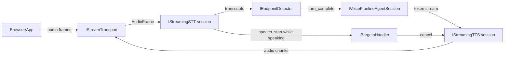
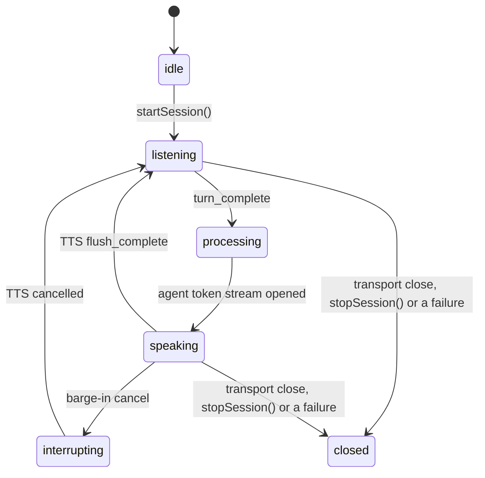

# Streaming voice pipeline

[`VoicePipelineOrchestrator`](https://github.com/framerslab/agentos/blob/master/src/io/voice-pipeline/VoicePipelineOrchestrator.ts) runs one spoken conversation over a transport. Audio frames from the client go to a streaming speech-to-text (STT) session; its transcripts go to an endpoint detector, which decides when the user's turn is over; the turn's text goes to an agent session; the reply's tokens go to a streaming text-to-speech (TTS) session; and its audio goes back through the transport. A barge-in handler decides what happens when the user speaks over the reply.

## Architecture



The orchestrator takes every component from the caller. `startSession(transport, agentSession, overrides)` throws when `overrides` lacks `streamingSTT` or `streamingTTS`, and, without `overrides.callProfile`, when it lacks `endpointDetector` or `bargeinHandler`; it resolves no provider from configuration or from installed extension packs. `overrides.diarizationEngine` is accepted and not used. One orchestrator runs one session; start another with a new instance. `overrides.callProfile` runs the session as one scoped call ([Call profile](#call-profile)); State Machine, Endpointing, Barge-in, WebSocket Messages and Failures describe a session without one, except where they name the call profile.

## State Machine



- On `turn_complete` the orchestrator sends `agent_thinking`, calls `agentSession.sendText(transcript, metadata)`, sends `agent_speaking` and pushes each token to TTS. When TTS reports `flush_complete` it sends `agent_done` with the spoken text and the played duration, resets the endpoint detector and returns to `listening`.
- On a barge-in `cancel` it cancels the TTS session, calls `agentSession.abort()`, sends `barge_in` and returns to `listening` at once. A decision the handler returns after the reply has ended is not acted on.
- A transport `close`, `stopSession()` or a failure (below) moves any state to `closed`. The orchestrator and the session it returned emit `close`; the orchestrator then calls `agentSession.abort()`, closes the STT and TTS sessions, resets the endpoint detector and closes the transport, unless the transport has closed itself. A pending `waitForUserTurn()` rejects, as does one called after the close.
- An `'error'` from the STT session, the TTS session, the transport or the endpoint detector, and a turn whose agent stream throws or whose TTS `flush()` rejects, end that session and no other. The orchestrator reports `Error('voice pipeline failed')` as its `'error'`, and as the returned session's `'error'` when that has a listener, or writes it as a console warning when nothing listens for the orchestrator's `'error'`; the report carries none of the failure's own text, which can hold what was said.
- While `listening`, a watchdog gives the endpoint detector a synthetic `speech_end` after `maxTurnDurationMs` (default `30000`); the detector decides whether that ends the turn.
- A send that the transport rejects, such as one on a WebSocket that is closing, is reported as the orchestrator's `'error'`, or written as a console warning when nothing listens for `'error'`; a failed send ends neither the turn nor the session. Each refused control message is reported; of a reply's audio, only the first refused chunk is. A call profile ends the call on a failed send instead.
- A `turn_complete` or `close` listener that throws or rejects is reported the same way, and the listeners after it still run.

## Quick Start

```typescript
import { randomUUID } from 'node:crypto';
import { WebSocketServer } from 'ws';
import { agent } from '@framers/agentos';
import {
  AgentSessionVoiceAdapter,
  DeepgramStreamingSTT,
  ElevenLabsStreamingTTS,
  HardCutBargeinHandler,
  HeuristicEndpointDetector,
  VoicePipelineOrchestrator,
  WebSocketStreamTransport,
} from '@framers/agentos/io/voice-pipeline';

const assistant = agent({ provider: 'openai', instructions: 'You are a voice assistant. Answer in short sentences.' });
const wss = new WebSocketServer({ port: 8765 });

wss.on('connection', async (ws) => {
  // The page sends 16 kHz mono 16-bit PCM as binary messages.
  const transport = new WebSocketStreamTransport(ws, { sampleRate: 16000, inboundEncoding: 'linear16' });
  const orchestrator = new VoicePipelineOrchestrator({ stt: 'deepgram', tts: 'elevenlabs', language: 'en-US' });

  await orchestrator.startSession(transport, new AgentSessionVoiceAdapter(assistant.session(randomUUID())), {
    streamingSTT: new DeepgramStreamingSTT({ apiKey: process.env.DEEPGRAM_API_KEY! }),
    streamingTTS: new ElevenLabsStreamingTTS({ apiKey: process.env.ELEVENLABS_API_KEY! }),
    endpointDetector: new HeuristicEndpointDetector(),
    bargeinHandler: new HardCutBargeinHandler({ minSpeechMs: 0 }), // see Barge-in
  });
});
```

`AgentSessionVoiceAdapter` sends each turn through `session.stream(text, { abortSignal })` and hands its text deltas to TTS. `abort()` aborts that signal, so the turn ends as an aborted `stream()` ends ([Cancellation](../getting-started/HIGH_LEVEL_API.md#cancellation)), and `whenIdle()` resolves once the turn's stream has unwound. One turn runs at a time: iterating a second `sendText()` while one is active throws. The config's `stt` and `tts` strings are required by the type and not read by the orchestrator; it reads `language` and `sttOptions` for the STT session, `voice`, `format`, `ttsOptions` and `ttsExpressiveness` for the TTS session, and `maxTurnDurationMs` for the watchdog.

`agent({ voice })` accepts a [`VoiceConfig`](https://github.com/framerslab/agentos/blob/master/src/api/types.ts) and does not read its fields, with one exception: `voice: { enabled: true, session: { factory, agent } }` binds a `VoiceSessionFactory` and a voice agent revision. That form refuses any other field in `voice` or `session`, `enabled: false` and `runtime: 'gmi'` at construction, and adds `voiceSession(request)`, which prepares the scoped call through `factory.startSession()` with the revision copied at construction. The agent's text calls stay text calls, and its exported configuration reads `voice` as `{ enabled: true }`. `agency({ voice: { enabled: true } })` adds `listen()`, which exchanges JSON text messages over a WebSocket and runs no speech recognition or synthesis ([Agency API](../orchestration/AGENCY_API.md)).

### Wunderland CLI

The [Wunderland](https://wunderland.sh) CLI's `chat --voice` starts a WebSocket voice server built on this orchestrator, with the reply streamed from the chat runtime and the model request aborted on barge-in ([flags](./TELEPHONY_PROVIDERS.md#wunderland-cli-flags)):

```sh
wunderland chat \
  --voice \
  --voice-stt=deepgram \
  --voice-tts=elevenlabs \
  --voice-endpointing=heuristic \
  --voice-barge-in=hard-cut \
  --voice-port=8765
```

## Components

| Interface | Implementations in AgentOS |
|-----------|---------|
| [`IStreamTransport`](https://github.com/framerslab/agentos/blob/master/src/io/voice-pipeline/types.ts) | `WebSocketStreamTransport`, `WebRTCStreamTransport`, `LiveKitStreamTransport`, `TelephonyStreamTransport` |
| [`IStreamingSTT`](https://github.com/framerslab/agentos/blob/master/src/io/voice-pipeline/types.ts) | `DeepgramStreamingSTT` (default model `nova-3`), `ElevenLabsStreamingSTT`, `OpenAIRealtimeTranscriptionSTT` (default model `gpt-4o-mini-transcribe`), `StreamingSTTChain` over several of them, and `ReconnectingSTT` over one |
| [`IEndpointDetector`](https://github.com/framerslab/agentos/blob/master/src/io/voice-pipeline/types.ts) | `HeuristicEndpointDetector`, `AcousticEndpointDetector` |
| [`IStreamingTTS`](https://github.com/framerslab/agentos/blob/master/src/io/voice-pipeline/types.ts) | `ElevenLabsStreamingTTS`, `DeepgramAuraStreamingTTS`, `CartesiaStreamingTTS`, `HumeStreamingTTS`, `OpenAIRealtimeTTS`, and `StreamingTTSChain` over several of them |
| [`IBargeinHandler`](https://github.com/framerslab/agentos/blob/master/src/io/voice-pipeline/types.ts) | `HardCutBargeinHandler`, `SoftFadeBargeinHandler` |
| [`IDiarizationEngine`](https://github.com/framerslab/agentos/blob/master/src/io/voice-pipeline/types.ts) | none in this package (see the diarization pack); the orchestrator does not call one |

`createVoiceProvidersFromEnv()` builds STT and TTS providers from the API keys in the environment.

## Endpointing

| Detector | The turn ends when | Text sent to the agent |
|------|-------------|---------|
| `HeuristicEndpointDetector` | speech ends and the last final transcript ends in `.`, `?` or `!`; otherwise after `silenceTimeoutMs` (default `1500`) of silence. When speech ends before any final, the first final that arrives before speech resumes is decided the same way when it arrives, the silence timeout still counted from the end of speech. Finals that carry an `itemId`, as those of `OpenAIRealtimeTranscriptionSTT` do (its final for an utterance follows the utterance's end of speech), are kept per item, and the turn is decided once every speech end the transcriber reported since it began has its final, the silence timeout counted from the last speech end: an utterance that starts before the previous one's final arrives stays in the same turn. A speech end whose final has not arrived within `silenceTimeoutMs` stops holding the turn, so an utterance that gets no final, such as a noise the provider found no words in, holds it for at most that long. A final that finds no speech end waiting answers one that stopped waiting without its final, if any, or else the next speech end the moment it comes, so a final that arrives before its end of speech, such as the one a listen session's stop flushes with client commits (`turnDetection: null`), decides the turn at that speech end without waiting. A speech end from a standalone VAD or from the orchestrator's `maxTurnDurationMs` watchdog (`source: 'vad'`) gets no final of its own and decides the turn on the finals held. Finals answer speech ends in the order they arrive, so a final that arrives more than `silenceTimeoutMs` after its own speech end can answer a later one and end the turn without that utterance's words ([#390](https://github.com/framerslab/agentos/issues/390)). After a reset of a turn in which speech started, including the one at each `turn_complete`, an item-keyed final that arrives before speech ends again, or before a standalone VAD (`source: 'vad'`) reports speech starting, is that turn's late final, including one that arrives while the transcriber reports the user's next utterance (it sends an utterance's final after that utterance's end of speech): it is dropped from the conversation's turns instead of joining the next turn or paying its speech end, and reported as `late_final`, which a listen session writes as its own turn | the last final transcript with text it received; with `itemId`s, the texts of the turn's finals that have words, each trimmed, joined by one space in the order their utterances began (by `startMs`; a final whose utterance has none keeps its place in the order the finals arrived). A final with no text adds nothing, and backchannel phrases such as "uh huh" are dropped |
| `AcousticEndpointDetector` | silence lasts `utteranceEndThresholdMs` (default `3000`) after speech ends | none: its `turn_complete` carries an empty transcript, and the orchestrator sends that empty text to the agent |
| `SemanticEndpointDetector` (pack `@framers/agentos-ext-endpoint-semantic`) | terminal punctuation as above; otherwise an LLM, called through the pack's `llmCall`, judges whether the turn is complete, with a silence timeout as the fallback | the transcript |

Without an `llmCall`, the semantic pack's classifier answers `INCOMPLETE` and the silence timeout ends every turn without terminal punctuation.

Without a call profile, the orchestrator feeds the detectors the STT session's `speech_start` and `speech_end` events; it runs no voice activity detection of its own. A call profile takes a VAD session and an audio endpoint detector instead ([Call profile](#call-profile)).

## Barge-in

Without a call profile, the orchestrator asks the barge-in handler when the STT session reports `speech_start` while the pipeline is `speaking`, and passes `speechDurationMs: 0`, since the speech has just started. A call profile measures the speech instead and needs no handler ([Call profile](#call-profile)).

| Handler | Decision | With the orchestrator |
|------|----------|----------|
| `HardCutBargeinHandler` | `cancel` when `speechDurationMs` is at least `minSpeechMs` (default `300`), else `ignore` | cancels only with `minSpeechMs: 0`; at the default it never cancels |
| `SoftFadeBargeinHandler` | `ignore` below `ignoreMs` (default `100`), `cancel` at `cancelMs` (default `2000`) or more, else `pause` with `fadeMs` (default `200`) | at the defaults it always ignores; with `ignoreMs: 0` it answers `pause` |

- `cancel`: the pipeline goes `interrupting` and back to `listening`, as described under State Machine.
- `pause`: the orchestrator sends `barge_in` with the action and keeps speaking; the client fades the audio. The orchestrator takes no action on a later `resume`.
- A `cancel` action carries `injectMarker: '[interrupted]'`; the client receives it in the `barge_in` message, and nothing writes it into the conversation history.
- There is no `disabled` handler, and the config's `bargeIn` field is not read. To never interrupt, pass a handler whose `handleBargein()` returns `{ type: 'ignore' }`.

## Extension Packs

These packs live in [agentos-extensions](https://github.com/framerslab/agentos-extensions/tree/master/registry/curated/voice). The orchestrator does not load packs: a host builds a pack's provider or detector and passes it in `overrides`.

| Pack | npm Package | Env Var |
|------|------------|---------|
| Deepgram streaming STT | `@framers/agentos-ext-streaming-stt-deepgram` | `DEEPGRAM_API_KEY` |
| Whisper streaming STT | `@framers/agentos-ext-streaming-stt-whisper` | `OPENAI_API_KEY` |
| OpenAI streaming TTS | `@framers/agentos-ext-streaming-tts-openai` | `OPENAI_API_KEY` |
| ElevenLabs streaming TTS | `@framers/agentos-ext-streaming-tts-elevenlabs` | `ELEVENLABS_API_KEY` |
| Speaker diarization | `@framers/agentos-ext-diarization` | — |
| Semantic endpointing | `@framers/agentos-ext-endpoint-semantic` | the key of the model behind `llmCall` |

## WebSocket Messages

`WebSocketStreamTransport` carries audio as binary messages and control as JSON text messages.

### Client → Server

- **Binary**: mono samples at the transport's `sampleRate`, as serialized `Float32Array` bytes by default, or as 16-bit little-endian PCM with `inboundEncoding: 'linear16'`.
- **Text**: JSON, emitted as the transport's `message` event. The protocol type names `{ type: 'config', config }` and `{ type: 'control', action: { type: 'mute' | 'unmute' | 'config' | 'stop' } }`; without a call profile the orchestrator acts on neither, so a host that offers them handles the event itself. A call profile acts on `control` with `mute`, `unmute` or `stop` and ends the call on any other message.
- **Transcript**: `{ type: 'transcript', text: 'Hello there.', itemId: '7', isFinal: true, confidence: 0.8, startMs: 1200, endMs: 2100, language: 'en' }`, from a client that transcribes on its own device.

A client that transcribes on its own device sends `transcript` messages ([`ClientTranscriptMessage`](https://github.com/framerslab/agentos/blob/master/src/io/voice-pipeline/types.ts)) in place of audio: every interim and the final of one line carry the same `itemId`, and `toClientTranscriptMessage()` makes one from a `TranscriptEvent`. Without a call profile, `VoicePipelineOrchestrator` checks each with `isClientTranscriptMessage()` and hands it to the endpoint detector as it does a transcript from its STT session, the client's lines standing in for speech start and end: the first line to open is a speech start (with barge-in while the agent speaks), and the final that closes the last open line is a speech end. Each final reaches the detector joined with the turn's earlier finals and without the line's `itemId`, so a turn of several lines reaches the agent whole, and a line that gets no message for five seconds is closed as by an empty final; a stop, or a transport close, ends every open line with the session. Nothing is echoed back. A call profile takes no transcripts from the client: a `transcript` message ends the call, as any message other than its three controls does. `WebSocketStreamTransport` and `LiveKitStreamTransport` deliver the message as `'message'`, as they deliver every JSON message; `WebRTCStreamTransport` emits its data channel's messages as `'control'`, which the orchestrator does not read.

### Server → Client

```typescript
{ type: 'transcript', text: 'Hello', isFinal: false, confidence: 0.92 }
{ type: 'agent_thinking' }
{ type: 'agent_speaking', text: '' }
{ type: 'agent_done', text: 'Hi there!', durationMs: 1840 }
{ type: 'barge_in', action: { type: 'cancel', injectMarker: '[interrupted]' } }

// Binary messages: each TTS audio chunk, in the TTS provider's output format
```

The protocol type also declares `session_started`, `error` and `session_ended` messages, which the orchestrator does not send. Under a call profile each message also carries the call's `scopeId`, `callId` and `generation`, and no message of a generation the call has left is sent.

## LiveKit Rooms

A listener that joins a meeting on a person's behalf is the meeting channel: see [Meeting bots](MEETING_BOTS.md).

An agent that joins a LiveKit room as a participant hears a person through [`LiveKitRoomAudioSource`](https://github.com/framerslab/agentos/blob/master/src/io/hearing/LiveKitRoomAudioSource.ts) and exchanges control messages with their page through [`LiveKitStreamTransport`](https://github.com/framerslab/agentos/blob/master/src/io/voice-pipeline/LiveKitStreamTransport.ts), which with its `publisher` option also speaks to them ([Speaking in the room](#speaking-in-the-room)). Both run in Node on `@livekit/rtc-node` (`^1.1.0`), an optional peer dependency: install it beside AgentOS with `npm install @livekit/rtc-node`. Without it, the source's first read throws an error that names the package, and a listen-only transport emits that error as `'error'`, or writes it as a console warning when nothing listens for `'error'`, and closes; a speaking transport emits `livekit input failed` instead and closes, and its `readyForPlayback()` rejects.

```typescript
import * as rtc from '@livekit/rtc-node';
import { LiveKitRoomAudioSource } from '@framers/agentos/io/hearing/livekit';
import { OpenAIRealtimeTranscriptionSTT } from '@framers/agentos/io/voice-pipeline';

const source = new LiveKitRoomAudioSource({
  room, // a connected rtc-node Room
  participantIdentity: 'user-1',
  sampleRate: 24_000, // the rate the STT takes
  rtc, // optional: the rtc-node module this process already imports
});

const stt = new OpenAIRealtimeTranscriptionSTT({ apiKey: process.env.OPENAI_API_KEY! });
const session = await stt.startSession({ language: 'en' });
for await (const frame of source) session.pushAudio(frame);
```

The source opens rtc-node's `AudioStream` on the participant's microphone track (the audio publication whose source is the microphone; a screen share's audio is passed over) at the requested sample rate and one channel, and yields `AudioFrame`s: Float32 samples in [-1, 1], with the participant's identity as `speakerHint`. When the participant's track is unpublished and a new one is published, as when their page reconnects, reading moves to the new track; `trackSid` names the track being read. It ends when `close()` is called, when a `for await` loop leaves, or when the room disconnects, a room that is not connected at the first read included. A source has one reader. `close()` stops the reading at once and cancels rtc-node's reader on the next microtask; `whenClosed()` resolves when that cancellation is acknowledged, rejects when it fails, and rejects before `close()`. With `strictMono: true`, which a speaking transport sets, a frame that arrives at another rate or channel count than the source asked rtc-node for, or whose data does not hold exactly `samplesPerChannel` samples, is refused: the read rejects with `livekit input format refused` and the source closes.

`LiveKitStreamTransport` implements `IPlaybackTransport` over the same room: `'audio'` carries the participant's frames, `sendControl()` sends a JSON message to the participant as a text stream on a topic (`'agentos.voice'` unless `topic` says otherwise), and a JSON message the participant sends on that topic arrives as `'message'`. Another sender's text stream on the topic is closed unread. Without the `publisher` option it does not publish audio: `sendAudio()` and `waitForPlayback()` reject, and a caller that does not wait for the `sendAudio()` promise raises no unhandled rejection, so a `VoicePipelineOrchestrator` given this transport hears the participant and sends its control messages, and its speech is not heard; the orchestrator reports the first refused chunk of each reply, as it reports any failed send, and not the rest of that reply's chunks. `close()` leaves the room connected and closes the text streams still arriving; `whenClosed()` then resolves once the source's reader has acknowledged its cancellation, the input loop has ended and the text streams are closed, and rejects with `livekit cleanup incomplete` when one of them failed; the transport also emits that error as `'error'`, or writes it as a console warning when nothing listens for `'error'`.

When a consumer emits `'pause'` on the transport, it holds up to two seconds of audio (`bufferMs`, default `2000`, a finite number of zero or more; the constructor throws otherwise), drops the oldest frames beyond that limit, and on `'resume'` reports any dropped audio as `'gap'` with `{ droppedMs, reason: 'paused' }` before emitting the held frames in order. A consumer that pauses again while the held frames are emitted stops them there, and the rest stay held for the next `'resume'`. `close()` drops what the transport held: a closed transport emits no held audio and no gap.

`@framers/agentos/io/hearing/livekit` exports both, with `loadLiveKitRtc()` and the structural types the two accept (`LiveKitRoomLike`, `LiveKitRtcModule` and their parts), which a real rtc-node `Room` and module satisfy as they are.

### Speaking in the room

With the `publisher` option, `LiveKitStreamTransport` also speaks to the participant, on one track that the room's local participant publishes. It is built for a call profile ([Call profile](#call-profile)): its input must be mono at 16 kHz (`sampleRate: 16000`; the constructor throws `invalid livekit input bound` otherwise), its source runs with `strictMono`, and every chunk it plays is acknowledged by the page that hears it.

```typescript
import * as rtc from '@livekit/rtc-node';
import { LiveKitStreamTransport } from '@framers/agentos/io/hearing/livekit';

const transport = new LiveKitStreamTransport({
  room, // a connected rtc-node Room; its local participant publishes the track
  participantIdentity: 'user-1',
  sampleRate: 16_000, // a speaking transport takes mono 16 kHz input
  rtc,
  publisher: {
    scopeId: 'scope-a',
    callId: 'call-a',
    generation: () => currentGeneration, // the call's VoiceGeneration, read at every admission and after each native step
    sampleRate: 48_000, // the published track's rate: 16000, 24000 or 48000
    maxBytes: 256_000, // a chunk's PCM bytes plus the bytes it is resampled to
    maxDurationMs: 2_000, // a chunk's longest audio and the native queue's length, at most 2000
    receiptTimeoutMs: 5_000, // the deadline of a receipt, a drain and a clear, from 1 to 30000; above a chunk's playing time
    rtc, // optional: imported on first use when omitted
  },
});
await transport.readyForPlayback(); // publishes the track; the call counts as connected only after this
```

- **Readiness.** `readyForPlayback()` creates one native `AudioSource` (one channel at the track's rate), one `LocalAudioTrack` and one publication with the microphone source, once; later calls share that work, and a closed transport rejects it. A host records the call as connected only after it resolves: `CallTransportBinding` awaits it before it starts or reattaches the pipeline. A listen-only transport resolves it at once and allocates nothing.
- **Audio.** `sendAudio(chunk)` takes a chunk that carries the publisher's `scopeId` and `callId`, the generation `generation()` returns and a positive whole `sequence`. The chunk is 16-bit PCM from 8000 to 192000 Hz: `format: 'pcm'` with `container: 'raw'` (the default) or `container: 'wav'` (a PCM16 mono WAV at the declared rate, whose header is read once and never played), and a `durationMs` within a millisecond of its samples; MP3 and Opus are refused with `UnsupportedAudioFormatError`. These checks and the bounds run before any native call, so a refused chunk publishes nothing. The samples are converted to 16-bit integers once and, when their rate differs from the track's, resampled by one `AudioResampler` that is pushed, flushed and closed for that chunk. The publisher then sends the participant an `audio` message on the topic (`scopeId`, `callId`, `generation`, `sequence`, `publicationId`, `encoding: 'pcm16le'`, `channels: 1`, `samples`, `sampleRate`, `publishedSamples`, `publishedSampleRate`), captures the frames one at a time, and resolves when the last capture has returned. A generation change, at admission or after any native step, cancels the chunk. One chunk is outstanding at a time: another is refused until the first's `waitForPlayback()` has settled or a `clearPlayback()` has finished.
- **Playback.** `waitForPlayback(generation, sequence, signal)` resolves with the chunk's `PlaybackReceipt` only when the native queue has drained (`AudioSource.waitForPlayout()`) and the participant has answered `{ type: 'playback', generation, sequence, playedSamples, sampleRate }` with the chunk's own sample count and rate; an aborted `signal` rejects it. The receipt's deadline of `receiptTimeoutMs` runs from the chunk's admission and the wait's from its call, so the deadline must exceed the longest chunk's playing time and the page's delay. rtc-node's drain is local bookkeeping and does not count as playback on its own.
- **Clearing.** `clearPlayback(generation)` cancels the chunk at once: it clears the native queue, waits for a capture in flight to return, clears the queue again, sends `{ type: 'clear', generation, clearId }` and resolves when the participant answers `{ type: 'cleared', generation, clearId }`. The next generation's chunk is admitted after that.
- **The page.** The page that plays the track matches each `audio` message to the audio it receives, answers `playback` once that audio has played and `cleared` once it has discarded the generation's audio. Without those answers, `waitForPlayback()` and `clearPlayback()` reject at their deadline.
- **Control.** The participant's text streams are read through their async iterator: at most 4096 bytes within five seconds each, four at once. A `playback` or `cleared` receipt goes to the publisher and a `control` message with `mute`, `unmute` or `stop` arrives as `'message'`. Any other message, a `transcript` included, a stream past a bound and a fifth stream at once are reported as `'error'` (`livekit control refused`) and close the transport. `sendControl()` sends at most 16384 bytes a message and four at once (`livekit control bound` otherwise), and a send not done within five seconds closes the transport.
- **Loss and closing.** The selected participant leaving the room (`participantDisconnected`) closes the transport, and the room stays connected. Errors carry fixed messages (`livekit input failed`, `livekit control refused`, `livekit cleanup incomplete`), and one that nothing listens for is dropped. `whenClosed()` resolves once the input reader's cancellation, the input loop, the text streams, the unpublication and the closing of the track and the native source have all finished, and rejects with `livekit cleanup incomplete` when any of them failed; a host's media cleanup awaits it before it releases what the call holds.

### Transcripts in the room

`LiveKitTranscriptionOutput` (in `@framers/agentos/io/hearing/livekit`) writes a speech-to-text session's transcripts into the room as LiveKit's own transcription output does, so a page's standard `lk.transcription` handler shows them: each interim and each final is a text stream with the line's whole text and the attributes `lk.segment_id` (the transcript's `itemId`), `lk.transcription_final` (`'true'` on the final) and `lk.transcribed_track_id`. A final whose transcript has `startMs` and `endMs` also carries `agentos.start_ms` and `agentos.end_ms` (`TRANSCRIPTION_TIME_ATTRIBUTES`, exported from `@framers/agentos/io/voice-pipeline` and `@framers/agentos/io/voice-pipeline/browser`): the line's start and end on the session's audio clock, rounded to whole milliseconds and written in decimal digits; an interim carries neither. It keeps the finals, and `replayAfter(itemId, identity)` sends that participant the finals after the line the page names, each with the times it was first written with, a line taken back among them as its empty final, so a page that reconnects is whole again. The page names the line its own ledger's `resumeAfterId()` gives, the last final before its first line still being heard, since completion events from different turns can arrive out of order; a final it already holds comes again and is dropped.

```typescript
import { LiveKitTranscriptionOutput } from '@framers/agentos/io/hearing/livekit';

const output = new LiveKitTranscriptionOutput({
  room, // a connected @livekit/rtc-node Room
  trackSid: () => heardTrack?.sid, // the track the session hears
});
session.on('transcript', (event) => {
  output.write(event).catch((error) => console.warn('transcript not sent', error));
});
```

The output takes the room through a structural type and imports no LiveKit package. Writes go out in the order they were asked for. A send that fails rejects its write and leaves the line in the output's ledger, so writing the same transcript again sends nothing; `replayAfter` sends a final again to a participant. A transcript from a provider that does not key its results carries no `itemId`: give the line's id as `write(event, { itemId })`.

On the page, `TranscriptLedger` (in `@framers/agentos/io/voice-pipeline/browser`) folds the streams into lines:

```typescript
import { LIVEKIT_TRANSCRIPTION_TOPIC, TranscriptLedger, transcriptEventFromLiveKit } from '@framers/agentos/io/voice-pipeline/browser';

const ledger = new TranscriptLedger();
room.registerTextStreamHandler(LIVEKIT_TRANSCRIPTION_TOPIC, async (reader) => {
  const event = transcriptEventFromLiveKit(await reader.readAll(), reader.info.attributes);
  if (event && ledger.apply(event)) render(ledger.items());
});
```

A line the provider could not transcribe arrives as an empty final with `agentos.transcription_failed` holding a short reason; an empty final without it takes back the text the line showed, and the ledger hides the line. `transcriptEventFromLiveKit()` reads a final's `agentos.start_ms` and `agentos.end_ms` into the event's `startMs` and `endMs`, so the ledger's line holds the times its final carried; a value that is not whole milliseconds in decimal digits is ignored, and its field stays undefined.

## Listening without speaking

[`startListenSession(transport, sink, overrides)`](https://github.com/framerslab/agentos/blob/master/src/io/voice-pipeline/ListenSession.ts) runs a session that only listens: the transport's audio goes to a streaming transcriber, and each final goes to a sink as a numbered turn. It takes no TTS, no barge-in handler and no agent session, and the endpoint detector is optional; `streamingSTT` and `runId` are the only fields `overrides` requires.

```typescript
import {
  DeepgramStreamingSTT,
  startListenSession,
  type ITranscriptInputSink,
  type TranscriptTurn,
} from '@framers/agentos/io/voice-pipeline';

const stored: TranscriptTurn[] = [];
const sink: ITranscriptInputSink = {
  async append(turn) {
    stored.push(turn);
  },
  // Numbers each final as its run's next turn (one run here).
  async appendNext(input) {
    const seq = stored.length + 1;
    const turn = { ...input, seq, turnId: `${input.runId}:${seq}` };
    stored.push(turn);
    return turn;
  },
};

const session = await startListenSession(transport, sink, {
  streamingSTT: new DeepgramStreamingSTT({ apiKey: process.env.DEEPGRAM_API_KEY! }),
  runId: 'run-1',
});
session.on('turn', (turn: TranscriptTurn) => render(turn));

// At the end: flush the transcriber and write its last final.
await session.close('stopped');
```

- **Turns.** Without an endpoint detector, each final of the transcriber is a turn, with the final's `startMs` and `endMs`. With `overrides.endpointDetector`, the detector's `turn_complete` is the turn; the session gives the detector the transcriber's transcripts and its `speech_start` and `speech_end`, as the orchestrator does. A final the detector reports as `late_final`, one that arrived after its turn completed and that no turn takes, is written as a turn of its own with the final's `startMs` and `endMs`, so its words are not lost; one with no words writes nothing. When the detector supplies empty text, as `AcousticEndpointDetector` does, the turn uses the STT finals since the previous turn, joined with spaces, with the first final's `startMs` and the last final's `endMs`. Interim hypotheses are excluded; an empty detector turn with no final text writes nothing.
- **The sink numbers them.** `appendNext(input)` takes an unnumbered final (`TranscriptInput`) and returns the stored `TranscriptTurn` with its run's next `seq` and the id `<runId>:<seq>`, or `undefined` when it drops the turn. The session writes one turn at a time, in arrival order, so a second listen session on the same run continues the run's sequence where the sink left it.
- **Backpressure.** When `sinkQueueLimit` finals (default `8`) wait for the sink, the session emits `pause` on the transport and `paused` on itself, then `resume` and `resumed` once the queue is down to half. Every ending path also releases an outstanding pause exactly once, so a caller-owned transport can be reused. No final is dropped for a slow sink. Frames a transport sends while asked to pause still reach the transcriber, and `stats().dropped` counts them.
- **The end.** `close('stopped')`, the default, first releases a pause the session asked for, so the audio a transport held while paused reaches the transcriber, then moves the session to `draining`: the transcriber is flushed and finals that arrive within `drainMs` (default `250`) are still accepted. A pending detector turn then has up to its `turnCompletionTimeoutMs`, plus one timer tick, to complete before reset: the heuristic detector exposes its configured silence timeout; the acoustic detector includes its silence threshold and polling interval. Detectors that omit the bound receive `3250` ms. If the provider has not reported speech ending, stop supplies `speech_end`. The turn and sink queue are written out before `ended`. `close('purged')` drains nothing and drops the finals waiting for the sink. The session also ends by itself with `stt_failed` (the transcriber failed for good), `transport_closed`, `transport_failed` (a transport error, included as `ended.error`) or `sink_failed` (the sink threw). It ends once, closes the transcriber, removes its transport listeners and leaves the transport open.

| Event | Payload | When |
|---|---|---|
| `turn` | `TranscriptTurn` | the sink stored a turn |
| `interim` | `TranscriptEvent` | the transcriber emitted an interim hypothesis |
| `stt:reconnected`, `stt:gap` | `SttReconnectedEvent`, `SttGapEvent` | the transcriber reconnected (below) |
| `paused`, `resumed` | none | the sink fell behind, then caught up or the session released the pause on ending |
| `ended` | `{ reason, error? }` | the session ended; `state` is `ended` |

### A transcriber that reconnects

Unless `overrides.reconnect` is `false`, the listen session wraps its transcriber in [`ReconnectingSTT`](https://github.com/framerslab/agentos/blob/master/src/io/voice-pipeline/ReconnectingSTT.ts), and `reconnect` may carry its options. A `StreamingSTTChain` of several providers is passed with `reconnect: false`, since the chain fails over by itself. `ReconnectingSTT` is an `IStreamingSTT` of its own and wraps any one provider:

| Option | Default | Effect |
|---|---|---|
| `maxAttemptsPerMinute` | `3` | Reconnects allowed in any sixty seconds; past them the session emits `error`, then `close`, and a listen session ends with `stt_failed`. |
| `ringBufferCapacityMs` | `3000` | Audio kept for replay into the new session. |
| `minReplayMs` | `400` | Less buffered audio than this is not replayed. |
| `queueCapacityMs` | `2000` | Audio queued while a reconnect runs; beyond it the oldest frames are dropped and counted in the session's `droppedFrames`. |
| `clock` | `Date.now` | The time for the attempt window and the gap. |

When the provider's session errors or closes without the caller asking, a new session of the same provider opens and hears the replayed audio first, then the frames that came meanwhile, then live audio. Each session's `startMs` and `endMs` are moved onto one timeline, the audio pushed since the session began. Queue overflow leaves a gap after the replay: with one second buffered and three seconds arriving into a two-second queue, the replay remains at 0–1000 ms and the retained queue starts at 2000 ms. End bounds are exclusive, so a final ending exactly at the replay boundary keeps its original end time.

`TranscriptDedupe` drops a final that repeats one already emitted over the same audio. Only finals with finite `startMs` and `endMs` and `endMs > startMs` enter its history; other finals bypass it without accumulating retained observations. `OpenAIRealtimeTranscriptionSTT` reports these bounds, while `DeepgramStreamingSTT` and `ElevenLabsStreamingSTT` do not, so with those a final transcribed again from the replay can arrive twice. Each reconnect emits `stt:reconnected` (`{ attempt, replayedMs }`) and `stt:gap` (`{ attempt, lostMs }`, the time the reconnect took).

A `flush()` during reconnect waits for the replacement and its replay and queued audio, then flushes that session. A close during the flush, or after it before further provider activity or pushed audio, ends the stream without reconnecting. A transcript, speech event, usage report or warning after a completed flush clears that terminal-close expectation, so a later close-only network failure reconnects. Deepgram can end its stream while flushing ([CloseStream](https://developers.deepgram.com/docs/close-stream)).

`startSession({ call })`, with an [`AudioIdentity`](https://github.com/framerslab/agentos/blob/master/src/io/voice-pipeline/types.ts) as `call`, opens the scoped path ([`scopedReconnect.ts`](https://github.com/framerslab/agentos/blob/master/src/io/voice-pipeline/scopedReconnect.ts)) instead; a [call profile](#call-profile) opens its STT session with the call's identity, so a `ReconnectingSTT` given as its `streamingSTT` takes this path. The provider's sessions must implement `pushAudioScoped()` and `reset()` ([`ScopedStreamingSTTSession`](https://github.com/framerslab/agentos/blob/master/src/io/voice-pipeline/types.ts)), or `startSession()` rejects. The session takes frames through `pushAudioScoped()` alone, and only those that carry its current scope, call, recognition turn and generation; `pushAudio()` throws. A reconnect opens the same provider, resets it to the current identity and, when at least `minReplayMs` is kept, replays the kept frames of that identity with the identity each was admitted with; it never changes provider. `reset(identity)` takes the same scope and call only, drops the kept frames and refuses frames of the earlier identity from then on. A transcript is passed on only from the provider's current session and only when it carries the current identity; its times are passed on unchanged and no dedupe runs. `queueCapacityMs` bounds the admitted audio not yet handed to the provider: a frame past it is refused (`recognition input bound`) rather than dropped, so the session has no `droppedFrames`. A reconnect whose session fails to open ends the session (`error`, then `close`) without a retry. `stt:reconnected` and `stt:gap` are emitted as above.

## Speech-to-text in the browser

`@framers/agentos/io/voice-pipeline/browser` is the entry a browser bundle imports: its modules import no Node built-in and no package statically, and the one package any of them loads at run time is `@moonshine-ai/moonshine-wasm`, which `MoonshineBrowserSTT` imports on first use when no `moonshine` option is given. `@framers/agentos/io/voice-pipeline` exports them as well.

[`MoonshineBrowserSTT`](https://github.com/framerslab/agentos/blob/master/src/io/voice-pipeline/providers/MoonshineBrowserSTT.ts) transcribes on the user's own device. It runs [Moonshine](https://github.com/moonshine-ai/moonshine)'s streaming models (MIT) in the browser through `@moonshine-ai/moonshine-wasm`, so the audio stays on the device and no service is paid per hour. It implements `IStreamingSTT`, so its sessions fit `StreamingSTTChain` like any other provider's, and the page sends the server text in place of audio (see the `transcript` message under [WebSocket Messages](#websocket-messages)).

```bash
npm install @framers/agentos @moonshine-ai/moonshine-wasm
```

The package is an optional peer dependency (MIT, with no dependencies of its own), so an install of AgentOS alone leaves it out.

```typescript
import {
  MoonshineBrowserSTT,
  checkMoonshineBrowserSupport,
  toClientTranscriptMessage,
} from '@framers/agentos/io/voice-pipeline/browser';

if (checkMoonshineBrowserSupport().supported) {
  const stt = new MoonshineBrowserSTT({
    // index.js of the package's dist folder, served whole (see "Serving the package")
    moonshine: () => import(/* webpackIgnore: true */ /* @vite-ignore */ moonshineIndexUrl),
    context: noteTitles.join('\n'), // names and terms from the user's own notes
    onProgress: ({ fraction }) => showProgress(fraction), // undefined until the total is known
  });
  await stt.load(); // downloads once, before the user starts; the browser caches the files

  const session = await stt.startSession({ language: 'en' });
  session.on('transcript', (event) => {
    showLine(event.itemId, event.text, event.isFinal); // one line keeps one itemId
    socket.send(JSON.stringify(toClientTranscriptMessage(event))); // the server gets text, not audio
  });
  session.pushAudio(frame); // mono Float32 at any sample rate
  await session.flush(); // completes the open line; the session stays open
  session.close();
  stt.dispose(); // releases the model and the worker
}
```

In a page the model runs in the package's own Web Worker, so a transcription pass never blocks the page; inside a worker of the host's it runs on that worker's thread. Every transcript carries `itemId` (Moonshine's line id), `startMs` and `endMs` on the session's audio clock, and `language`. `flush()` completes the open line and keeps the session open; `close()` ends it at once, and an open line gets an empty final, which retracts its interim text. A transcription failure emits `error`, or writes a console warning when nothing listens for `'error'`, then `close`. A listener that throws on one of these last events (an open line's empty final, `error`, `close`) is written as a console warning; the listeners after it still run, and the session still closes. A model that cannot load rejects `startSession()`, so a `StreamingSTTChain` moves to its next provider, a smaller size (under a [`ProviderPolicy`](#provider-policy), only one the policy permits); to use the server's transcription instead, the page sends audio. Over a WebSocket the page sends each message as a text frame; in a LiveKit room it sends it as a text stream on `LiveKitStreamTransport`'s topic (`'agentos.voice'` unless the server names another).

| Option | Default | Effect |
|--------|---------|--------|
| `model` | `'auto'` | `'moonshine-medium'`, `'moonshine-small'`, `'moonshine-tiny'`, or `'auto'` for the size the device runs. |
| `language` | `'en'` | The model's language; a session that asks for another is refused. |
| `modelBaseUrl`, `modelFileNames`, `modelBytes` | the package's CDN | The host's own copy of the files, at `<modelBaseUrl>/<size>-streaming-<language>/<file>` (the seven names in `MOONSHINE_STREAMING_MODEL_FILES`), and each size's total bytes, so progress has a fraction. |
| `keyterms`, `context`, `contextMaxTerms` | none, none, `200` | Terms to bias the transcription towards (no term may contain a comma), and a passage whose unusual words become such terms. |
| `onProgress` | none | `{ model, loaded, total, fraction, file }` as the model downloads; a cached file counts at once. |
| `thread` | `'auto'` | `'worker'` (the package's Web Worker), `'calling'` (the calling thread), or `'auto'` (the worker in a page). |
| `wasmBaseUrl` | the package's folder | Where the package's worker finds `moonshine.wasm`. |
| `singleThreadBuild` | `false` | The page serves a single-thread build of the package, so `healthCheck()` asks for no cross-origin isolation. |
| `moonshine` | imported by name on first use (Node, or a page with an import map) | The package, or a function that imports it from where the page serves its `dist` folder. |
| `device` | read from the browser | The signals `'auto'` picks the size by. |

### Input level

```typescript
import { InputSilenceWatch, inputLevelDb } from '@framers/agentos/io/voice-pipeline/browser';

const watch = new InputSilenceWatch(); // heard above -60 dBFS, dead at or below -150 dBFS, after 5 seconds
watch.reset(performance.now()); // a new input, not heard yet

// for each block of samples the page captures:
const level = inputLevelDb(block); // dBFS; -Infinity for a block of zeros
drawMeter(level);
showNoSoundNotice(watch.push(level, performance.now()));
```

`inputLevelDb(samples)` is a block's level in decibels of full scale, from its root mean square: `0` for samples at full scale, `-Infinity` for an empty block or a block of zeros. `InputSilenceWatch` takes each block's level with its time and answers whether no sound reaches the page from the input in use, by two rules:

- nothing above `heardAboveDb` (`-60` unless set) for `afterMs` (`5000` unless set) since the input was chosen;
- a dead signal, at or below `deadAtOrBelowDb` (`-150` unless set), for `afterMs` at any time, counted from its first block.

A quiet pause after the input was heard is not silence, since a capture with noise suppression reads low between words. `reset(atMs)` starts a new input, not heard yet; `restart(atMs)` counts afresh on the same input, after a pause in listening, and keeps whether it was heard.

### A sentence said aloud

```typescript
import { phraseHeard } from '@framers/agentos/io/voice-pipeline/browser';

const notice = 'This call is transcribed. Tell me if you would rather it was not.';
const { heard, ratio, itemIds } = phraseHeard(notice, ledger.finalsAfter(undefined)); // the ledger's final lines, in order
```

`phraseHeard(phrase, lines, { threshold, maxWords, maxPhraseWords })` answers whether a sentence a speaker was asked to say, such as a recording notice or an enrollment phrase, is in a transcript's first lines. A line is any `{ itemId, text }`, so a `TranscriptLedger`'s lines fit as they are. It joins the lines' words in order, reads at most `maxWords` of them (`400` unless set) and no further into a line than the last of those, and counts the most of the phrase's words they hold in order, other words between them allowed (the longest common subsequence of words):

- `ratio` is that count over the phrase's word count, from `0` to `1`;
- `heard` is `true` when `ratio` is at or above `threshold` (`0.8` unless set);
- `itemIds` names the lines that held a matched word, in order, each once.

Words are lower-case runs of letters and digits (`lexicalTokens`, the library's word rule), so case, punctuation and spacing are ignored and an apostrophe splits a word: "doesn't" is the two words "doesn" and "t", which "does not" does not match. Nothing is stemmed. A phrase with no words throws an `Error`. A phrase of more than `maxPhraseWords` words (`400` unless set) throws a `RangeError`, which keeps the comparison within `maxPhraseWords` words of the phrase and `maxWords` words of the lines however long either is. A `threshold` outside `0` to `1`, a `maxWords` that is not a whole number, `0` or more, and a `maxPhraseWords` that is not a whole number, `1` or more, throw a `RangeError` too. The function is pure, so a server and a page that read the same lines reach the same answer.

### Capture on the page

`AudioWorkletCapture` (in `@framers/agentos/io/hearing/capture`) hands a page's audio to its listeners as mono Float32 blocks with the context's sample rate, the samples a streaming session's `pushAudio` takes. It reads the audio off the page's main thread through an `AudioWorkletNode`: the `MediaStream` goes through `createMediaStreamSource` into the worklet, whose processor mixes its input's channels to their mean and posts a block each time it holds `blockSize` samples (2048 unless set, about 43 ms at 48 kHz; a size that is not a positive whole number throws a `RangeError` when the capture is made). The worklet's one output goes to the context's destination through a gain of zero, so the page plays nothing.

```typescript
import { AudioWorkletCapture } from '@framers/agentos/io/hearing/capture';

const context = new AudioContext();
const stream = await navigator.mediaDevices.getUserMedia({ audio: true });
const capture = new AudioWorkletCapture({ context, stream, moduleUrl: '/audio/capture-worklet.js' });
capture.onBlock((samples, sampleRate) => session.pushAudio({ samples, sampleRate, timestamp: Date.now() }));
await capture.start(); // loads the module, once per context, and builds the path

capture.setStream(otherStream); // another microphone, or a mix the page made, on the same node
capture.stop(); // every node disconnected and every listener removed; no block is handed on after it
```

The blocks keep the context's sample rate, which a frame built from them carries in `sampleRate`. `DeepgramStreamingSTT` and `ElevenLabsStreamingSTT` read their audio as 16 kHz whatever a frame's `sampleRate` says, so blocks bound for them are resampled to 16 kHz first.

A second `start()` leaves a running capture as it is, and a `stop()` while the module loads leaves nothing built. `stop()` removes the listeners as well, so a capture started again hands its blocks to the listeners added after it. `stop()` also posts the worklet's processor a stop message: its `process()` then answers `false`, so the browser can end the node, which no longer has an input. A `start()` that fails, on a module that did not load or a stream with no audio track, leaves nothing connected, and the next `start()` tries again. A `setStream()` keeps the samples the worklet holds toward its next block, which open the first block after the change, so no sample the worklet took in before the change is dropped. Given a stream with no audio track, `setStream()` throws, and the capture keeps hearing the stream it had.

The worklet module is `capture-worklet.js`, the file beside the entry's own in the package's `dist`. It imports nothing, so the host copies it into its static files at build time and passes its address as `moduleUrl`. A worklet's module is a script to the page's content security policy, so a page whose policy allows scripts from its own origin alone serves the file there.

```typescript
// A build step in Node: copy the worklet module into the site's static files.
import { copyFile } from 'node:fs/promises';

const entry = import.meta.resolve('@framers/agentos/io/hearing/capture');
await copyFile(new URL('./capture-worklet.js', entry), 'public/audio/capture-worklet.js');
```

`AudioProcessor` (in `@framers/agentos/io/hearing`) is the older capture: it reads the audio through a `ScriptProcessorNode` on the page's main thread, a node deprecated in favour of `AudioWorkletNode` ([MDN](https://developer.mozilla.org/en-US/docs/Web/API/ScriptProcessorNode)), and feeds its frames to `EnvironmentalCalibrator` and `AdaptiveVAD`.

### The browser entry

The entry's modules import no Node built-in and no package statically: a test walks its built module graph (static imports and re-exports, and dynamic imports of a literal path) and fails on any import that is not one of the library's own. `MoonshineBrowserSTT` imports its optional peer through a variable specifier when the host passes no `moonshine` option, which resolves in Node and on a page with an import map; a bundled page passes `moonshine`. The entry also exports every type of the streaming contracts (the voice pipeline's [`types.ts`](https://github.com/framerslab/agentos/blob/master/src/io/voice-pipeline/types.ts)), `StreamingSTTChain` with its parts (`CircuitBreaker`, `VoiceMetricsReporter`, `VoicePipelineError`, `AggregateVoiceError`, `defaultCapabilities`, `supportsLanguage`), `VoiceEventEmitter` (an event emitter with Node's semantics; the contracts extend its interface, `EventEmitterLike`, which Node's `EventEmitter` satisfies), `MoonshineBrowserSTT` with its helpers, and `toClientTranscriptMessage()`, `isClientTranscriptMessage()` and `transcriptEventFromClient()`. `@framers/agentos/io/voice-pipeline` exports all of it too, beside the providers, transports and orchestrator that run on a server. The test holds the run-time graph, not the typings: `types.ts` names Node's global `Buffer` type (`EncodedAudioChunk.audio`, `BatchTTSResult.audio` and `IBatchSTT.transcribe()`), so a project that checks the library's typings with `skipLibCheck` off needs `@types/node`.

### Serving the package

`@moonshine-ai/moonshine-wasm` starts its Web Worker (`stt-worker.js`) and loads its WebAssembly (`moonshine.mjs`, `moonshine.wasm`) from files beside its own module, so the page serves the package's `dist` folder whole: copy `node_modules/@moonshine-ai/moonshine-wasm/dist` into the page's static files at build time, or take the published folder from a CDN as the package's own demos do, and import that folder's `index.js` by its URL (`moonshineIndexUrl` above, for example `'/moonshine/index.js'`), with the comments that tell webpack and Vite to leave the import as it is. A bundle that takes the package in does not build its worker: the worker's URL is held in a variable, and neither webpack nor Vite follows a `Worker` built that way ([webpack](https://webpack.js.org/guides/web-workers/), [Vite](https://vite.dev/guide/features.html#web-workers)).

### What the page needs

```text
Cross-Origin-Opener-Policy: same-origin
Cross-Origin-Embedder-Policy: require-corp
```

The package's default build runs WebAssembly SIMD with threads. Threads need `SharedArrayBuffer`, which a browser gives only to a [cross-origin isolated](https://developer.mozilla.org/en-US/docs/Web/API/Window/crossOriginIsolated) page, so the page is served with both headers ([the package's README](https://github.com/moonshine-ai/moonshine/blob/main/language-bindings/wasm/README.md#cross-origin-isolation-required-for-the-default-build)). Under `require-corp`, a cross-origin resource the page loads without CORS (an image, or a script without `crossorigin`) loads only when its server sends a `Cross-Origin-Resource-Policy` header that allows it, and one requested with CORS needs its server's CORS permission ([MDN](https://developer.mozilla.org/en-US/docs/Web/HTTP/Reference/Headers/Cross-Origin-Embedder-Policy)). The package fetches the model files with CORS, and its CDN allows any origin; a host's own copy on another origin allows the page's. Safari does not support `credentialless`, so `require-corp` is the value for every engine. The default build runs in Chrome 91, Firefox 114 and Safari 16.4 and later.

A page that cannot be cross-origin isolated serves a single-thread build of the package, which needs SIMD alone: build it from the package's source with `scripts/build-wasm.sh single-thread`, as [its README](https://github.com/moonshine-ai/moonshine/blob/main/language-bindings/wasm/README.md#building-from-source) shows, and pass `singleThreadBuild: true`.

`checkMoonshineBrowserSupport()` reports, with no download, whether the provider can run where it is called, before a host chooses it:

```typescript
const support = checkMoonshineBrowserSupport(); // { singleThreadBuild: true } for that build
// support.supported: WebAssembly SIMD, and cross-origin isolation or a single-thread build
// support.missing: [] or 'webassembly-simd' and 'cross-origin-isolation'
// support.thread: 'worker' in a page, 'calling' in a worker
// support.model: the size 'auto' picks here
```

### The model

| Size | Download (package 0.1.5) | Picked by `'auto'` for |
|------|--------------------------|------------------------|
| `moonshine-medium` | 305 MB | a laptop or desktop |
| `moonshine-small` | 165 MB | a phone, or a laptop or desktop that reports under 4 GB of memory or fewer than 4 logical cores |
| `moonshine-tiny` | 51 MB | a phone that reports under 4 GB of memory |

`'auto'` reads `navigator.userAgentData.mobile` where the browser has it (Chromium) and the user agent elsewhere, `navigator.deviceMemory` (Chromium) and `navigator.hardwareConcurrency` (which Safari reports as 4 or 8). A figure the browser does not report constrains nothing, so Safari gets Medium on a Mac and Small on an iPhone. `readMoonshineDeviceSignals()` and `chooseMoonshineModel()` are exported for a host that picks the size itself.

The files come from the package's CDN (`https://download.moonshine.ai`) or from the host's own copy, and the browser keeps them with the Cache API, so a later visit downloads nothing. Safari deletes a site's script-written storage, the Cache API's included, after seven days of use without an interaction with the site ([WebKit](https://webkit.org/blog/10218/full-third-party-cookie-blocking-and-more/)), so on Safari the model can download again.


## Failures

| Failure | What happens |
|---------|----------|
| The transport closes | The pipeline goes `closed` and closes the STT and TTS sessions. The client reconnects into a new session; a call profile can instead be detached and reattached to a new transport ([Call profile](#call-profile)). |
| An STT or TTS provider fails to start | Through `StreamingSTTChain` or `StreamingTTSChain` under the legacy policy, the default, the next provider in priority order starts instead; a circuit breaker skips providers that failed recently. Under a `ProviderPolicy` ([Provider policy](#provider-policy)) the chain tries only the providers the policy permits, in its order, and authorizes each opening first: with `fallback: 'none'` no second provider opens, and a refused authorization fails `startSession()` with no provider opened. A single provider fails the `startSession()` call, and the orchestrator closes, its transport included. |
| An STT or TTS session fails during the call | Through a chain with mid-call failover on (`enableMidUtteranceFailover` and `enableMidSynthesisFailover`, both on by default in `createVoiceProvidersFromEnv()`), the next provider takes over: the STT chain replays up to `ringBufferCapacityMs` (default `3000`) of buffered audio, then the frames pushed during the switch (at most `maxPendingFrames`, default `100`; the older ones are dropped and reported as `stt:gap`), and the TTS chain replays the text admitted since the last `flush_complete` (at most `maxReplayCharacters`, default `65536`). Under a `ProviderPolicy` the switch needs `fallback: 'allowlisted'` and an authorized opening, and a TTS request that has already produced audio is not replayed: the session fails instead. Otherwise the session is the provider's own, and a provider has no reconnect, except `OpenAIRealtimeTranscriptionSTT`: it reconnects, the first retry after 100 ms and each later one after 2 s, up to 3 in a row, and sends the audio held meanwhile first; past the retries its session fails like any other. `ReconnectingSTT` reconnects any one STT provider, with replay ([A transcriber that reconnects](#a-transcriber-that-reconnects)). A session's `'error'` that reaches the orchestrator ends its session (see State Machine). |
| No turn completes | The watchdog gives the endpoint detector a synthetic `speech_end` after `maxTurnDurationMs`. |

Wunderland's `chat --voice` server and `TelephonyStreamTransport` (Twilio, Telnyx and Plivo media streams) build on the same orchestrator; see [Telephony Providers](./TELEPHONY_PROVIDERS.md).

## Provider policy

`StreamingSTTChain` and `StreamingTTSChain` take a `policy` option ([`ProviderPolicy.ts`](https://github.com/framerslab/agentos/blob/master/src/io/voice-pipeline/ProviderPolicy.ts)). Without one, or with `legacyProviderPolicy`, which `createVoiceProvidersFromEnv()` and `createSttChainFromEnv()` pass, a chain tries every provider in priority order and asks no one. A `ProviderPolicy` names what a call may open:

```typescript
import { StreamingSTTChain } from '@framers/agentos/io/voice-pipeline';
import { assertCallProviderPolicy } from '@framers/agentos/io/voice-pipeline/ProviderPolicy';

const policy = assertCallProviderPolicy({
  mode: 'hosted',
  fallback: 'allowlisted',
  identity: { scopeId: 'scope-a', callId: 'call-a', turnId: 'turn-1', generation: { workerGeneration: 1, inferenceGeneration: 1, transportEpoch: 1 } },
  purposes: ['stt'],
  providers: [
    { providerId: 'local-stt', locality: 'local', purposes: ['stt'], priceVersion: 'local-v1' },
    { providerId: 'remote-stt', locality: 'remote', purposes: ['stt'], priceVersion: 'remote-v3' },
  ],
  authorize: async (opening) => { await reservations.check(opening); },
  onFallback: (event) => metrics.record(event.reason, event.to),
});
const stt = new StreamingSTTChain([localStt, remoteStt], { policy, enableMidUtteranceFailover: true });
```

- **Selection.** The chain keeps the providers the policy permits for its purpose (`'stt'` or `'tts'`), in the policy's order, and needs exactly one configured provider for each id it keeps; the constructor throws otherwise, and for a policy that does not permit the purpose. `local` mode keeps only providers whose `locality` is `local`, whatever keys the process holds, and `fallback: 'none'` keeps only the first.
- **Authorization.** Every opening awaits `authorize` with a content-free `ProviderOpening`: the scope, call, turn and generation, the purpose, `from`, `to`, the `reason` (`primary`, `unavailable`, `initialization_failed` or `mid_session_failure`) and the `priceVersion` of `to`. That covers the first choice, a provider tried after an earlier one failed to open or was skipped by the circuit breaker, and a backup after the open session failed. A rejection opens nothing and fails the opening with `provider authorization refused`. After an authorized move to another provider, and before it opens, `onFallback` receives the same data.
- **Identity.** An opening is authorized for the session's `config.call` identity, or the policy's own without one. Another scope or call, another worker generation, or an earlier inference generation or transport epoch than the policy's is refused.
- **During a session.** With mid-call failover on, a switch obeys the same permissions. Under `fallback: 'none'` a failed session ends: the facade emits `error` to its listener, then `close`, and no other provider opens. A TTS request that has produced audio is never sent to a backup: the facade fails with `partial synthesis cannot be replayed` rather than repeat speech the listener may have heard.
- **Redaction.** Under a policy, `onProviderFailed` and the `provider_failed` metric carry `provider opening failed` in place of the provider's message, and the STT facade's `warning` carries no provider text.
- **The call boundary.** `assertCallProviderPolicy()` refuses `legacyProviderPolicy`, so a call built through it never runs on the environment's keys. Reopening the same provider is `ReconnectingSTT`'s ([A transcriber that reconnects](#a-transcriber-that-reconnects)) and widens no policy.

## Call profile

`overrides.callProfile` ([`CallPipelineProfile`](https://github.com/framerslab/agentos/blob/master/src/io/voice-pipeline/VoicePipelineOrchestrator.ts)) runs the session as one scoped call. `startSession()` then returns the call's own session and reads neither `endpointDetector` nor `bargeinHandler`. It throws when the config sets `diarization: true`, when the agent session has no `abort()`, when `minSpeechMs`, `maxTextCharacters` or `maxSynthesisRequests` is not a positive safe integer, and when the transport lacks `waitForPlayback()` and `clearPlayback()` ([`IPlaybackTransport`](https://github.com/framerslab/agentos/blob/master/src/io/voice-pipeline/types.ts)). `LiveKitStreamTransport` has both and speaks only with its `publisher` option ([Speaking in the room](#speaking-in-the-room)); without it, the first reply's send rejects and fails the call. An STT session without `pushAudioScoped()` and `reset()` ([`ScopedStreamingSTTSession`](https://github.com/framerslab/agentos/blob/master/src/io/voice-pipeline/types.ts)) closes the call, and `startSession()` rejects.

- **Input.** Each transport frame must be normalized 16 kHz mono PCM; a frame that is not ends the call. One sequenced queue, bounded by `maxInputFrames` and `maxInputSamples`, hands each frame to the STT session, the profile's audio endpoint detector and its VAD session, in that order, stamped with the call's scope, call, recognition turn and fences. An overflow, an out-of-order frame, or a gap the transport (`gap`) or the STT session (`stt:gap`) reports is emitted as `gap` and handled as an interruption, so recognition from before the gap never completes a turn.
- **Turns.** A `turn_complete` from the endpoint detector is taken only while the call is `listening`, and only when it carries the call's current scope, call, recognition turn and generation. Taking it advances the inference generation, waits for `onGeneration` and resets the input sessions before the agent is asked. Transcripts, VAD events and synthesis of an earlier generation are dropped.
- **Replies.** Each reply opens a TTS session of its own, given the call's identity and a request id as `config.call`; the session must implement `setAudioSink()` and `writeTokens()`. The producer waits for its sink with each chunk, and the chunk waits in a one-slot playback queue (`playback` bounds its bytes and duration, at most two seconds) until the transport acknowledges that it played. The call stays `speaking` until then: `agent_done`, with the acknowledged duration, goes out only once `flush()` has resolved after `flush_complete` and a final `completed` `usage` report, and the last chunk has played. The sink refuses a chunk of another scope or call; a refusal that reaches `writeTokens()` or `flush()` ends the call, and so do a usage report of another request, a chunk emitted as `audio` instead of through the sink, more than `maxTextCharacters` of reply text and more than `maxSynthesisRequests` replies.
- **Interruption.** The VAD session's `vad` events add up the duration of successive speech frames, measured from their samples; a frame of silence clears the sum. When it reaches `minSpeechMs` while the call is `processing` or `speaking`, the call advances the generation, calls `onInterrupted` with the interrupted identity and `agentSession.abort()`, cancels and closes the TTS session, clears playback, waits for `fenceInference` on the old generation and for the reply to unwind, resets the input sessions and returns to `listening`. A shorter sound does not interrupt. A client `mute` interrupts as well, and input is dropped until `unmute`.
- **Detach and reattach.** `detach(reason, transportEpoch)` for the call's current epoch drops input, interrupts as above and emits `detached`; the call stays open and emits no `close`. `reattach(generation)` takes only the same worker and inference generations with a strictly newer transport epoch: it fences that generation with `onGeneration`, resets the input sessions and emits `reattached`. Anything else throws.
- **Failures.** An `'error'` from the STT, TTS or VAD session, the endpoint detector or the transport, an STT session that closes by itself, a TTS session that closes before its flush completes, a transport send that rejects, a refused chunk or usage report, a VAD event that is not the one for the frame just admitted, more than 32 transcripts waiting, and a client message other than `control` with `mute`, `unmute` or `stop` each call `onFailure` with a content-free code and emit `failure`. The call then closes itself, unless `managerOwned` is set; the host then closes it, and a transport `close` or a client `stop` is left to the host as well.
- **Closing.** `stopSession()` moves the call to `closed` and emits `close` at once, then aborts the agent and synthesis, clears playback, closes the STT session, waits for `fenceInference`, for the work in flight and for the VAD session and the endpoint detector to be disposed, advances the generation and closes the transport. Its promise rejects when that cleanup fails; the call stays closed. A host that orders the steps itself runs `cancelSynthesis()`, `drainRecognition(signal)` and `clearCallPlayback()` first: after `cancelSynthesis()` the call accepts only final transcripts of the closing generation, and only while `drainRecognition()` runs.
- **Events.** The orchestrator re-emits the call's `turn_complete` (a `ScopedTurnCompleteEvent`), `close`, `transcript`, `gap`, `generation`, `interrupted`, `usage` (each synthesis report, a `StreamingTTSUsageEvent`), `failure`, `detached` and `reattached`. `waitForUserTurn()` resolves with the next turn and rejects on close; `pushToTTS()` speaks its text as a reply of its own while the call is `listening`.

---

## Voice in Orchestration Graphs

### Voice nodes

`voiceNode()` (from `@framers/agentos/orchestration`) builds a [`GraphNode`](https://github.com/framerslab/agentos/blob/master/src/orchestration/ir/types.ts) of type `'voice'`; so does a workflow step with a `voice` field, `step('listen', { voice: { mode: 'conversation', maxTurns: 3 } })`.

```typescript
import { voiceNode } from '@framers/agentos/orchestration';

const intake = voiceNode('intake', {
  mode: 'conversation',
  maxTurns: 5,
  exitOn: 'keyword',
  exitKeywords: ['confirmed', 'cancel'],
})
  .on('keyword:confirmed', 'process-intake')
  .on('keyword:cancel', 'goodbye')
  .on('hangup', 'end')
  .on('turns-exhausted', 'fallback')
  .build();
```

| Property | Value |
|----------|-------|
| `type` | `'voice'` |
| `executorConfig.type` | `'voice'` |
| `executionMode` | `'react_bounded'` |
| `effectClass` | `'external'` |
| `checkpoint` | `'before'` |

A voice node runs only when both of these hold; otherwise it returns `success: false`:

- the compiled graph's dependencies include a [`VoiceNodeExecutor`](https://github.com/framerslab/agentos/blob/master/src/orchestration/runtime/VoiceNodeExecutor.ts): `compile({ deps: { voiceExecutor: new VoiceNodeExecutor(eventSink) } })`;
- the run's `state.scratch.voiceTransport` holds the transport. [`VoiceTransportAdapter.init(state)`](https://github.com/framerslab/agentos/blob/master/src/orchestration/runtime/VoiceTransportAdapter.ts) puts it there, with itself as `state.scratch.voiceAdapter`.

`VoiceNodeExecutor` and `VoiceTransportAdapter` are imported from `@framers/agentos/orchestration/runtime/VoiceNodeExecutor` and `@framers/agentos/orchestration/runtime/VoiceTransportAdapter`.

The executor reads the node's `mode`, `speakText`, `maxTurns`, `exitOn` and `exitKeywords`. The node's `stt`, `tts`, `voice`, `endpointing`, `bargeIn`, `diarization` and `language` are not read: the node uses whatever pipeline the transport carries.

- `mode: 'speak-only'` sends `speakText` to TTS through the adapter's `deliverNodeOutput()` and exits with `completed`.
- Any other mode listens for `interim_transcript`, `final_transcript`, `turn_complete`, `barge_in` and `speech_start` on `transport._voiceSession`, and races the exit conditions below. `VoiceTransportAdapter` sets `_voiceSession` to the `session` passed in its fourth argument, `new VoiceTransportAdapter(config, transport, eventSink, { pipeline, session })`. A `VoicePipelineSession` from `startSession()` emits only `state_change`, so the host passes an emitter that relays the pipeline's transcript, turn and barge-in events under those names.

| `exitReason` | Trigger |
|---|---|
| `hangup` | the transport emits `close` or `disconnected` |
| `turns-exhausted` | a `turn_complete` brings the turn count to `maxTurns` (`0` or unset: no limit) |
| `keyword:<word>` | with `exitOn: 'keyword'`, a `final_transcript` contains one of `exitKeywords` (case-insensitive substring) |
| `silence-timeout` | with `exitOn: 'silence-timeout'`, 30 s pass without `speech_start` or `turn_complete` |
| `interrupted` | the node's abort signal fires, including through a [`VoiceInterruptError`](https://github.com/framerslab/agentos/blob/master/src/io/voice-pipeline/VoiceInterruptError.ts) |
| `completed` | a `speak-only` node finished |
| `error` | the session threw |

The exit reason picks the edge set with `.on(exitReason, target)`. A loopback edge restarts listening after a barge-in:

```typescript
voiceNode('listen', { mode: 'conversation' })
  .on('interrupted', 'listen')
  .on('turns-exhausted', 'summarize')
  .on('hangup', 'end')
  .build();
```

### The adapter

`VoiceTransportAdapter` bridges graph input and output to a voice pipeline:

- `init(state)` puts the transport and the adapter into `state.scratch`. Given `{ pipeline, session }`, it uses that pipeline; without them it constructs a `VoicePipelineOrchestrator` from its config and does not start a session, so `deliverNodeOutput()` then throws `No active TTS session` and `getNodeInput()` waits on a pipeline that never runs. Pass a pipeline whose session you started.
- `getNodeInput(nodeId)` waits for the pipeline's next `turn_complete` and returns its transcript.
- `deliverNodeOutput(nodeId, text)` sends text or a token stream to the pipeline's TTS session and emits a `voice_audio` graph event.
- `dispose()` emits `voice_session` with `action: 'ended'`.

`workflow().transport('voice', config)` stores the config on the builder; `compile()` does not read it and creates no adapter.

### Graph events

| Event type | When |
|---|---|
| `voice_session` (action `started`) | the executor starts a listening node, or the adapter's `init()` runs |
| `voice_transcript` (`isFinal: false`) | each `interim_transcript` on the session emitter |
| `voice_transcript` (`isFinal: true`) | each `final_transcript` on the session emitter |
| `voice_turn_complete` | each `turn_complete` on the session emitter, and each `getNodeInput()` result |
| `voice_audio` (direction `outbound`) | `deliverNodeOutput()` |
| `voice_barge_in` | each `barge_in` on the session emitter |
| `voice_session` (action `ended`) | the node exits, with its `exitReason`, or the adapter is disposed |

The executor and the adapter send these events to the sink each was constructed with:

```typescript
import { VoiceNodeExecutor } from '@framers/agentos/orchestration/runtime/VoiceNodeExecutor';

const voiceExecutor = new VoiceNodeExecutor((event) => {
  if (event.type === 'voice_transcript' && event.isFinal) console.log(event.text);
  if (event.type === 'voice_session' && event.action === 'ended') console.log('exit:', event.exitReason);
});
```

### Checkpoints

Voice nodes take a checkpoint before they run, so a resumed graph starts the voice node again. After each run the executor writes a [`VoiceNodeCheckpoint`](https://github.com/framerslab/agentos/blob/master/src/orchestration/runtime/VoiceNodeExecutor.ts) to `scratchUpdate[nodeId]`:

```typescript
interface VoiceNodeCheckpoint {
  turnIndex: number;              // turns completed, including earlier runs of the node
  transcript: Array<{ speaker: string; text: string; timestamp: number }>; // the buffered transcript
  lastExitReason: string | null;
  speakerMap: Record<string, string>;
  sessionConfig: VoiceNodeConfig;
}
```

When the node runs again, the executor reads `state.scratch[nodeId].turnIndex` and continues the turn count from it, so a call that spans several graph runs (for example around a human approval) counts its turns across them.

### YAML workflows (Wunderland)

AgentOS has no YAML workflow compiler. Wunderland's `compileWorkflowYaml()` (in the `wunderland` package) reads `voice` steps, which it lowers to the same `voice` nodes, and a top-level `transport` block, which it attaches to the compiled workflow as `_transport`:

```yaml
name: phone-intake
transport:
  type: voice
  stt: deepgram
  tts: elevenlabs
steps:
  - id: greet
    voice:
      mode: speak-only
  - id: intake
    voice:
      mode: conversation
      maxTurns: 3
      exitOn: keyword
      exitKeywords: [confirmed, done]
```

A voice step takes the [`VoiceNodeConfig`](https://github.com/framerslab/agentos/blob/master/src/orchestration/ir/types.ts) fields; `mode` (`conversation`, `listen-only` or `speak-only`) is required.

---

## Provider Options (sttOptions / ttsOptions)

`VoicePipelineConfig.sttOptions` and `ttsOptions` reach the providers as `providerOptions` when `startSession()` opens the STT and TTS sessions. Both sessions last for the whole pipeline session, so the options hold for every turn of it.

### Deepgram STT Options

```typescript
const orchestrator = new VoicePipelineOrchestrator({
  stt: 'deepgram',
  tts: 'elevenlabs',
  sttOptions: {
    sentiment: true,
    smart_format: true,
    diarize: true,
    utterance_end_ms: 1000,
    keywords: ['Gideon:2', 'fireball:1.5'],
  },
});
```

| Option | Type | Deepgram query parameter |
|--------|------|---------------|
| `sentiment` | `boolean` | `sentiment=true` |
| `smart_format` | `boolean` | `smart_format=true` |
| `diarize` | `boolean` | `diarize=true` |
| `utterance_end_ms` | `number` | `utterance_end_ms=N` |
| `keywords` | `string[]` | `keywords=term:weight`; with a `nova-3` model (the default) each term goes as `keyterm` with its `:weight` dropped |

With `sentiment: true`, the session's [`TranscriptEvent`](https://github.com/framerslab/agentos/blob/master/src/io/voice-pipeline/types.ts) carries `sentiment`:

```typescript
interface TranscriptEvent {
  text: string;
  confidence: number;
  words: TranscriptWord[];
  isFinal: boolean;
  durationMs?: number;
  sentiment?: {
    label: 'positive' | 'negative' | 'neutral';
    confidence: number;
  };
  itemId?: string;   // the provider's key for the utterance (OpenAI Realtime's item_id)
  startMs?: number;  // the utterance's start on the session's audio clock
  endMs?: number;    // the utterance's end on the session's audio clock
  language?: string; // the detected language, or the session's configured one
}
```

The orchestrator relays `text`, `isFinal` and `confidence` to the client; the other fields stay on the STT session's events.

### OpenAI Realtime Transcription

[`OpenAIRealtimeTranscriptionSTT`](https://github.com/framerslab/agentos/blob/master/src/io/voice-pipeline/providers/OpenAIRealtimeTranscriptionSTT.ts) streams speech-to-text over an OpenAI Realtime session in its transcription mode (`wss://api.openai.com/v1/realtime?intent=transcription`). It sends 24 kHz PCM16, keys every interim and final transcript by OpenAI's `item_id`, reconnects a dropped socket, and moves a long session to a new connection before OpenAI's session limit.

```typescript
import { OpenAIRealtimeTranscriptionSTT } from '@framers/agentos/io/voice-pipeline';

const stt = new OpenAIRealtimeTranscriptionSTT({
  apiKey: process.env.OPENAI_API_KEY!,
  model: 'gpt-4o-mini-transcribe', // the default
  usageIntervalMs: 15_000, // a usage report every 15 s for each open connection
});

const session = await stt.startSession({
  language: 'en-US',
  providerOptions: { safetyIdentifier: hashedUserId },
});

session.on('transcript', (event) => {
  // One utterance keeps one itemId: replace its text with each interim, then with the final.
  showLine(event.itemId, event.text, event.isFinal);
});
session.on('usage', (usage) => meter(usage.connectionIndex, usage.audioSeconds, usage.final));

session.pushAudio(frame); // mono Float32 at any sample rate, resampled to 24 kHz
await session.flush(); // at the end: commits the turn in progress and waits for its final
session.close();
```

| Option | Default | Effect |
|--------|---------|--------|
| `model` | `'gpt-4o-mini-transcribe'` | The transcription model, named in the session update. |
| `turnDetection` | server VAD (threshold 0.5, 600 ms prefix padding, 350 ms silence); `null` for `gpt-live-transcribe` and `gpt-realtime-whisper` | `null` turns server turn detection off: each `flush()` then commits a turn. |
| `prompt` | none | Context for the transcription model; per session, `providerOptions.prompt`. |
| `safetyIdentifier` | none | Sent as the `OpenAI-Safety-Identifier` header; per session, `providerOptions.safetyIdentifier`. |
| `connectTimeoutMs` | `10000` | Time a connection has to open and have its session update confirmed. |
| `maxRetries`, `retryIntervalMs` | `3`, `2000` | Reconnects after consecutive failures; the first waits 100 ms. The count resets after every final and after a connection that had stayed open longer than `connectTimeoutMs`. |
| `maxBufferedMs` | `10000` | Audio held while no connection is open, sent first to the next one. |
| `finalTimeoutMs` | `5000` | Longest wait for finals in `flush()` and when a connection closes. |
| `usageIntervalMs` | `0` | `'usage'` reports for open connections at this interval; `0` reports each connection once, when it closes. |
| `rollover` | below | `false` keeps a single connection. |

Events: `transcript` (with `itemId`, `startMs` and `endMs` on the session's audio clock, and `language`); `speech_start` and `speech_end`; `usage` ([`StreamingSTTUsageEvent`](https://github.com/framerslab/agentos/blob/master/src/io/voice-pipeline/types.ts): `providerId`, `model`, `connectionIndex`, `audioSeconds`, `final`); `warning` (a `VoicePipelineError`, for a server error the session survives, an item whose transcription failed, or a `rollover.approve` that threw); and `error` followed by `close` when the session cannot go on: a reconnect refused as unauthorised, or failures beyond the retries. A failed item that had shown interim text gets a final with empty text, so a display keyed by `itemId` drops it.

**Ending a session.** Call `flush()` before `close()`: it commits the turn in progress and waits for its final, while `close()` ends every connection at once and discards audio not yet committed. With `turnDetection: null`, `flush()` commits the buffer. Under server turn detection it commits only while the server reports speech in progress, so an utterance that began within the voice detector's reporting latency before the call (the time the server takes to send `input_audio_buffer.speech_started`) is not committed, and the `close()` that follows discards it.

**Long sessions.** OpenAI documents a 60-minute limit for a Realtime session ([Realtime conversations](https://developers.openai.com/api/docs/guides/realtime-conversations)); the rollover keeps every connection under it. Once a connection is 55 minutes old (`rollover.afterMs`), the session opens the next one at the first end of speech, or at 58 minutes (`rollover.deadlineMs`) whatever is being said. Both connections receive the same audio for at least 3 s (`rollover.overlapMs`); the old one then stops at its first pause, finishes its items and closes, and an utterance both transcribed is emitted once: from the old connection, or from the new one when the old connection's transcription of it fails, comes back empty or never arrives. An old connection still in speech at 59.5 minutes (`rollover.hardStopMs`) commits what it holds, and the words of that last stretch can appear in both connections' finals. With `turnDetection: null` the switch comes at the first `flush()` after 55 minutes, or with a commit at 58, and the connections do not overlap. `rollover.approve` is called before the rollover opens the next connection: refusing it, or not answering by the hard stop, keeps the current connection until its hard stop and then closes the session, so a host that pays for each hour can reserve the next one first. A next connection that cannot open within the retries also keeps the current one until its hard stop, and the session then ends with that `error`. A connection opened to recover from a dropped one runs under the current approval and keeps the dropped connection's clocks, so the next approval comes at the same time as without the drop; when the connection that took over drops during the overlap, its replacement keeps that newer connection's clocks.

**Without speech output.** `createSttChainFromEnv()` builds the STT chain alone. It reads `DEEPGRAM_API_KEY`, `ELEVENLABS_API_KEY` and `OPENAI_API_KEY` as `createVoiceProvidersFromEnv()` does, needs no TTS key, and leaves mid-utterance failover off, so a session is its provider's own:

```typescript
import { createSttChainFromEnv } from '@framers/agentos/io/voice-pipeline';

const { stt } = createSttChainFromEnv({ openaiRealtime: { usageIntervalMs: 15_000 } });
const session = await stt.startSession({ language: 'en' });
```

In both constructors OpenAI Realtime transcription joins the STT chain when `OPENAI_API_KEY` is set, after Deepgram and ElevenLabs. With mid-utterance failover on, the default in `createVoiceProvidersFromEnv()`, a session is the chain's failover facade: it forwards transcripts, speech events and `warning` from the provider session in use and `usage` from each provider session it attached, a failed one too, and its `flush()` drains the provider session in use, so a configuration in which the caller commits each turn (`turnDetection: null`) commits through the facade too. A close that session makes after flush and before the next frame is pushed ends the facade: it emits `close` once, releases the active session and starts no backup. Later `pushAudio()` and `flush()` calls are ignored, as after the caller's `close()`; open a new session to resume transcription. `currentProviderId` retains the last selected provider's id.

### ElevenLabs TTS Options

```typescript
const orchestrator = new VoicePipelineOrchestrator({
  stt: 'deepgram',
  tts: 'elevenlabs',
  ttsOptions: {
    stability: 0.3,
    similarityBoost: 0.75,
    style: 0.6,
    useSpeakerBoost: true,
    speed: 0.85,
  },
});
```

| Option | Type | Default | Sent as |
|--------|------|---------|--------|
| `stability` | `number` | `0.5` | `voice_settings.stability` |
| `similarityBoost` | `number` | `0.75` | `voice_settings.similarity_boost` |
| `style` | `number` | `0` | `voice_settings.style` |
| `useSpeakerBoost` | `boolean` | `true` | `voice_settings.use_speaker_boost` |
| `speed` | `number` | not sent | `generation_config.speed` |

They go in the first message of the ElevenLabs WebSocket stream. `ttsExpressiveness`, when set, takes precedence over these keys. Settings computed from a character's state apply from the next pipeline session, since the TTS session opens once per pipeline session.

---

## References

### Voice activity detection and endpoint detection

- Tan, Z.-H., Sarkar, A. K., & Dehak, N. (2020). [*rVAD: An unsupervised segment-based robust voice activity detection method.*](https://arxiv.org/abs/1906.03588) *Computer Speech & Language*, 59, 1–21.
- Silero Team. (2024). [*Silero VAD: Pre-trained enterprise-grade voice activity detector.*](https://github.com/snakers4/silero-vad)
- Skerry-Ryan, R. J., Battenberg, E., Xiao, Y., Wang, Y., Stanton, D., Shor, J., Weiss, R., Clark, R., & Saurous, R. A. (2018). [*Towards end-to-end prosody transfer for expressive speech synthesis with Tacotron.*](https://arxiv.org/abs/1803.09047) ICML 2018.

### Streaming ASR

- Graves, A., Fernández, S., Gomez, F., & Schmidhuber, J. (2006). [*Connectionist temporal classification: Labelling unsegmented sequence data with recurrent neural networks.*](https://dl.acm.org/doi/10.1145/1143844.1143891) ICML 2006.
- Chiu, C.-C., Sainath, T. N., Wu, Y., Prabhavalkar, R., Nguyen, P., Chen, Z., Kannan, A., Weiss, R. J., Rao, K., Gonina, E., Jaitly, N., Li, B., Chorowski, J., & Bacchiani, M. (2018). [*State-of-the-art speech recognition with sequence-to-sequence models.*](https://arxiv.org/abs/1712.01769) ICASSP 2018.
- Radford, A., Kim, J. W., Xu, T., Brockman, G., McLeavey, C., & Sutskever, I. (2023). [*Robust speech recognition via large-scale weak supervision.*](https://arxiv.org/abs/2212.04356) ICML 2023.

### Barge-in and turn-taking

- Edlund, J., Heldner, M., & Hirschberg, J. (2009). [*Pause and gap length in face-to-face interaction.*](https://www.isca-speech.org/archive/interspeech_2009/edlund09_interspeech.html) Interspeech 2009.
- Skantze, G. (2021). [*Turn-taking in conversational systems and human-robot interaction: A review.*](https://doi.org/10.1016/j.csl.2020.101178) *Computer Speech & Language*, 67, 101178.

### Real-time speech synthesis

- Anastassiou, P., Chen, J., Chen, J., Chen, Y., Chen, Z., Chen, Z., Cong, J., Deng, L., Ding, C., Gao, L., Gong, M., Huang, P., Huang, Q., Huang, Z., Huo, Y., Jia, D., Li, C., Li, F., Li, H., ... Wei, X. (2024). [*Seed-TTS: A family of high-quality versatile speech generation models.*](https://arxiv.org/abs/2406.02430) arXiv:2406.02430.

### Implementation references

- [`src/io/voice-pipeline/VoicePipelineOrchestrator.ts`](https://github.com/framerslab/agentos/blob/master/src/io/voice-pipeline/VoicePipelineOrchestrator.ts): the state machine
- [`src/io/voice-pipeline/HeuristicEndpointDetector.ts`](https://github.com/framerslab/agentos/blob/master/src/io/voice-pipeline/HeuristicEndpointDetector.ts) and [`AcousticEndpointDetector.ts`](https://github.com/framerslab/agentos/blob/master/src/io/voice-pipeline/AcousticEndpointDetector.ts): endpoint detection
- [`src/io/voice-pipeline/HardCutBargeinHandler.ts`](https://github.com/framerslab/agentos/blob/master/src/io/voice-pipeline/HardCutBargeinHandler.ts) and [`SoftFadeBargeinHandler.ts`](https://github.com/framerslab/agentos/blob/master/src/io/voice-pipeline/SoftFadeBargeinHandler.ts): barge-in handlers
- [`src/io/voice-pipeline/types.ts`](https://github.com/framerslab/agentos/blob/master/src/io/voice-pipeline/types.ts): the transport, STT, TTS, endpoint and barge-in interfaces
