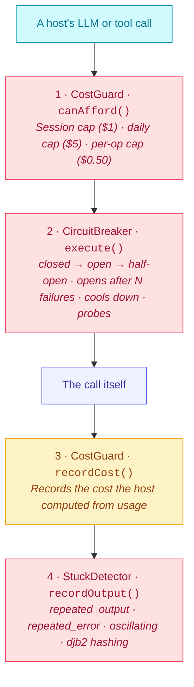

# Safety Primitives

Autonomous agents with LLM access can incur unbounded cost when a vendor API flakes, a retry policy misfires, or an output guardrail silently rejects every attempt. AgentOS ships small, independent primitives that bound the failure modes behind runaway spend, stuck loops and hung tools. Three run inside the runtime: `generateText()` and `streamText()` consult the [provider health registry](#llmproviderhealthregistry), `processRequest()` reserves against a configured [spend meter](#spend-meter), and `generateText()`, `streamText()`, `generateObject()`, `embedText()` and `agent()` check each provider call against a [CostGuard](#costguard) when they are given a spend budget ([Cost Optimization](./COST_OPTIMIZATION.md#a-spend-budget-for-a-run-of-calls)). A host calls the others around its own model and tool calls, and can call a CostGuard of its own the same way.

Each has defaults and works alone or composed with the others ([How they work together](#how-they-work-together)).

These are operational guards. Apart from a [governed tool](#governed-tools)'s evidence check, which compares a quote with the message the host stored, they don't read message content. For content-level safety (toxicity, PII, prompt injection, folder-level filesystem permissions) see [Guardrails](./GUARDRAILS_USAGE.md).

## A host's guard chain



Each layer is independent; use any subset.

## CircuitBreaker

Three-state (closed -> open -> half-open) pattern wrapping any async operation. When failures exceed a threshold within a time window, the circuit opens and rejects all calls immediately with a [`CircuitOpenError`](https://github.com/framerslab/agentos/blob/master/src/safety/runtime/CircuitBreaker.ts). After a cooldown period, it transitions to half-open and allows probe calls through. If probes succeed, it closes again.

### Config

| Option | Default | Description |
|--------|---------|-------------|
| `name` | required | Breaker identifier (used in errors and callbacks) |
| `failureThreshold` | `5` | Failures before opening |
| `failureWindowMs` | `60,000` | Window in ms for counting failures |
| `cooldownMs` | `30,000` | Time in open state before probing |
| `halfOpenSuccessThreshold` | `2` | Successes needed in half-open to close |
| `onStateChange` | `undefined` | Callback: `(from, to, name) => void` |

### Usage

```typescript
import { CircuitBreaker, CircuitOpenError } from '@framers/agentos';

const breaker = new CircuitBreaker({
  name: 'openai-api',
  failureThreshold: 3,
  cooldownMs: 60_000,
  onStateChange: (from, to, name) => {
    console.log(`[${name}] ${from} -> ${to}`);
  },
});

try {
  const response = await breaker.execute(async () => {
    return await openai.chat.completions.create({ model: 'gpt-4o-mini', messages });
  });
} catch (err) {
  if (err instanceof CircuitOpenError) {
    console.log(`Circuit open. Retry after ${err.cooldownRemainingMs}ms`);
  }
}

// Inspect state
const stats = breaker.getStats();
// { name: 'openai-api', state: 'closed', failureCount: 0, totalTripped: 0, ... }
```

## LLMProviderHealthRegistry

A status-aware, process-lifetime memory of LLM provider health, keyed by `providerId`. Wired into [`generateText`](https://github.com/framerslab/agentos/blob/master/src/api/generateText.ts) and [`streamText`](https://github.com/framerslab/agentos/blob/master/src/api/streamText.ts) so the next caller doesn't pay a full TLS round-trip to rediscover a provider that just returned `402 Insufficient Credits` or `401 Invalid API key`.

The plain [`CircuitBreaker`](https://github.com/framerslab/agentos/blob/master/src/safety/runtime/CircuitBreaker.ts) above uses a single failure-threshold + cooldown pair per instance — fine for one-off operations. The router needs **per-error-class** behavior: open immediately on a payment or auth failure, but require a streak before tripping on a 429 or 5xx. This is what the registry adds.

| Error class                | Threshold | Cooldown |
| -------------------------- | --------- | -------- |
| 402 insufficient credits   | 1 fail    | 5 min    |
| 401, 403 auth/forbidden    | 1 fail    | 30 min   |
| 429 rate limit             | 3 fails   | 30 s     |
| 5xx + unclassifiable       | 5 fails   | 60 s     |

The 5-minute window on 402 reflects operational reality: credits might get topped up while a batch job is in flight. 30 minutes on 401/403 is longer because those failures usually require an env change plus redeploy. 429 cooldowns are intentionally short because rate limits typically lift in a single billing interval.

### How the router uses it

1. **Before the primary call**, `generateText` consults `globalLLMProviderHealth.isOpen(resolvedProviderId)`. If the breaker is open, it throws a synthetic `LLMProviderCircuitOpenError` with `httpStatus: 503`. The existing [`isRetryableError`](https://github.com/framerslab/agentos/blob/master/src/api/generateText.ts) check recognizes that status and routes the call into the fallback chain. No network round-trip, no TLS handshake, no waste.
2. **On a real provider error** (anything caught in the outer try/catch except the breaker's own `LLMProviderCircuitOpenError` and a call the caller stopped: a spend budget's refusal, a hook's error under `hookErrors: 'throw'`, or the call's `abortSignal` aborting), `recordFailure(providerId, error)` classifies the error by HTTP status and either trips immediately (for 401/402/403) or increments the streak counter (for 429/5xx).
3. **On success**, `recordSuccess(providerId)` resets the streak counter so a future transient failure starts fresh. A single success does NOT shorten an already-open cooldown: the breaker is open precisely because we want to stop probing for a window.
4. **In the fallback chain loop**, every fallback entry is checked against `isOpen()` before its attempt. A dead chain entry is skipped instantly, so the loop walks to the first healthy provider with O(N) constant-time checks rather than O(N) network calls.

### Error classification

The registry reads HTTP status from three sources, in order:

1. `[NNN] ...` prefix in `error.message` — the shape [`OpenRouterProvider`](https://github.com/framerslab/agentos/blob/master/src/core/llm/providers/implementations/OpenRouterProvider.ts) decorates its errors with so downstream regex-based routing can find them.
2. `error.statusCode` numeric property — [`OpenRouterProviderError`](https://github.com/framerslab/agentos/blob/master/src/core/llm/providers/errors/OpenRouterProviderError.ts) sets this explicitly.
3. `error.status` numeric property — the Anthropic and OpenAI SDK shape.

If none of those resolves, the error is treated as the conservative transient class (5-failure threshold, 60 s cooldown). Better to under-protect on a one-off network blip than lock out a healthy provider.

Errors that judge the request rather than the provider do not count: a 4xx other than 401, 402, 403, 408 and 429 (a malformed body, an unknown model), a content-policy decline (`code` or `type` of `content_filter`, `content_policy_violation` or `safety_violations`), and a request larger than the model's context window.

### Config

The policy table is fixed in code; the registry takes no options.

### Usage

```typescript
import { globalLLMProviderHealth, LLMProviderHealthRegistry } from '@framers/agentos/core/safety';

// Read state for an admin / diagnostics endpoint
const stats = globalLLMProviderHealth.getStats('openrouter');
if (stats?.state === 'open') {
  console.log(
    `OpenRouter circuit open; ${stats.cooldownRemainingMs}ms until close. ` +
    `Last status: ${stats.lastStatusCode}, total trips: ${stats.totalTrips}`,
  );
}

// Manually reset after a credit top-up so the next call probes immediately
globalLLMProviderHealth.reset('openrouter');

// Construct a private registry for a test
const isolated = new LLMProviderHealthRegistry();
isolated.recordFailure('mock-provider', new Error('[402] Test'));
expect(isolated.isOpen('mock-provider')).toBe(true);
```

### Why a singleton

Provider health is process-wide state. Two concurrent `generateText` calls inside the same Node process see the same OpenRouter: if one just discovered it's at 402, the other shouldn't redo the discovery. The [`globalLLMProviderHealth`](https://github.com/framerslab/agentos/blob/master/src/core/safety/LLMProviderHealthRegistry.ts) singleton is the natural granularity. Tests construct their own [`LLMProviderHealthRegistry`](https://github.com/framerslab/agentos/blob/master/src/core/safety/LLMProviderHealthRegistry.ts) instances to keep state isolated across cases.

The registry is **ephemeral by design**: it lives in memory and resets on server restart. Persistent provider-health tracking would add complexity (Redis, write-through cache invalidation) for a problem the in-process singleton already solves for the dominant case: a long-running batch job hammering a degraded provider.

## ActionDeduplicator

Hash-based recent action tracking with a configurable time window and LRU eviction. The caller computes the key string -- this class is intentionally generic. Use it to prevent duplicate votes, duplicate posts, or any repeated action within a window.

### Config

| Option | Default | Description |
|--------|---------|-------------|
| `windowMs` | `3,600,000` (1 hr) | Time window for dedup tracking |
| `maxEntries` | `10,000` | Maximum tracked entries before LRU eviction |

### Usage

```typescript
import { ActionDeduplicator } from '@framers/agentos';

const dedup = new ActionDeduplicator({ windowMs: 900_000 }); // 15-minute window

const key = `vote:${agentId}:${postId}`;

if (dedup.isDuplicate(key)) {
  console.log('Already voted on this post recently');
  return;
}

dedup.record(key);
await castVote(agentId, postId);

// Or use the combined check-and-record method:
const { isDuplicate, entry } = dedup.checkAndRecord(`like:${agentId}:${postId}`);
if (isDuplicate) {
  console.log(`Seen ${entry.count} times since ${new Date(entry.firstSeenAt)}`);
}
```

## StuckDetector

Detects agents producing identical outputs or errors repeatedly. Uses fast djb2 hashing (no crypto overhead) to track output history per agent within a sliding window.

Detects three patterns:
- **`repeated_output`** -- The same output appears N times in a row
- **`repeated_error`** -- The same error message appears N times in a row
- **`oscillating`** -- Agent alternates between two outputs (A, B, A, B pattern)

### Config

| Option | Default | Description |
|--------|---------|-------------|
| `repetitionThreshold` | `3` | Identical outputs before flagging stuck |
| `errorRepetitionThreshold` | `3` | Identical errors before flagging stuck |
| `windowMs` | `300,000` (5 min) | Sliding window for history |
| `maxHistoryPerAgent` | `50` | Max entries tracked per agent |

### Usage

```typescript
import { StuckDetector } from '@framers/agentos';

const detector = new StuckDetector({ repetitionThreshold: 3 });

// After each LLM call, check for stuck behavior
const check = detector.recordOutput('agent-1', response.content);

if (check.isStuck) {
  console.log(`Agent stuck: ${check.reason}`);
  // check.reason is 'repeated_output' | 'repeated_error' | 'oscillating'
  // check.details has a human-readable description
  // check.repetitionCount tells you how many repeats were detected
  pauseAgent('agent-1');
}

// Also track errors
try {
  await callLLM();
} catch (err) {
  const errCheck = detector.recordError('agent-1', err.message);
  if (errCheck.isStuck) {
    // Same error 3 times in a row -- stop retrying
    break;
  }
}

// Clean up when an agent is removed
detector.clearAgent('agent-1');
```

## CostGuard

Per-agent spending caps with three levels: session, daily, and single operation, kept in process memory. CostGuard stops nothing itself: the host asks `canAfford()` before a call and records the cost after it, and `onCapReached` fires when a recorded cost reaches a cap. CostGuard never throws `CostCapExceededError`, and AgentOS runs no CostGuard of its own unless a call carries a spend budget: a `budget` on `generateText()`, `streamText()`, `generateObject()`, `embedText()` or `agent()` keeps a CostGuard (the one passed as `guard`, or one it makes), checks each provider call against it before the call and records the call's cost after it, and refuses a call that would pass the budget with `CostCapExceededError` unless the budget is set to warn. `reserveSpend()` and `reserveOperationSpend()` throw the same error, with the cap type `daily`, when an admission would take a day's committed spending past its cap; that day's total lives in the caller's own tables, not in a CostGuard.

A budget given a `meter` and an `accountId` also holds each call in that [spend meter](#spend-meter): `assertCanSpend(what, { providerId, modelId, request, operationId })` reserves the call's [largest cost](#pricing-a-call-before-it-is-sent) in micro-dollars before the call, and `record(costUSD, tokens, what, { operationId })` settles it at what it cost after it, so concurrent calls cannot overrun the allowance by the calls they have in flight. The generation helpers (`generateText()`, `streamText()`, `generateObject()`, `embedText()`, `agent()`, `gmi()` and a launched team's seats) reserve each provider call they make on such a budget before its request is sent, under an operation id of the call's own that covers the provider's retries of it. The provider sends that id in its operation id header when one is named (`AGENTOS_OPERATION_ID_HEADER`, or the provider's `operationIdHeader`), so the evidence a server in front of the provider keeps names the call as the meter does, and a `resolveExpired` can match the two. `embedText()` sends its requests itself and puts the id on every one of them, in the header `AGENTOS_OPERATION_ID_HEADER` names: each batch to an OpenAI-compatible endpoint, the request to Ollama, and each batch and retry of Gemini's `batchEmbedContents` ([Cost Optimization](./COST_OPTIMIZATION.md#a-spend-budget-for-a-run-of-calls)). The helpers settle it when the call ends by the [Settlement](#settlement) rule: consumed at its usage when usage came back, released when the request never left or the provider itself refused it with a 4xx before any output (a bad request, a refused key or model, a rate limit), and deferred, held and counted until a reconcile decides from evidence, when the request went out and no usage came back or the answer was a 5xx. A host that holds its own provider calls in the meter makes those two calls itself around each one ([Cost Optimization](./COST_OPTIMIZATION.md#a-spend-budget-for-a-run-of-calls)).

### Config

| Option | Default | Description |
|--------|---------|-------------|
| `maxSessionCostUsd` | `$1.00` | Maximum spend per agent session |
| `maxDailyCostUsd` | `$5.00` | Maximum spend per agent per day |
| `maxSingleOperationCostUsd` | `$0.50` | Maximum spend for a single operation |
| `onCapReached` | `undefined` | Callback: `(agentId, capType, currentCost, limit) => void` |

### Usage

```typescript
import { CostGuard } from '@framers/agentos';

const guard = new CostGuard({
  maxDailyCostUsd: 2.00,
  onCapReached: (agentId, capType, cost, limit) => {
    console.log(`${agentId} hit ${capType} cap: $${cost.toFixed(4)} / $${limit.toFixed(2)}`);
    pauseAgent(agentId); // the host's own pause
  },
});

// Before each operation, check affordability
const check = guard.canAfford('agent-1', 0.003); // estimated cost
// A refusal names its cap in check.capType, with the total so far and the cap in check.currentCostUsd and check.limitUsd
if (!check.allowed) {
  throw new Error(check.reason); // "Daily cost $5.0031 would exceed limit $5.00"
}

// After the operation, record actual cost
guard.recordCost('agent-1', actualCostUsd, 'llm-call-123');

// Per-agent overrides
guard.setAgentLimits('expensive-agent', { maxDailyCostUsd: 10.00 });

// Inspect spending
const snapshot = guard.getSnapshot('agent-1');
// { sessionCostUsd: 0.42, dailyCostUsd: 1.87, isSessionCapReached: false, ... }

// Daily totals reset at the process's local midnight. Manual reset:
guard.resetSession('agent-1');
guard.resetDailyAll();
```

## Spend meter

A persisted allowance per account and period, for a product that sells a number of turns a month, or per account over a rolling window, for one that allows a number of calls in any hour. `CostGuard` caps one process's spending in memory; the spend meter keeps the count in a database several processes share, so two servers cannot both sell the last turn, and a restart loses nothing.

`processRequest` reserves before anything reaches a provider and the turn settles the reservation when it ends:

| What happens | The request | The reservation |
|---|---|---|
| No `operationId` on the input | One error chunk, `SYS_VALIDATION_ERROR` | none |
| The period has no room | One error chunk, `BILLING_ALLOWANCE_EXHAUSTED` (402), with `reason`, `period` and `remaining` in `details` | none |
| The same `operationId` again, still running or already counted | One error chunk, `SYS_ALREADY_EXISTS` | unchanged |
| The meter's store does not answer within its retry policy | One error chunk, `SYS_SPEND_METER_UNAVAILABLE` (503) | none |
| The turn finishes, or stops for a tool the host runs | The reply, or the request for the tool | `consumed`, with the turn's usage |
| The turn fails before any text reached the stream, a turn that fails while it saves its pause for a tool included | The error | `released` |
| The turn fails after some text reached the stream | The error | `consumed` |
| An output guardrail blocks the reply | The guardrail's error chunk | refunded (`released`, outcome `replaced`) |
| The process dies mid-turn | nothing more | settled by `reconcile()` once its lease runs out |

Each refusal reaches the caller before any model call. The turn settles in the orchestrator, so a caller that stops reading early still has its turn counted.

### Config

`SqlSpendMeter` runs on a `@framers/sql-storage-adapter` store. Give it a Postgres adapter of its own (or the product's pool), never AgentOS's provenance-wrapped storage adapter.

| Option | Default | Description |
|--------|---------|-------------|
| `db` | required | The store. It must offer transactions, persistence and concurrent access unless `requireShared: false` |
| `allowanceFor(accountId, period)` | required | The account's allowance in units for the period, read at every reservation |
| `periodOf(now, accountId)` | required unless `windowMs` is set | The period a moment falls in for the account, such as its calendar month in its own time zone. Not read with a window |
| `windowMs` | none | A rolling window in milliseconds, in place of periods: the allowance holds the units consumed in the `windowMs` before each reservation and every unit still reserved, whatever its age |
| `leaseMs` | `45000` | How long a reservation lives without a heartbeat; the turn heartbeats on each tool iteration |
| `maxAttemptsPerOperation` | `3` | Reservations one operation may take, its retries after a release included |
| `retry` | 3 tries, 50 to 400 ms, 2 s deadline | Retries of transient store errors before `SpendMeterUnavailableError` |
| `resolveUnknown(reservation)` | none | Asked by `reconcile()` what became of an expired reservation: `consumed`, `released` or `unknown` |
| `resolveExpired(reservation)` | none | Asked by `reconcile()` for each expired reservation in place of `resolveUnknown` and `unknownAfterLease`: `consumed`, `released`, or `deferred` until `retryAt` with its evidence, which keeps the reservation reserved and counted. See [Deferred expiry](#deferred-expiry) |
| `unknownAfterLease` | `'release'` | How an expired reservation settles when the answer is `unknown` |
| `ensureSchema` | `true` | Create the two tables when missing, and on tables that exist the indexes and the `settled_units` column they lack; a product that runs its own migrations copies `SPEND_METER_DDL`, or `spendMeterDdl(prefix)` for its `tablePrefix`, and passes `false` |
| `tablePrefix` | `'agentos_spend'` | The start of the two tables' names, `<prefix>_meter` and `<prefix>_reservations`; their indexes are named `idx_<prefix>_reservations_*`, and `idx_spend_reservations_*` under the default. A lower-case letter and at most 37 more lower-case letters, digits or underscores, and not `spend`: the constructor throws on any other value, before any statement is built. At 38 characters the longest names, `idx_<prefix>_reservations_account` and `idx_<prefix>_reservations_settled`, take the 63 bytes Postgres keeps of an identifier |
| `onWarning(warning)` | none | Told of each statement that failed while `ensureSchema` brought tables that exist up to the meter's indexes and its `settled_units` column, with the `statement` and the `error`: an index the store refused, the catalogue read before them, or the `ALTER` that adds the column when another process added it first or the store refuses it for good; with `ensureSchema: false`, once, the read that found the reservations table without the column. The meter uses the tables as they are. A read of the column or an `ALTER` that fails for any other reason is not reported here: it fails the statement |

With `windowMs` the meter counts from the reservations themselves, inside each reservation's own transaction and after it has taken the account row's lock, so two reservations cannot both take the last unit of a window. Every row then carries the period `window`, which is the period `allowanceFor` is asked for. A consumed unit counts within its accounting window: from its reservation until more than `windowMs` have passed. A still-reserved hold counts until explicit settlement, even across window boundaries; expiration alone does not release it. A released reservation never counts, and one whose lease ran out still counts until `reconcile()` releases it. `snapshot()` answers the units consumed and reserved inside the window and what remains. A meter given neither `periodOf` nor `windowMs` throws when it is constructed.

The window's count reads the index `idx_spend_reservations_account`, and `purge()` finds the reservations settled before its `before` through `idx_spend_reservations_settled`, on `settled_at` and `state` (`idx_<prefix>_reservations_account` and `idx_<prefix>_reservations_settled` under another prefix). The DDL creates both with the tables. On tables that exist, `ensureSchema` reads the store's catalogue before the meter's first statement (`pg_indexes` on Postgres, `sqlite_master` on SQLite) and runs the `CREATE INDEX IF NOT EXISTS` statement of each of the meter's indexes the tables lack, so a store whose tables an earlier release made gains them. A meter whose tables hold all three runs no index statement, so on Postgres its start takes no SHARE lock on the reservations table, the lock a `CREATE INDEX` takes before it checks `IF NOT EXISTS`. The indexes change no answer of the meter, so tables that refuse one, as Postgres does for a role that does not own them, are used as they are, and the statement and its error go to `onWarning`. Postgres holds back writes to a table while it builds an index on it, so a product with a large reservations table creates the two indexes first in its own migration, with `CREATE INDEX CONCURRENTLY IF NOT EXISTS` and the names and columns `spendMeterDdl(prefix)` gives them, and runs the meter with `ensureSchema: false`.

The reservations table's last column, `settled_units`, records the units a consumed settle moved to `used` (see [Settlement](#settlement)). On a reservations table that lacks it, a meter that ensures its schema runs `ALTER TABLE <prefix>_reservations ADD COLUMN settled_units BIGINT` once, at its first statement; a table that holds it gets no `ALTER`. A product that runs its own migrations adds the column with that statement in one of them (`agentos_spend_reservations` under the default prefix). Until the column is there, a meter settles as it did before it: a consumed settle takes the whole reservation, whatever `units` it names, and `onWarning` is told of the refused `ALTER`, or, with `ensureSchema: false`, of the read that found the column missing. Only a refusal that will not change takes a meter there: Postgres's 42501, as a role that does not own the table gets, or 25006, or a read-only SQLite file. Only Postgres's 42703 or SQLite's "no such column" counts as a read that found the column missing. Any other failure of the read or the `ALTER` (a deadlock, a busy database, a lock or statement timeout) says nothing about the column: `run()` retries a transient one, the rest reject with `SpendMeterUnavailableError`, and the next statement reads again, so a passing lock leaves no meter settling whole. Rows settled before the column existed hold NULL there and count by their whole reservation. A release or a refund clears the figure, so a retry under the same operation id starts with none. A meter reads whether the column is there once, at its first statement: one that started before the column was added, or a process of an earlier release, keeps settling a consumed reservation whole and refunds one by its whole reservation, even one a meter with the column settled at fewer units, so restart such processes once the column is added.

### Several meters in one database

Meters with different rules take a prefix each. Every statement a meter runs names its own two tables, so its count reads only its own rows and its `purge()` deletes only its own rows. Meters under one prefix share its two tables and every row in them, and a purge by one reaches the settled reservations of the others.

```typescript
import { SqlSpendMeter, spendMeterDdl } from '@framers/agentos';

// Twenty calls an account in any hour, in the default tables
const hourly = new SqlSpendMeter({ db, windowMs: 3_600_000, allowanceFor: () => 20 });

// Five hundred a month, in tables of its own: monthly_spend_meter and monthly_spend_reservations
const monthly = new SqlSpendMeter({
  db,
  tablePrefix: 'monthly_spend',
  periodOf: (now) => new Date(now).toISOString().slice(0, 7),
  allowanceFor: () => 500,
});

// The same tables and indexes for a product's own migration, with ensureSchema: false on the meter
const migration = spendMeterDdl('monthly_spend');
```

With no prefix, `spendMeterDdl()` answers `SPEND_METER_DDL` word for word; given a prefix the constructor refuses, it throws.

### Usage

```typescript
import { AgentOS, SqlSpendMeter } from '@framers/agentos';
import { createPostgresAdapter } from '@framers/sql-storage-adapter';

const db = createPostgresAdapter({ connectionString: process.env.DATABASE_URL!, max: 3 });
await db.open();

const meter = new SqlSpendMeter({
  db,
  allowanceFor: async (accountId) => (await plans.planOf(accountId)).turnsPerMonth,
  periodOf: async (now, accountId) => monthIn(await accounts.timeZoneOf(accountId), now), // "2026-10"
  resolveUnknown: async ({ operationId }) => ((await replies.storedFor(operationId)) ? 'consumed' : 'unknown'),
});
meter.startReconciler(); // every 15 seconds

const agentos = await AgentOS.create({ spendMeter: { meter, accountIdOf: (input) => input.userId } });

for await (const chunk of agentos.processRequest({
  userId, sessionId, textInput,
  operationId: messageId, // the product's durable id of this message: a retry with it is never charged twice
})) {
  // ...
}

// The month so far, for the product's own meter line
const { used, remaining } = await meter.snapshot(userId);

// A plan change mid-period: the units used carry over, the new allowance applies at once
await meter.setAllowance(userId, 600);
```

### Settlement

How a reservation settles follows from what the host can show of the work it held units for:

| What the host knows | Settle | The allowance |
|---|---|---|
| The work never ran: the request never left, the provider itself refused it with a 4xx before any output (a bad request, a refused key or model, a rate limit), or it answered with zero usage | `released` | Nothing used; the whole reservation is free again |
| The work completed and its usage is known | `consumed` with `units`, the units it used | `units` used; the rest of the reservation is free again |
| The outcome is uncertain: a stream broke, a provider timed out, the answer was a 5xx (a gateway or the provider can answer one after the model ran), the process died mid-call | Nothing yet: the reservation stays reserved and counted ([deferred](#deferred-expiry)) | Held until evidence settles it |
| A verified fault kept a completed answer from the person | `replaced` on the consumed reservation, with the host's own record of the fault beside it | What the consumed settle took is given back |

No elapsed time settles an uncertain outcome. A timeout alone does not show that the provider billed nothing, so a reservation whose work may have run stays reserved until the host's evidence, or a person, settles it. Reserve such a call with `requireFence`, which no reconcile pass without `resolveExpired` settles, and give the meter a `resolveExpired` that defers it until the evidence comes. `replaced` moves the reservation from consumed to released and takes its units back out of `used`. The meter keeps one row for the operation, and that row then holds the outcome alone: its `settled_units` is cleared, and `usage_json` holds only what the refund's own settle names. A record that shows the debit and its refund as separate entries is the host's own, written beside the settle.

```typescript
// A call reserved at its largest cost, in micro-dollars, settled at what it cost
const held = await meter.reserve({ accountId, operationId, units: maxMicro, requireFence: true });
// ...the call runs, and the provider reports its usage...
await meter.settle({ operationId, outcome: 'consumed', units: actualMicro, usage });
```

`units` on a `consumed` settle moves that many units to `used`, and the whole reservation leaves `reserved`, so the rest is free at once. The figure is held to the reservation. More than it reserved counts as the reservation (an actual cost above the reserved bound is the host's estimator or price-table defect, which it records and fixes), a negative number as none, a fraction by its whole part, and NaN as the whole reservation. Left out, the whole reservation is consumed. `released` and `replaced` ignore it. The reservation row keeps the figure in `settled_units`, so a later `replaced` gives back the units the work used, and a rolling window counts a consumed reservation by them. `resolveExpired` settles an expired reservation the same way: `{ outcome: 'consumed', units }` takes the usage the host's evidence shows, and `{ outcome: 'consumed' }` the whole reservation. `releaseExpiredSpend` reads the decision's `units` as micro-dollars, which its store holds to the amount reserved. On that day store a figure below zero was never known and settles the whole listed amount, as `releaseSpend` settles a cost below zero: settled at nothing, it would take the reservation out of the day's total.

One operation id holds one reservation: a retry under the same id while it is reserved is `in_flight`, after it counted `already_consumed`, and after a release it reserves again up to `maxAttemptsPerOperation`. So a client's retry of one logical call is never charged twice. A host that reserves each attempt of a call under an id of its own (`<call>:<attempt>`), to keep an attempt's units apart from the next one's, decides which attempt is debited: it settles the one whose work completed `consumed` and the others `released`, or `replaced` where one had already counted.

No reservation takes `used + reserved` past a period's allowance, and no settle raises their sum: a consumed settle adds to `used` at most what it takes from `reserved`. Neither falls below zero (`CHECK (used >= 0 AND reserved >= 0)`).

### Deferred expiry

A call whose work may outlive its lease (a worker still running, an inference not yet stopped) must not be released or consumed by a sweeper that cannot prove it stopped. Reserve it with `requireFence: true` and give the meter `resolveExpired`:

```typescript
const meter = new SqlSpendMeter({
  db, periodOf, allowanceFor,
  resolveExpired: async (reservation) => {
    const fence = await controlPlane.fenceOf(reservation.operationId); // the host's own evidence
    if (!fence.transportClosed || !fence.inferenceTerminated) return { outcome: 'deferred', retryAt: Date.now() + 15_000, evidence: fence };
    return { outcome: fence.served ? 'consumed' : 'released' };
  },
});
await meter.reserve({ accountId, operationId: callId, requireFence: true });
```

A deferred reservation stays reserved and counted, with its evidence and its next check kept on its row; a resolver that throws defers it for one lease. A meter without `resolveExpired` (a legacy sweeper over the same tables) leaves a `requireFence` reservation reserved and counts it pending; an explicit `settle()` still ends it. A rolling window counts a reservation still reserved whatever its age. `releaseExpiredSpend(store, at, { resolve })` does the same for a day's bound, with `SpendDayStore.deferReservation` keeping the next check.

A `reconcile()` pass writes each decision to the reservation as it read it, in one conditional statement: the same attempt, still reserved, still past its lease and, for a settlement on a meter without `resolveExpired`, still unfenced. A reservation that an opted-in pass defers, or that a heartbeat renews, while a legacy pass asks `resolveUnknown` about it stays reserved. While `resolveExpired` is asked, a heartbeat's renewed lease stands, and so does another pass's deferral to a next check after the pass's `now`, with its evidence; an operation released and retried meanwhile keeps the retry reserved under its own lease, with none of the earlier attempt's fence, evidence or next check. A meter without `resolveExpired` reads the ordinary expired reservations into its page first and the fenced holds only into the room they leave, each in expiry order on the `(state, expires_at)` index, so the fenced holds it leaves never keep one from settling, whatever the `limit`, and no pass sorts every due row to find its page.

### Retention

A settled reservation's row stays, so that a retry of its operation is recognised, and a window meter keeps one row per account. `purge({ before, limit })` deletes the reservations settled before `before` and, for a window meter, the account rows that hold nothing reserved and were last written before `before`. One call deletes at most `limit` of each (default 1,000) and answers how many of each it deleted, so a sweep calls it again while a count comes back full.

```typescript
// Twenty calls an account in any hour
const hourly = new SqlSpendMeter({ db, windowMs: 3_600_000, allowanceFor: () => 20 });

// The sweep: what settled more than an hour ago is past the window, and goes
const { reservations, periods } = await hourly.purge({ before: Date.now() - 3_600_000 });
```

A reservation still reserved is never deleted, and neither is a period meter's period row, which holds the period's count: a month's `snapshot()` reads the same after its settled reservations are purged. For a window meter, a `before` at least one window back keeps every unit the window counts. Once an operation's row is purged the meter no longer knows the operation: a retry of it reserves and counts again, and a refund of it finds nothing, so `before` lies past the time either can come. `purge()` deletes across every account in its meter's two tables, so meters under one prefix share their retention, and a meter under a prefix of its own keeps its own.

### Pricing a call before it is sent

A meter that holds an allowance in money reserves each provider call's largest cost before the call and settles to what it cost after. `estimateMaxCallCostUSD(providerId, modelId, request)` gives that largest cost, an upper bound in US dollars, or `undefined` for a call it cannot bound, which the host refuses:

```typescript
import { costOfUsageUSD } from '@framers/agentos';
import { estimateMaxCallCostUSD, registerModelPricing } from '@framers/agentos/safety/runtime';

// OpenRouter's models, refreshed from its models endpoint each day; OpenAI's and Anthropic's tables are built in.
registerModelPricing('openrouter', (modelId) => openRouterPrices.get(modelId));

const max = estimateMaxCallCostUSD('anthropic', body.model, {
  messages: body.messages,
  system: body.system,
  tools: body.tools,
  maxOutputTokens: body.max_tokens,
  cacheMarkers: body.cache_control !== undefined, // a request-level marker its messages do not show
});
if (max === undefined) return refuse(400, 'not_priced');
const held = await meter.reserve({ accountId, operationId, units: Math.ceil(max * 1_000_000), requireFence: true });
if (held.status !== 'reserved') return refuse(402, held.reason); // the account's allowance cannot hold the call
// Only now is the call sent. Once it has finished, it settles at what it cost and the rest of the hold is free;
// a cost the table cannot give leaves `units` out, which consumes the whole hold.
const actual = costOfUsageUSD('anthropic', body.model, usage);
await meter.settle({ operationId, outcome: 'consumed', units: actual === undefined ? undefined : Math.ceil(actual * 1_000_000) });
```

The bound:

| Part | Counted as |
|---|---|
| Prompt tokens | One token per UTF-8 byte of the messages (as JSON), the system prompt and the tool definitions (as JSON), plus `MAX_COST_TOKENS_PER_MESSAGE` (8) for each message and for the system prompt, plus `MAX_COST_TOOL_USE_TOKENS` (1,024) once for a request with tools, the tool-use system prompt a provider adds (`maxInputTokens(request)` gives this number) |
| Input rate | The highest the request reaches: the long-context card's once the token bound passes its threshold (OpenAI over 272,000 tokens on its 1.05M-context models, Claude Haiku 5.5 over 100,000), and the highest cache-write rate the card names where the request asks for caching (`cacheMarkers: true`, which a host passes for a request-level setting the request's text does not carry, such as OpenAI's `prompt_cache_options` or `prompt_cache_retention`, or a `cache_control` or `prompt_cache_breakpoint` key in its text: Anthropic's 1-hour write at 2x input, OpenAI's 12-hour write at 2.5x) or where the model writes the cache by default (OpenAI's GPT-5.6 and later, at 1.25x) |
| Output | `maxOutputTokens` as the request sends it, at the highest output rate the request reaches. A host that cuts a cap above the model's ceiling cuts it first and passes the cut cap: a ceiling the library knows bounds what a request is shaped to, never what it is billed |

A byte-level tokenizer's token covers at least one byte, so the prompt bound holds where four characters a token does not: Anthropic's counting endpoint gives base64 0.94 tokens a byte on Claude Opus 5.5, and CJK text and emoji well over a token for every four characters. The test fixture `src/api/runtime/__tests__/fixtures/max-cost-token-counts.json` holds both providers' own counts for CJK text, source code, emoji, base64, many short turns and tool definitions, and the tests hold the bound at or above each.

`undefined` comes back for a model with no price row, a request with no finite output cap, `n` above 1 (each completion bills its own output), a content part that is not text (an image, a document, audio, a file, a server tool's call or result; in Gemini's shape a part with `inlineData` or `fileData`, in its own `parts` or in a function response's, and a built-in tool's `toolCall` or `toolResponse`) or a message that replays an earlier audio answer (Chat Completions' assistant `audio`), a tool the provider defines or runs (any tool `type` but `function` or `custom`, and a Gemini tool with no `type` other than `functionDeclarations`, such as `googleSearch` or `codeExecution`), and a request flagged `nonTextParts`, `providerSideTools`, `priorityTier` (OpenAI's priority or fast tier, Anthropic's fast mode) or `regionalProcessing` (Anthropic's `inference_geo: 'us'`, OpenAI's regional endpoints), each of which bills by a measure or at a rate the text and the table do not show. A replayed thinking block counts by its bytes: its signature carries the whole thinking.

`modelPricing(providerId, modelId)` reads the rates in US dollars per million tokens: OpenAI's table, Anthropic's table, then the table the host registered for the provider with `registerModelPricing(providerId, table)`. For `openai` and `anthropic` the host's table fills only the models the built-in table lacks; registering again replaces a table. A host row with a rate that is NaN, infinite or negative is no price, since a NaN estimate passes every budget check. A spend budget's estimate (`estimateCallCostUSD`) and its cost of a finished call (`costOfUsageUSD`) read the same rows; the estimate takes the long-context card once its prompt's assumed tokens (four characters a token) pass the threshold. A provider built on the OpenAI provider (Groq, LiteLLM, Mistral, Together and xAI send through it, MiniMax extends it) reports OpenAI's list price for a model id OpenAI's table holds; where the host registered a row for that provider, `costOfUsageUSD` prices the call at that row instead, the rate it was estimated at. A bill the provider's API returned (OpenRouter's and Requesty's `usage.cost`) stands. An embedding on an OpenAI-compatible endpoint (`embedText` with Mistral, OpenRouter or Requesty) reports no cost and is priced at the host's row; a batch whose answer reports no prompt tokens is charged at the bound of its inputs, one token per UTF-8 byte and `MAX_COST_TOKENS_PER_MESSAGE` for each input, while the usage `embedText` returns stays what the answers counted. Where the provider reported no cost, `costOfUsageUSD` prices the whole prompt, cache reads and writes included (`inclusiveInputTokens`; Anthropic's prompt tokens leave the cache out), at the long-context card when that prompt is over its threshold: the cache reads at the card's cache-read rate (`cacheReadPerMTokUSD`: OpenAI's cached-input rate from its pricing page, Anthropic's cache-read rate; the input rate where the card has none), the writes the usage names as made with the longer lifetime (`cacheCreationExtendedInputTokens`: Anthropic's `cache_creation.ephemeral_1h_input_tokens`, OpenAI's `cache_write_tokens_details.ttl_12h_tokens`) at its highest write rate (`cacheWritePerMTokUSD`: 2x input on Anthropic, 2.5x on OpenAI), and every other write at the default lifetime's rate (`defaultCacheWritePerMTokUSD`: Anthropic's 5-minute and OpenAI's 30-minute write, 1.25x input each), the rate a write the request names no lifetime for is billed at. A usage that does not split its writes is priced as if every write had the default lifetime. A host row that names `cacheWritePerMTokUSD` alone prices every write at it.

The bound counts what the request carries. A request that draws in context stored with the provider (OpenAI's `previous_response_id`, `conversation` or a stored `prompt`) is billed for tokens its text does not show, so a host sends that context in `messages` or refuses the request. A request for output that is not text (OpenAI's `modalities` with `audio`) bills audio tokens at their own rates, so a host flags it `nonTextParts`.

An actual cost above the reserved bound is a price-table or estimator defect: the host settles at the reservation (a `units` above it is held to it), records the difference and alerts. [Settlement](#settlement) gives the outcome for every other ending of the call.

## Compound credit

A host that sells metered calls reserves each call's most before any work starts, and settles it once from measured quantities. `@framers/agentos/safety/runtime` carries the arithmetic and the ledger; the host supplies rates, caps and its allocation policy.

```typescript
import {
  InMemoryCompoundCreditStore,
  grantCreditLot,
  reserveCompoundCredit,
  settleCompoundCredit,
  ModelAttemptBudget,
} from '@framers/agentos/safety/runtime';

const store = new InMemoryCompoundCreditStore(); // SqlCompoundCreditStore on Postgres in a deployment
await grantCreditLot(store, { scopeId: 'scope-a', kind: 'paid', fundingRef: 'payment-1', principalMicro: 10_000_000, at: Date.now() });
const held = await reserveCompoundCredit(store, {
  scopeId: 'scope-a', operationId: 'call-1', kind: 'call', requestHash: 'h', rates: { primary: rates },
  mediaComponent: 'media_second', durationSeconds: 600,
  attempts: { maxAttempts: 64, perAttempt: { input_token: 8_192, output_token: 512 } },
  supplierDailyCapMicro: 10_000_000, at: Date.now(), expiresAt: Date.now() + 3_660_000,
});
if (held.status === 'reserved') {
  const budget = new ModelAttemptBudget({ store, holdId: held.hold.holdId });
  const attempt = await budget.authorize({ purpose: 'initial' }); // before every provider request
  await budget.record(attempt.attemptId, { input_token: 900, output_token: 120 }, true);
  await settleCompoundCredit(store, {
    holdId: held.hold.holdId, connectedMs: 61_500, at: Date.now(),
    fence: { mediaClosed: true, inferenceTerminated: true, evidence: 'room closed; worker exited', observedAt: Date.now() },
  });
}
```

- A rate is rational (`micro` micro-dollars for every `per` units), and a component's charge is one ceiling of the exact product, on BigInt. `quoteCompoundLiability` prices the full duration and every permitted attempt at the dearest authorized snapshot; reasoning tokens are counted once when the snapshot says output includes them.
- A hold is allocated to lots in the policy's order (`promotionsFirstPolicy`: earliest-expiring promotions, then paid lots); settlement consumes those shares in that order. A policy orders only the eligible lots (`isLotEligible`: active, unexpired, with a free balance), and the balance counts only those, whatever the policy. An expired promotion keeps the share an admitted hold took, and whatever that share does not consume retires.
- The supplier side of a hold is checked against the platform's daily cap together with every hold still open, whatever day it was made on. Reservations take that check one at a time on one platform-wide lock (the supplier day of the epoch, `1970-01-01`), so two on either side of midnight cannot both pass the cap.
- Settlement needs evidence that the media closed and the inference stopped; without it the hold is deferred, still held. `reconcileCompoundCredit` defers when its resolver cannot tell or fails.
- Every provider attempt (initial, tool continuation, retry, fallback) is authorized with `authorizeModelAttempt` before it is sent; an attempt that never reports usage keeps its supplier most open.
- Refunds take only a paid lot's free principal, reserved before the payment rail is asked (`refundCreditLot`, then `completeLotRefund`). A refund id answers `existing` only for its own scope, lot and amount; another request under it, one racing it from another scope included, is refused as `conflict` and reserves nothing. A dispute freezes the lot and the account's admission; a lost reversal past the free balance is a receivable outside spendable credit.
- `marginReport` reconciles a scope's period: paid-funded revenue, promotional usage, reversals, refunds, supplier cost including failed work, compute by measured runtime, and other costs quantified or excluded; a missing cost makes it `unreconciled`, with no contribution stated. Every hold settled in the period needs a measured runtime, an explicit zero included, or compute stays unreconciled. The period's settlements are the ones its settlement entries name, however many holds the scope settled before.

With credit funding, the scoped voice factory uses `ModelAttemptBudget` below provider request and retry loops; a call with local funding counts its attempts with `CountingAttemptBudget`, which holds no money. The OpenAI provider's request loop counts every call's attempts with `CountingAttemptBudget` as well, at the call's `maxAttempts` or the provider's configured count, so an attempt past the count is refused before it is sent ([Attempts](../getting-started/HIGH_LEVEL_API.md#attempts)). Call minutes remain quantity-only in `CallMinuteMeter`; rational-rate arithmetic and final component rounding belong to the ledger. Stop evidence, final supplier quantities and the hold's rate snapshots and lot allocations determine settlement. Do not release a deferred hold because its process stopped reporting. `marginReport` aggregates the ledger's recorded revenue and supplier cost with the measured runtime the host supplies; it neither invents a tariff nor makes unknown supplier cost zero.

## Governed tools

`governTool()` turns a tool into a governed tool, for an agent whose tools act on people: hold a message for review, mute an account in a room. A call acts only when its evidence holds, only inside limits counted in a shared store, and only with an audit record written before and after. The wrapper is the tool's own `execute()`, so a call is governed wherever the tool runs: the tool loops of `generateText()` and `streamText()`, `agent()`, `agency()`, the full runtime, or a host's own executor.

```typescript
import { governTool, SqlActionLimiter, type ActionLimitRule } from '@framers/agentos/safety/runtime';

const limits: ActionLimitRule[] = [
  { id: 'mute_room_hour', scope: 'room', windowMs: 3_600_000, max: 3 },
  { id: 'mute_target_day', scope: 'target', windowMs: 86_400_000, max: 1 },
  { id: 'mute_all_hour', scope: 'platform', windowMs: 3_600_000, max: 20 },
];
const limiter = new SqlActionLimiter({ db, rules: limits }); // a Postgres adapter every process shares
limiter.startReconciler();                                  // in one process

const mute = governTool(muteInRoomTool, {
  action: 'mute_in_room',
  target: (args) => ({ accountId: args.userId, roomId: args.roomId }),
  limits,
  dryRunOutput: () => ({ muted: true }),
}, {
  actor: { id: 'moderation-service', kind: 'system' },
  mode: 'enforce',
  limiter,
  evidenceSource: messages, // the host's store: getMessage(id), and hasVerdict(id) when calls cite verdicts
  ruleBook: { '2026-11': ['harassment.1', 'spam.2'] },
  audit,                    // the host's sink: begin(record), finish(recordId, end)
});
```

The governed tool keeps every member of the tool, sets `hasSideEffects: true`, and requires `evidence` in its input schema (`ACTION_EVIDENCE_SCHEMA`). A call runs in this order:

| Step | What happens | How it can end |
|---|---|---|
| 1. Arguments | `evidence` is checked for shape in code, every id in it an id (letters, digits and `_ . : / -`, at most 128). Then the policy's own `target()`, `expiresAt()`, `idempotencyKey()` and, in a dry run, `dryRunOutput()` run, before anything is reserved | `refused_arguments` with `ARGUMENT_SHAPE`, or `POLICY_ERROR` when one of them throws or answers another shape |
| 2. Evidence | The tool's own target must be the evidence's: its account, its room, and a message it names among the quoted ones. Then `verifyActionEvidence()` holds the evidence to the host's store and rule book | `voided_evidence` with `TARGET_MISMATCH` or the check's failure |
| 3. Audit, first half | `audit.begin(record)`, with the values step 2 confirmed. Nothing is reserved yet, and nothing runs unrecorded | `audit_unavailable` when the sink throws |
| 4. Limits | One unit under every rule, in the order given | `limit_reached`, `duplicate`, `refused_arguments` with `LIMIT_SCOPE_MISSING`, or `limiter_unavailable` |
| 5. The action | The tool's own `execute()`, with the caller's context and `governedAction`. In a dry run, `dryRunOutput()` takes its place | `executed`, `would_execute` or `failed` |
| 6. Audit, second half | `audit.finish(recordId, end)` | A sink that throws is written as `action.audit_failed`, and the outcome stands |

Every refusal answers `{ success: false, error, details: { governance: { outcome, code, recordId } } }`, with a fixed sentence per outcome as `error`: no argument, code or id is ever part of it. A call that ran answers the tool's own result with `details.governance` set the same way. A tool that throws is answered with the fixed sentence of `failed`, never what it threw, and a tool that answers a failure keeps its own result. A failed action is released and not counted, so a governed tool reports a failure only when it changed nothing; the same action may be asked for three times in all, and the fourth ask ends `limit_reached` with `RETRIES_EXHAUSTED` for a person to decide.

The wrapper copies the call's arguments before checking them and gives that copy to the tool. Changes to the caller's arguments while evidence, audit or limit requests are pending cannot change the checked target or evidence. Arguments that cannot be copied are refused as `ARGUMENT_SHAPE`. The standalone `verifyActionEvidence()` also checks a copy of its input.

Between the reservations and the tool's start the wrapper awaits nothing but the limiter. When the reservations outlived their lease before the tool could start (a store that slow), the units are given back and the call ends `limiter_unavailable` with `LEASE_EXPIRED`: a reservation past its lease may already be settled by a reconcile pass, and a unit counts from the time it was reserved.

`refusalBeforeApproval()` answers the shape refusal, so on the full runtime, whose tool orchestrator asks it, nobody is asked to approve a call that cannot act. The tool loops of `generateText()` and `streamText()` and `agency()`'s approval gate do not ask it ([Human in the loop](./HUMAN_IN_THE_LOOP.md#guardrail-override-post-approval-safety-net)).

### The evidence

| Field | What it is |
|---|---|
| `targetId` | The account the action is about: the author of every quoted message |
| `roomId` | The room the quoted messages are in |
| `ruleId`, `policyVersion` | The rule the action rests on, and the version of the policy text it was read from |
| `quotes` | `{ messageId, quote }` for each message the action rests on |
| `verdictRefs` | The host's ids of the guard verdicts that led here |

`verifyActionEvidence(evidence, source, ruleBook, rule?)` holds it to the host's store and rule book, each comparison exact:

- `policyVersion` is an own key of the rule book and `ruleId` one of that version's ids (`UNKNOWN_POLICY_VERSION`, `UNKNOWN_RULE`). A governed call cites only rules in the host's rule book, so a rule id copied from a message is refused however well it fits an id's shape.
- Each `verdictRefs` entry is confirmed by the source's `hasVerdict()` (`VERDICT_NOT_FOUND`, for any entry when the source has none).
- Quotes from at least `minQuotes` distinct messages, 1 by default (`NO_QUOTES`): two quotes of one message count once. Both `minQuotes` and `minQuoteLength`, when supplied, must be positive safe integers. Invalid thresholds, including `NaN`, cause a governed call to return `POLICY_ERROR` before reservation; the standalone checker throws `TypeError`.
- Each quoted message exists under exactly the id asked for (`MESSAGE_NOT_FOUND`), the account the action is about wrote it (`AUTHOR_MISMATCH`), and it is in the given room; a stored message with no room fails a given room (`ROOM_MISMATCH`).
- Each quote is in its message character for character, with no trimming, no case folding and no Unicode normalisation (`QUOTE_MISMATCH`), and is at least `minQuoteLength` code units, 12 by default, unless it is the whole message (`QUOTE_TOO_SHORT`).
- A store that throws answers `SOURCE_UNAVAILABLE`.

The check proves that the quote is real and who wrote it, and that the rule and the verdicts it cites exist. It does not prove the rule applies. Its answer keeps a SHA-256 and a length of each quote, never the quote, and names a failed quote by its index, never by an id the store did not confirm.

### The limiter

`SqlActionLimiter` keeps one [spend meter](#spend-meter) per distinct `windowMs`, each counting over a rolling window under the table prefix `<tablePrefix>_w<windowMs>`. A rule counts under the key `<rule id>|r:<room id>`, `<rule id>|t:<account id>` or `<rule id>|p`, and reserves the operation `<idempotency key>:<rule id>`; the idempotency key is the SHA-256 of the policy's `idempotencyKey(args)`, by default of the actor, action, account, room and unique sorted evidence message ids, plus the target message id when the policy names one. Repeating a quote cannot create a new action or reset its three-attempt retry ceiling. Two different target messages remain different actions even when they cite the same supporting messages. Account actions without repeated evidence retain their existing key format.

| Option | Default | Description |
|--------|---------|-------------|
| `db` | required | The store. It must offer transactions, persistence and concurrent access unless `requireShared: false` |
| `rules` | required | Every rule the host uses, so a process that never reserves (a deletion job, a nightly purge) still knows every window and every key. A rule id is a lower-case letter and at most 18 more lower-case letters, digits or underscores. The constructor refuses one id with two sets of numbers, and `reserve()` throws for a rule that is not listed, which a governed tool ends as `limiter_unavailable` |
| `tablePrefix` | `'agentos_action'` | The start of each window's prefix. `<tablePrefix>_w<windowMs>` must pass the spend meter's prefix rule, 38 characters at most, or the constructor throws |
| `leaseMs` | `60000` | How long a reservation lives while its tool runs. It must be shorter than every rule's window |
| `requireShared`, `ensureSchema` | `true` | As the spend meter's |

No limit has a default: `governTool()` refuses a tool with no limit, since an unlimited automatic action is a configuration error. The counts are rows in the host's database, so they are shared between processes and survive a restart only on a shared store; a SQLite file per process gives each process limits of its own. They are not atomic across two rules: each rule reserves in its own transaction, and a denial gives back the units taken before it. A crash between a reservation and its end counts the action.

Someone must run `reconcile()`. A reservation whose lease ran out still counts against its window, and keeps its action a duplicate, until a pass settles it as used: a host calls `startReconciler()` in one process, or `reconcile()` from a job, and the limiter starts nothing by itself. `purge(before)` deletes settled reservations, each meter only those settled before both `before` and one of its own windows back, so no unit a window still counts is deleted; an action whose rows are gone is no longer a duplicate. `forgetTarget(accountId)` deletes the rows of every target-scoped rule under the account's exact key, for a host's account deletion. A host that runs its own migrations creates the tables from `actionLimiterDdl(windowsMs, tablePrefix)` and passes `ensureSchema: false`.

### The audit record

The host's sink takes two halves: `begin(record)` before the action runs, where a throw refuses the action, and `finish(recordId, end)` when it has ended, where a throw is written as an event and the outcome stands.

A record holds its own id (`act_` and a random UUID, the `recordId` of the tool result), the actor, the action, the tool's name, the mode, the target's account, room and message ids, the rule, the policy version and the verdict ids, each quote's SHA-256 and length, the SHA-256 of the idempotency key, and an `expiresAt` the library wrote from the instant `policy.expiresAt()` returned. It holds no quote, and no tool call id: a model or a provider supplies that id, so it is never recorded. A refusal at step 1 or 2 records nothing taken from the arguments or the call's context (its target and evidence are empty, and its idempotency key is the SHA-256 of its own record id), because a steered model may have filled any of them with text. A quote's hash is unsalted, so a short quote can be matched to a guessed text: it is personal data derived from the message and follows the record's retention and deletion.

The end holds the outcome, its code, `endedAt`, and `reversalRef` when the tool filed a reversal. The wrapper mints that key (`rev_` and a random UUID) before the tool runs and hands it to the tool with the record's id; the tool reads both with `governedActionOf(context)`, files what undoing needs under the key in its own store, and answers `details.reversible: true`. On success and failure alike, a key or a reversal the tool returns as `details.reversalRef` or `details.reversal` is passed on to neither the sink nor the caller, and its presence puts `REVERSAL_DROPPED` on the end. A failed action never records a reversal reference.

### The dry run

With `mode: 'dryRun'` the tool is not called. The units are committed under dry keys, every key and operation id starting with `dry:`, so dry and real counts never mix and a dry run meets the same ceilings. The model receives `dryRunOutput(args)` (default `{ dryRun: true }`) as a successful result with `details.dryRun`, and the call ends `would_execute`. A second dry run over the same messages meets the first run's keys and reads every action as a duplicate, so each run gets a limiter with a `tablePrefix` of its own.

### Outcomes

| Outcome | Codes |
|---|---|
| `executed` | none, or `REVERSAL_DROPPED` |
| `would_execute` | none |
| `failed` | none, or `REVERSAL_DROPPED` |
| `refused_arguments` | `ARGUMENT_SHAPE`, `POLICY_ERROR`, `LIMIT_SCOPE_MISSING` |
| `voided_evidence` | `TARGET_MISMATCH`, `NO_QUOTES`, `QUOTE_TOO_SHORT`, `MESSAGE_NOT_FOUND`, `AUTHOR_MISMATCH`, `ROOM_MISMATCH`, `QUOTE_MISMATCH`, `SOURCE_UNAVAILABLE`, `UNKNOWN_POLICY_VERSION`, `UNKNOWN_RULE`, `VERDICT_NOT_FOUND` |
| `limit_reached` | The id of the tool's own rule that had no room left, or `RETRIES_EXHAUSTED` |
| `duplicate` | none: the same idempotency key already ran or is running |
| `limiter_unavailable` | none, or `LEASE_EXPIRED` |
| `audit_unavailable` | none |

Three things can be down, and in each the tool does not run: the evidence source throws (`voided_evidence` with `SOURCE_UNAVAILABLE`), the limiter's store does not answer (`limiter_unavailable`), or the audit sink's `begin()` throws (`audit_unavailable`). Every end writes one `action.ended` line ([Logging](../observability/LOGGING.md#governed-action-events)).

## ToolExecutionGuard

Wraps tool execution with a timeout and per-tool circuit breaker, so a hung tool returns a timeout result and a tool that keeps failing is refused while its breaker is open. Each tool gets its own circuit breaker instance and health tracking. `execute()` never throws: a timeout, an error or an open breaker comes back as `{ success: false }`. A timed-out call is not cancelled; its promise runs on and its result is dropped.

### Config

| Option | Default | Description |
|--------|---------|-------------|
| `defaultTimeoutMs` | `30,000` | Default timeout per tool execution |
| `toolTimeouts` | `undefined` | Per-tool timeout overrides (`Record<string, number>`) |
| `enableCircuitBreaker` | `true` | Whether each tool gets its own circuit breaker |
| `circuitBreakerConfig` | `undefined` | Config applied to per-tool circuit breakers |

### Usage

```typescript
import { ToolExecutionGuard } from '@framers/agentos';

const guard = new ToolExecutionGuard({
  defaultTimeoutMs: 15_000,
  toolTimeouts: {
    'web-search': 45_000,  // Search gets more time
    'calculator': 5_000,   // Calculator should be fast
  },
});

const result = await guard.execute('web-search', async () => {
  return await searchTool.run(query);
});

if (result.success) {
  console.log(result.result);       // The tool's return value
  console.log(result.durationMs);   // How long it took
} else {
  console.log(result.error);        // Error message
  console.log(result.timedOut);     // true if it was a timeout
}

// Health monitoring
const health = guard.getToolHealth('web-search');
// { totalCalls: 47, failures: 2, timeouts: 1, avgDurationMs: 3200, circuitState: 'closed' }

// All tools at once
const allHealth = guard.getAllToolHealth();
```

## How they work together

A host composes the primitives around its own model call:

```typescript
import { CostGuard, CircuitBreaker, StuckDetector } from '@framers/agentos';

const costGuard = new CostGuard({ maxDailyCostUsd: 2 });
const breaker = new CircuitBreaker({ name: 'llm' });
const stuck = new StuckDetector();

async function guardedCall(agentId: string, prompt: string) {
  const affordable = costGuard.canAfford(agentId, 0.001); // the host's estimate
  if (!affordable.allowed) throw new Error(affordable.reason);

  const response = await breaker.execute(() => callModel(prompt)); // the host's model call

  costGuard.recordCost(agentId, priceOf(response.usage)); // the host's pricing

  const check = stuck.recordOutput(agentId, response.text);
  if (check.isStuck) pauseAgent(agentId, check.details); // the host's own pause

  return response;
}
```

`ActionDeduplicator` fits around actions with side effects (a vote, a post, a message), and `ToolExecutionGuard` around tool calls.

## Defense Matrix

| Layer | Protection | Default Trigger | Error Type |
|-------|-----------|----------------|------------|
| CircuitBreaker | Opens after failures, cooldown before retry | 5 fails in 60s | [`CircuitOpenError`](https://github.com/framerslab/agentos/blob/master/src/safety/runtime/CircuitBreaker.ts) |
| LLMProviderHealthRegistry | Skips a provider that keeps failing, in `generateText()` and `streamText()` | 402: 1 failure; 401/403: 1; 429: 3; 5xx: 5 | `LLMProviderCircuitOpenError` (status 503, routed to the fallback chain) |
| CostGuard | Spending caps per session/day/operation, checked by the host or by a spend budget ([Cost Optimization](./COST_OPTIMIZATION.md#a-spend-budget-for-a-run-of-calls)) | $5/day per agent | `{ allowed: false, reason }` from `canAfford()`; `onCapReached` callback; `CostCapExceededError` from a spend budget |
| Spend meter | A persisted allowance per account and period, in `processRequest()` | the host's allowance | `BILLING_ALLOWANCE_EXHAUSTED` error chunk |
| Spend reservations | A day's spending cap held in the caller's own tables, across processes ([Cost Optimization](./COST_OPTIMIZATION.md#a-days-bound-across-processes)) | the cap each admission names | `CostCapExceededError` (`daily`) from `reserveSpend()` and `reserveOperationSpend()` |
| StuckDetector | Flags repeated output or oscillation | 3 identical outputs in 5 min | `{ isStuck: true, reason }` |
| ToolExecutionGuard | Timeout + per-tool circuit breaker | 30s timeout | `{ success: false, timedOut }` |
| ActionDeduplicator | Prevent duplicate actions within window | 1 hr window, 10k entries | Boolean check |
| Governed tools | A tool that acts on people runs only with evidence the host's store confirms, inside limits in a shared store, with an audit record | the host's limits; none by default | `{ success: false, details: { governance } }` from the tool |

## Imports

The primitives are exported from the `@framers/agentos` package, the provider health registry from `@framers/agentos/core/safety`:

```typescript
import {
  CircuitBreaker,
  CircuitOpenError,
  ActionDeduplicator,
  StuckDetector,
  CostGuard,
  CostCapExceededError,
  ToolExecutionGuard,
  ToolTimeoutError,
  SqlSpendMeter,
  governTool,
  governedActionOf,
  verifyActionEvidence,
  SqlActionLimiter,
} from '@framers/agentos';
import { globalLLMProviderHealth, LLMProviderHealthRegistry } from '@framers/agentos/core/safety';
```

Killswitches, social rate limits and an action audit log (`SafetyEngine`, `ActionAuditLog`, `ContentSimilarityDedup`) belong to Wunderland's social network, not to AgentOS.

---

## References

### Circuit breakers + bulkheads

- Nygard, M. T. (2018). [*Release It! Design and Deploy Production-Ready Software*](https://pragprog.com/titles/mnee2/release-it-second-edition/) (2nd ed.). Pragmatic Bookshelf. — Foundational treatment of stability patterns: circuit breaker, bulkhead, timeout, and steady-state. The [`CircuitBreaker`](https://github.com/framerslab/agentos/blob/master/src/safety/runtime/CircuitBreaker.ts) here implements the three-state (closed / open / half-open) machine from this book.
- Fowler, M. (2014). [*CircuitBreaker.*](https://martinfowler.com/bliki/CircuitBreaker.html) Martin Fowler's bliki. — Practical write-up of the circuit-breaker pattern with state-transition examples.

### Cost guards + resource controls

- Chen, L., Zaharia, M., & Zou, J. (2023). [*FrugalGPT: How to use large language models while reducing cost and improving performance.*](https://arxiv.org/abs/2305.05176) arXiv:2305.05176. — Cost-aware LLM cascades; background for budgeting model calls.
- Chen, L., Zaharia, M., & Zou, J. (2020). [*FrugalML: How to use ML prediction APIs more accurately and cheaply.*](https://arxiv.org/abs/2006.07512) NeurIPS 2020. — Earlier work on prediction-API cost optimization that informed the model-cascade pattern.

### Stuck detection / liveness

- Brewer, E. A. (2000). [*Towards robust distributed systems.*](https://people.eecs.berkeley.edu/~brewer/cs262b-2004/PODC-keynote.pdf) PODC 2000 keynote. — The CAP theorem framing that motivates aggressive timeout + stuck-detection in distributed agent runtimes where partial unavailability is normal.
- Cantrill, B. (2006). [*Hidden in plain sight.*](https://queue.acm.org/detail.cfm?id=1117401) *ACM Queue*, 4(1). — On instrumenting production systems to find pathological behaviour where it happens.

### Implementation references

- [`src/safety/runtime/CircuitBreaker.ts`](https://github.com/framerslab/agentos/blob/master/src/safety/runtime/CircuitBreaker.ts) — three-state circuit breaker
- [`src/safety/runtime/CostGuard.ts`](https://github.com/framerslab/agentos/blob/master/src/safety/runtime/CostGuard.ts) — per-agent cost caps in memory
- [`src/safety/runtime/StuckDetector.ts`](https://github.com/framerslab/agentos/blob/master/src/safety/runtime/StuckDetector.ts) — repeated-output and oscillation detection
- [`src/safety/runtime/SqlSpendMeter.ts`](https://github.com/framerslab/agentos/blob/master/src/safety/runtime/SqlSpendMeter.ts) — the persisted spend meter
- [`src/safety/runtime/GovernedTool.ts`](https://github.com/framerslab/agentos/blob/master/src/safety/runtime/GovernedTool.ts), [`ActionEvidence.ts`](https://github.com/framerslab/agentos/blob/master/src/safety/runtime/ActionEvidence.ts) and [`ActionLimiter.ts`](https://github.com/framerslab/agentos/blob/master/src/safety/runtime/ActionLimiter.ts) — governed tools, the evidence check and the action limiter
- [`src/core/safety/LLMProviderHealthRegistry.ts`](https://github.com/framerslab/agentos/blob/master/src/core/safety/LLMProviderHealthRegistry.ts) — per-provider health for the fallback router
