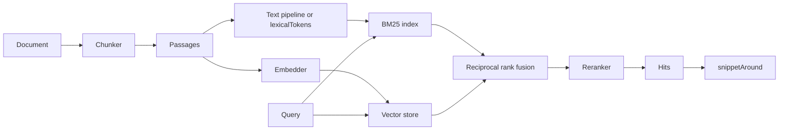

# Text Processing & Search

AgentOS processes, measures, searches and scores text with classes and functions a host calls directly, with no agent in the loop. The memory and retrieval layers use the same parts: `HybridRetriever` searches with a `BM25Index`, `LibraryIndex` fuses its legs with `reciprocalRankFusion`, and `RetrievalAugmentor` reranks with `RerankerService`.



| To | Use | Page |
|---|---|---|
| Split text into words, drop stop words, stem | `TextProcessingPipeline`, `createProsePipeline()`, `createRagPipeline()`, `createCodePipeline()` | [Text Processing Pipeline](./TEXT_PROCESSING.md) |
| Count, compare and classify text: sentences, n-grams, keywords, readability, similarity, language, summaries | `StatisticalUtilityAI`, `LLMUtilityAI`, `HybridUtilityAI` | [Text Statistics and Classification](./TEXT_STATISTICS.md) |
| Search by keywords, save the index as JSON, search in a browser | `LexicalIndex`, `BM25Index` | [Lexical and Hybrid Search](./LEXICAL_AND_HYBRID_SEARCH.md) |
| Search records as someone types, with typos, word beginnings and field weights, and mark the matches | `FuzzyIndex` | [Lexical and Hybrid Search](./LEXICAL_AND_HYBRID_SEARCH.md#fuzzyindex) |
| Fuse keyword and vector search | `HybridSearcher`, `reciprocalRankFusion()` | [Lexical and Hybrid Search](./LEXICAL_AND_HYBRID_SEARCH.md#hybridsearcher) |
| Fuse any number of ranked lists, with a weight a list and a cap a list and a group | `fuseRanked()` | [Lexical and Hybrid Search](./LEXICAL_AND_HYBRID_SEARCH.md#fusing-ranked-lists) |
| Cut documents and transcripts into passages, show a hit's words | `SemanticChunker`, `chunkTurns()`, `ChunkingEngine`, `snippetAround()` | [Chunking and Snippets](./CHUNKING_AND_SNIPPETS.md) |
| Reorder retrieved passages | `RerankerService` and its providers | [Reranking](./RERANKING.md) |
| Search a library of sources by tenant and access group | `LibraryIndex` | [Library Index](../features/LIBRARY_INDEX.md) |
| Fuse BM25 with memory retrieval | `HybridRetriever` | [Hybrid BM25 + Dense Retriever](../architecture/hybrid-retriever.md) |

## Where each part runs

| Part | Import | Runs in | Calls a model |
|---|---|---|---|
| `LexicalIndex`, `FuzzyIndex`, `lexicalTokens`, `snippetAround`, `chunkTurns` | `@framers/agentos/cognition/library/browser` | A browser or Node | No |
| Text pipeline and presets | `@framers/agentos/cognition/nlp` | Node: it loads `natural` through `node:module` | No |
| `StatisticalUtilityAI` | The package root, `@framers/agentos/cognition/nlp`, `@framers/agentos/cognition/nlp/ai_utilities` | Node | No |
| `LLMUtilityAI` | The package root, `@framers/agentos/cognition/nlp`, `@framers/agentos/cognition/nlp/ai_utilities` | Node | Yes: a provider's key or a local model server |
| `BM25Index`, `HybridSearcher`, `SemanticChunker` | `@framers/agentos/cognition/rag` | Node | `HybridSearcher` calls the embedder you give it |
| `reciprocalRankFusion` | `@framers/agentos/cognition/memory` | Node | No |
| `fuseRanked` | `@framers/agentos/cognition/rag` | Node | No |
| Rerankers | `@framers/agentos/cognition/rag/reranking` | Node; its modules import no Node module of their own | The local cross-encoder runs a model in-process; Cohere and the LLM judge call out |

## Examples

Four examples in the repository's `examples/` folder run with no API key:

| File | What it shows |
|---|---|
| [`text-processing-pipeline.mjs`](../../examples/text-processing-pipeline.mjs) | The three preset pipelines over a paragraph and a line of code; tokens with positions and stems; a pipeline built stage by stage |
| [`text-statistics.mjs`](../../examples/text-statistics.mjs) | `StatisticalUtilityAI`'s measures over one text |
| [`text-search-bm25.mjs`](../../examples/text-search-bm25.mjs) | `BM25Index` with any, all and prefix matching, saved as JSON and restored; a stemming pipeline; `LexicalIndex` with snippets |
| [`text-hybrid-search.mjs`](../../examples/text-hybrid-search.mjs) | `HybridSearcher` over an in-memory vector store, with a stand-in embedder written in the example, and each result's ranks |

They import the package by its name, which resolves to the build through the package's `exports` map, and CI runs all four against each build. From a clone:

```bash
pnpm install && pnpm run build
node examples/text-search-bm25.mjs
```

## Related pages

- [Library Index](../features/LIBRARY_INDEX.md): a library of sources over a vector store, with scoped lexical, dense and hybrid search.
- [Hybrid BM25 + Dense Retriever](../architecture/hybrid-retriever.md): BM25 fused with cognitive memory retrieval.
- [RAG Memory Configuration](../memory/RAG_MEMORY_CONFIGURATION.md): vector stores, embeddings, retrieval strategies and the reranker chain.
- [Document Ingestion](../memory/MEMORY_DOCUMENT_INGESTION.md): loading files into a memory brain, with `ChunkingEngine`.
